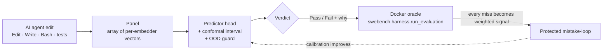

<div align="center">


# 🔮 ContextGraph · The Oracle

### A machine learning to tell whether code is *true*.

**An open research program building toward domain super-intelligence for Python software engineering** — a deterministic predictor that judges any AI-generated code change **Pass** or **Fail** against reality, *before* you ever trust it.


**[Mission](#-the-mission) · [Why](#-why-the-oracle-exists) · [What It Does](#-what-the-oracle-does) · [How It Works](#️-how-it-works) · [North Star](#-the-north-star) · [Milestones & Discoveries](#-milestones--discoveries) · [The Journey](#-the-journey-so-far) · [Roadmap](#️-the-road-to-super-intelligence) · [Origins](#-origins-the-contextgraph-engine) · [Build](#-build-it)**

</div>

---

> **This repository is the public window into one mission: teaching a machine to predict, with certainty, whether AI-generated software actually works.**
> It is where you can watch — commit by commit, number by number — an AI agent climb toward **domain super-intelligence for Python software engineering**. Crack Python, and the same blueprint unlocks every other language. Unlock every language, and you unlock super-intelligence for the entire discipline of engineering. **That is the goal. This is the climb.**

> **A note on the name.** *ContextGraph* is the engine; *The Oracle* is the mission it now serves. The project began as ContextGraph — a multi-dimensional semantic-memory system for AI assistants (see *[Origins](#-origins-the-contextgraph-engine)*) — and evolved into a binary reality predictor for code. The memory machinery became the *perception* machinery; the graph became the substrate a predictor reads to know whether code is true.

---

## 🚀 The Mission


Today, AI can *write* code. It cannot *know* whether that code is correct — and neither can you, until a human reads it or a test suite runs. That trust gap is the single biggest thing standing between "AI that suggests code" and "AI that ships engineering."

**The Oracle closes that gap.** It is a *binary reality predictor*: give it any change an AI agent proposes to a Python codebase, and it tells you whether that change will **pass or fail** against the ground truth of real, executed tests — and it tells you *why* when it predicts failure.

The mission is deliberately staged:

```
   Python software engineering   ─►   every programming language   ─►   engineering itself
   ── prove it once, rigorously ──     ── replicate the blueprint ──    ── domain super-intelligence ──
```

When the predictor is right often enough, reliably enough, on hard enough problems, a line is crossed: **reviewing AI-generated Python patches by hand becomes statistically unjustified.** That crossing is the first instance of domain super-intelligence — and the template for all the rest.

---

## 💡 Why The Oracle Exists

AI writes code faster than any human can possibly review it. But speed without trust is a liability:

- 🕳️ **AI hallucinates correctness.** It will confidently claim a fix works when it doesn't.
- 🧍 **Human review doesn't scale.** Reading every AI patch re-introduces the bottleneck AI was supposed to remove.
- 🎲 **"Looks right" isn't "is right."** Static inspection — by humans *or* models — repeatedly fails to catch behavioral bugs that only surface when the code actually runs.

The Oracle's answer is to stop guessing from how code *looks* and start predicting from what code *does*. Every verdict is anchored to a single, incorruptible source of truth: **the real test suite, executed in a real environment.** No vibes. No opinions. Just a falsifiable prediction against reality.

> **The promise:** *Ship AI-written Python with the confidence that a calibrated machine — not a tired reviewer at 4 PM — has already told you whether it works.*

---

## 🎯 What The Oracle Does

For any AI-generated code change, the Oracle answers four grounded questions — each one checked against reality, not asserted:

| | Question | What you get | Grounded against |
|---|----------|--------------|------------------|
| **Q1** | Does what the AI *claimed* it did actually **exist**? | Pass / Fail | The bytes & AST on disk |
| **Q2** | Does the change **work**? | **Pass / Fail** + confidence | The real Docker test oracle |
| **Q3** | **Why** would it fail? | A named failure mode + closest real examples | Attached to the Q2 verdict |
| **Q5** | How does it **impact reality**? | Predicted vs. observed change events | The live runtime shift log |

**Feature → benefit, in one line each:**

| The Oracle gives you… | …so that you can |
|---|---|
| A binary **Pass/Fail** verdict on AI code | trust a patch without reading every line |
| A **calibrated confidence** + abstention | know exactly when *not* to trust the prediction |
| A **named reason** on predicted failure | fix the real defect instead of hunting for it |
| Verdicts anchored to **executed tests** | stop shipping code that only *looks* correct |
| A learning loop that **converts mistakes into training** | watch the predictor get sharper over time |

---

## ⚙️ How It Works


The Oracle is built on **ME-JEPA-Code** — a Joint-Embedding Predictive Architecture for code. The pipeline is deliberately simple to state and hard to fool:



1. **Perceive.** An AI agent's edit — its `Edit`, `Write`, `Bash`, and test runs — *is* the data-generating process. The Oracle perceives the change as it happens.
2. **Encode.** The change is projected through a **panel** of distinct, frozen embedders — each a different "sense" for what code means (see *[The Panel](#-the-panel)* below).
3. **Predict.** A trained head emits a binary verdict with a conformal confidence interval and a teleological-constellation guard that rejects out-of-distribution inputs instead of bluffing.
4. **Ground.** The verdict is measured against the **Docker oracle** — `swebench.harness.run_evaluation` — the same real test execution that defines whether code truly works.
5. **Learn.** Every miss becomes weighted training signal through a protected mistake-loop, so the predictor's calibration improves with experience.

The discipline that makes it trustworthy: **fail closed on the unknown, never fake a pass, and read the source of truth back for every claim.**

---

## 🌌 The Panel


The Oracle never collapses code into a single opaque vector. Instead it builds a **teleological constellation** — an array of per-embedder vectors, each living in its own space, each a different perspective on the same change. Meaning emerges from the *whole constellation*, the way a single star tells you nothing but a constellation tells you where you are.

A core research finding drives the whole program: **static embedders see what code *looks like*, not what it *does*.** Behavioral bugs hide in execution, not in syntax. So the frontier of this work is teaching the panel to perceive **execution** — coverage, value divergence, and real test behavior — which is exactly where the Oracle's accuracy has climbed the most.

---

## 🧭 The North Star

Everything here traces to one **falsifiable predicate** — and it is deliberately strict. A single high accuracy number is *not* enough. The system has reached **domain super-intelligence for Python** only when **every** condition below holds at once, and stays true across time:

```text
SUPERHUMAN_VERIFIER(Python)  ⇔  ∃ a deterministic predictor P such that:

  TIER 1 — ship-gate numbers
    corr(P, Docker-oracle) ≥ 0.95           (raw Pearson vs real test Pass/Fail)
    STABLE × 4 consecutive rolling windows
    AND a second, independent sensor panel also ≥ 0.95
    AND |corr_A − corr_B| ≤ 0.05            (learned reality, not one panel)

  TIER 2 — per-cell quality
    every (mutation-class × language) cell clears its own bar
    (Pearson / class-recall + Brier ≤ 0.05 + ECE ≤ 0.05 + conformal coverage)

  TIER 3 — it learns from being wrong
    mistake_repeat_rate ≤ 0.05   AND   no damage to unrelated cells

  TIER 4 — doctrine invariants hold EXACTLY (fences, not goals)
    slot identity preserved · no flat-vector fusion · no inner generator ·
    frozen-target gradient leak = 0 · oracle labels never used as live inputs

  TIER 5 — the substrate can actually carry the answer
    I(panel ; oracle) ≥ 0.95 bits           (the panel SHARES the verdict's bits)
    oracle_self_consistency ≥ 0.97          (the oracle agrees with itself)
    oracle_validity        ≥ 0.97           (the verdict tracks real correctness)

  TIER 6 — every sensor earns its place
    novelty < 0.7 vs existing slots   AND   per-cell utility lift ≥ 0.005
```

Two facts make this honest rather than aspirational:

- **The oracle is the ceiling.** You can never agree with the test oracle more often than it agrees with itself — and only when its verdicts track *real* correctness. So `0.95` is bounded above by oracle **self-consistency** *and* **validity**, and we measure and defend the oracle *first*.
- **The panel must carry the bits before any model can.** By the data-processing inequality, no predictor can know more about the verdict than `I(panel; oracle)` shares with it. If the panel is information-starved, *no amount of training moves Tier 1.* That is the **current binding constraint** — see the climb below.

> 📄 The complete predicate — all five eligibility prerequisites, all six tiers, every threshold and *why* it has that value — is developed alongside the companion papers *The Oracle and the Kernel* (the oracle as grounding anchor; mutual information as a kernel-existence test) and *The Calculus of Association* (frozen embedders as designable measurement instruments).

---

## 🔬 Milestones & Discoveries

> *This is honest, in-progress research. The most valuable output so far isn't a benchmark score — it's a chain of hard, falsifiable findings about **where the problem actually lives.** Every entry below is a logged experiment with a source-of-truth artifact behind it.*

### Part I — What was built

<table>
<tr><td>🧠</td><td><b>A multi-dimensional semantic-memory engine (ContextGraph).</b> 13 specialized embedders, Reciprocal-Rank-Fusion retrieval, RocksDB + HNSW indexes, 56 MCP tools, asymmetric causal reasoning, and post-retrieval temporal boosting. The origin of everything here — see <a href="#-origins-the-contextgraph-engine">Origins</a>.</td></tr>
<tr><td>🔭</td><td><b>The reframe to a binary reality predictor (ME-JEPA-Code).</b> From "semantic memory" to a single, falsifiable question: <i>will this change Pass or Fail against a real test oracle?</i> A Joint-Embedding Predictive Architecture for code.</td></tr>
<tr><td>🕳️</td><td><b>The inner LLM was removed.</b> A single outer loop: the AI agent <i>is</i> the actor — its edits and test runs are the data-generating process. No hidden generator to hallucinate. The predictor only ever <i>judges</i> reality.</td></tr>
<tr><td>✳️</td><td><b>The teleological-constellation panel.</b> An array of per-embedder frozen vectors — slot identity is sacred, never flattened into one blob. Frozen targets carry <i>zero</i> trainable parameters, so the target space is collapse-immune by construction.</td></tr>
<tr><td>🎛️</td><td><b>Grounded surfaces Q1 / Q2 / Q3 / Q5.</b> Existence (bytes &amp; AST), works (Docker oracle), why-it-fails (named failure mode + nearest real exemplars), and reality-impact (live shift log). Ambiguous, ungroundable surfaces were frozen out on purpose.</td></tr>
<tr><td>🧪</td><td><b>A reproducible oracle corpus.</b> SWE-bench Lite — <b>300 instances × 8 mutation categories = 2,400 candidates</b> (<code>known_good</code>, <code>subtle_flip</code>, <code>off_by_one</code>, <code>swap_variable</code>, <code>delete_test_call</code>, <code>wrong_file</code>, <code>over_engineer</code>, <code>compile_error</code>) bridged to the containerized SWE-bench harness.</td></tr>
<tr><td>🛡️</td><td><b>Trust machinery.</b> A conformal predictor for calibrated intervals, an out-of-distribution guard that <i>abstains</i> rather than bluffs, and an EWC++ Fisher-protected mistake-loop — the only path allowed to update weights at serving time.</td></tr>
</table>

### Part II — What was discovered

Each finding narrowed the search until the real bottleneck was cornered.

**1. Measure the anchor before the model.** Oracle *self-consistency* was probed by replica voting — 30 instances × 10 independent Docker evaluations. Result: **`oracle_self_consistency = 1.0`** (300/300 agreed). The anchor doesn't wobble on the flakiness axis, so `0.95` isn't blocked by oracle noise. *(Whether the oracle points at exactly the right thing — validity — is a separate, still-open axis; see finding 11.)*

**2. The clean negative — the pivotal discovery.** How much does the panel actually tell you about the verdict, in bits? A stack of mutual-information estimators (MINE, classifier lower-bound, k-NN) run over all 2,400 rows agreed:

| Estimator | `I(panel ; oracle)` | vs. target `0.95 bits` |
|---|:---:|:---:|
| MINE (Donsker–Varadhan) | **0.096 bits** | ≪ |
| Classifier lower-bound | **0.125 bits** | ≪ |
| k-NN (Kraskov, projected) | **0.461 bits** | ≪ |

Because these are *lower-bound* estimators, their agreement is decisive. By the **data-processing inequality**, `I(panel; oracle)` caps *every possible predictor, kernel search, and calibrator that reads the panel*. **The bottleneck is not the model. It is the panel.** No amount of training can breach a substrate that never carried the bits. This single result redirected the entire program.

**3. The bits are missing in *behavior*, not *form*.** Per-cell MI localized the deficit precisely: mutations that visibly change tokens carry signal; mutations whose verdict is set at *runtime* carry almost none.

| Mutation cell | `I` (bits) | Character |
|---|:---:|---|
| `swap_variable` | 0.231 | purely syntactic — tokens visibly change |
| `off_by_one` | 0.021 | borderline syntactic |
| `subtle_flip`, `compile_error`, `delete_test_call`, `wrong_file`, `over_engineer` | ≈ 0 | **behavioral** — only runtime reveals the bug |

The lesson, stated as doctrine: **static embedders perceive what code looks like, not what it does.**

**4. No single sensor was load-bearing.** Drop-one-sensor ablation showed every marginal contribution was tiny (largest ≈ 0.031 bits). That distinguishes *absence* of signal from *redundancy* — the panel wasn't carrying the same bits many times over; it simply lacked a whole modality. The prescription wrote itself: **add execution sensors.**

**5. Value beats control-flow — and it's information-dense.** Teaching the panel to see *return-value divergence* between gold and mutated runs was startling: a channel-ablation showed **2 value-capture dimensions carry roughly as much signal as 27 control-flow dimensions.** What a function *returns* is far more diagnostic of correctness than which branches it took.

**6. Coverage gating cleans the signal.** Tests that never execute the changed line contribute only noise. Gating features to *coverage-reaching* tests sharpened the panel measurably.

**7. Run what the oracle runs.** Tracing execution under the *oracle's own test scope* — not an arbitrary entrypoint — lifted best-head correlation on covered behavioral rows to **~0.66**. And the channels **compose additively** (control-flow → + value → + exception), with no sign of early saturation — evidence the path to `0.95` is viable, not asymptotic.

**8. Scientific honesty forced a pivot.** A tempting single-seed gain turned out to be **seed-luck**. A rigorous multi-seed re-measurement revealed that the entire family of *hand-crafted* execution features asymptotes around **~0.52 — far below `0.95`.** Conclusion: closing the gap needs a **learned execution encoder**, not more hand-tuned scalars. Reporting the negative result *changed the roadmap* — exactly what honest metric discipline is for.

**9. The bridge — turning oracle labor into panel signal.** Rows whose mutated site was never covered by an existing test were invisible to the panel. By running *generated, coverage-reaching* tests and re-tracing, **10/10 such rows became panel-visible** — a mechanism that converts expensive oracle work into durable panel sufficiency.

**10. Closing blind spots the panel couldn't see.** One real kill diverged *only* in a `SystemExit.code` — identical everywhere else, invisible to the tracer. Adding an **exception-value fingerprint** sensor closed the blind spot with no false positives on unrelated rows. Perception grows one measured gap at a time.

**11. Hardening the oracle itself (validity).** SWE-bench's curated tests are sometimes too weak to *observe* a real bug. Independent, stronger oracles and **coverage-reaching test generation** (~15% kill rate, in line with the published Meta ACH result) recovered mislabeled cases and tightened the ground truth — because a predictor can only ever be as truthful as the oracle it is measured against.

> **The through-line:** the program didn't chase a leaderboard. It proved *where* the problem is (an information-starved panel), proved *why* it's there (form, not behavior), and is now building the execution-aware perception that the substrate-sufficiency test says must come first.

<sub>Numbers are best-head correlation on covered behavioral rows of the 300 × 8 SWE-bench Lite Python corpus, or mutual information in bits as noted. Figures move as the work advances — that's the point of tracking them in the open.</sub>

---

## 📈 The Journey So Far


Teaching the panel to perceive **execution** is what moves the number:

| Stage of the climb | Oracle correlation* |
|---|:---:|
| 📉 Static-text panel (judging code by appearance) | ~0.48 |
| ➕ Execution value-capture (return-value divergence) | ~0.46 → 0.54 |
| ➕ Coverage gating (ignore tests that never run the change) | ~0.54 |
| ➕ Real oracle-scope tracing (run what the oracle runs) | ~0.66 |
| 🚀 Combined execution-aware panel, covered rows (best head) | **~0.74** |
| 🎯 **The target** | **0.95** |

<sub>*Best-head correlation on covered behavioral rows of the 300 × 8 SWE-bench Lite Python corpus. The real gate is the substrate-sufficiency test `I(panel; oracle) ≥ 0.95 bits` — the constraint these execution sensors exist to satisfy.*</sub>

---

## 🗺️ The Road to Super-Intelligence

```
  ✅  Build the binary reality predictor for Python        ← the engine exists
  ✅  Prove the clean negative: static panel is starved     ← I(panel;oracle) ≈ 0.46 bits
  🔬  Assemble an execution-aware panel to I ≥ 0.95 bits    ← we are here (Tier 5)
  🔬  Harden the oracle: audit + repair weak-test validity  ← we are here (Tier 5)
  🎯  Drive oracle correlation to 0.95, stable, cross-panel ← the ship gate (Tiers 1–4)
  🐍  Make human review of Python patches unjustified      ← the first super-intelligence
  🌐  Replicate the blueprint across every language        ← generalize
  🏛️  Domain super-intelligence for engineering itself     ← the mission
```

---

## 🧠 Origins: the ContextGraph engine

Before it was a reality predictor, this was **ContextGraph** — persistent, multi-dimensional semantic memory for AI assistants, exposed as an MCP server. That machinery is why the Oracle can *perceive* code so richly today. The perception layer it pioneered:

<details>
<summary><b>The 13-dimension memory engine (click to expand)</b></summary>

<br/>

**Multi-perspective retrieval.** A query like *"Why does auth fail under load?"* searches simultaneously through semantic similarity, causal reasoning, code patterns, entity linking, graph structure, and paraphrase matching — each perspective catching what the others miss, then fused with **Reciprocal Rank Fusion**.

**Asymmetric causal reasoning.** Several embedders store *dual* vectors for directional queries. *"What caused X?"* and *"What did X cause?"* return different results because cause and effect are embedded separately with directional boosting.

**Temporal awareness without temporal bias.** Time-based signals (freshness, periodicity, sequence) are applied as *post-retrieval* boosts, not during retrieval — so recent memories never drown out relevant older ones.

**A full toolbox, not just store-and-search.** 56 MCP tools spanning causal-chain building, entity extraction with TransE predictions, topic discovery via HDBSCAN, code-aware AST-chunked search, file watching, and provenance tracking.

**Production-grade storage.** RocksDB with 51 column families, HNSW indexes for O(log n) K-NN search, soft-delete with 30-day recovery, background compaction, and graceful degradation when components fail.

</details>

---

## 🏗️ Inside the Repository

The Oracle is a Rust workspace. The trunk:

| Crate | Role |
|---|---|
| `context-graph-mejepa` | The predictor, compiler, heal scheduler, and evaluation — the trunk model |
| `context-graph-mejepa-embedders` | The panel: distinct embedder "senses" for code |
| `context-graph-mejepa-instruments` | Frozen teleological constellation (zero-trainable-parameter targets) |
| `context-graph-mejepa-corpus` | Mutation operators + the SWE-bench Docker-oracle bridge |
| `context-graph-mejepa-train` | Trainer, replay buffer, and the mistake-loop learner |
| `context-graph-mejepa-tct` | Teleological constellations + the out-of-distribution guard |
| `context-graph-mcp` | The product surface — an MCP server AI agents call over JSON-RPC |

> **Architecture invariant:** *slot identity is sacred.* The panel is an array of per-embedder vectors — never flattened into a single blob for comparison. Meaning lives in the constellation, not in any one star.

---

## 🔧 Build It

```bash
# Clone
git clone https://github.com/ChrisRoyse/contextgraph.git
cd contextgraph

# Build the trunk model and the MCP server
cargo build --release -p context-graph-mejepa
cargo build --release -p context-graph-mcp

# Run the test suite
cargo test
```

Requires a recent stable Rust toolchain (see `rust-toolchain.toml`). GPU-accelerated embedders use `candle`; a CUDA toolkit is recommended for training.

---

## 🛰️ Follow The Progress

This repository **is** the progress tracker. The mission advances in the open:

- 📌 **Issues** are the live research log — every experiment, finding, and number is recorded there.
- 📊 **Commits** move specific numbers on the North Star sheet, or they don't ship.
- ⭐ **Star the repo** to follow the climb from 0.74 toward 0.95 — and the moment the first engineering super-intelligence is proven.

> *Built by [Chris Royse](https://github.com/ChrisRoyse). The Oracle is the work of an AI agent, supervised in the open, climbing toward something that has never existed before.*

---

## 📜 License

Released under the **[PolyForm Noncommercial License 1.0.0](LICENSE)**. Free for noncommercial use, research, and study. For commercial licensing inquiries, contact **chrisroyseai@gmail.com**.

---

<div align="center">


### 🔮 *Teaching machines to know what is true — one verdict at a time.*

<sub><a href="#-contextgraph--the-oracle">↑ Back to top</a></sub>

</div>
