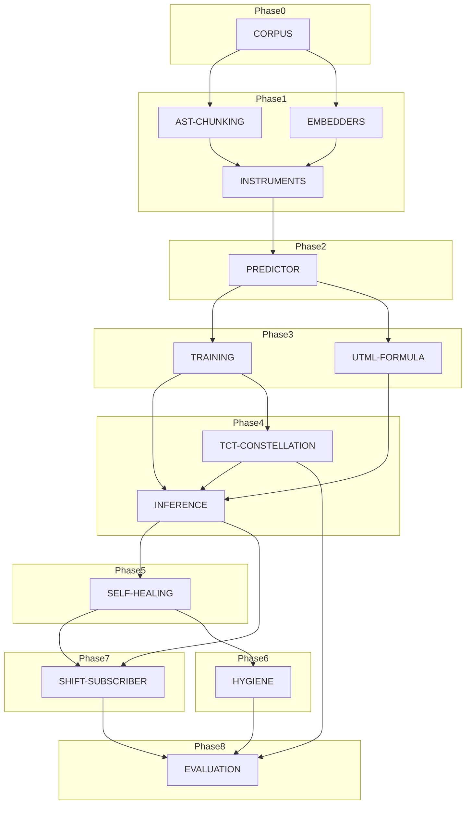

# Tasks Index — Dependency DAG (Level 4)

> **Level 4 — atomic work units.** Each task is one conceptual change with explicit `<input_context_files>`, `<definition_of_done>` (with exact Rust signatures), and `<files_to_create>`. Inside-Out, Bottom-Up layered: foundation → logic → surface. Task N cannot reference files from Task N+1.

**Authority:** `../constitution.md` overrides. Tasks generated from `../functional/SPEC-<DOMAIN>.md` + `../technical/TECH-<DOMAIN>.md` per `prdtospec.md` §4.

---

## Phase-ordered execution

Phases are mostly sequential at the domain boundary. Within a phase, tasks obey foundation → logic → surface within their layer.



---

## Task directory layout

```
tasks/
├── _index.md                                  # THIS FILE
├── _traceability.md                            # spec-to-task coverage matrix
├── phase0-corpus/
│   ├── _index.md                               # phase task list (sequence order)
│   └── TASK-CORPUS-NNN.md                      # atomic tasks
├── phase1-ast-chunking/
│   ├── _index.md
│   └── TASK-AST-NNN.md
├── phase1-embedders/
│   ├── _index.md
│   └── TASK-EMBED-NNN.md
├── phase1-instruments/
│   ├── _index.md
│   └── TASK-INSTR-NNN.md
├── phase2-predictor/
│   ├── _index.md
│   └── TASK-PRED-NNN.md
├── phase3-training/
│   ├── _index.md
│   └── TASK-TRAIN-NNN.md
├── utml-learning-formula/
│   ├── _index.md
│   └── TASK-UTML-NNN.md
├── phase4-inference/
│   ├── _index.md
│   └── TASK-INFER-NNN.md
├── phase4-tct-constellation/
│   ├── _index.md
│   └── TASK-TCT-NNN.md
├── phase5-self-healing/
│   ├── _index.md
│   └── TASK-HEAL-NNN.md
├── phase6-hygiene/
│   ├── _index.md
│   └── TASK-HYG-NNN.md
├── phase7-shift-subscriber/
│   ├── _index.md
│   └── TASK-SHIFT-NNN.md
├── phase7-mcp-tools/
│   ├── _index.md
│   └── TASK-MCP-NNN.md
└── phase8-evaluation/
    ├── _index.md
    └── TASK-EVAL-NNN.md
```

Each phase's `_index.md` lists its tasks in canonical execution order, with the per-task `<layer>` (foundation/logic/surface) tag and `<depends_on>` references.

---

## Task ID conventions

Per `prdtospec.md` §4:
- `TASK-<DOMAIN>-NNN` where NNN is zero-padded sequence (001, 002, ...)
- One task = one conceptual change (entity + migration; service method + tests; endpoint + controller)
- Layer tags: `foundation` (data models, types, RocksDB CFs, error taxonomy) → `logic` (instruments, predictor, loss, observe, drift detector, Gτ) → `surface` (MCP tools, CLI commands, subscriber, ops)
- Iron rule: Task N cannot reference files created in Task N+1 or later

---

## Quality gates

Before executing tasks (per `prdtospec.md` §4.6 + §6.2):

- [ ] All tech spec items have tasks (`_traceability.md` complete)
- [ ] Dependency order correct (acyclic DAG; layer ordering preserved)
- [ ] Each task truly atomic (one change)
- [ ] `<input_context_files>` minimal and correct
- [ ] `<definition_of_done>` has exact Rust signatures
- [ ] Constraints reference constitution
- [ ] Test commands specified
- [ ] No task references files from a later task

---

## Cross-references

- Master index: `../_README.md`
- Implementation plan: `../implementation-plan.md`
- Constitution: `../constitution.md`
- Functional specs: `../functional/_index.md`
- Technical specs: `../technical/_index.md`
- Traceability matrix: `./_traceability.md`
- Spec-authoring framework: `/home/cabdru/contextgraph/docs2/prdtospec.md`
