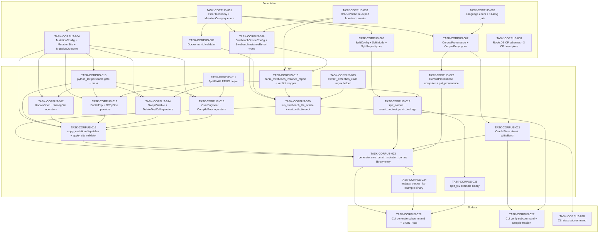

# Phase 0 — CORPUS Task Index

> **Level 4.** Atomic task specifications for the **CORPUS domain** (Phase 0: SWE-bench Lite mutation corpus + Docker oracle bridge + RocksDB CFs + train/calibration/holdout split). Authority order: `../../constitution.md` (Level 1) > `../../functional/SPEC-CORPUS.md` (Level 2) > `../../technical/TECH-CORPUS.md` (Level 3) > this file (Level 4). Each task is one conceptual change shippable end-to-end with FSV evidence per `docs2/prdtospec.md` §4.

## Phase scope

Implements all 16 functional REQ-CORPUS-NN requirements (cross-linked in `../_traceability.md` under `### CORPUS`) and all 8 component contracts in `../../technical/TECH-CORPUS.md`. Foundation → Logic → Surface ordering is enforced; no task references files created by a later task.

**Implementation state callout (refreshed 2026-05-09 against `crates/context-graph-mejepa-corpus/`).** This pass walked the source tree (`lib.rs`, `oracle.rs`, `swebench.rs`, `split.rs`, `python_lex.rs`, `prng.rs`, the eight operator modules, `patch_mutation.rs`, `source_patch.rs`, `source_patch_support.rs`, `bin/mejepa-corpus.rs`, `examples/*.rs`, `tests.rs`, `split_tests.rs`) and the contributing commit chain (`acc6f78c`, `3f46ff78`, `b6b4810c`, `d0053100`, `6f72a02e`, `15522841`, `1c45fdce`, `bf11c350`, `be0773b4`, `7cc42eec`, `828a1133`, `d039544d`, `24450e43`).

- **Shipped foundations** (verified-by-grep, not just claimed):
  - `MutationCategory` with all 8 variants, `all() -> [Self; 8]`, `slug()`, `#[serde(rename_all = "snake_case")]` (lib.rs:139–191).
  - `MutationConfig`, `MutationSite`, `MutationOutcome`, `apply_mutation`, `apply_site` (lib.rs).
  - 3-variant `MutationError` (`InvalidInput` / `NoMutationSite` / `OperatorFailed`) with `code()` mapping (lib.rs:66–134).
  - 7-variant generic `OracleError` shared by both the local command/Docker wrappers and the SWE-bench bridge (oracle.rs:31–177).
  - `SwebenchOracleConfig`, `SwebenchPrediction`, `SwebenchPredictionMode`, `SwebenchInstanceReport`, `SwebenchOracleArtifacts`, `SwebenchOracleResult`, `run_swebench_lite_oracle`, `parse_swebench_instance_report`, `swebench_report_to_verdict`, `extract_exception_class`, `wait_with_timeout` (swebench.rs / oracle.rs).
  - Docker-name-safe run_id validator inline in `validate_oracle_config` enforcing `[a-zA-Z0-9._-]` and ASCII alphanumeric-only first character (swebench.rs:552–581).
  - `SplitConfig`, `SplitMode { InstanceAtomic, RepoAtomic }`, `SplitReport`, `TaskAssignment`, `CorpusEntry` (split.rs); `split_corpus`, `assert_no_test_patch_leakage`, `split_is_leakage_free` shipped; LPT bin-pack + SplitMix64 shuffle wired.
  - `OracleStore` over RocksDB with two named CFs `CF_MEJEPA_MUTATION_CORPUS` + `CF_MEJEPA_ORACLE_VERDICTS`, plus `put_mutation`/`get_mutation`/`put_verdict`/`get_verdict`/`count_cf`/`scan_cf_json`/`flush` (oracle.rs:318–525).
  - `SplitMix64` PRNG (prng.rs).
  - `ensure_parseable_python` tree-sitter-backed gate + lexical token mask (python_lex.rs).
  - All eight mutation operators: `known_good`, `subtle_flip`, `off_by_one`, `swap_variable`, `delete_test_call`, `wrong_file`, `over_engineer`, `compile_error`.
  - Source-backed patch generation pipeline (`patch_mutation.rs`, `source_patch.rs`, `source_patch_support.rs`) for the batch CLI — adds the structural ability to mutate canonical fix sources even when the official diff has no `+` lines suitable for in-line operator targets (commits `b6b4810c`, `3f46ff78`).
  - CLI subcommands `generate` / `verify` / `stats` (bin/mejepa-corpus.rs).
  - Five FSV examples: `mejepa_corpus_fsv.rs`, `split_fsv.rs`, `oracle_fsv.rs`, `oracle_store_fsv.rs`, `swebench_oracle_fsv.rs` (examples/).
  - End-to-end Docker FSV against `swebench/sweb.eval.x86_64.sympy_1776_sympy-20590:latest` in both gold and custom prediction modes (memory: project_phase0_mejepa_mutation_corpus.md, 2026-05-09e).
  - 81 mejepa-corpus crate tests passing (per memory entry 2026-05-09e); `cargo build --release -p context-graph-mejepa-corpus` green.

- **Pending against this Level-4 spec set:**
  - `MutationError::LeakageDetected` variant and `MEJEPA_CORPUS_LEAKAGE_DETECTED` code (TASK-CORPUS-001).
  - `OracleError::DockerRunIdUnsafe` variant and `MEJEPA_CORPUS_DOCKER_RUN_ID_UNSAFE` code (TASK-CORPUS-001 / TASK-CORPUS-009 — validator exists, but raises generic `InvalidInput` rather than the dedicated typed variant).
  - `MutationCategory::from_slug` reverse helper (TASK-CORPUS-001).
  - `Language` enum + 11-language gate (TASK-CORPUS-002 — Phase 0 is Python-only today; the enum is needed before any non-Python operator lands).
  - OracleVerdict re-export from the corpus crate's public surface (TASK-CORPUS-003 — instruments crate exports it; corpus consumers currently import from instruments directly).
  - `CorpusProvenance` record + `CF_MEJEPA_CORPUS_PROVENANCE` (3rd CF) + `OracleStore::put_provenance` (TASK-CORPUS-007, TASK-CORPUS-008, TASK-CORPUS-022).
  - `OracleStore::put_mutation_and_verdict` atomic WriteBatch (TASK-CORPUS-021 — current code uses two separate writes + flush, so a crash mid-task can leave a mutation with no verdict).
  - Library entry `generate_swe_bench_mutation_corpus` reusable from a non-CLI caller (TASK-CORPUS-023 — logic currently lives inline in `bin/mejepa-corpus.rs::generate`).
  - SIGINT trap in the CLI generate subcommand (TASK-CORPUS-026).
  - `--sample-fraction` flag on the verify subcommand (TASK-CORPUS-027).
  - Full 300-instance × 8-category batch run against the Docker oracle (operational deliverable; primitive plumbing is shipped and proven on one instance).

Tasks below cover BOTH the shipped slice (verification-only or extension tasks) AND the pending work. Each shipped-slice task includes a `verify-shipped-state` step in addition to delivering net-new value (provenance hooks, FSV evidence updates, etc.). Net-new tasks are clearly marked.

## Dependency Graph



## Execution order

| # | Task ID | Title | Layer | Depends On | Est complexity |
|---|---|---|---|---|---|
| 1 | TASK-CORPUS-001 | Error taxonomy + MutationCategory enum | foundation | — | low |
| 2 | TASK-CORPUS-002 | Language enum + 11-language gate | foundation | — | low |
| 3 | TASK-CORPUS-003 | OracleVerdict re-export from instruments | foundation | — | low |
| 4 | TASK-CORPUS-004 | MutationConfig + MutationSite + MutationOutcome types | foundation | 001 | low |
| 5 | TASK-CORPUS-005 | SplitConfig + SplitMode + SplitReport types | foundation | 001 | low |
| 6 | TASK-CORPUS-006 | SwebenchOracleConfig + SwebenchInstanceReport types | foundation | 001, 003 | medium |
| 7 | TASK-CORPUS-007 | CorpusProvenance + CorpusEntry types | foundation | 001, 002 | low |
| 8 | TASK-CORPUS-008 | RocksDB CF schemas (3 CF descriptors) | foundation | 001 | low |
| 9 | TASK-CORPUS-009 | Docker run-id validator | foundation | 001 | low |
| 10 | TASK-CORPUS-010 | python_lex parseable gate + LexicalMask | logic | 001, 004 | medium |
| 11 | TASK-CORPUS-011 | SplitMix64 PRNG helper | logic | 001 | low |
| 12 | TASK-CORPUS-012 | KnownGood + WrongFile operators | logic | 004, 010 | low |
| 13 | TASK-CORPUS-013 | SubtleFlip + OffByOne operators | logic | 004, 010, 011 | medium |
| 14 | TASK-CORPUS-014 | SwapVariable + DeleteTestCall operators | logic | 004, 010, 011 | medium |
| 15 | TASK-CORPUS-015 | OverEngineer + CompileError operators | logic | 004, 010, 011 | medium |
| 16 | TASK-CORPUS-016 | apply_mutation dispatcher + apply_site validator | logic | 012, 013, 014, 015 | medium |
| 17 | TASK-CORPUS-017 | split_corpus + assert_no_test_patch_leakage | logic | 005, 011 | medium |
| 18 | TASK-CORPUS-018 | parse_swebench_instance_report + swebench_report_to_verdict | logic | 003, 006 | medium |
| 19 | TASK-CORPUS-019 | extract_exception_class regex helper | logic | 003 | low |
| 20 | TASK-CORPUS-020 | run_swebench_lite_oracle + wait_with_timeout | logic | 006, 009, 018, 019 | high |
| 21 | TASK-CORPUS-021 | OracleStore atomic WriteBatch | logic | 007, 008 | medium |
| 22 | TASK-CORPUS-022 | CorpusProvenance computer + put_provenance | logic | 007, 021 | low |
| 23 | TASK-CORPUS-023 | generate_swe_bench_mutation_corpus library entry | logic | 016, 017, 020, 021, 022 | high |
| 24 | TASK-CORPUS-024 | mejepa_corpus_fsv example binary | logic | 023 | medium |
| 25 | TASK-CORPUS-025 | split_fsv example binary | logic | 017 | low |
| 26 | TASK-CORPUS-026 | CLI generate subcommand + SIGINT trap | surface | 023, 024, 025 | high |
| 27 | TASK-CORPUS-027 | CLI verify subcommand + --sample-fraction | surface | 020, 021 | medium |
| 28 | TASK-CORPUS-028 | CLI stats subcommand | surface | 021 | low |

## Status

| Task | Status | Completed | Verified |
|---|---|---|---|
| TASK-CORPUS-001 | 🟡 partial | core MutationCategory + 3 MutationError + 7 OracleError variants shipped | LeakageDetected + DockerRunIdUnsafe + from_slug + slug/code unit tests pending |
| TASK-CORPUS-002 | ⏳ pending | — | Language enum not yet introduced (Phase 0 is Python-only today) |
| TASK-CORPUS-003 | ⏳ pending | OracleVerdict reachable from `context-graph-mejepa-instruments::OracleVerdict` | corpus crate does not yet re-export it |
| TASK-CORPUS-004 | ✅ complete | MutationConfig/MutationSite/MutationOutcome shipped (lib.rs:196–223) | matches spec; round-trip tests in `tests.rs` |
| TASK-CORPUS-005 | ✅ complete | SplitConfig/SplitMode/SplitReport/TaskAssignment/CorpusEntry shipped (split.rs) | leakage_check_passed + LPT pre-sort + SplitMix64 shuffle verified |
| TASK-CORPUS-006 | ✅ complete | SwebenchOracleConfig/Prediction/Mode/InstanceReport/Artifacts/Result shipped (swebench.rs:51–215) | gold + custom mode FSV against real Docker image |
| TASK-CORPUS-007 | ⏳ pending | CorpusEntry exists for split.rs (task→bucket mapping) | full CorpusProvenance record (sha + operator + run_id + timestamp) not yet defined |
| TASK-CORPUS-008 | 🟡 partial | 2 of 3 CFs shipped: CF_MEJEPA_MUTATION_CORPUS + CF_MEJEPA_ORACLE_VERDICTS (oracle.rs:26–28) | CF_MEJEPA_CORPUS_PROVENANCE pending |
| TASK-CORPUS-009 | 🟡 partial | run_id validator inline in `validate_oracle_config` (swebench.rs:552–581) | uses generic `OracleError::InvalidInput`; dedicated `DockerRunIdUnsafe` variant pending |
| TASK-CORPUS-010 | 🟡 partial | `ensure_parseable_python` shipped (python_lex.rs); used by every operator | LexicalMask helper API + standalone unit tests for the mask shape pending |
| TASK-CORPUS-011 | ✅ complete | SplitMix64 shipped (prng.rs:1–50) | `pick_index_or_fail` helper used by 4 operators + split |
| TASK-CORPUS-012 | ✅ complete | KnownGood + WrongFile shipped (known_good.rs, wrong_file.rs) | tests + FSV pass |
| TASK-CORPUS-013 | ✅ complete | SubtleFlip + OffByOne shipped (subtle_flip.rs, off_by_one.rs) | python_lex mask wired; `->` / `<<` / `>>` / float-fraction guards in place |
| TASK-CORPUS-014 | ✅ complete | SwapVariable + DeleteTestCall shipped (swap_variable.rs, delete_test_call.rs) | tests + FSV pass |
| TASK-CORPUS-015 | ✅ complete | OverEngineer + CompileError shipped (over_engineer.rs, compile_error.rs) | tests + FSV pass |
| TASK-CORPUS-016 | ✅ complete | apply_mutation + apply_site shipped (lib.rs:231–335) | UTF-8 boundary + range guards; original_text equality enforced |
| TASK-CORPUS-017 | ✅ complete | split_corpus + assert_no_test_patch_leakage + split_is_leakage_free shipped (split.rs:294–620) | 80/10/10 LPT + leakage cross-check; 50 unit tests + FSV |
| TASK-CORPUS-018 | ✅ complete | parse_swebench_instance_report + swebench_report_to_verdict shipped (swebench.rs:303–522) | grading.py FAIL_TO_PASS / PASS_TO_PASS / FAIL_TO_FAIL / PASS_TO_FAIL semantics |
| TASK-CORPUS-019 | ✅ complete | extract_exception_class shipped (swebench.rs:525) | regex over the 10 ExceptionClass slugs |
| TASK-CORPUS-020 | ✅ complete | run_swebench_lite_oracle + wait_with_timeout shipped (swebench.rs:215–301, oracle.rs) | end-to-end Docker FSV against sympy_1776_sympy-20590 (gold + custom) |
| TASK-CORPUS-021 | 🟡 partial | OracleStore::put_mutation + put_verdict + flush shipped (oracle.rs:354–520) | atomic `put_mutation_and_verdict` WriteBatch combining both into one transaction pending |
| TASK-CORPUS-022 | ⏳ pending | — | depends on TASK-CORPUS-007 + TASK-CORPUS-008 |
| TASK-CORPUS-023 | 🟡 partial | end-to-end orchestration shipped inline in `bin/mejepa-corpus.rs::generate` | reusable library entry `generate_swe_bench_mutation_corpus` pending (logic still lives in CLI main) |
| TASK-CORPUS-024 | ✅ complete | examples/mejepa_corpus_fsv.rs shipped | FSV evidence at /tmp/contextgraph-mejepa-corpus-fsv/ |
| TASK-CORPUS-025 | ✅ complete | examples/split_fsv.rs shipped | split-evidence.json + split-assignments.json under /tmp |
| TASK-CORPUS-026 | 🟡 partial | CLI generate subcommand shipped + source-backed patch generation pipeline (commits b6b4810c, 3f46ff78) | SIGINT trap pending |
| TASK-CORPUS-027 | 🟡 partial | CLI verify subcommand shipped (re-hashes patch + compares against index) | --sample-fraction flag pending |
| TASK-CORPUS-028 | ✅ complete | CLI stats subcommand shipped (entries-by-bucket / entries-by-category / store CF counts) | output asserted by FSV |

**Progress: 16/28 complete (57%) · 8 partial · 4 pending**

End-to-end primitive plumbing for the corpus generator is shipped and proven on one instance via Docker FSV. The remaining 12 tasks split into provenance plumbing (007, 008, 022), error-taxonomy hardening (001 LeakageDetected/DockerRunIdUnsafe, 009 typed variant, 023 library entry, 021 atomic WriteBatch), CLI ergonomics (026 SIGINT, 027 sample-fraction), the multi-language pivot (002), and a stylistic re-export (003).

## Status legend

- ⏳ pending — Not yet started; dependencies may or may not be met.
- 🟡 partial — Core deliverable shipped end-to-end; some sub-requirements (typed error variants, helper API surface, atomic WriteBatch, etc.) deferred.
- 🔄 in_progress — Currently being worked on.
- ✅ complete — Finished and verified against the spec.
- ⛔ blocked — Waiting on dependencies.
- ❌ failed — Needs revision.

## Coverage

This phase covers all 16 REQ-CORPUS-NN requirements. See `../_traceability.md` `### CORPUS` for the per-REQ → task mapping.

| REQ | Covered by tasks | State |
|---|---|---|
| REQ-CORPUS-01 (generate function) | 023, 026 | 🟡 partial — CLI surface shipped; reusable library entry pending |
| REQ-CORPUS-02 (8 mutation operators) | 010, 011, 012, 013, 014, 015, 016 | ✅ complete |
| REQ-CORPUS-03 (run_swebench_lite_oracle) | 020 | ✅ complete |
| REQ-CORPUS-04 (verdict mapping) | 018 | ✅ complete |
| REQ-CORPUS-05 (run_id validation) | 009 | 🟡 partial — validator shipped; typed `DockerRunIdUnsafe` error variant pending |
| REQ-CORPUS-06 (split_corpus) | 005, 017 | ✅ complete |
| REQ-CORPUS-07 (assert_no_test_patch_leakage) | 017 | ✅ complete |
| REQ-CORPUS-08 (RocksDB CFs) | 008, 021 | 🟡 partial — 2 of 3 CFs shipped; atomic WriteBatch pending |
| REQ-CORPUS-09 (CLI subcommands) | 026, 027, 028 | 🟡 partial — generate/verify/stats shipped; SIGINT + --sample-fraction pending |
| REQ-CORPUS-10 (FSV examples) | 024, 025 | ✅ complete (5 example binaries shipped) |
| REQ-CORPUS-11 (ensure_parseable_python) | 010 | ✅ complete |
| REQ-CORPUS-12 (CorpusProvenance) | 007, 022 | ⏳ pending |
| REQ-CORPUS-13 (Language enum) | 002 | ⏳ pending — Phase 0 stays Python-only until non-Python operators land |
| REQ-CORPUS-14 (timeouts) | 020 | ✅ complete |
| REQ-CORPUS-15 (verify subcommand) | 027 | 🟡 partial — verify shipped; --sample-fraction pending |
| REQ-CORPUS-16 (fail-closed complete flag) | 023, 026 | ✅ complete (CLI writes `complete: false` then sets to true after the last entry) |

## Critical path (remaining)

The shipped slice already executes the original critical path `001 → 004 → 010 → 016 → 023 → 026` end-to-end. The **remaining** critical path to "fully spec-aligned Phase 0" is:

```
001 (LeakageDetected + DockerRunIdUnsafe) → 007 → 008 (3rd CF) → 021 (WriteBatch) → 022 → 023 (library entry) → 026 (SIGINT) → 027 (--sample-fraction)
```

(Provenance plumbing → atomic store → reusable library entry → CLI ergonomics.)

## Parallel opportunities

- **Batch 1 (foundation, parallel):** 001 (extension), 002, 003 — no inter-deps; all three ship independently.
- **Batch 2 (foundation, after 001 extension):** 007, 008 (3rd CF) — parallel.
- **Batch 3 (logic, after 008+007):** 021 (atomic WriteBatch), 022 (provenance) — parallel.
- **Batch 4 (logic, after 021+022):** 023 (library entry).
- **Batch 5 (surface, after 023):** 026 (SIGINT trap), 027 (--sample-fraction) — parallel.
- **Optional (anywhere):** 009 typed variant + 023 library entry can be picked up in parallel with batches 2–4 since they only depend on already-shipped code.

## Reality-boundary discipline

Per `../../constitution.md` `<anti_patterns reason="Reality-Boundary">`, no task in this phase touches:
- `swebench/**` (the upstream evaluator — invoked as a subprocess only)
- `tests/oracle_**`
- `crates/context-graph-benchmark/datasets/swe_bench_*/**`
- `crates/*/src/reward_specs/**`
- `crates/*/src/verifiers/**`
- `*.pem`, `*.key`, `**/credentials.json`, `.env*`

The Docker oracle bridge (TASK-CORPUS-020) READS swebench Python harness output and SPAWNS a subprocess; it never writes into the swebench package tree.

## Cross-references

- Functional spec: `../../functional/SPEC-CORPUS.md`
- Technical spec: `../../technical/TECH-CORPUS.md`
- Constitution: `../../constitution.md`
- Spec-authoring framework: `/home/cabdru/contextgraph/docs2/prdtospec.md`
- Phase traceability matrix: `../_traceability.md` (`### CORPUS` section)
- Source tree: `crates/context-graph-mejepa-corpus/src/`
- FSV examples: `crates/context-graph-mejepa-corpus/examples/`
- Memory entries: `project_phase0_mejepa_mutation_corpus.md` (auto-memory index)
