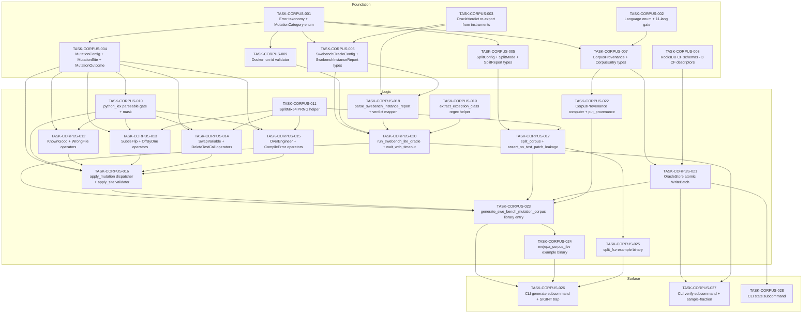

# Phase 0 — CORPUS Task Index

> **Level 4.** Atomic task specifications for the **CORPUS domain** (Phase 0: SWE-bench Lite mutation corpus + Docker oracle bridge + RocksDB CFs + train/calibration/holdout split). Authority order: `../../constitution.md` (Level 1) > `../../functional/SPEC-CORPUS.md` (Level 2) > `../../technical/TECH-CORPUS.md` (Level 3) > this file (Level 4). Each task is one conceptual change shippable end-to-end with FSV evidence per `docs2/prdtospec.md` §4.

## Phase scope

Implements all 16 functional REQ-CORPUS-NN requirements (cross-linked in `../_traceability.md` under `### CORPUS`) and all 8 component contracts in `../../technical/TECH-CORPUS.md`. Foundation → Logic → Surface ordering is enforced; no task references files created by a later task.

**Implementation state callout** (per TECH-CORPUS `<implementation_state>`):
- Shipped: 8 Python operators (KnownGood/SubtleFlip/OffByOne/SwapVariable/DeleteTestCall/WrongFile/OverEngineer/CompileError); split helper (InstanceAtomic + RepoAtomic); one-instance Docker bridge (gold + custom modes); RocksDB CFs; CLI scaffolding; FSV harnesses; Docker run-id validator; tree-sitter-python input gate.
- Pending: full 300×8 batch generation; CF_MEJEPA_CORPUS_PROVENANCE write path; SIGINT trap; `--sample-fraction` flag wiring on `verify`; per-language operators for the 10 deferred languages (separate phase).

Tasks below cover BOTH the shipped slice (verification + extension tasks) AND the pending work. Each shipped-slice task includes a `verify-shipped-state` verification step in addition to delivering net-new value (provenance hooks, FSV evidence updates, etc.). Net-new tasks are clearly marked as such.

## Dependency Graph



## Execution order

| # | Task ID | Title | Layer | Depends On | Est complexity |
|---|---|---|---|---|---|
| 1 | TASK-CORPUS-001 | Error taxonomy + MutationCategory enum | foundation | — | low |
| 2 | TASK-CORPUS-002 | Language enum + 11-language gate | foundation | — | low |
| 3 | TASK-CORPUS-003 | OracleVerdict re-export from instruments | foundation | — | low |
| 4 | TASK-CORPUS-004 | MutationConfig + MutationSite + MutationOutcome types | foundation | 001 | low |
| 5 | TASK-CORPUS-005 | SplitConfig + SplitMode + SplitReport types | foundation | 001 | low |
| 6 | TASK-CORPUS-006 | SwebenchOracleConfig + SwebenchInstanceReport types | foundation | 001, 003 | medium |
| 7 | TASK-CORPUS-007 | CorpusProvenance + CorpusEntry types | foundation | 001, 002 | low |
| 8 | TASK-CORPUS-008 | RocksDB CF schemas (3 CF descriptors) | foundation | 001 | low |
| 9 | TASK-CORPUS-009 | Docker run-id validator | foundation | 001 | low |
| 10 | TASK-CORPUS-010 | python_lex parseable gate + LexicalMask | logic | 001, 004 | medium |
| 11 | TASK-CORPUS-011 | SplitMix64 PRNG helper | logic | 001 | low |
| 12 | TASK-CORPUS-012 | KnownGood + WrongFile operators | logic | 004, 010 | low |
| 13 | TASK-CORPUS-013 | SubtleFlip + OffByOne operators | logic | 004, 010, 011 | medium |
| 14 | TASK-CORPUS-014 | SwapVariable + DeleteTestCall operators | logic | 004, 010, 011 | medium |
| 15 | TASK-CORPUS-015 | OverEngineer + CompileError operators | logic | 004, 010, 011 | medium |
| 16 | TASK-CORPUS-016 | apply_mutation dispatcher + apply_site validator | logic | 012, 013, 014, 015 | medium |
| 17 | TASK-CORPUS-017 | split_corpus + assert_no_test_patch_leakage | logic | 005, 011 | medium |
| 18 | TASK-CORPUS-018 | parse_swebench_instance_report + swebench_report_to_verdict | logic | 003, 006 | medium |
| 19 | TASK-CORPUS-019 | extract_exception_class regex helper | logic | 003 | low |
| 20 | TASK-CORPUS-020 | run_swebench_lite_oracle + wait_with_timeout | logic | 006, 009, 018, 019 | high |
| 21 | TASK-CORPUS-021 | OracleStore atomic WriteBatch | logic | 007, 008 | medium |
| 22 | TASK-CORPUS-022 | CorpusProvenance computer + put_provenance | logic | 007, 021 | low |
| 23 | TASK-CORPUS-023 | generate_swe_bench_mutation_corpus library entry | logic | 016, 017, 020, 021, 022 | high |
| 24 | TASK-CORPUS-024 | mejepa_corpus_fsv example binary | logic | 023 | medium |
| 25 | TASK-CORPUS-025 | split_fsv example binary | logic | 017 | low |
| 26 | TASK-CORPUS-026 | CLI generate subcommand + SIGINT trap | surface | 023, 024, 025 | high |
| 27 | TASK-CORPUS-027 | CLI verify subcommand + --sample-fraction | surface | 020, 021 | medium |
| 28 | TASK-CORPUS-028 | CLI stats subcommand | surface | 021 | low |

## Status

| Task | Status | Completed | Verified |
|---|---|---|---|
| TASK-CORPUS-001 | ⏳ ready | — | — |
| TASK-CORPUS-002 | ⏳ ready | — | — |
| TASK-CORPUS-003 | ⏳ ready | — | — |
| TASK-CORPUS-004 | ⏳ ready | — | — |
| TASK-CORPUS-005 | ⏳ ready | — | — |
| TASK-CORPUS-006 | ⏳ ready | — | — |
| TASK-CORPUS-007 | ⏳ ready | — | — |
| TASK-CORPUS-008 | ⏳ ready | — | — |
| TASK-CORPUS-009 | ⏳ ready | — | — |
| TASK-CORPUS-010 | ⏳ ready | — | — |
| TASK-CORPUS-011 | ⏳ ready | — | — |
| TASK-CORPUS-012 | ⏳ ready | — | — |
| TASK-CORPUS-013 | ⏳ ready | — | — |
| TASK-CORPUS-014 | ⏳ ready | — | — |
| TASK-CORPUS-015 | ⏳ ready | — | — |
| TASK-CORPUS-016 | ⏳ ready | — | — |
| TASK-CORPUS-017 | ⏳ ready | — | — |
| TASK-CORPUS-018 | ⏳ ready | — | — |
| TASK-CORPUS-019 | ⏳ ready | — | — |
| TASK-CORPUS-020 | ⏳ ready | — | — |
| TASK-CORPUS-021 | ⏳ ready | — | — |
| TASK-CORPUS-022 | ⏳ ready | — | — |
| TASK-CORPUS-023 | ⏳ ready | — | — |
| TASK-CORPUS-024 | ⏳ ready | — | — |
| TASK-CORPUS-025 | ⏳ ready | — | — |
| TASK-CORPUS-026 | ⏳ ready | — | — |
| TASK-CORPUS-027 | ⏳ ready | — | — |
| TASK-CORPUS-028 | ⏳ ready | — | — |

**Progress: 0/28 tasks (0%)**

## Status legend

- ⏳ ready — Can be started now (dependencies met)
- 🔄 in_progress — Currently being worked on
- ✅ complete — Finished and verified
- ⛔ blocked — Waiting on dependencies
- ❌ failed — Needs revision

## Coverage

This phase covers all 16 REQ-CORPUS-NN requirements. See `../_traceability.md` `### CORPUS` for the per-REQ → task mapping.

| REQ | Covered by tasks |
|---|---|
| REQ-CORPUS-01 (generate function) | 023, 026 |
| REQ-CORPUS-02 (8 mutation operators) | 010, 011, 012, 013, 014, 015, 016 |
| REQ-CORPUS-03 (run_swebench_lite_oracle) | 020 |
| REQ-CORPUS-04 (verdict mapping) | 018 |
| REQ-CORPUS-05 (run_id validation) | 009 |
| REQ-CORPUS-06 (split_corpus) | 005, 017 |
| REQ-CORPUS-07 (assert_no_test_patch_leakage) | 017 |
| REQ-CORPUS-08 (RocksDB CFs) | 008, 021 |
| REQ-CORPUS-09 (CLI subcommands) | 026, 027, 028 |
| REQ-CORPUS-10 (FSV examples) | 024, 025 |
| REQ-CORPUS-11 (ensure_parseable_python) | 010 |
| REQ-CORPUS-12 (CorpusProvenance) | 007, 022 |
| REQ-CORPUS-13 (Language enum) | 002 |
| REQ-CORPUS-14 (timeouts) | 020 |
| REQ-CORPUS-15 (verify subcommand) | 027 |
| REQ-CORPUS-16 (fail-closed complete flag) | 023, 026 |

## Critical path

```
001 → 004 → 010 → 016 → 023 → 026
```

(Foundation error taxonomy → mutation types → Python lex → mutation dispatcher → batch entry point → CLI generate.)

## Parallel opportunities

- **Batch 1 (foundation, parallel):** 001, 002, 003 (no inter-deps)
- **Batch 2 (foundation, after 001):** 004, 005, 008, 009 (parallel)
- **Batch 3 (foundation, after 001+002):** 007 (single)
- **Batch 4 (foundation, after 001+003):** 006 (single)
- **Batch 5 (logic, after 004):** 010, 011 (parallel; 011 has no deps on 010)
- **Batch 6 (mutation operators, parallel after 010+011):** 012, 013, 014, 015 (all parallel; share 010+011 deps)
- **Batch 7 (logic, after batch 6):** 016 (single)
- **Batch 8 (logic, parallel):** 017 (after 005+011), 018 (after 003+006), 019 (after 003), 021 (after 007+008)
- **Batch 9 (logic, after 018+019+009+006):** 020 (oracle invoker)
- **Batch 10 (logic, after 021+007):** 022
- **Batch 11 (logic, after 016+017+020+021+022):** 023
- **Batch 12 (logic, parallel):** 024 (after 023), 025 (after 017)
- **Batch 13 (surface):** 026, 027, 028 (sequenced; 026 deepest)

## Reality-boundary discipline

Per `../../constitution.md` `<anti_patterns reason="Reality-Boundary">`, no task in this phase touches:
- `swebench/**` (the upstream evaluator — invoked as a subprocess only)
- `tests/oracle_**`
- `crates/context-graph-benchmark/datasets/swe_bench_*/**`
- `crates/*/src/reward_specs/**`
- `crates/*/src/verifiers/**`
- `*.pem`, `*.key`, `**/credentials.json`, `.env*`

The Docker oracle bridge (TASK-CORPUS-020) READS swebench Python harness output and SPAWNS a subprocess; it never writes into the swebench package tree.

## Cross-references

- Functional spec: `../../functional/SPEC-CORPUS.md`
- Technical spec: `../../technical/TECH-CORPUS.md`
- Constitution: `../../constitution.md`
- Spec-authoring framework: `/home/cabdru/contextgraph/docs2/prdtospec.md`
- Phase traceability matrix: `../_traceability.md` (`### CORPUS` section)
