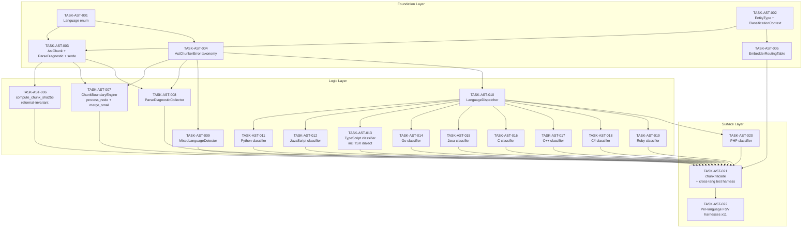

# Phase 1a — AST-CHUNKING Task Index

> **Phase 1a — multi-language AST-perfect atomic chunker.** Extends the shipped Rust-only chunker (`crates/context-graph-core/src/memory/ast_chunker.rs`, 1216 LOC) to all 11 tree-sitter languages: Rust, Python, JavaScript, TypeScript, Go, Java, C, C++, C#, Ruby, PHP. Implements `SPEC-AST-CHUNKING.md` (15 functional requirements) per `TECH-AST-CHUNKING.md` (8 component contracts).
>
> **Authority:** `../../constitution.md` overrides. `../_traceability.md` proves 100% coverage.

---

## Overview

- **Total tasks:** 22
- **Foundation layer:** 5 tasks (TASK-AST-001..005)
- **Logic layer:** 14 tasks (TASK-AST-006..019)
- **Surface layer:** 3 tasks (TASK-AST-020..022)
- **Estimated walltime:** ~12 days end-to-end (per doc 14 §6 13-item roadmap, items 1-6 + 13)
- **Crate touched:** `crates/context-graph-core` (extension, not new crate)
- **Output module path:** `crates/context-graph-core/src/memory/ast_chunker/` (directory module replacing the single 1216-LOC file)

---

## Dependency DAG



---

## Execution Order

| #  | Task ID         | Title                                                  | Layer      | Depends On                              | Status   |
|----|-----------------|--------------------------------------------------------|------------|-----------------------------------------|----------|
| 1  | TASK-AST-001    | `Language` enum (11 variants, `#[non_exhaustive]`)     | foundation | —                                       | Ready    |
| 2  | TASK-AST-002    | `EntityType` (13 variants) + `ClassificationContext`   | foundation | —                                       | Ready    |
| 3  | TASK-AST-003    | `AstChunk` + `ParseDiagnostic` + serde                 | foundation | 001, 002                                | Blocked  |
| 4  | TASK-AST-004    | `AstChunkerError` taxonomy (5 variants)                | foundation | 001                                     | Blocked  |
| 5  | TASK-AST-005    | `EmbedderRoutingTable` per `EntityType`                | foundation | 002                                     | Blocked  |
| 6  | TASK-AST-006    | `compute_chunk_sha256` (AST-node-id hashing)           | logic      | 003                                     | Blocked  |
| 7  | TASK-AST-007    | `ChunkBoundaryEngine` (`process_node` + `merge_small`) | logic      | 003, 004                                | Blocked  |
| 8  | TASK-AST-008    | `ParseDiagnosticCollector` (BFS, cap 32)               | logic      | 003, 004                                | Blocked  |
| 9  | TASK-AST-009    | `MixedLanguageDetector` (PHP+HTML / JS+HTML)           | logic      | 004                                     | Blocked  |
| 10 | TASK-AST-010    | `LanguageDispatcher` (parser_for_language)             | logic      | 001, 004                                | Blocked  |
| 11 | TASK-AST-011    | Python entity classifier                               | logic      | 002, 010                                | Blocked  |
| 12 | TASK-AST-012    | JavaScript entity classifier                           | logic      | 002, 010                                | Blocked  |
| 13 | TASK-AST-013    | TypeScript / TSX entity classifier                     | logic      | 002, 010, 012                           | Blocked  |
| 14 | TASK-AST-014    | Go entity classifier                                   | logic      | 002, 010                                | Blocked  |
| 15 | TASK-AST-015    | Java entity classifier                                 | logic      | 002, 010                                | Blocked  |
| 16 | TASK-AST-016    | C entity classifier (declarator-aware)                 | logic      | 002, 010                                | Blocked  |
| 17 | TASK-AST-017    | C++ entity classifier                                  | logic      | 002, 010, 016                           | Blocked  |
| 18 | TASK-AST-018    | C# entity classifier                                   | logic      | 002, 010                                | Blocked  |
| 19 | TASK-AST-019    | Ruby entity classifier                                 | logic      | 002, 010                                | Blocked  |
| 20 | TASK-AST-020    | PHP entity classifier                                  | surface    | 002, 010                                | Blocked  |
| 21 | TASK-AST-021    | `chunk` facade + cross-lang test harness               | surface    | 005, 006, 007, 008, 009, 011..020       | Blocked  |
| 22 | TASK-AST-022    | Per-language FSV harnesses (x11) + reformat-invariance | surface    | 021                                     | Blocked  |

---

## Status Legend

- Ready    — All dependencies satisfied; can start now.
- Blocked  — Waiting on a dependency.
- Active   — Currently being worked on.
- Done     — Completed and FSV-verified.
- Failed   — Needs revision.

---

## Critical Path

```
TASK-AST-001 → TASK-AST-002 → TASK-AST-003 → TASK-AST-007 → TASK-AST-021 → TASK-AST-022
```

Length: 6 sequential nodes. Other foundation/logic tasks parallelize off the critical path.

---

## Parallel batches

- **Batch F0** (parallel, no deps):              TASK-AST-001, TASK-AST-002
- **Batch F1** (depends on F0):                  TASK-AST-003, TASK-AST-004, TASK-AST-005
- **Batch L0** (depends on F1):                  TASK-AST-006, TASK-AST-007, TASK-AST-008, TASK-AST-009, TASK-AST-010
- **Batch L1 — per-language classifiers** (parallel, all depend on TASK-AST-002 + TASK-AST-010):
  - TASK-AST-011 Python
  - TASK-AST-012 JavaScript
  - TASK-AST-014 Go
  - TASK-AST-015 Java
  - TASK-AST-016 C
  - TASK-AST-018 C#
  - TASK-AST-019 Ruby
  - TASK-AST-020 PHP
- **Batch L2** (depends on L1 siblings):         TASK-AST-013 TypeScript (after JS), TASK-AST-017 C++ (after C)
- **Batch S0** (depends on all logic):           TASK-AST-021 facade + cross-lang harness
- **Batch S1** (depends on facade):              TASK-AST-022 11x FSV binaries

---

## Coverage hint

Per `../_traceability.md`, the AST-CHUNKING domain has 15 functional REQs and 8 technical components. These 22 tasks cover all of them with explicit traceability:

| REQ ID    | Task ID(s)                                  |
|-----------|---------------------------------------------|
| REQ-AST-01 | TASK-AST-001, TASK-AST-010, TASK-AST-021   |
| REQ-AST-02 | TASK-AST-003, TASK-AST-007, TASK-AST-021   |
| REQ-AST-03 | TASK-AST-002                                |
| REQ-AST-04 | TASK-AST-006                                |
| REQ-AST-05 | TASK-AST-007                                |
| REQ-AST-06 | TASK-AST-005, TASK-AST-021                 |
| REQ-AST-07 | TASK-AST-022                                |
| REQ-AST-08 | TASK-AST-008, TASK-AST-021                 |
| REQ-AST-09 | TASK-AST-001, TASK-AST-010                 |
| REQ-AST-10 | TASK-AST-021                                |
| REQ-AST-11 | TASK-AST-009                                |
| REQ-AST-12 | TASK-AST-011..020                           |
| REQ-AST-13 | TASK-AST-021, TASK-AST-022                 |
| REQ-AST-14 | TASK-AST-021                                |
| REQ-AST-15 | TASK-AST-022                                |

---

## Notes for executors

1. **Reuse existing code aggressively.** The shipped Rust chunker at `crates/context-graph-core/src/memory/ast_chunker.rs` is the algorithmic source-of-truth. Per-language classifier logic should be ported from `crates/context-graph-cli/src/commands/dynamicjepa.rs:6400+` (multi-language semantic extractor already covers all 11 languages).
2. **Files under 500 lines (constitution `<file_organization>`).** The current 1216-LOC `ast_chunker.rs` exceeds this; the Phase 1a refactor splits into a directory module `ast_chunker/{mod,types,error,language,classifier/{rust,python,javascript,typescript,go,java,c,cpp,csharp,ruby,php},hash,boundary,diagnostics,mixed_lang,dispatch,router}.rs`.
3. **REQ-AST-14 backwards compat:** the existing `AstCodeChunker::new_rust` + `chunk(&str, &str)` API stays intact and is implemented in terms of the new uniform `chunk(&[u8], Language)` API. Existing tests must pass unchanged.
4. **Determinism:** all maps/sets are `BTreeMap`/`BTreeSet`; chunk emission order is source-order (line_start ascending); no `HashMap`/`HashSet` in chunker output paths.
5. **Anti-pattern `Architecture/no raw-text chunking`** is absolute. ParseFailed is the only response to ERROR/MISSING; never text-fallback.
6. **GENERIC-ONLY** (constitution `<anti_patterns>`): every classifier must work for every file in its language, not specific repos. No per-task hints.

---

## Cross-references

- Functional spec: `../../functional/SPEC-AST-CHUNKING.md`
- Technical spec: `../../technical/TECH-AST-CHUNKING.md`
- Constitution:   `../../constitution.md`
- Roadmap source: `../../14_AST_EMBEDDER_ATOMIC_CHUNKING.md` §6 (13-item roadmap)
- Traceability:   `../_traceability.md`
- Master DAG:     `../_index.md`
- Shipped Rust chunker (source of truth): `crates/context-graph-core/src/memory/ast_chunker.rs`
- DynamicJEPA per-language semantic extractor: `crates/context-graph-cli/src/commands/dynamicjepa.rs:6400+`
