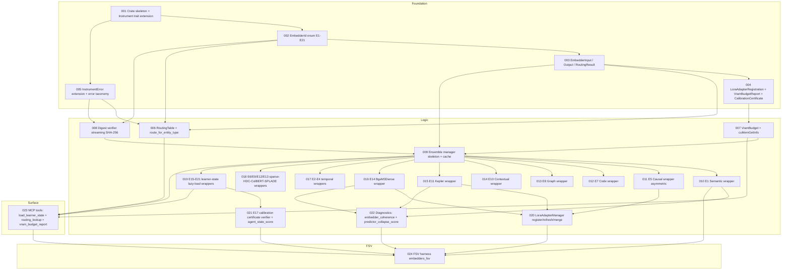

# Phase 1b — EMBEDDERS Task Index (Level 4 atomic tasks)

> **Phase 1b** wraps the existing 21-embedder ensemble (E1-E21) shipped in `crates/context-graph-embeddings/` behind the unified `Instrument` trait + per-chunk-type routing table + LoRA adapter scaffolding + VRAM budget enforcement. New crate: `crates/context-graph-mejepa-embedders/`.

**Authority:** `../../constitution.md` overrides. Spec sources: `../../functional/SPEC-EMBEDDERS.md`, `../../technical/TECH-EMBEDDERS.md`, `docs/ruvectorfindings/12_EMBEDDER_INTEGRATION.md` §3-§4.

---

## Overview

| Metric | Value |
|---|---:|
| Total tasks | 23 |
| Foundation layer | 5 |
| Logic layer | 15 |
| Surface layer | 3 |
| Estimated total wall-clock | ~14-18 days |

## Phase entry conditions

- Phase 1 INSTRUMENTS scaffolding shipped (`Instrument` trait + 15-slot `Panel` + `PanelBuilder` exist in `context-graph-mejepa-instruments`). ✅
- AST chunker `EntityType` enum stable (Rust today; Python+9-language extension is a parallel Phase 1 deliverable that does NOT block this phase — routing table accepts `Option<Language>` and gracefully falls back).
- `crates/context-graph-embeddings` shipping with `ModelId` (E1-E14) + `LearnerEmbedderSlot` (E15-E21) + `training/{lora,optimizer,loss,distillation,multitask}.rs`. ✅
- `config/models_config.toml` exists or is created in TASK-EMBED-002.

## Phase exit conditions

- All 23 tasks complete and FSV evidence written under `/tmp/contextgraph-mejepa-embedders-fsv/`.
- `Ensemble::load_content_set()` succeeds against real weight files with verified SHA-256 digests; `cargo test -p context-graph-mejepa-embedders` green.
- 3 MCP tools (`mejepa_load_learner_state`, `mejepa_routing_lookup`, `mejepa_vram_budget_report`) registered in `context-graph-mcp` and returning typed responses.
- Routing table covers 13 EntityType variants × 11 languages without gaps (`MEJEPA_EMBED_ROUTING_MISSING` impossible for any in-spec input).
- E17 calibration certificate verifier rejects `agent_state_score()` calls without a signed cert in `memory/decisions/`.

---

## Dependency graph



---

## Execution order (sequence)

| # | Task ID | Title | Layer | Depends on | Est. complexity |
|---:|---|---|---|---|---|
| 1 | TASK-EMBED-001 | Create crate skeleton + extend Instrument trait | foundation | — | low |
| 2 | TASK-EMBED-002 | EmbedderId enum (E1-E21) + serde + From&lt;&str&gt; | foundation | 001 | low |
| 3 | TASK-EMBED-003 | EmbedderInput / EmbedderOutput / RoutingResult | foundation | 002 | low |
| 4 | TASK-EMBED-004 | LoraAdapterRegistration + VramBudgetReport + CalibrationCertificate | foundation | 003 | low |
| 5 | TASK-EMBED-005 | EmbedError taxonomy with .code() + InstrumentError extension | foundation | 001 | low |
| 6 | TASK-EMBED-006 | RoutingTable + route_for_entity_type fail-closed | logic | 002, 003, 005 | medium |
| 7 | TASK-EMBED-007 | VramBudget + cudarc cuMemGetInfo enforcer | logic | 004 | medium |
| 8 | TASK-EMBED-008 | Streaming SHA-256 digest verifier | logic | 002, 005 | low |
| 9 | TASK-EMBED-009 | Ensemble manager skeleton + forward-cache | logic | 003, 007, 008 | medium |
| 10 | TASK-EMBED-010 | E1 Semantic Instrument wrapper (e5-large-v2, 1024-d) | logic | 009 | medium |
| 11 | TASK-EMBED-011 | E5 Causal wrapper (nomic-embed, 768-d, asymmetric cause/effect) | logic | 009 | medium |
| 12 | TASK-EMBED-012 | E7 Code wrapper (Qodo, 1536-d) | logic | 009 | medium |
| 13 | TASK-EMBED-013 | E8 Graph wrapper (e5-large-v2 graph use, 1024-d) | logic | 009, 010 | low |
| 14 | TASK-EMBED-014 | E10 Contextual wrapper (e5-base-v2, 768-d) | logic | 009 | medium |
| 15 | TASK-EMBED-015 | E11 Kepler wrapper (RoBERTa+TransE, 768-d) | logic | 009 | medium |
| 16 | TASK-EMBED-016 | E14 BgeM3Dense wrapper (BGE-M3, 1024-d) | logic | 009 | medium |
| 17 | TASK-EMBED-017 | E2-E4 temporal embedders (one task, all 3) | logic | 009 | low |
| 18 | TASK-EMBED-018 | E6/E9/E12/E13 sparse + HDC + ColBERT + SPLADE | logic | 009 | medium |
| 19 | TASK-EMBED-019 | E15-E21 learner-state lazy-load wrappers | logic | 009 | high |
| 20 | TASK-EMBED-020 | LoraAdapterManager (register, refresh, merge_oldest_delta) | logic | 011, 015, 016 | high |
| 21 | TASK-EMBED-021 | E17 calibration certificate verifier + agent_state_score | logic | 019 | medium |
| 22 | TASK-EMBED-022 | Diagnostics: embedder_coherence + predictor_collapse_score | logic | 010, 015, 016 | medium |
| 23 | TASK-EMBED-023 | MCP tools (3): load_learner_state + routing_lookup + vram_budget_report | surface | 006, 007, 009, 019 | medium |

---

## Parallelisable batches

After foundation (001-005) ships sequentially, the following batches may run in parallel:

**Batch A** (post 005): T006, T007, T008 share no source files.
**Batch B** (post 009): T010, T011, T012, T014, T015, T016, T017, T018, T019 are independent embedder wrappers — same trait, separate per-embedder modules.
**Batch C** (post 019): T020 (LoRA), T021 (calibration), T022 (diagnostics), T023 (MCP) all depend on T009 + their specific predecessors but not on each other.

---

## Critical path

```
TASK-EMBED-001 → TASK-EMBED-002 → TASK-EMBED-003 → TASK-EMBED-004 →
TASK-EMBED-007 → TASK-EMBED-009 → TASK-EMBED-016 (E14 — heaviest forward path) →
TASK-EMBED-020 → TASK-EMBED-023
```

---

## Risk register

- **R-EMBED-1** Real GPU access (RTX 5090) for end-to-end FSV. Mitigation: gate `--feature gpu`; CPU fallback for CI; a single GPU-required FSV run produces canonical evidence.
- **R-EMBED-2** Weight file disk size (E7 Qodo ≈ 5.8 GB fp32, ≈ 2.9 GB bf16). Mitigation: streaming SHA-256 (TASK-EMBED-008) reads in 4 MB chunks; never load full file into RAM.
- **R-EMBED-3** Tokenizer normalization drift between `tokenizers` versions. Mitigation: `code_version` SHA includes pinned `Cargo.lock` versions of candle/cudarc/tokenizers/sha2/ed25519-dalek (TASK-EMBED-002 + TASK-EMBED-003).
- **R-EMBED-4** bf16 GPU non-determinism (driver-internal reduction order). Mitigation: every `EmbedderOutput` records `precision_class`; `--strict-fp32-replay` flag re-runs through fp32; > 1-ULP disagreement raises `MEJEPA_EMBED_DETERMINISM_VIOLATION`.
- **R-EMBED-5** LoRA gradient leakage into frozen base. Mitigation: pre/post SHA-256 of base buffer per fit step (TASK-EMBED-020) — refuses with `MEJEPA_EMBED_FROZEN_BASE_VIOLATION` and rolls back.

---

## FSV evidence target

`/tmp/contextgraph-mejepa-embedders-fsv/`:
- `vram_budget_report.json` — post `load_content_set()` + 1 lazy load.
- `routing_coverage.json` — every (EntityType × Language) → RoutingResult; asserts no `MEJEPA_EMBED_ROUTING_MISSING` for in-spec inputs.
- `digest_mismatch_evidence.json` — corruption-detection round-trip.
- `lora_frozen_base_invariance.json` — pre/post SHA equality across 10-epoch fit on E5 with synthetic causal-pair corpus.
- `determinism_evidence.json` — 100 byte-equal encodes per active embedder.
- `latency_benchmark.json` — p50/p99 per embedder + per panel materialization.
- `coherence_collapse_evidence.json` — coherence + collapse_score on synthetic panels.
- `calibration_cert_evidence.json` — E17 cert presence/absence flow; `MEJEPA_EMBED_E17_UNCALIBRATED` exercise.

---

## Cross-references

- Domain spec (functional): `../../functional/SPEC-EMBEDDERS.md`
- Domain spec (technical): `../../technical/TECH-EMBEDDERS.md`
- Doc 12: `docs/ruvectorfindings/12_EMBEDDER_INTEGRATION.md`
- Master DAG: `../_index.md`
- Traceability matrix: `../_traceability.md` (EMBEDDERS section updated by this phase)
- Spec-authoring framework: `/home/cabdru/contextgraph/docs2/prdtospec.md`
