# Phase 1c — INSTRUMENTS Task Index

> **📊 2026-05-10 STATUS — partial.** All 15 panel slots have deterministic typed encoders + Panel/PanelBuilder/PanelStore + JSON envelope + frozen-hook + linear-probe quality gate shipped (`crates/context-graph-mejepa-instruments/`); 11 of 14 instruments are placeholders awaiting embedder/analyzer-backed replacements (E_Oracle, E_Witness, E_StaticAnalysis are first-class today). Authoritative status: ../../implementation-plan.md Phase 1c.

> **Level 4.** Atomic task specifications for the **INSTRUMENTS domain** (Phase 1c: 14 named instruments + Scalars aggregator + Panel/PanelBuilder, summing to the 5,120-d panel). Authority order: `../../constitution.md` (Level 1) > `../../functional/SPEC-INSTRUMENTS.md` (Level 2) > `../../technical/TECH-INSTRUMENTS.md` (Level 3) > this file (Level 4). Each task is one conceptual change shippable end-to-end with FSV evidence per `docs2/prdtospec.md` §4.

## Phase scope

Implements all 23 functional REQ-INSTR-NN requirements (cross-linked in `../_traceability.md` under `### INSTRUMENTS`) and all 17 component contracts in `../../technical/TECH-INSTRUMENTS.md`. Foundation -> Logic -> Surface ordering enforced; Iron Rule applies (no task references files created by a later task).

**Implementation state callout** (per TECH-INSTRUMENTS `<implementation_state>`):

- Shipped (deterministic encoders + scaffolding):
  - `Panel`, `PanelBuilder`, `PanelSerde` invariant gate, `InstrumentSlot::layout()` (5,120-d sum), `Instrument` trait, `InstrumentError` taxonomy with `MEJEPA_INSTRUMENTS_INVALID_INPUT` / `_NUMERICAL_INVARIANT` codes (`crates/context-graph-mejepa-instruments/src/lib.rs`).
  - `EOracleInstrument` 128-d (shipped, `e_oracle.rs`).
  - `EWitnessInstrument` 256-d (shipped, `e_witness.rs`; calls `context_graph_witness::verify_chain_bytes`).
  - `EStaticAnalysisInstrument` 256-d (shipped, `e_static_analysis.rs`).
  - `EAstInstrument`, `ECfgInstrument`, `EDataFlowInstrument`, `ETypeGraphInstrument`, `EDiffInstrument` deterministic typed encoders over `CodeInstrumentInput`/`DiffInstrumentInput` (shipped, `e_code.rs`).
  - `ETestInstrument`, `EProblemInstrument`, `ECommitMsgInstrument` deterministic typed text encoders (shipped, `e_text.rs`).
  - `ETraceInstrument` deterministic typed encoder (shipped, `e_trace.rs`).
  - `ERuntimeInstrument` deterministic typed encoder (shipped, `e_runtime.rs`).
  - `EReasoningInstrument` deterministic typed encoder (shipped, `e_reasoning.rs`).
  - `ScalarsInstrument` deterministic typed encoder (shipped, `e_scalars.rs`).
  - 27 unit tests pass; FSV at `/tmp/contextgraph-mejepa-instruments-fsv/{all_pass,mixed,crash_assertion_error,crash_type_error}_{input,encoded}.json` + `panel.json` (46 KB).

- Pending (this phase):
  - **Frozen-target gradient hook** (`FrozenGuard` + `MEJEPA_INSTR_FROZEN_VIOLATION`). CRITICAL bug detector for `UTML_DXi.target_collapse > 0`. Not yet wired (no Phase 3 training loop exists).
  - **Neural-backed replacements** for the 11 deterministic encoders (Qodo / E1 / E7 / E8 / E11 / E17 frozen forwards + projections / graph-attention heads / sequence transformer). Currently typed deterministic encoders ship behind the same trait; neural replacements MUST implement the same `Instrument` trait so callers swap with no API change.
  - **Multi-language chunk routing** (consume real `crates/context-graph-core/src/memory/ast_chunker.rs` `AstChunk` instead of the simplified `CodeInstrumentInput { language: String, source: String }`).
  - **Real toolchain evidence** for `E_TypeGraph` (Pyright / mypy / rust-analyzer / javac / dotnet build / tsc / gcc / ruby / go / php) and for `E_StaticAnalysis` extension (additional clippy / ruff / eslint integrations).
  - **`materialize_panel` helper** with `TimeStep::{T0, T1, T2}` rules per doc 09 §2.3.
  - **Linear-probe quality gate** per instrument (>= 70% top-1 mutation-category accuracy on 100-example holdout).
  - **Panel JSON serialization protocol** with provenance metadata (`code_version`, `embedder_versions`, `corpus_sha`, `frozen_at`) + RocksDB `CF_MEJEPA_PANELS` + `CF_MEJEPA_PANEL_META` persistence path.
  - **`phase1_extended_fsv` harness** extending the shipped `panel.json` with all 14 instruments × 4 boundary cases.

Tasks below cover BOTH the shipped slice (verification + extension tasks) AND the pending work. Each shipped-slice task includes a `verify-shipped-state` check (read invariants + run existing unit tests) AND delivers net-new value (frozen-hook registration, doc-string augmentation, extension API surface, FSV evidence). Net-new tasks are clearly marked as such.

---

## Overview

- **Total tasks:** 23
- **Foundation layer:** 4 tasks (TASK-INSTR-001..004)
- **Logic layer:** 17 tasks (TASK-INSTR-005..021)
- **Surface layer:** 2 tasks (TASK-INSTR-022..023)
- **Estimated walltime:** ~25 days end-to-end (per master plan Phase 1 budget; neural backends dominate)
- **Crate touched:** `crates/context-graph-mejepa-instruments` (extension)
- **New file paths created:**
  - `crates/context-graph-mejepa-instruments/src/frozen_hook.rs` (Frozen gradient guard primitive; trait counterpart in Phase 3 `context-graph-mejepa-train`)
  - `crates/context-graph-mejepa-instruments/src/materialize.rs` (panel time-step builder)
  - `crates/context-graph-mejepa-instruments/src/panel_json.rs` (JSON schema with provenance)
  - `crates/context-graph-mejepa-instruments/src/linear_probe.rs` (DoD probe harness)
  - `crates/context-graph-mejepa-instruments/examples/phase1_extended_fsv.rs` (extended FSV)
  - `crates/context-graph-mejepa-instruments/examples/linear_probe_e_*.rs` (15 probe binaries; one per instrument)

---

## Dependency DAG

```mermaid
graph TD
    subgraph Foundation [Foundation Layer]
        T001[TASK-INSTR-001<br/>Verify InstrumentSlot + layout]
        T002[TASK-INSTR-002<br/>Verify Instrument trait + InstrumentError]
        T003[TASK-INSTR-003<br/>Verify Panel + PanelBuilder + PanelSerde]
        T004[TASK-INSTR-004<br/>FrozenGuard primitive<br/>MEJEPA_INSTR_FROZEN_VIOLATION]
    end

    subgraph Logic [Logic Layer]
        T005[TASK-INSTR-005<br/>EOracleInstrument verify+extend]
        T006[TASK-INSTR-006<br/>EWitnessInstrument verify+extend]
        T007[TASK-INSTR-007<br/>EStaticAnalysisInstrument verify+extend]
        T008[TASK-INSTR-008<br/>EAstInstrument neural<br/>Qodo + 1536-&gt;384]
        T009[TASK-INSTR-009<br/>ECfgInstrument neural<br/>E8 + graph-attn]
        T010[TASK-INSTR-010<br/>EDataFlowInstrument neural<br/>E11 + graph-attn]
        T011[TASK-INSTR-011<br/>ETypeGraphInstrument neural<br/>E11 + toolchain lattice]
        T012[TASK-INSTR-012<br/>ETestInstrument neural<br/>E1 e5-large-v2]
        T013[TASK-INSTR-013<br/>ETraceInstrument neural<br/>seq transformer]
        T014[TASK-INSTR-014<br/>EDiffInstrument neural<br/>Qodo + diff edges]
        T015[TASK-INSTR-015<br/>EProblemInstrument neural<br/>E1 1024-d]
        T016[TASK-INSTR-016<br/>ECommitMsgInstrument neural<br/>E1 + 1024-&gt;384]
        T017[TASK-INSTR-017<br/>ERuntimeInstrument verify+extend]
        T018[TASK-INSTR-018<br/>EReasoningInstrument neural<br/>E17 AffectText]
        T019[TASK-INSTR-019<br/>ScalarsInstrument verify+extend]
        T020[TASK-INSTR-020<br/>materialize_panel helper<br/>T0/T1/T2 rules]
        T021[TASK-INSTR-021<br/>linear-probe quality gate<br/>&gt;=70% top-1]
    end

    subgraph Surface [Surface Layer]
        T022[TASK-INSTR-022<br/>Panel JSON protocol<br/>+ CF_MEJEPA_PANELS]
        T023[TASK-INSTR-023<br/>phase1_extended_fsv<br/>14 instruments x 4 cases]
    end

    %% Foundation -> Logic
    T001 --> T003
    T002 --> T003
    T001 --> T004
    T002 --> T004
    T003 --> T005
    T003 --> T006
    T003 --> T007
    T003 --> T008
    T003 --> T009
    T003 --> T010
    T003 --> T011
    T003 --> T012
    T003 --> T013
    T003 --> T014
    T003 --> T015
    T003 --> T016
    T003 --> T017
    T003 --> T018
    T003 --> T019
    T004 --> T008
    T004 --> T009
    T004 --> T010
    T004 --> T011
    T004 --> T012
    T004 --> T013
    T004 --> T014
    T004 --> T015
    T004 --> T016
    T004 --> T018

    %% Logic chain
    T005 --> T020
    T006 --> T020
    T007 --> T020
    T008 --> T020
    T009 --> T020
    T010 --> T020
    T011 --> T020
    T012 --> T020
    T013 --> T020
    T014 --> T020
    T015 --> T020
    T016 --> T020
    T017 --> T020
    T018 --> T020
    T019 --> T020

    T005 --> T021
    T006 --> T021
    T007 --> T021
    T008 --> T021
    T009 --> T021
    T010 --> T021
    T011 --> T021
    T012 --> T021
    T013 --> T021
    T014 --> T021
    T015 --> T021
    T016 --> T021
    T017 --> T021
    T018 --> T021
    T019 --> T021

    %% Logic -> Surface
    T020 --> T022
    T020 --> T023
    T022 --> T023
    T021 --> T023
```



---

## Execution order (sequential)

| # | Task ID | Title | Layer | Depends on | Status |
|---|---|---|---|---|---|
| 1 | TASK-INSTR-001 | Verify InstrumentSlot enum + layout (15 slots, 5,120-d) | foundation | (shipped) | ready (verify) |
| 2 | TASK-INSTR-002 | Verify Instrument trait + InstrumentError taxonomy | foundation | (shipped) | ready (verify) |
| 3 | TASK-INSTR-003 | Verify Panel + PanelBuilder + PanelSerde invariant gate | foundation | 001, 002 | ready (verify) |
| 4 | TASK-INSTR-004 | FrozenGuard primitive (MEJEPA_INSTR_FROZEN_VIOLATION) | foundation | 001, 002 | ready (net-new) |
| 5 | TASK-INSTR-005 | EOracleInstrument verify + edge-case audit | logic | 003 | ready (verify+extend) |
| 6 | TASK-INSTR-006 | EWitnessInstrument verify + edge-case audit | logic | 003 | ready (verify+extend) |
| 7 | TASK-INSTR-007 | EStaticAnalysisInstrument verify + edge-case audit | logic | 003 | ready (verify+extend) |
| 8 | TASK-INSTR-008 | EAstInstrument neural backing (Qodo + 1536->384) | logic | 003, 004, AST-022 | blocked (Phase 1 embedders) |
| 9 | TASK-INSTR-009 | ECfgInstrument neural (E8 + graph-attn) | logic | 003, 004, AST-022 | blocked |
| 10 | TASK-INSTR-010 | EDataFlowInstrument neural (E11 + graph-attn) | logic | 003, 004, AST-022 | blocked |
| 11 | TASK-INSTR-011 | ETypeGraphInstrument neural (E11 + toolchain lattice) | logic | 003, 004, AST-022 | blocked |
| 12 | TASK-INSTR-012 | ETestInstrument neural (E1 e5-large-v2 + 1024->384) | logic | 003, 004 | blocked (E1) |
| 13 | TASK-INSTR-013 | ETraceInstrument neural (sequence transformer) | logic | 003, 004 | blocked |
| 14 | TASK-INSTR-014 | EDiffInstrument neural (Qodo + diff-edge encoder) | logic | 003, 004, AST-022 | blocked |
| 15 | TASK-INSTR-015 | EProblemInstrument neural (E1 1024-d direct) | logic | 003, 004 | blocked (E1) |
| 16 | TASK-INSTR-016 | ECommitMsgInstrument neural (E1 + 1024->384) | logic | 003, 004 | blocked (E1) |
| 17 | TASK-INSTR-017 | ERuntimeInstrument verify + extend (determinism flag, syscall histo) | logic | 003 | ready (verify+extend) |
| 18 | TASK-INSTR-018 | EReasoningInstrument neural (E17 AffectText) | logic | 003, 004 | blocked (E17) |
| 19 | TASK-INSTR-019 | ScalarsInstrument verify + extend (16-bin BFS / blame / churn / coverage / repo) | logic | 003 | ready (verify+extend) |
| 20 | TASK-INSTR-020 | `materialize_panel` helper (T0 / T1 / T2 rules per doc 09 §2.3) | logic | 005..019 | ready (after instruments) |
| 21 | TASK-INSTR-021 | Per-instrument linear-probe quality gate (>= 70% top-1) | logic | 005..019 | ready (after instruments) |
| 22 | TASK-INSTR-022 | Panel JSON serialization protocol + CF_MEJEPA_PANELS / CF_MEJEPA_PANEL_META | surface | 020 | blocked (storage) |
| 23 | TASK-INSTR-023 | `phase1_extended_fsv` harness (14 instruments x 4 boundary cases) | surface | 020, 021, 022 | blocked |

**Status legend:** `ready` (can start now); `blocked` (waits on a prior task or upstream deliverable, e.g. Phase 1b embeddings or AST-022 chunker facade); `verify+extend` (shipped slice — verify invariants + add net-new contract); `verify` (foundation already shipped — confirm signatures + run existing tests); `net-new` (no shipped slice).

---

## Parallel-execution batches

Within the layer ordering, the following sub-batches have no inter-batch dependencies and may execute concurrently:

- **Batch F.1** (foundation, parallel-safe): TASK-INSTR-001, TASK-INSTR-002 — both inspect `lib.rs` invariants in disjoint namespaces.
- **Batch F.2** (foundation, depends on F.1): TASK-INSTR-003, TASK-INSTR-004 — both depend on slot enum + trait but write distinct files.
- **Batch L.1** (logic, depends on F.2): TASK-INSTR-005, TASK-INSTR-006, TASK-INSTR-007, TASK-INSTR-017, TASK-INSTR-019 — five "verify + extend" tasks on shipped instruments touching disjoint files.
- **Batch L.2** (logic, depends on F.2 + Phase 1b embedders): TASK-INSTR-008..016, TASK-INSTR-018 — 10 neural-backed instruments. Each touches one source file (`e_code.rs`, `e_text.rs`, `e_trace.rs`, `e_reasoning.rs`) so partition the editing across owners; logical merge happens after each is FSV-green.
- **Batch L.3** (logic, depends on L.1 + L.2): TASK-INSTR-020, TASK-INSTR-021 — both consume the full instrument set.
- **Batch S.1** (surface, depends on L.3): TASK-INSTR-022 alone (storage path).
- **Batch S.2** (surface, depends on S.1 + L.3): TASK-INSTR-023 (FSV harness aggregator).

---

## Critical path

```
TASK-INSTR-001 -> TASK-INSTR-003 -> TASK-INSTR-008 -> TASK-INSTR-020 -> TASK-INSTR-022 -> TASK-INSTR-023
```

The neural EAstInstrument (TASK-INSTR-008) is the longest single-task: Qodo forward integration + 1536->384 projection + frozen-weight loading + per-language FSV. Anchor scheduling here.

---

## Cross-domain dependencies

- **AST-CHUNKING (Phase 1a):** TASK-AST-022 (per-language FSV harness) ships the multi-language `AstChunk` API consumed by code-domain instruments (TASK-INSTR-008/009/010/011/014). Until then, those instruments fall back to the deterministic encoders shipped in `e_code.rs`.
- **EMBEDDERS (Phase 1b):** Provides E1, E7, E8, E11, E17 frozen forwards. Until shipped, neural-backed instruments emit `MEJEPA_INFER_INSTRUMENT_MISSING`.
- **CORPUS (Phase 0):** `OracleVerdict` re-export from `context_graph_mejepa_corpus::swebench` (TASK-CORPUS-018) is the input source for `EOracleInstrument`. Already shipped.
- **WITNESS:** `verify_chain_bytes`, `WitnessEntry`, `WITNESS_ENTRY_SIZE`, `HASH_SIZE` from `context-graph-witness`. Already shipped.
- **STORAGE:** `CF_MEJEPA_PANELS` + `CF_MEJEPA_PANEL_META` column-family registration (TASK-INSTR-022 surface task wires these into `context-graph-storage`).

---

## Coverage roll-up

Every functional REQ-INSTR-NN (23 total) and every component contract (17 total) maps to at least one task in this index. Coverage tracking is in `../_traceability.md`. See per-task `<implements>` blocks for the precise REQ/component bindings.

| REQ | Title | Task ID(s) |
|---|---|---|
| REQ-INSTR-01 | EAstInstrument 384-d | TASK-INSTR-008 |
| REQ-INSTR-02 | ECfgInstrument 256-d | TASK-INSTR-009 |
| REQ-INSTR-03 | EDataFlowInstrument 256-d | TASK-INSTR-010 |
| REQ-INSTR-04 | ETypeGraphInstrument 256-d | TASK-INSTR-011 |
| REQ-INSTR-05 | ETestInstrument 384-d | TASK-INSTR-012 |
| REQ-INSTR-06 | ETraceInstrument 512-d | TASK-INSTR-013 |
| REQ-INSTR-07 | EDiffInstrument 256-d | TASK-INSTR-014 |
| REQ-INSTR-08 | EWitnessInstrument 256-d | TASK-INSTR-006 |
| REQ-INSTR-09 | EOracleInstrument 128-d | TASK-INSTR-005 |
| REQ-INSTR-10 | EProblemInstrument 1024-d | TASK-INSTR-015 |
| REQ-INSTR-11 | ECommitMsgInstrument 384-d | TASK-INSTR-016 |
| REQ-INSTR-12 | EStaticAnalysisInstrument 256-d | TASK-INSTR-007 |
| REQ-INSTR-13 | ERuntimeInstrument 256-d | TASK-INSTR-017 |
| REQ-INSTR-14 | EReasoningInstrument 384-d | TASK-INSTR-018 |
| REQ-INSTR-15 | Panel + PanelBuilder fail-closed | TASK-INSTR-003 |
| REQ-INSTR-16 | ScalarsInstrument 128-d | TASK-INSTR-019 |
| REQ-INSTR-17 | materialize_panel helper | TASK-INSTR-020 |
| REQ-INSTR-18 | Frozen-instrument invariant + FrozenGuard | TASK-INSTR-004 (and asserted in 008-016, 018) |
| REQ-INSTR-19 | AST-perfect chunk consumption | TASK-INSTR-008/009/010/011/014 |
| REQ-INSTR-20 | FSV harness (4 boundary cases) | TASK-INSTR-023 |
| REQ-INSTR-21 | Linear-probe DoD (>= 70% top-1) | TASK-INSTR-021 |
| REQ-INSTR-22 | Panel materialization perf budgets | TASK-INSTR-020 (latency) + TASK-INSTR-023 (profile) |
| REQ-INSTR-23 | Provenance metadata in panel JSON | TASK-INSTR-022 |

---

## Authority cross-reference

- Functional spec: `../../functional/SPEC-INSTRUMENTS.md`
- Technical spec: `../../technical/TECH-INSTRUMENTS.md`
- Constitution: `../../constitution.md`
- Master traceability: `../_traceability.md`
- Predecessor phase: `../phase1-ast-chunking/_index.md` (AST chunker; consumed by code-domain instruments)
- Successor phase: `../phase2-predictor/` (consumes panels)
- Architectural sources: `docs/ruvectorfindings/09_END_GOAL_REVIEW_REPLACEMENT.md` §2.2, §2.3, §3.5.5; `docs/ruvectorfindings/12_EMBEDDER_INTEGRATION.md` §3; `docs/ruvectorfindings/14_AST_AWARE_CHUNKING_FOR_EMBEDDERS.md` §3.2 §4
- Memory: `memory/project_phase0_mejepa_mutation_corpus.md` (2026-05-09d shipped-state snapshot; 27 unit tests + FSV evidence paths)
