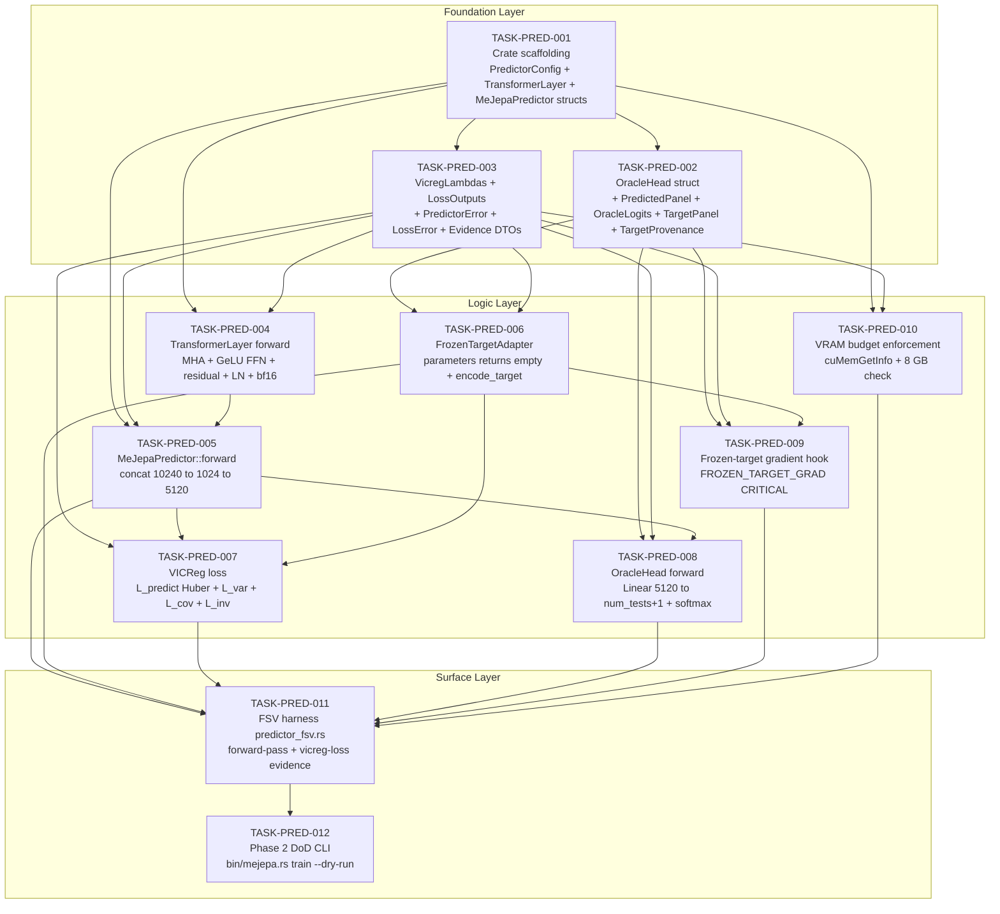

# Phase 2 — PREDICTOR Task Index

> **Level 4.** Atomic task specifications for the **PREDICTOR domain** (Phase 2: 6-layer transformer + Oracle head + frozen target adapter + VICReg loss + DoD CLI). Authority order: `../../constitution.md` (Level 1) > `../../functional/SPEC-PREDICTOR.md` (Level 2) > `../../technical/TECH-PREDICTOR.md` (Level 3) > this file (Level 4). Each task is one conceptual change shippable end-to-end with FSV evidence per `docs2/prdtospec.md` §4.

## Phase scope

Implements all 18 functional REQ-PRED-NN requirements (cross-linked in `../_traceability.md` under `### PREDICTOR`) and all 6 component contracts in `../../technical/TECH-PREDICTOR.md`. Foundation -> Logic -> Surface ordering enforced; Iron Rule applies (no task references files created by a later task).

The defining structural property is constitution `<utml_v1_invariants>` rule 2: **`ΔΞ.target_collapse = 0` by construction.** The trainable predictor (transformer + Oracle head) is the ONLY trainable component of ME-JEPA-Code; the FrozenTargetAdapter has zero trainable parameters and the trait API forbids `&mut self` weight-mutating methods. Defense-in-depth runtime gradient hook (TASK-PRED-009) catches any violation as a CRITICAL bug.

**Net-new crate:** `crates/context-graph-mejepa/` (does not yet exist; created by TASK-PRED-001 with the workspace `Cargo.toml` registration).

---

## Overview

- **Total tasks:** 12
- **Foundation layer:** 3 tasks (TASK-PRED-001..003)
- **Logic layer:** 7 tasks (TASK-PRED-004..010)
- **Surface layer:** 2 tasks (TASK-PRED-011..012)
- **Estimated walltime:** ~7-10 days end-to-end (per master plan Phase 2 budget)
- **Crate touched:** `crates/context-graph-mejepa` (new)
- **New file paths created:**
  - `crates/context-graph-mejepa/Cargo.toml`
  - `crates/context-graph-mejepa/src/lib.rs`
  - `crates/context-graph-mejepa/src/config.rs` (PredictorConfig + ActivationKind + constants)
  - `crates/context-graph-mejepa/src/predictor/mod.rs` (MeJepaPredictor)
  - `crates/context-graph-mejepa/src/predictor/transformer_layer.rs`
  - `crates/context-graph-mejepa/src/oracle_head/mod.rs`
  - `crates/context-graph-mejepa/src/frozen_target/mod.rs` (FrozenTargetAdapter + TargetProvenance)
  - `crates/context-graph-mejepa/src/data_models.rs` (PredictedPanel + OracleLogits + TargetPanel)
  - `crates/context-graph-mejepa/src/error.rs` (PredictorError + LossError)
  - `crates/context-graph-mejepa/src/loss/vicreg.rs`
  - `crates/context-graph-mejepa/src/loss/variance_floor.rs`
  - `crates/context-graph-mejepa/src/grad_hook.rs`
  - `crates/context-graph-mejepa/src/vram.rs`
  - `crates/context-graph-mejepa/src/evidence.rs` (ForwardPassEvidence + VicregLossEvidence + VicregLambdas)
  - `crates/context-graph-mejepa/examples/predictor_fsv.rs`
  - `crates/context-graph-mejepa/src/bin/mejepa.rs`

---

## Dependency DAG



---

## Execution order (sequential)

| # | Task ID | Title | Layer | Depends on | Status |
|---|---|---|---|---|---|
| 1 | TASK-PRED-001 | Crate scaffolding + PredictorConfig + TransformerLayer + MeJepaPredictor structs | foundation | — | ready |
| 2 | TASK-PRED-002 | OracleHead struct + PredictedPanel + OracleLogits + TargetPanel + TargetProvenance | foundation | 001 | ready |
| 3 | TASK-PRED-003 | VicregLambdas + LossOutputs + PredictorError + LossError + Forward/VicregLossEvidence DTOs | foundation | 001 | ready |
| 4 | TASK-PRED-004 | TransformerLayer forward (MHA + GeLU + residual + LN; bf16 with fp32 master weights) | logic | 001, 003 | ready |
| 5 | TASK-PRED-005 | MeJepaPredictor::forward (concat + 6 layers + projections; output 5,120-d) | logic | 001, 003, 004 | ready |
| 6 | TASK-PRED-006 | FrozenTargetAdapter (empty parameters slice + encode_target with detach) | logic | 002, 003 | ready |
| 7 | TASK-PRED-007 | VICReg loss components + combined `vicreg_loss(predicted, target, lambdas)` | logic | 003, 005, 006 | ready |
| 8 | TASK-PRED-008 | OracleHead forward (Linear 5120 -> num_tests+1) + predict_probabilities softmax | logic | 002, 003, 005 | ready |
| 9 | TASK-PRED-009 | Frozen-target gradient detection (norm > 1e-12 -> MEJEPA_PRED_FROZEN_TARGET_GRAD CRITICAL) | logic | 002, 003, 006 | ready |
| 10 | TASK-PRED-010 | VRAM budget enforcement (cudarc `cuMemGetInfo` + 8 GB target / 9 GB warn) | logic | 001, 003 | ready |
| 11 | TASK-PRED-011 | Forward-pass FSV harness `examples/predictor_fsv.rs` (forward-pass + vicreg-loss evidence) | surface | 005, 006, 007, 008, 009, 010 | ready |
| 12 | TASK-PRED-012 | Phase 2 DoD CLI `bin/mejepa.rs train --dry-run --batches 1 --batch-size 64` | surface | 011 | ready |

**Status legend:** `ready` (can start now). All tasks are net-new (no shipped slice in this domain).

---

## Parallel-execution batches

Within layer ordering, the following sub-batches have no inter-batch dependencies and may execute concurrently:

- **Batch F.1** (foundation, parallel-safe after T001): TASK-PRED-002, TASK-PRED-003 — both depend only on the crate skeleton from T001 and write distinct files.
- **Batch L.1** (logic, depends on F.1): TASK-PRED-004, TASK-PRED-006, TASK-PRED-010 — three independent logic tasks (transformer block forward, frozen target adapter, VRAM check) that touch disjoint modules.
- **Batch L.2** (logic, depends on L.1): TASK-PRED-005, TASK-PRED-008 — predictor full forward + Oracle head forward; both consume the transformer layer and Oracle head structs.
- **Batch L.3** (logic, depends on L.1 + L.2): TASK-PRED-007, TASK-PRED-009 — VICReg loss + gradient hook; both consume the predictor + frozen adapter.
- **Batch S.1** (surface, depends on all logic): TASK-PRED-011 alone (FSV aggregator).
- **Batch S.2** (surface, depends on S.1): TASK-PRED-012 alone (DoD CLI).

---

## Critical path

```
TASK-PRED-001 -> TASK-PRED-003 -> TASK-PRED-004 -> TASK-PRED-005 -> TASK-PRED-007 -> TASK-PRED-011 -> TASK-PRED-012
```

The 6-layer transformer forward (TASK-PRED-005) is the longest single task: input projection + 6 layers + output projection + dim/finiteness validation. Anchor scheduling here.

---

## Cross-domain dependencies

- **INSTRUMENTS (Phase 1c):** `crates/context-graph-mejepa-instruments::{Panel, PanelBuilder, Instrument, InstrumentError, PANEL_DIM}` are consumed by TASK-PRED-006 (FrozenTargetAdapter wraps `Vec<Box<dyn Instrument + Send + Sync>>`). The `Panel` re-export bridges `PANEL_DIM = 5_120`.
- **EMBEDDERS (Phase 1b):** All 21 embedders are loaded with `requires_grad = false` and `.detach()` in their factory; the gradient hook in TASK-PRED-009 audits this property at runtime. No direct API call.
- **CORPUS (Phase 0):** `OracleVerdict` re-export from `context_graph_mejepa_corpus::swebench` is the upstream source of supervision panels; the FSV harness in TASK-PRED-011 may pull synthetic random panels for the dry-run (production training in Phase 3 consumes the real corpus).
- **STORAGE:** `CF_MEJEPA_WEIGHT_BLOBS` (theta_sha keyed predictor weights) is a Phase 3 surface, not Phase 2; this index does not depend on it.
- **WITNESS:** Per-step training certificates land in CF_MEJEPA_TRAIN_CERTS in Phase 3; LossOutputs (TASK-PRED-003) is the data contract.

---

## Coverage roll-up

Every functional REQ-PRED-NN (18 total) and every component contract (6 total) maps to at least one task in this index. Coverage tracking is in `../_traceability.md`. See per-task `<implements>` blocks for the precise REQ/component bindings.

| REQ | Title | Task ID(s) |
|---|---|---|
| REQ-PRED-01 | (panel_t0, panel_t1) -> (B, 5120) shape contract | TASK-PRED-001, TASK-PRED-002, TASK-PRED-005 |
| REQ-PRED-02 | 6-layer transformer, hidden 1024, 8 heads, GeLU | TASK-PRED-001, TASK-PRED-004 |
| REQ-PRED-03 | Forward latency p50 < 50 ms at batch 64 on RTX 5090 | TASK-PRED-005, TASK-PRED-011, TASK-PRED-012 |
| REQ-PRED-04 | Output finite (no NaN, no Inf) -> MEJEPA_PRED_NAN_DETECTED | TASK-PRED-003, TASK-PRED-005 |
| REQ-PRED-05 | Eval-mode determinism (byte-equal SHA-256) | TASK-PRED-005, TASK-PRED-011 |
| REQ-PRED-06 | VICReg L_total formula (Huber + var + cov + inv) | TASK-PRED-003, TASK-PRED-007 |
| REQ-PRED-07 | LossOutputs four-term decomposition exposed | TASK-PRED-003, TASK-PRED-007 |
| REQ-PRED-08 | Variance-floor diagnostic MEJEPA_PRED_VICREG_DEGENERATE | TASK-PRED-007 (via VarianceFloorHistory) |
| REQ-PRED-09 | FrozenTargetAdapter::parameters() == &[] | TASK-PRED-002, TASK-PRED-006 |
| REQ-PRED-10 | Gradient hook MEJEPA_PRED_FROZEN_TARGET_GRAD | TASK-PRED-003, TASK-PRED-009 |
| REQ-PRED-11 | Frozen target encoder determinism (SHA-256 equal) | TASK-PRED-006, TASK-PRED-011 |
| REQ-PRED-12 | OracleHead Linear(5120, num_tests+1) + softmax | TASK-PRED-002, TASK-PRED-008 |
| REQ-PRED-13 | VRAM steady-state <= 8 GB at batch 64 | TASK-PRED-010, TASK-PRED-012 |
| REQ-PRED-14 | VRAM warn threshold 9 GB -> MEJEPA_PRED_VRAM_EXCEEDED | TASK-PRED-010 |
| REQ-PRED-15 | Phase 2 DoD CLI exit 0 with FSV evidence | TASK-PRED-011, TASK-PRED-012 |
| REQ-PRED-16 | LossOutputs.l_predict public for SPEC-UTML compute_delta_p | TASK-PRED-003, TASK-PRED-007 |
| REQ-PRED-17 | Gradient checkpointing config flag | TASK-PRED-001 (config), TASK-PRED-005 (consumer) |
| REQ-PRED-18 | Boundary validation (dim, finite, dtype) at all entry points | TASK-PRED-005, TASK-PRED-006, TASK-PRED-007, TASK-PRED-008 |

---

## Authority cross-reference

- Functional spec: `../../functional/SPEC-PREDICTOR.md`
- Technical spec: `../../technical/TECH-PREDICTOR.md`
- Constitution: `../../constitution.md` (especially `<utml_v1_invariants>` rule 2)
- Master traceability: `../_traceability.md`
- Predecessor phase: `../phase1-instruments/_index.md` (15-slot Panel + Instrument trait consumed here)
- Successor phase: `../phase3-training/_index.md` (consumes vicreg_loss + LossOutputs + trainable_parameters; not yet authored)
- Architectural sources: `docs/ruvectorfindings/09_END_GOAL_REVIEW_REPLACEMENT.md` §2.4 (predictor architecture), §2.5 (Oracle head), §3.5.5 (panel layout 5,120-d), §7 (Phase 2 DoD); `docs/ruvectorfindings/11_MEJEPA_LEARNING_FORMULA.md` §5.2 (target-side collapse-immunity), §5.3 (predictor-side defenses); `docs/ruvectorfindings/12_EMBEDDER_INTEGRATION_INTO_MEJEPA.md` §4 (VRAM budget table)
- Memory: `memory/project_phase0_mejepa_mutation_corpus.md` (most recent shipped-state snapshot)
