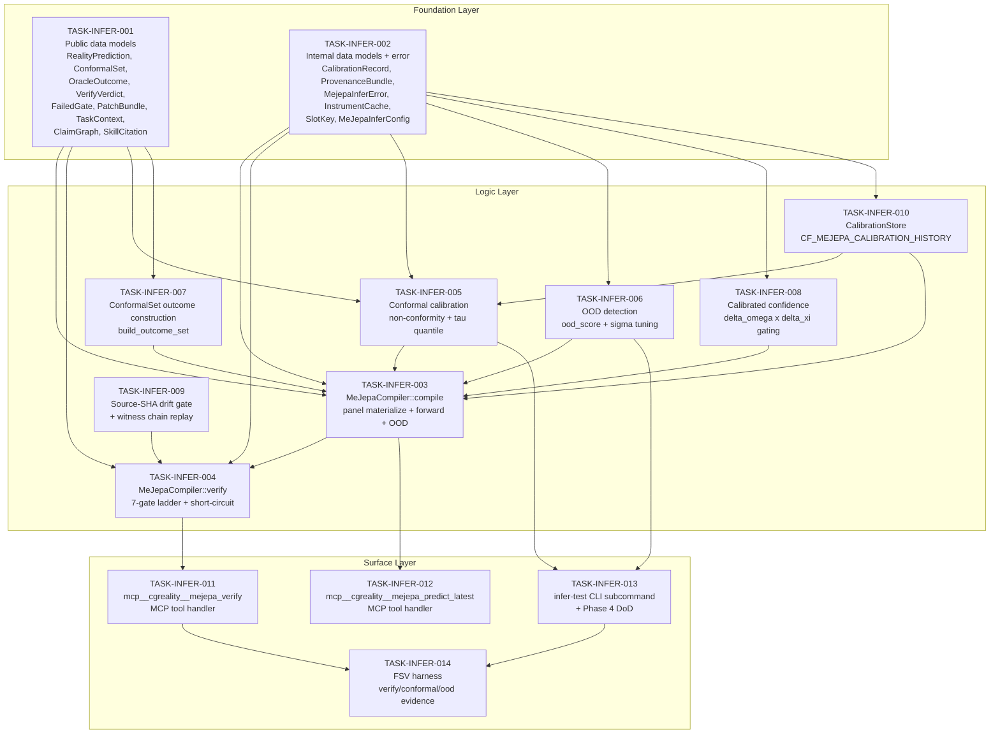

# Phase 4a — INFERENCE Task Index

> **📊 2026-05-10 STATUS — SHIPPED.** `MeJepaCompiler::{compile, compile_with_panel, verify, observe}` + conformal interval + OOD detection + `Verdict::{Pass, Fail, OutOfDistribution, Abstain, GuardRejected}` in `crates/context-graph-mejepa/`. MCP tool `mcp__cgreality__mejepa_verify` live. `inference_fsv` example. Authoritative status: ../../implementation-plan.md Phase 4a.

> **Level 4.** Atomic task specifications for the **INFERENCE domain** (Phase 4a: `MeJepaCompiler::compile/verify`, conformal calibration, OOD detection, ΔΩ × ΔΞ multiplicative gating, 7-gate verify ladder, MCP tools, CLI). Authority order: `../../constitution.md` (Level 1) > `../../functional/SPEC-INFERENCE.md` (Level 2) > `../../technical/TECH-INFERENCE.md` (Level 3) > this file (Level 4). Each task is one conceptual change shippable end-to-end with FSV evidence per `docs2/prdtospec.md` §4.

## Phase scope

Implements all 20 functional REQ-INFER-NN requirements (cross-linked in `../_traceability.md` under `### INFERENCE`) and all 4 component contracts (`MeJepaCompiler`, `CalibrationStore`, `InstrumentCache`, `MejepaInferError`) in `../../technical/TECH-INFERENCE.md`. Foundation -> Logic -> Surface ordering enforced; Iron Rule applies (no task references files created by a later task).

**Cross-cutting note:** Phase 4a (INFERENCE) calls into Phase 4b (TCT-CONSTELLATION) at Gate 7 via the surface contract `Verdict::ConstellationGuardRejected`. Until SPEC-TCT ships, `ConstellationGuard` is a `MockedAlwaysApprove` plus a `provenance_warnings: ["constellation_unavailable"]` flag. Once TCT ships (`crates/context-graph-mejepa-tct/`), the mock is replaced with the real Gτ test — no API change required.

---

## Overview

- **Total tasks:** 14
- **Foundation layer:** 2 tasks (TASK-INFER-001..002)
- **Logic layer:** 8 tasks (TASK-INFER-003..010)
- **Surface layer:** 4 tasks (TASK-INFER-011..014)
- **Estimated walltime:** ~3-5 days end-to-end (per master plan Phase 4 budget)
- **Crate created:** `crates/context-graph-mejepa/` (NEW)
- **Crate touched (handler wrapper):** `crates/context-graph-mcp/`

---

## Dependency DAG



---

## Execution order (sequential)

| # | Task ID | Title | Layer | Depends on | Status |
|---|---|---|---|---|---|
| 1 | TASK-INFER-001 | Public inference data models (RealityPrediction, ConformalSet, OracleOutcome, VerifyVerdict, FailedGate, PatchBundle, TaskContext, ClaimGraph, SkillCitation) | foundation | (Phase 1c shipped) | ready |
| 2 | TASK-INFER-002 | Internal data models + error taxonomy (CalibrationRecord, ProvenanceBundle, MejepaInferError, InstrumentCache, SlotKey, MeJepaInferConfig) | foundation | 001 | ready |
| 3 | TASK-INFER-003 | MeJepaCompiler::compile (panel materialization + predictor forward + Oracle head + conformal set + OOD score + Granger attestations) | logic | 002, 005, 006, 007, 008, 010 | blocked (needs PREDICTOR + TRAINING) |
| 4 | TASK-INFER-004 | MeJepaCompiler::verify (7-gate ladder: SourceShaDrift, WitnessChainBroken, OOD, PredictedFailure, LowConfidence, GrangerRejection, ConstellationGuardRejected) | logic | 003, 009 | blocked |
| 5 | TASK-INFER-005 | Conformal calibration (non-conformity score + (1-α) quantile threshold + sigma tuning entry-point) | logic | 002, 010 | blocked |
| 6 | TASK-INFER-006 | OOD detection (`ood_score = 1 - exp(-||g_φ − f_ξ||² / σ²)`; σ² tuned so calibration < 0.30) | logic | 002, 010 | blocked |
| 7 | TASK-INFER-007 | ConformalSet outcome construction (`{outcomes : non_conformity_score(outcome) ≤ τ}`) | logic | 001, 005 | ready (after 005) |
| 8 | TASK-INFER-008 | Calibrated confidence widening by ΔΩ_mean × ΔΞ_mean (degraded-state fail-closed) | logic | 002 | blocked (reads CF_MEJEPA_TRAIN_CERTS) |
| 9 | TASK-INFER-009 | Source-SHA drift gate (claimed pre/post SHAs match disk) + witness chain replay | logic | 002 | ready (after 002) |
| 10 | TASK-INFER-010 | CalibrationStore (CF_MEJEPA_CALIBRATION_HISTORY persist + load_active + recompute_sliding_window) | logic | 002 | ready (after 002) |
| 11 | TASK-INFER-011 | mcp__cgreality__mejepa_verify MCP tool (with include_provenance flag) | surface | 004 | blocked |
| 12 | TASK-INFER-012 | mcp__cgreality__mejepa_predict_latest MCP tool | surface | 003 | blocked |
| 13 | TASK-INFER-013 | CLI subcommand `infer-test` (Phase 4 DoD: stated 0.90, empirical 0.88-0.92, p50<100ms, OOD AUC>0.85) | surface | 005, 006, 010 | blocked |
| 14 | TASK-INFER-014 | FSV harness (verify-evidence.json, conformal-calibration-evidence.json, ood-evidence.json, latency-histogram.json) | surface | 011, 013 | blocked |

**Status legend:** `ready` (can start now); `blocked` (waits on a prior task or upstream Phase 2/3 deliverable). Phase 4a is fully blocked until Phase 2 (predictor) + Phase 3 (training loop) ship; this index is the implementation plan once those land.

---

## Parallel-execution batches

- **Batch F.1** (foundation, parallel-safe): TASK-INFER-001 alone (data-model file).
- **Batch F.2** (foundation, depends on F.1): TASK-INFER-002 (internal types + error).
- **Batch L.1** (logic, depends on F.2 + Phase 3 cert stream): TASK-INFER-008, TASK-INFER-009, TASK-INFER-010 — three independent helpers.
- **Batch L.2** (logic, depends on F.2 + L.1): TASK-INFER-005, TASK-INFER-006 — calibration + OOD against CalibrationStore.
- **Batch L.3** (logic, depends on L.2): TASK-INFER-007 — outcome-set builder.
- **Batch L.4** (logic, depends on L.1 + L.2 + L.3 + Phase 2 predictor + TCT mock): TASK-INFER-003 (compile).
- **Batch L.5** (logic, depends on L.4): TASK-INFER-004 (verify gate ladder).
- **Batch S.1** (surface, depends on L.5): TASK-INFER-011, TASK-INFER-012 (MCP tools).
- **Batch S.2** (surface, depends on L.2 + L.4 + L.1): TASK-INFER-013 (CLI).
- **Batch S.3** (surface, depends on S.1 + S.2): TASK-INFER-014 (FSV).

---

## Critical path

```
TASK-INFER-001 -> TASK-INFER-002 -> TASK-INFER-010 -> TASK-INFER-005 -> TASK-INFER-003 -> TASK-INFER-004 -> TASK-INFER-011 -> TASK-INFER-014
```

The conformal calibration (005) gates the predictor head (003) which gates the verify ladder (004) which gates the MCP surface (011) which gates FSV evidence (014). Anchor scheduling on TASK-INFER-005 once the calibration split is delivered by SPEC-CORPUS.

---

## Cross-domain dependencies

- **PREDICTOR (Phase 2)**: provides `Arc<Predictor>`, `Arc<FrozenTarget>`, `Arc<OracleHead>` consumed by `MeJepaCompiler::new()` (TASK-INFER-002 reserves the field shapes).
- **TRAINING (Phase 3)**: produces per-step training certificates in `CF_MEJEPA_TRAIN_CERTS` consumed by TASK-INFER-008 for ΔΩ × ΔΞ runtime gating.
- **INSTRUMENTS (Phase 1c)**: provides the `Instrument` trait + `Panel`/`PanelBuilder` + 15 slot encoders consumed by panel materialization in TASK-INFER-003. Already shipped (deterministic encoders); neural backings replace transparently.
- **EMBEDDERS (Phase 1b)**: provides 21 frozen embedders + per-embedder weight SHA-256 digests consumed by `ProvenanceBundle.embedder_versions` in TASK-INFER-002 / TASK-INFER-011 (when `include_provenance: true`).
- **CORPUS (Phase 0)**: provides the calibration split in `./data/mejepa-corpus/calibration` consumed by TASK-INFER-013 CLI; provides `OracleVerdict` + `OracleOutcome` re-export consumed by TASK-INFER-001.
- **TCT (Phase 4b)**: provides `ConstellationGuard::gtau_test()` consumed at Gate 7 in TASK-INFER-004. Until shipped, `MockedAlwaysApprove` returns approve + warning.
- **WITNESS (shipped)**: provides `verify_chain_bytes` + `WITNESS_ENTRY_SIZE` consumed by Gate 5 (WitnessChainBroken) in TASK-INFER-009.
- **SOLVER (shipped)**: provides Granger F-test (`granger.rs`) consumed at Gate 4 (GrangerRejection) in TASK-INFER-003 / TASK-INFER-004.

---

## Coverage roll-up

Every functional REQ-INFER-NN (20 total) and every component contract (4 in TECH-INFERENCE) maps to at least one task in this index. Coverage tracking is in `../_traceability.md`.

| REQ | Title | Task ID(s) |
|---|---|---|
| REQ-INFER-01 | MeJepaCompiler impl block (compile/verify/observe signatures) | TASK-INFER-003, TASK-INFER-004 |
| REQ-INFER-02 | RealityPrediction struct shape + invariants | TASK-INFER-001 |
| REQ-INFER-03 | VerifyVerdict {Approve, EscalateToHuman} enum | TASK-INFER-001 |
| REQ-INFER-04 | FailedGate 7 variants | TASK-INFER-001 |
| REQ-INFER-05 | PatchBundle + TaskContext shape | TASK-INFER-001 |
| REQ-INFER-06 | Conformal calibration (non-conformity + (1-α) quantile) | TASK-INFER-005, TASK-INFER-010 |
| REQ-INFER-07 | OOD detection formula + σ tuning | TASK-INFER-006 |
| REQ-INFER-08 | ΔΩ × ΔΞ multiplicative gating of confidence | TASK-INFER-008 |
| REQ-INFER-09 | Gate 1 OutOfDistribution | TASK-INFER-006, TASK-INFER-004 |
| REQ-INFER-10 | Gate 2 PredictedFailure | TASK-INFER-003, TASK-INFER-004 |
| REQ-INFER-11 | Gate 3 LowConfidence | TASK-INFER-007, TASK-INFER-004 |
| REQ-INFER-12 | Gate 4 GrangerRejection | TASK-INFER-003, TASK-INFER-004 |
| REQ-INFER-13 | Gate 5 WitnessChainBroken | TASK-INFER-009 |
| REQ-INFER-14 | Gate 6 SourceShaDrift | TASK-INFER-009 |
| REQ-INFER-15 | Gate 7 ConstellationGuardRejected (cross-cut TCT) | TASK-INFER-004 (mock until TCT ships) |
| REQ-INFER-16 | mcp__cgreality__mejepa_verify | TASK-INFER-011 |
| REQ-INFER-17 | Fail-closed error taxonomy + .code() + log_context | TASK-INFER-002 |
| REQ-INFER-18 | Performance budgets (p50<100ms, p99<500ms, AUC>0.85, coverage±2%) | TASK-INFER-013, TASK-INFER-014 |
| REQ-INFER-19 | CF_MEJEPA_LIVE_PREDICTIONS persist + mejepa_predict_latest | TASK-INFER-012 |
| REQ-INFER-20 | Phase 4 DoD verification command | TASK-INFER-013 |

| Tech component | Layer | Task ID |
|---|---|---|
| MeJepaCompiler | logic | TASK-INFER-003, TASK-INFER-004 |
| CalibrationStore | logic | TASK-INFER-010 |
| InstrumentCache | foundation | TASK-INFER-002 |
| MejepaInferError | foundation | TASK-INFER-002 |

---

## Authority cross-reference

- Functional spec: `../../functional/SPEC-INFERENCE.md`
- Technical spec: `../../technical/TECH-INFERENCE.md`
- Constitution: `../../constitution.md`
- Master traceability: `../_traceability.md`
- Predecessor phases: `../phase2-predictor/`, `../phase3-training/`, `../utml-learning-formula/`
- Cross-cutting domain: `../phase4-tct-constellation/_index.md` (Gate 7)
- Successor phase: `../phase5-self-healing/` (consumes RealityPrediction.confidence)
- Architectural sources: `docs/ruvectorfindings/09_END_GOAL_REVIEW_REPLACEMENT.md` §1.3, §4.1-4.3, §7 Phase 4; `docs/ruvectorfindings/10_MEJEPA_PIVOT_2026_05_09.md` §B, §F priority #7; `docs/ruvectorfindings/11_MEJEPA_LEARNING_FORMULA.md` §12
- Memory: `memory/decisions/2026-05-09--single-loop-claude-code-actor-mejepa-data-factory.md`
