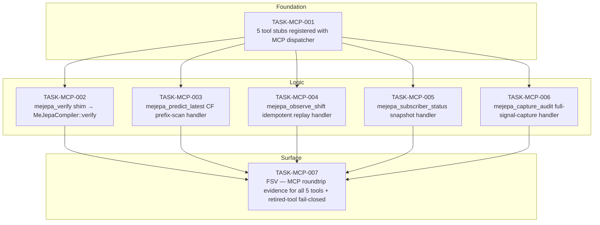

# Phase 7 — MCP Tools Task Index

> **📊 2026-05-10 STATUS — partial.** Live ME-JEPA MCP tools: `mejepa_verify`, `mejepa_predict_latest`, `mejepa_constellation_inspect`, `mejepa_heal_status`, `mejepa_rollback_to`, `mejepa_load_learner_state`, `mejepa_routing_lookup`, `mejepa_vram_budget_report`. Pending: `mejepa_observe_shift`, `mejepa_subscriber_status`, `mejepa_capture_audit`, `mejepa_gc_run`, `mejepa_quota_status`, `mejepa_witness_compress`, `mejepa_eval_run`, `mejepa_eval_ship_gate_status`, `mejepa_active_learning_queue`, `mejepa_active_learning_label`. Authoritative status: ../../implementation-plan.md Phase 7.

> **Domain:** SHIFT-SUBSCRIBER (Phase 7 — 5 new `mcp__cgreality__mejepa_*` MCP tools)
>
> **Authority:**
> - `../../constitution.md` (`<mcp_tool_namespace_lock>`)
> - `../../functional/SPEC-SHIFT-SUBSCRIBER.md` (REQ-SHIFT-07, REQ-SHIFT-10..13)
> - `../../technical/TECH-SHIFT-SUBSCRIBER.md` (5 MCP tool component contracts)
>
> **Crate:** `crates/context-graph-mcp/src/handlers/tools/mejepa/` (NEW handler tree)
>
> **Cross-cutting:**
> - `mejepa_verify` body owned by SPEC-INFERENCE; this domain wires the MCP shim only
> - `mejepa_observe_shift` calls into `ShiftSubscriber::process_shift` (sister phase phase7-shift-subscriber)
> - `mejepa_capture_audit` reads from CFs populated by sister phase
> - `mejepa_subscriber_status` reads `SubscriberMetrics` from sister phase
> - Retired `reality_run_attempt` and friends MUST emit fail-closed `CCREALITY_ENGINE_RETIRED`

---

## Overview

- **Total Tasks:** 7
- **Foundation:** 1 task (TASK-MCP-001)
- **Logic:** 5 tasks (TASK-MCP-002..006, one per tool)
- **Surface:** 1 task (TASK-MCP-007 — FSV roundtrip)
- **Sister phase:** `../phase7-shift-subscriber/` (14 tasks for the Tokio subscriber + watermark + data models)

---

## Dependency Graph



---

## Execution Order

| # | Task ID | Title | Layer | Depends On (this phase) | Cross-phase Depends | Status |
|---|---------|-------|-------|--------------------------|----------------------|--------|
| 1 | TASK-MCP-001 | Register 5 mejepa_* tool stubs with the MCP handler dispatcher | foundation | — | TASK-SHIFT-003 (retired surfaces fail closed) | ready |
| 2 | TASK-MCP-002 | `mejepa_verify` MCP shim — wires SPEC-INFERENCE body | logic | 001 | sister TASK-SHIFT-007 (subscriber state snapshot) | ready |
| 3 | TASK-MCP-003 | `mejepa_predict_latest` — most recent live prediction for active session | logic | 001 | sister TASK-SHIFT-007 (CF_MEJEPA_LIVE_PREDICTIONS writer) | ready |
| 4 | TASK-MCP-004 | `mejepa_observe_shift` — idempotent specific-shift consumption | logic | 001 | sister TASK-SHIFT-007, TASK-SHIFT-011 | ready |
| 5 | TASK-MCP-005 | `mejepa_subscriber_status` — watermark + lag + error rate + cache hit rate | logic | 001 | sister TASK-SHIFT-002 (Metrics types), TASK-SHIFT-008 | ready |
| 6 | TASK-MCP-006 | `mejepa_capture_audit` — full signal capture for an attempt | logic | 001 | sister TASK-SHIFT-002 (CaptureAuditBundle type), TASK-SHIFT-007 | ready |
| 7 | TASK-MCP-007 | FSV: MCP roundtrip test for each of the 5 tools + retired-tool round-trip | surface | 002, 003, 004, 005, 006 | sister TASK-SHIFT-013 | ready |

---

## Status Legend

- ready — Can be started now
- in_progress — Currently being worked on
- complete — Finished and verified
- blocked — Waiting on dependencies
- failed — Needs revision

---

## Critical Path

```
TASK-MCP-001 → (TASK-MCP-002..006 in any order) → TASK-MCP-007
```

## Parallel Opportunities

- **Batch 1 (after 001):** TASK-MCP-002, TASK-MCP-003, TASK-MCP-004, TASK-MCP-005, TASK-MCP-006 (all 5 tool handlers are independent of each other)

---

## Layer Distribution

- Foundation: 1 / 7 (14 %)
- Logic:      5 / 7 (72 %)
- Surface:    1 / 7 (14 %)

---

## MCP namespace lock

All 5 new tools land under `mcp__cgreality__mejepa_*` per constitution `<mcp_tool_namespace_lock>`. The retired `mcp__cgreality__reality_run_attempt`, `reality_alter_*`, and any pre-pivot harness-write surfaces MUST remain fail-closed with `CCREALITY_ENGINE_RETIRED` (no compatibility shims, no aliasing) — the wiring is owned by sister TASK-SHIFT-003 and verified by TASK-MCP-007.
