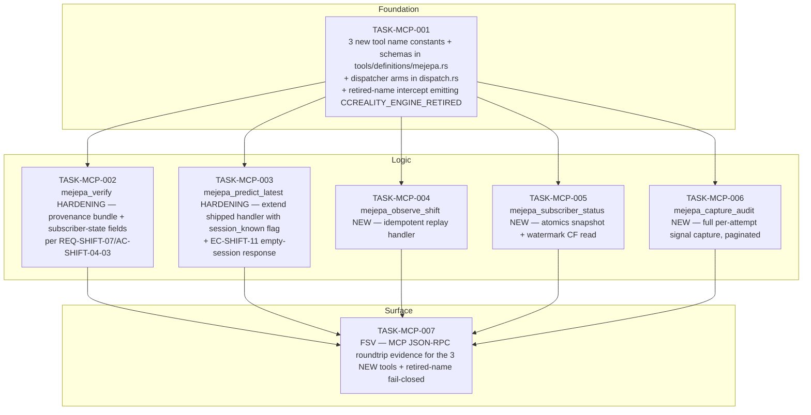

# Phase 7 — MCP Tools Task Index

> **📊 2026-05-11 STATUS — partial.** **8 ME-JEPA MCP tools shipped, 3 Phase 7 tools pending.**
>
> **Shipped (live in `crates/context-graph-mcp/src/handlers/tools/mejepa_tools.rs` and `embedder_tools.rs`):** `mcp__cgreality__mejepa_verify`, `mcp__cgreality__mejepa_predict_latest`, `mcp__cgreality__mejepa_constellation_inspect`, `mcp__cgreality__mejepa_heal_status`, `mcp__cgreality__mejepa_rollback_to`, `mejepa_load_learner_state`, `mejepa_routing_lookup`, `mejepa_vram_budget_report`. Phase 6 hygiene tools shipped: `mcp__cgreality__mejepa_gc_run`, `mcp__cgreality__mejepa_quota_status`, `mcp__cgreality__mejepa_witness_compress` (in `mejepa_hygiene_tools.rs`).
>
> **Pending Phase 7 (this directory):** `mcp__cgreality__mejepa_observe_shift`, `mcp__cgreality__mejepa_subscriber_status`, `mcp__cgreality__mejepa_capture_audit`. Plus a tiny `RetiredToolHandler` shim that returns `CCREALITY_ENGINE_RETIRED` for any pre-pivot tool name (the prior wholesale deletion left no shim, so retired-name calls today fall through to a generic "method not found" — a regression against constitution `<mcp_tool_namespace_lock>`).
>
> **Authoritative shipping table:** `../../implementation-plan.md` Phase 7 row.

> **Domain:** PHASE-7-MCP-TOOLS (3 new + 1 hardening tools, plus FSV roundtrip)
>
> **Authority:**
> - `../../constitution.md` (`<mcp_tool_namespace_lock>`, `<failure_taxonomy>` `CCREALITY_ENGINE_RETIRED`)
> - `../../functional/SPEC-SHIFT-SUBSCRIBER.md` (REQ-SHIFT-07 register tools, REQ-SHIFT-10 capture-audit, REQ-SHIFT-11 observe-shift, REQ-SHIFT-12 subscriber-status, REQ-SHIFT-13 retired-tool fail-closed)
> - `../../technical/TECH-SHIFT-SUBSCRIBER.md` (`<api_contracts>` `<component_contracts>` for the 4 handlers and the retired-shim)
>
> **Crate (chosen path — Occam's razor):** `crates/context-graph-mcp/src/handlers/tools/mejepa_tools.rs` (FLAT FILE, append new handlers next to existing ones). The previously-specified `crates/context-graph-mcp/src/handlers/tools/mejepa/` sub-module tree was NEVER created — the workspace evolved into the flat-file pattern (cf. shipped `mejepa_tools.rs` 838 lines, `mejepa_hygiene_tools.rs` 106 lines). Stay in the flat pattern unless an operator-approved refactor lands first.
>
> **Cross-cutting:**
> - `mejepa_verify` is SHIPPED today; this directory does NOT re-implement it
> - `mejepa_observe_shift` calls into `ShiftSubscriber::process_shift` (sister phase phase7-shift-subscriber TASK-SHIFT-007)
> - `mejepa_capture_audit` reads from CFs populated by sister phase tasks 007/011
> - `mejepa_subscriber_status` reads `SubscriberMetrics` populated by sister phase tasks 002/010
> - The retired-tool shim is mandated by REQ-SHIFT-13 + constitution `<mcp_tool_namespace_lock>` and is owned partly by sister TASK-SHIFT-003 (taxonomy) and partly by this phase (dispatcher fall-through emitter)

---

## Codebase reality (verified 2026-05-11 by reading source)

| Question | Answer (audit) |
|---|---|
| Where do shipped `mejepa_*` handlers live? | Flat file `crates/context-graph-mcp/src/handlers/tools/mejepa_tools.rs` (838 lines, 5 handlers); `mejepa_hygiene_tools.rs` (106 lines, 3 Phase 6 handlers); `embedder_tools.rs` lines ~1753-1840 (3 handlers). |
| Where do `MEJEPA_*` tool-name constants live? | `crates/context-graph-mcp/src/tools/names.rs` lines 96-114. **Each constant holds the FULLY-NAMESPACED wire string** (e.g. `MEJEPA_PREDICT_LATEST = "mcp__cgreality__mejepa_predict_latest"`). There is NO separate dispatcher prefix added at runtime. New tools MUST follow this convention exactly. |
| Where is the dispatcher match arm? | `crates/context-graph-mcp/src/handlers/tools/dispatch.rs` lines 191-218 enumerate every `tool_names::MEJEPA_*` arm. New tools land here as `tool_names::<NEW_NAME> => call_<new_name>(arguments),`. |
| Where do tool DEFINITIONS (JSON-Schema) live? | `crates/context-graph-mcp/src/tools/definitions/mejepa.rs` (149 lines). Add new schemas here. |
| Does `crates/context-graph-mcp/src/handlers/tools/reality_loop/retired.rs` exist? | **No.** Retired surfaces (`reality_run_attempt`, `reality_alter_*`, `reality-loop` binary) were deleted wholesale in commits 4072dcf3 / d48102e6. **No `CCREALITY_ENGINE_RETIRED` literal exists anywhere in the MCP source today.** Calls to retired names currently fall through to the generic unknown-tool branch — this is a regression against constitution. The fix is small: add a single intercept in `dispatch.rs` (or a tiny `retired_tools.rs`) that recognizes the retired name set and emits `CCREALITY_ENGINE_RETIRED` with the constitution-mandated payload BEFORE the unknown-tool branch. |
| What is the `session_id` contract on shipped `mejepa_predict_latest`? | **Hex-32 string decoding to `[u8; 16]`** (per `mejepa_tools.rs:169-185`). Stricter than the SPEC's "up to 64 chars UTF-8" — the codebase wins per CLAUDE.md "trust the code over memory when they conflict". New tools (`mejepa_observe_shift`, `mejepa_subscriber_status`, `mejepa_capture_audit`) consuming `session_id` MUST use the same hex-32 contract. |
| What CFs are already declared and ready? | `context-graph-mejepa-cf::lib.rs` declares all required CFs: `CF_MEJEPA_SHIFT_WATERMARK`, `CF_MEJEPA_LIVE_PREDICTIONS`, `CF_MEJEPA_TRAIN_CERTS`, `CF_MEJEPA_ORACLE_VERDICTS`, `CF_MEJEPA_PANEL_CACHE`, `CF_MEJEPA_PANEL_META`. **No new CF needs creation in this phase.** |
| Is the `MejepaStore` trait wired? | Yes. `crates/context-graph-mejepa/src/compiler.rs:127` defines `pub trait MejepaStore` with `write_live_prediction` + `read_live_predictions`. `RocksDbInferStore` (in `store.rs`) is the implementation new handlers should use. |
| Is the shift-log producer SHIPPED? | Yes. `crates/context-graph-mcp/src/handlers/tools/reality_loop/shift_log.rs` (252 lines) produces JSONL into `<runtime_root>/cgreality-shift-log/<session_id>.jsonl` and serves the `reality_shift_log` reader tool. The `ShiftRecord` schema is the truth-source for `ShiftEntry` shape — sister phase TASK-SHIFT-001 lifts the same fields. |

---

## Overview

- **Total Tasks:** 7
- **Foundation:** 1 (TASK-MCP-001 — name constants + schemas + dispatcher wiring + retired-shim intercept)
- **Logic:** 5 (TASK-MCP-002..006 — one per tool body, but TASK-MCP-002 is now a HARDENING-ONLY task because `mejepa_verify` already ships)
- **Surface:** 1 (TASK-MCP-007 — FSV MCP roundtrip evidence for the new tools + retired-name fail-closed regression)
- **Sister phase:** `../phase7-shift-subscriber/` (14 tasks for the Tokio subscriber + watermark + data models the handlers read from)

---

## Dependency Graph



---

## Execution Order

| # | Task ID | Title | Layer | Depends On (this phase) | Cross-phase Depends | Status |
|---|---------|-------|-------|--------------------------|----------------------|--------|
| 1 | TASK-MCP-001 | Add 3 NEW `MEJEPA_*` name constants + 3 schemas + 3 dispatcher arms + retired-name intercept | foundation | — | sister TASK-SHIFT-003 (`SubscriberError::EngineRetired{..}` taxonomy contributes the payload shape; if SHIFT-003 not shipped yet, inline a minimal `serde_json::json!` payload here and refactor later) | ready |
| 2 | TASK-MCP-002 | `mejepa_verify` HARDENING — extend shipped handler to attach `last_consumed_shift_id` + `subscriber_lag_at_call_time` + provenance bundle when `include_provenance: true` | logic | 001 | sister TASK-SHIFT-007 (subscriber metrics snapshot reachable via Arc), TASK-SHIFT-010 (subscriber alive) | ready |
| 3 | TASK-MCP-003 | `mejepa_predict_latest` HARDENING — add `session_known: bool` to response and ensure empty-session returns `{predictions: [], session_known: false}` per EC-SHIFT-11 | logic | 001 | sister TASK-SHIFT-007 (writer side already shipped via `MejepaStore::write_live_prediction`) | ready |
| 4 | TASK-MCP-004 | `mejepa_observe_shift` NEW — accept `{shift_id}`, locate via SubscriberIndex, dispatch `process_shift(replay: true)`, NEVER advance watermark backward | logic | 001 | sister TASK-SHIFT-007 (`process_shift` body), TASK-SHIFT-011 (EWC++ replay tolerance) | ready |
| 5 | TASK-MCP-005 | `mejepa_subscriber_status` NEW — accept no args, snapshot atomics + read CF_MEJEPA_SHIFT_WATERMARK + RSS, return `LiveSubscriberStatus` | logic | 001 | sister TASK-SHIFT-002 (`SubscriberMetrics` struct), TASK-SHIFT-008 (watermark reader) | ready |
| 6 | TASK-MCP-006 | `mejepa_capture_audit` NEW — accept `{attempt_id, page?}`, load panels + predictions + verdicts + certs + counterfactuals, paginate when > 1 MiB | logic | 001 | sister TASK-SHIFT-002 (`CaptureAuditBundle`), TASK-SHIFT-007 (writers) | ready |
| 7 | TASK-MCP-007 | FSV: `mejepa_phase7_mcp_roundtrip_fsv` example writes evidence at `/tmp/contextgraph-mejepa-phase7-mcp-fsv/` for each of the 3 NEW tools (happy path + 3 edge cases each) and one `CCREALITY_ENGINE_RETIRED` round-trip | surface | 002, 003, 004, 005, 006 | sister TASK-SHIFT-013 (subscriber FSV provides fixture data) | ready |

---

## Status Legend

- ready — Can be started now (dependency tree satisfied OR dependency may be stubbed locally)
- in_progress — Currently being worked on
- complete — Finished and verified with FSV evidence
- blocked — Waiting on a hard cross-phase dependency
- failed — Needs revision

---

## Critical Path

```
TASK-MCP-001 (constants + schemas + dispatcher + retired-shim)
  → TASK-MCP-{002, 003, 004, 005, 006} (5-way parallel)
  → TASK-MCP-007 (FSV)
```

## Parallel Opportunities

- **Batch 1 (after 001):** TASK-MCP-{002, 003, 004, 005, 006} are independent of each other (each touches a different handler); spawn five workers to ship in parallel.
- TASK-MCP-002 and TASK-MCP-003 are HARDENING-only and need no sister-phase work; they can start the moment 001 lands.
- TASK-MCP-004/005/006 need their sister TASK-SHIFT-* foundation work for the cross-cutting types (`SubscriberMetrics`, `CaptureAuditBundle`, `process_shift`); start them after sister TASK-SHIFT-002 and -007 land OR stub the sister types locally and refactor when SHIFT lands.

---

## Layer Distribution

- Foundation: 1 / 7 (14 %)
- Logic:      5 / 7 (72 %)
- Surface:    1 / 7 (14 %)

---

## MCP namespace lock + retired-tool fail-closed

All 3 new tools land under `mcp__cgreality__mejepa_*` per constitution `<mcp_tool_namespace_lock>`. The retired set MUST emit `CCREALITY_ENGINE_RETIRED` with the constitution-mandated payload. Authoritative retired-name list (from doc 10 + constitution + memory):

```
mcp__cgreality__reality_run_attempt
mcp__cgreality__reality_alter_file
mcp__cgreality__reality_alter_run
mcp__cgreality__reality_alter_apply
mcp__cgreality__reality_drip_attempt
```

**Today these names hit the dispatcher's unknown-tool branch and emit a generic `tools/list` error.** This is a regression against the constitution — TASK-MCP-001 fixes it via a small intercept BEFORE the unknown-tool fall-through, and TASK-MCP-007 verifies via roundtrip FSV. NO compatibility shim. NO subprocess spawn. NO aliasing to a new tool.

---

## Hard rules (apply to every task in this directory)

1. **No backwards compatibility.** No migration shim. Schema changes wipe + recreate. Synthetic data only.
2. **No mock data in tests.** Use real `RocksDbInferStore` against a tempdir. Tests must FAIL when the system is broken.
3. **Fail closed with structured `MEJEPA_*` codes.** No `unwrap_or` defaults on confidence/quota/correlation/signature/chain-integrity paths.
4. **Robust error logging.** Every fail-path emits `tracing::error!` with `code = "MEJEPA_*"` + actionable context (which CF, which key, which file SHA, which byte offset).
5. **Files under 500 lines.** `mejepa_tools.rs` is at 838 today; if your new handler pushes it past 1500, split BEFORE shipping.
6. **`additionalProperties: false`** on every JSON-Schema object node (recursive); `#[serde(deny_unknown_fields)]` on every Args DTO. Both layers are required (audit-9 lesson).
7. **Tool names are FULLY-NAMESPACED constants** in `tools/names.rs` (e.g. `pub const MEJEPA_OBSERVE_SHIFT: &str = "mcp__cgreality__mejepa_observe_shift";`).
8. **Full State Verification (FSV) is mandatory** — every task ships FSV evidence under `/tmp/contextgraph-mejepa-phase7-mcp-fsv/<task-id>/`; readback verifies the persisted state, not the return value.
