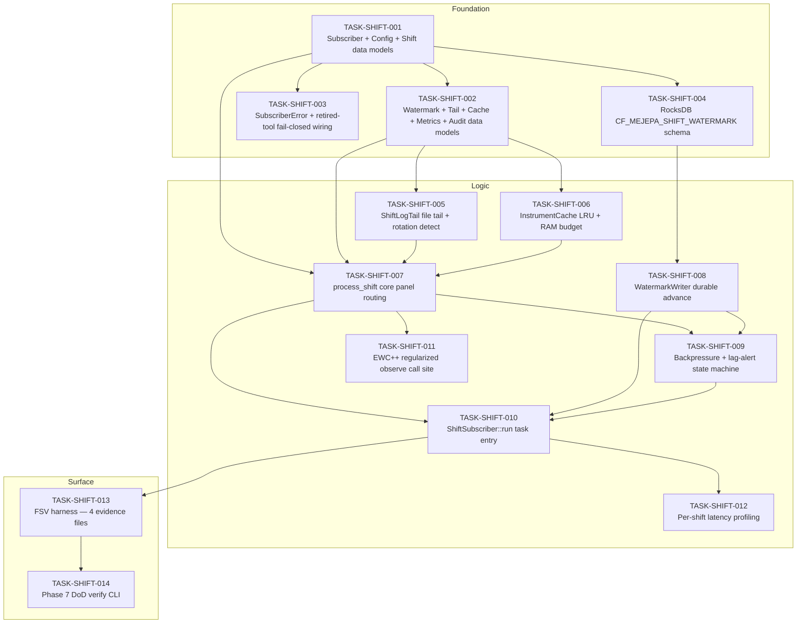

# Phase 7 — Shift-Subscriber Task Index

> **Domain:** SHIFT-SUBSCRIBER (Phase 7 — Tokio shift-log subscriber + watermark + cross-cutting wiring)
>
> **Authority:**
> - `../../constitution.md` (`<reality_loop_contract>` + `<mcp_tool_namespace_lock>`)
> - `../../functional/SPEC-SHIFT-SUBSCRIBER.md` (18 REQ-SHIFT-NN)
> - `../../technical/TECH-SHIFT-SUBSCRIBER.md` (10 components)
>
> **Crate:** `crates/context-graph-mejepa-shift-subscriber/` (NEW)
>
> **Cross-cutting:**
> - `observe()` body owned by SPEC-SELF-HEALING; this domain wires the call site
> - `predict()` / `verify()` body owned by SPEC-INFERENCE; this domain wires the MCP shim + call site
> - Per-step training cert format owned by SPEC-TRAINING; this domain writes via `train_cert_writer`
> - LRU eviction policy owned by SPEC-HYGIENE; this domain implements the cache mechanism
> - Corpus persistence owned by SPEC-CORPUS; this domain calls `oracle_writer.append`

---

## Overview

- **Total Tasks:** 14
- **Foundation:** 4 tasks (TASK-SHIFT-001..004)
- **Logic:** 8 tasks (TASK-SHIFT-005..012)
- **Surface:** 2 tasks (TASK-SHIFT-013..014)
- **Sister phase:** `../phase7-mcp-tools/` (7 tasks for the 5 new `mcp__cgreality__mejepa_*` tools)

---

## Dependency Graph



---

## Execution Order

| # | Task ID | Title | Layer | Depends On | Status |
|---|---------|-------|-------|------------|--------|
| 1 | TASK-SHIFT-001 | ShiftSubscriber + Config + ShiftEntry/ShiftSide/ShiftId/SessionId/ShiftOutcome/SkipReason data models | foundation | — | ready |
| 2 | TASK-SHIFT-002 | WatermarkRecord + ShiftLogTail + InstrumentCache/SlotKey + SubscriberMetrics + UtmlFactorBundle + CaptureAuditBundle + LiveSubscriberStatus + PanicInfo data models | foundation | 001 | ready |
| 3 | TASK-SHIFT-003 | SubscriberError taxonomy + retired-tool CCREALITY_ENGINE_RETIRED fail-closed wiring | foundation | 001 | ready |
| 4 | TASK-SHIFT-004 | RocksDB CF_MEJEPA_SHIFT_WATERMARK schema + per-shift cert key layout | foundation | 001 | ready |
| 5 | TASK-SHIFT-005 | ShiftLogTail line-buffered reader + rotation detector + resume-from-offset | logic | 002 | ready |
| 6 | TASK-SHIFT-006 | InstrumentCache 4 GB LRU + per-instrument hit/miss metrics | logic | 002 | ready |
| 7 | TASK-SHIFT-007 | ShiftSubscriber::process_shift — panel materialize → predict/observe routing | logic | 001, 002, 005, 006 | ready |
| 8 | TASK-SHIFT-008 | WatermarkWriter durable, idempotent, restart-safe advance | logic | 004 | ready |
| 9 | TASK-SHIFT-009 | Backpressure + lag-alert state machine (>500/>60s) | logic | 007, 008 | ready |
| 10 | TASK-SHIFT-010 | ShiftSubscriber::run — Tokio task entry point (1 CPU + 512 MB RSS) | logic | 007, 008, 009 | ready |
| 11 | TASK-SHIFT-011 | EWC++-regularized observe() call site (idempotent against duplicate/out-of-order) | logic | 007 | ready |
| 12 | TASK-SHIFT-012 | Per-shift latency profiling (p50 < 5s cached, p99 < 30s cold) | logic | 010 | ready |
| 13 | TASK-SHIFT-013 | FSV harness writing 4 evidence files at /tmp/contextgraph-mejepa-shift-subscriber-fsv/ | surface | 010 | ready |
| 14 | TASK-SHIFT-014 | Phase 7 DoD `verify` CLI under context-graph-mejepa | surface | 013 | ready |

---

## Status Legend

- ready — Can be started now
- in_progress — Currently being worked on
- complete — Finished and verified
- blocked — Waiting on dependencies
- failed — Needs revision

---

## Critical Path

```
TASK-SHIFT-001 → TASK-SHIFT-002 → TASK-SHIFT-005 → TASK-SHIFT-007
              → TASK-SHIFT-009 → TASK-SHIFT-010 → TASK-SHIFT-013 → TASK-SHIFT-014
```

## Parallel Opportunities

- **Batch 1 (after 001):** TASK-SHIFT-002, TASK-SHIFT-003, TASK-SHIFT-004 (independent foundation extensions)
- **Batch 2 (after 002):** TASK-SHIFT-005, TASK-SHIFT-006 (tail + cache are independent)
- **Batch 3 (after 007):** TASK-SHIFT-011 can be done while TASK-SHIFT-009 is in-flight (both depend only on 007/008)

---

## Layer Distribution

- Foundation: 4 / 14 (29 %)
- Logic:      8 / 14 (57 %)
- Surface:    2 / 14 (14 %)

(Surface count is small because the public surface — 5 MCP tools + the verify CLI — lives mostly in the sister phase `../phase7-mcp-tools/`.)
