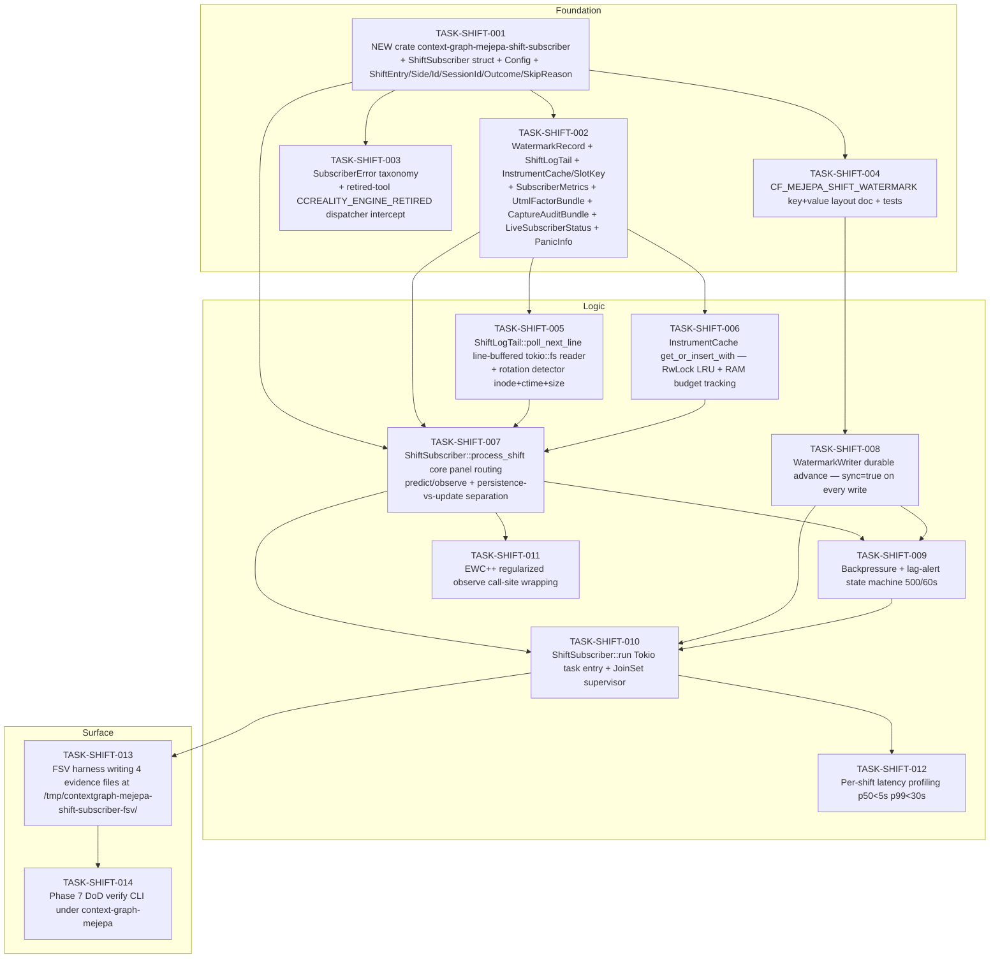

# Phase 7 — Shift-Subscriber Task Index

> **📊 2026-05-11 STATUS — partial.** **Producer side SHIPPED. Consumer side PENDING.**
>
> **Shipped:**
> - `crates/context-graph-mcp/src/handlers/tools/reality_loop/shift_log.rs` (252 lines) is the durable JSONL **producer + reader** (`reality_shift_log` MCP tool, `reality_shift_compare_to_my_view` MCP tool, `append_shift()` writer used by hooks).
> - `context-graph-mejepa-cf::lib.rs` declares all required CFs: `CF_MEJEPA_SHIFT_WATERMARK`, `CF_MEJEPA_LIVE_PREDICTIONS`, `CF_MEJEPA_TRAIN_CERTS`, `CF_MEJEPA_ORACLE_VERDICTS`.
> - `mcp__cgreality__mejepa_predict_latest` MCP tool is live (`crates/context-graph-mcp/src/handlers/tools/mejepa_tools.rs:151-220`) and READS from `CF_MEJEPA_LIVE_PREDICTIONS` via `MejepaStore::read_live_predictions`.
> - `MejepaStore` trait + `RocksDbInferStore` impl SHIPPED (`crates/context-graph-mejepa/src/{compiler.rs, store.rs}`). New subscriber wires through this trait — does NOT touch raw RocksDB.
>
> **Pending (this directory's domain):**
> - `crates/context-graph-mejepa-shift-subscriber/` crate (does not exist yet).
> - The Tokio task that **consumes** the JSONL stream and **writes** to `CF_MEJEPA_LIVE_PREDICTIONS` / `CF_MEJEPA_ORACLE_VERDICTS` / `CF_MEJEPA_SHIFT_WATERMARK`.
> - Sister-phase MCP tools `mejepa_observe_shift`, `mejepa_subscriber_status`, `mejepa_capture_audit` (`../phase7-mcp-tools/`).
> - Retired-tool fail-closed shim in `dispatch.rs` (per CCREALITY_ENGINE_RETIRED — no shim exists today, retired names hit unknown-tool fall-through).
>
> Authoritative shipping table: `../../implementation-plan.md` Phase 7 row.

> **Domain:** SHIFT-SUBSCRIBER (Tokio JSONL tail subscriber + watermark CF consumer + cross-cutting wiring)
>
> **Authority:**
> - `../../constitution.md` (`<reality_loop_contract>`, `<mcp_tool_namespace_lock>`, `<failure_taxonomy>` `MEJEPA_SHIFT_SUBSCRIBER_*`)
> - `../../functional/SPEC-SHIFT-SUBSCRIBER.md` (REQ-SHIFT-01..18 — all 18 requirements)
> - `../../technical/TECH-SHIFT-SUBSCRIBER.md` (10 components — ShiftSubscriber, ShiftLogTail, InstrumentCache, WatermarkWriter, plus 4 MCP handlers + RetiredSurfaceHandler)
>
> **Crate (NEW):** `crates/context-graph-mejepa-shift-subscriber/` (kebab-case per constitution; lands as a new workspace member).
>
> **Cross-cutting (read these specs to understand who owns what body):**
> - `observe()` body lives in SPEC-SELF-HEALING (`crates/context-graph-mejepa/src/heal/`); this domain wires the call site
> - `predict()` body lives in SPEC-INFERENCE (`crates/context-graph-mejepa/src/compiler.rs::predict`); this domain wires the call site
> - Per-step training-cert FORMAT is owned by SPEC-TRAINING (`crates/context-graph-mejepa-train/src/cert/`); this domain WRITES via the existing writer
> - LRU eviction POLICY is owned by SPEC-HYGIENE; this domain implements the cache MECHANISM
> - Corpus persistence WRITER is owned by SPEC-CORPUS; this domain CALLS `oracle_writer.append`

---

## Codebase reality (verified 2026-05-11 by reading source)

| Question | Answer |
|---|---|
| Where is the shift-log producer? | `crates/context-graph-mcp/src/handlers/tools/reality_loop/shift_log.rs::append_shift()` writes to `<runtime_root>/cgreality-shift-log/<safe_id(session_id)>.jsonl`. Each line is `serde_json::to_string(&ShiftRecord)`. |
| What is the on-disk JSONL row schema? | `ShiftRecord { shift_id: String, timestamp_unix_ns: u128, tool_name: String, tool_use_id: Option<String>, session_id: String, subject: Value, before: Value, after: Value, delta_summary: Value, verification: Value, harness_transition_path: Option<String> }` (`shift_log.rs:11-24`). The `byte_offset: u64` field that `ShiftEntry` adds is **synthesized by the subscriber's tail reader** — the producer does NOT write it. |
| What is the runtime root? | `require_active_runtime_root()` reads `file:/mnt/d/contextgraph/state/cgreality/active_runtime_root` (per the latest D-mount config refresh in commit `af3bf090`). Tests use a tempdir. |
| What CFs are declared? | All required CFs SHIPPED in `crates/context-graph-mejepa-cf/src/lib.rs`: `CF_MEJEPA_SHIFT_WATERMARK` (line 14), `CF_MEJEPA_LIVE_PREDICTIONS` (line 16), `CF_MEJEPA_ORACLE_VERDICTS` (line 17), `CF_MEJEPA_TRAIN_CERTS` (line 15), `CF_MEJEPA_PANEL_CACHE`, `CF_MEJEPA_PANEL_META`. **No CF declaration work needed in this phase** — only schema layout (key bytes, value JSON) per TASK-SHIFT-004. |
| How does the subscriber write predictions? | Through `MejepaStore::write_live_prediction(&prediction)` (`crates/context-graph-mejepa/src/compiler.rs:133`). The `RocksDbInferStore` impl (`store.rs:36-156`) handles serialization + key layout (`session_id_bytes[16] || created_at_unix_ms[8 BE] || prediction_id[16]`). New subscriber takes `Arc<dyn MejepaStore>` — does NOT touch raw RocksDB. |
| What is the `session_id` contract? | `MejepaStore::read_live_predictions(session_id: [u8; 16], limit: u32)` — **fixed 16-byte session id**. The MCP shim (`mejepa_predict_latest`) accepts a 32-character hex string, decodes to `[u8; 16]`. ALL new tools and the subscriber MUST use this contract — the SPEC's "up to 64 chars UTF-8" is stale; trust the code. |
| Does `crates/context-graph-mejepa-shift-subscriber/` exist? | **No.** TASK-SHIFT-001 creates it. Adjacent crate naming pattern: `context-graph-mejepa-corpus`, `-instruments`, `-train`, `-hygiene`, `-tct`, `-cf`, `-embedders` — all already in `crates/`. |
| Do retired-tool MCP shims exist? | **No.** `crates/context-graph-mcp/src/handlers/tools/reality_loop/retired.rs` does NOT exist; `CCREALITY_ENGINE_RETIRED` literal does NOT appear anywhere in the MCP source. Retired names today hit the dispatcher's unknown-tool branch → wrong error code. TASK-SHIFT-003 + sister `phase7-mcp-tools/TASK-MCP-001` jointly land the fix. |
| Where is the witness-chain reader for `E_Witness` panel slot? | `crates/context-graph-mcp/src/handlers/tools/reality_loop/witness_chain*.rs` (multiple files). The subscriber accesses witness segments through `WitnessChainReader` (a thin trait it owns) so it can be unit-tested against an in-memory chain. |
| Where do per-step training certs live? | `crates/context-graph-mejepa-train/src/cert/` (SHIPPED). Subscriber writes via `Arc<TrainCertWriter>` (a public type from that crate) — NOT inline construction. |

---

## Overview

- **Total Tasks:** 14
- **Foundation:** 4 (TASK-SHIFT-001..004 — crate skeleton + data models + error taxonomy + watermark CF schema)
- **Logic:** 8 (TASK-SHIFT-005..012 — tail, cache, process_shift, watermark writer, lag-alert state machine, run() task entry, EWC++ wiring, latency profiling)
- **Surface:** 2 (TASK-SHIFT-013..014 — FSV harness + Phase-7 DoD verify CLI)
- **Sister phase:** `../phase7-mcp-tools/` (7 tasks for the 4 MCP-side handlers + retired-shim + FSV)

---

## Dependency Graph



---

## Execution Order

| # | Task ID | Title | Layer | Depends On | Status |
|---|---------|-------|-------|------------|--------|
| 1 | TASK-SHIFT-001 | NEW crate `context-graph-mejepa-shift-subscriber` + workspace registration + `ShiftSubscriber`/`MeJepaShiftSubscriberConfig`/`ShiftEntry`/`ShiftSide`/`ShiftId`/`SessionId`/`ShiftOutcome`/`SkipReason` data models | foundation | — | ready |
| 2 | TASK-SHIFT-002 | `WatermarkRecord` + `ShiftLogTail` + `InstrumentCache`/`SlotKey` + `SubscriberMetrics` + `UtmlFactorBundle` + `CaptureAuditBundle` + `LiveSubscriberStatus` + `PanicInfo` data models | foundation | 001 | ready |
| 3 | TASK-SHIFT-003 | `SubscriberError` taxonomy (8 variants per `<failure_taxonomy>`) + retired-tool `CCREALITY_ENGINE_RETIRED` dispatcher intercept (the literal must FIRST land in code; today it is absent — see codebase reality table) | foundation | 001 | ready |
| 4 | TASK-SHIFT-004 | `CF_MEJEPA_SHIFT_WATERMARK` key (`b"wm:{session_id}"`) + value (JSON `WatermarkRecord`) layout documented + unit tests against a tempdir RocksDB | foundation | 001 | ready |
| 5 | TASK-SHIFT-005 | `ShiftLogTail::poll_next_line` — `tokio::fs::File` + `BufReader` + line-buffered + rotation detector (inode + ctime + size monotonicity, ext4 inode-reuse guard via ctime compare) | logic | 002 | ready |
| 6 | TASK-SHIFT-006 | `InstrumentCache::get_or_insert_with` — RwLock<LruCache<SlotKey, Arc<Vec<f32>>>> + RAM budget AtomicU64; lookup-miss-insert pattern that releases the lock during `compute()`; eviction loop until under budget OR `MEJEPA_SHIFT_SUBSCRIBER_INSTRUMENT_CACHE_OVERFLOW` | logic | 002 | ready |
| 7 | TASK-SHIFT-007 | `ShiftSubscriber::process_shift` — panel materialize (15 slots × `materialize_slot`) → branch on oracle outcome → `predict()` always persists → `observe()` only on `L_step ≥ 0.05` → `process_shift` returns Ok ONLY after CF persistence fsynced (REQ-SHIFT-09 persistence-vs-update separation) | logic | 001, 002, 005, 006 | ready |
| 8 | TASK-SHIFT-008 | `WatermarkWriter::write_watermark` — JSON serialize `WatermarkRecord` + `WriteOptions { sync: true }`; backwards-monotonicity check (`MEJEPA_SHIFT_SUBSCRIBER_WATERMARK_BACKWARDS`); read_all for restart hydration | logic | 004 | ready |
| 9 | TASK-SHIFT-009 | Backpressure + lag-alert state machine (Idle → Watching → Trigger → AlertActive → AlertClearing) — atomic `AtomicU8` state + sustained-window timer; emit `MEJEPA_SHIFT_SUBSCRIBER_LAG_ALERT` exactly once per Idle→AlertActive transition | logic | 007, 008 | ready |
| 10 | TASK-SHIFT-010 | `ShiftSubscriber::run` — Tokio task entry; per-session readers hydrated from `read_all_watermarks()`; `tokio::select!` on shutdown; `tokio::task::JoinSet` supervisor catches panics → populates `PanicInfo` | logic | 007, 008, 009 | ready |
| 11 | TASK-SHIFT-011 | EWC++-regularized `observe()` call site (idempotent against duplicate/out-of-order; the `replay: true` flag flows through to per-step training cert) | logic | 007 | ready |
| 12 | TASK-SHIFT-012 | Per-shift latency profiling (p50 < 5s cached, p99 < 30s cold) — Instant::now() + histogram (use `hdrhistogram` crate); export via `mejepa_subscriber_status` | logic | 010 | ready |
| 13 | TASK-SHIFT-013 | FSV harness writing 4 evidence files at `/tmp/contextgraph-mejepa-shift-subscriber-fsv/{watermark.json,observe-evidence.json,predict-latency-evidence.json,mcp-tool-roundtrip-evidence.json}` (mode `0o600` per SEC-MEJEPA-07); each file readback-verified via separate process | surface | 010 | ready |
| 14 | TASK-SHIFT-014 | Phase 7 DoD verify CLI: `cargo run --release -p context-graph-mejepa -- verify --task <swe_lite_id> --patch <path>` reports `panel_materialization_ms`, `me_jepa_verify_verdict`, `me_jepa_predicts_match_oracle`, `corpus_entry_added`, `total_corpus_size` | surface | 013 | ready |

---

## Status Legend

- ready — Can be started now (dependency tree satisfied OR dependency may be stubbed locally)
- in_progress — Currently being worked on
- complete — Finished and verified with FSV evidence
- blocked — Waiting on a hard cross-phase dependency
- failed — Needs revision

---

## Critical Path

```
TASK-SHIFT-001 → TASK-SHIFT-002 → TASK-SHIFT-005 → TASK-SHIFT-007
              → TASK-SHIFT-009 → TASK-SHIFT-010 → TASK-SHIFT-013 → TASK-SHIFT-014
```

## Parallel Opportunities

- **Batch 1 (after 001):** TASK-SHIFT-{002, 003, 004} — independent foundation extensions; spawn three workers.
- **Batch 2 (after 002):** TASK-SHIFT-{005, 006} — tail and cache are independent; two workers.
- **Batch 3 (after 007):** TASK-SHIFT-011 can run in parallel with TASK-SHIFT-{008, 009} since each touches different modules.
- **Cross-phase parallelism:** while TASK-SHIFT-007 is in flight, sister `phase7-mcp-tools/TASK-MCP-{004, 005, 006}` can be drafted against the published `<data_models>` block in `TECH-SHIFT-SUBSCRIBER.md` and integration-tested once SHIFT-007 lands.

---

## Layer Distribution

- Foundation: 4 / 14 (29 %)
- Logic:      8 / 14 (57 %)
- Surface:    2 / 14 (14 %)

(Surface count is small because the public surface — 4 MCP tools (3 NEW + 1 hardened) + the verify CLI — lives mostly in the sister phase `../phase7-mcp-tools/`.)

---

## Hard rules (apply to every task in this directory)

1. **No backwards compatibility.** No migration shim. `RocksDbInferStore` schema changes wipe + recreate. Synthetic data only.
2. **No mock data in tests.** Use a real tempdir RocksDB + the SHIPPED `RocksDbInferStore`. Tests must FAIL when the system is broken.
3. **Fail closed with structured `MEJEPA_SHIFT_SUBSCRIBER_*` codes.** No `unwrap_or` defaults. No silent fallback. Never zero-pad a missing instrument slot.
4. **Robust error logging.** Every fail-path emits `tracing::error!` with `code = "MEJEPA_*"` + actionable context (which session, which shift_id, which byte offset, which CF, which file SHA).
5. **Files under 500 lines.** Split via the `file-length-manager` agent if exceeded.
6. **Watermark advance is the structural correctness invariant.** It happens AFTER `process_shift` returns Ok AND `WriteOptions { sync: true }` returns. Never batch watermark writes. Never advance on partial persistence.
7. **Persistence-vs-update separation (REQ-SHIFT-09).** `predict()` result MUST persist to `CF_MEJEPA_LIVE_PREDICTIONS` regardless of `L_step` gate. The gate ONLY controls whether `observe()` runs.
8. **`max_concurrent_shifts: 1`** locked in v1.0 (REQ-SHIFT-17) — preserves `observe()` ordering for EWC++ correctness. Inner-shift slot parallelism (`buffer_unordered`) is allowed and recommended.
9. **`tokio::task::spawn_blocking` for AST + embedder forward** — they are CPU-bound and would block the cooperative scheduler.
10. **Provenance metadata on every persisted record:** `corpus_sha`, `embedder_versions`, `frozen_at`, `code_version` (`git describe --always --dirty` captured ONCE at construction).
11. **Full State Verification (FSV) is mandatory** — every task ships FSV evidence under `/tmp/contextgraph-mejepa-shift-subscriber-fsv/<task-id>/`; readback verifies the persisted RocksDB row / JSONL line / cache entry, not the function return value.
