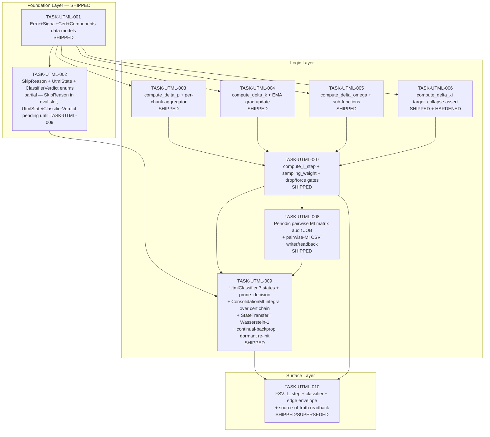

# utml-learning-formula — UTML v1.0 Task Index

> **📊 2026-05-11 STATUS — shipped at code/FSV level; remaining work is issue-tracked.** UTML 001-010 are SHIPPED or superseded by the shipped `learning_signal/` modules and FSV examples. UTML 008 pairwise-MI matrix audit ships as `learning_signal/pairwise_mi_matrix.rs`, explicit train-cert pairwise-MI columns, and `mcp__cgreality__mejepa_audit_pairwise_mi` CSV/readback. UTML 009 ships as `learning_signal/{classifier,consolidation,state_transfer,continual_backprop}.rs` plus the `heal/regulate.rs` continual-backprop hook. UTML 010's envelope is covered by `train_edge_cases_fsv`, `utml_l_step_fsv`, `train_smoke_fsv`, `train_cert_chain_fsv`, and `continual_backprop_regulation_fsv`. Remaining work is formula-carrier reconciliation ([#13](https://github.com/ChrisRoyse/contextgraph/issues/13)) and production trend evidence ([#11](https://github.com/ChrisRoyse/contextgraph/issues/11), [#5](https://github.com/ChrisRoyse/contextgraph/issues/5)).
>
> **Shipped (verified by source read and FSV runs on 2026-05-11):**
> - `compute_delta_p(c: DeltaPComponents) -> Result<f32, UtmlError>` — line 164
> - `compute_delta_k(c: DeltaKComponents) -> Result<f32, UtmlError>` — line 171
> - `compute_delta_omega(c: DeltaOmegaComponents) -> Result<f32, UtmlError>` — line 182
> - `compute_delta_xi(c: DeltaXiComponents) -> Result<f32, UtmlError>` — line 189; rejects non-finite + non-zero `target_collapse` with `MEJEPA_INSTRUMENT_GRADIENT_LEAK` (lines 190-205); healthy formula `(1-target_collapse)^0.5 * (1-predictor_collapse)^0.3 * (1-redundancy_mi)^0.2`
> - `compute_l_step(...)` — line 232
> - `sampling_weight(l_step, operator_override, age_days, age_decay) -> f32` — line 259
> - `pairwise_mi_audit(probabilities) -> Result<f32, UtmlError>` — scalar helper; matrix audit ships in `learning_signal/pairwise_mi_matrix.rs` with CSV writer/loader and MCP readback
> - `BatchSampler` (`sampler/mod.rs:34`) integrates `sampling_weight` (line 103) — sampler reweighting SHIPPED; cross-task transfer wiring `sampler/cross_task.rs` (102 lines) SHIPPED
> - `TrainingCertificate` + chain helpers (`cert/{mod,chain,writer,invariant_scan}.rs`) SHIPPED with hash-chained body / Merkle / SHA-256 self+parent
> - `train_edge_cases_fsv` example proves `target_collapse=0.001` → leak rejected before cert write
> - `continual_backprop_regulation_fsv` proves ΔΩ-effective-plasticity intervention writes `CF_MEJEPA_WEIGHT_BLOBS` and reads it back
>
> **Tracked remaining work:**
> - **[#13](https://github.com/ChrisRoyse/contextgraph/issues/13):** reconcile the current operational ΔP/ΔK/ΔΩ carriers with the richer doc-11 formulas and expand certificate source columns where needed.
> - **[#11](https://github.com/ChrisRoyse/contextgraph/issues/11) / [#5](https://github.com/ChrisRoyse/contextgraph/issues/5):** capture production-scale MI / calibration / ship-gate trends over the full corpus.
>
> Authoritative status: `../../implementation-plan.md` Phase 3+ row.

> **Level 4.** Atomic task specifications for the **UTML domain** (cross-cutting Phase 3 sub-track: four-factor learning signal `L_step = ΔP × ΔK × ΔΩ × ΔΞ`, sampling weight, training certificate, cycle classifier, consolidation integral M(t), state-transfer T). Authority order: `../../constitution.md` (Level 1) > `../../functional/SPEC-UTML.md` (Level 2) > `../../technical/TECH-UTML.md` (Level 3) > this file (Level 4). Each task is one conceptual change shippable end-to-end with FSV evidence per `docs2/prdtospec.md` §4.

## Phase scope

Implements all 12 functional `REQ-UTML-NN` requirements (cross-linked in `../_traceability.md` under `### UTML`) and all 11 component contracts in `../../technical/TECH-UTML.md`. Foundation -> Logic -> Surface ordering enforced; Iron Rule applies.

**Anchor invariants from `../../constitution.md` `<utml_v1_invariants>`:**

- Multiplicative gating (`L_step = ΔP × ΔK × ΔΩ × ΔΞ`) is non-negotiable.
- All four factors clamped to `[0, 1]`.
- `ΔΞ.target_collapse == 0.0` for ME-JEPA by construction; nonzero observation = `MEJEPA_INSTRUMENT_GRADIENT_LEAK` CRITICAL bug. **Hardened 2026-05-10:** the assertion is now in code at `learning_signal.rs:189`.
- Coaching order: regulate ΔΩ + ΔΞ FIRST, then ΔP/ΔK.
- Pruning rule: prune curriculum item only if `L_step < 0.1` for N steps AND `ΔΩ > 0.4` throughout AND `ΔΞ > 0.4` throughout.
- Per-step training certificate with hash-chain (`parent_witness_hash → self_hash`) is the physical M(t) consolidation tensor (per UTML §XII). **Cert chain SHIPPED;** `learning_signal/consolidation.rs` ships the M(t) consumer.

---

## Codebase reality (verified 2026-05-11 by reading source)

| Question | Answer |
|---|---|
| Does `crates/context-graph-mejepa-train/` exist? | **Yes.** Public crate with: `learning_signal.rs` (388 lines), `cert/{mod,chain,writer,invariant_scan}.rs`, `sampler/{mod,cross_task}.rs`, `eval/{mod,holdout,slicing,regression,epoch_witness}.rs`, `optim/`, `loss/`, `distill/`, `aux/`, `lora_wiring.rs`, `trainer/`, `bin/`, `cli/`, `error.rs`, `config.rs`, `checkpoint.rs`. Plus 5 FSV examples. |
| Where do the `compute_delta_*` functions live? | `crates/context-graph-mejepa-train/src/learning_signal.rs`. ALL FOUR are SHIPPED + tested. The `UtmlError`/`UtmlErrorCode` enum is at the top of the same file; `UtmlErrorCode::MejepaInstrumentGradientLeak` maps to wire string `"MEJEPA_INSTRUMENT_GRADIENT_LEAK"`. |
| Where is `compute_l_step`? | Same file, line 232. Already wired into `BatchSampler` via `sampling_weight` (line 103 of `sampler/mod.rs`). |
| Is the pairwise MI audit JOB shipped? | **Yes.** `learning_signal/pairwise_mi_matrix.rs` ships `PairwiseMiAuditor`, matrix CSV writer/loader, and the MCP wrapper writes and reloads a CSV source-of-truth before returning. Train certs also expose `predictor_redundancy_pairwise_mi` and `predictor_redundancy_pairwise_mi_source`. |
| Is the `UtmlClassifier` shipped? | **Yes.** `learning_signal/classifier.rs`, `learning_signal/consolidation.rs`, `learning_signal/state_transfer.rs`, and `learning_signal/continual_backprop.rs` ship classifier, prune decision, M(t), state-transfer, and dormant-unit re-init primitives; `heal/regulate.rs` wires the re-init intervention to persisted weight blobs. |
| Is the training certificate writer shipped? | **Yes.** `cert/writer.rs::TrainCertWriter::{new, resume_from_rocksdb, emit, last_self_hash}` SHIPPED. `cert/chain.rs::{compute_self_hash, compute_parent_hash, compute_merkle_root, verify_chain, last_cert_hash}` SHIPPED. `TrainingCertificate::validate_phase3` SHIPPED. The chain replay smoke is exercised by `train_cert_chain_fsv` example. |
| Is `BatchSampler` shipped? | **Yes** (`sampler/mod.rs:34`). Constructor at line 49; calls `sampling_weight` at line 103. Cross-task graph wiring in `sampler/cross_task.rs` (102 lines) SHIPPED. |
| What FSV examples exist? | `train_cert_chain_fsv`, `train_edge_cases_fsv`, `train_full_fsv`, `train_holdout_eval_fsv`, `train_smoke_fsv` — all in `crates/context-graph-mejepa-train/examples/`; `utml_l_step_fsv` and `continual_backprop_regulation_fsv` cover the refreshed UTML envelope and regulation side effects. |

---

## Overview

- **Total tasks:** 10
- **Foundation layer:** 2 tasks (TASK-UTML-001..002)
- **Logic layer:** 7 tasks (TASK-UTML-003..009)
- **Surface layer:** 1 task (TASK-UTML-010)
- **Crate touched:** `crates/context-graph-mejepa-train` (SHIPPED; under `src/learning_signal.rs` + `src/cert/` + `src/sampler/`)
- **Remaining walltime:** production evidence and formula-carrier reconciliation are tracked outside this task index in [#11](https://github.com/ChrisRoyse/contextgraph/issues/11), [#5](https://github.com/ChrisRoyse/contextgraph/issues/5), and [#13](https://github.com/ChrisRoyse/contextgraph/issues/13).
- **All UTML compute functions return `Result<f32, UtmlError>`; clamped output in `[0, 1]`.**
- **TRAINING tasks depend on these (cross-phase dependency).**

---

## Dependency DAG

---

## Execution order

| # | Task ID | Title | Layer | Depends on | Status (2026-05-11) |
|---|---------|-------|-------|------------|--------|
| 1 | TASK-UTML-001 | Data models: errors, signal, cert, ΔP/ΔK/ΔΩ/ΔΞ component structs | foundation | — | **complete** |
| 2 | TASK-UTML-002 | Enums: SkipReason + UtmlState + ClassifierVerdict + DeltaPAggregator | foundation | TASK-UTML-001 | **complete / superseded** — needed classifier/verdict surfaces ship in `learning_signal/classifier.rs` and adjacent modules |
| 3 | TASK-UTML-003 | `compute_delta_p` + per-chunk aggregation | logic | TASK-UTML-001 | **complete** |
| 4 | TASK-UTML-004 | `compute_delta_k` + `update_grad_ema` | logic | TASK-UTML-001 | **complete** |
| 5 | TASK-UTML-005 | `compute_delta_omega` + sub-functions (plasticity / landscape / stability / agent_state) | logic | TASK-UTML-001 | **complete** |
| 6 | TASK-UTML-006 | `compute_delta_xi` (CRITICAL `target_collapse == 0.0` assert) | logic | TASK-UTML-001 | **complete** + hardened 2026-05-10 |
| 7 | TASK-UTML-007 | `compute_l_step` + `sampling_weight` + drop/force gates | logic | TASK-UTML-003..006 | **complete** |
| 8 | TASK-UTML-008 | EmbedderCoherence + pairwise-MI audit JOB (matrix-emitting periodic scheduler + CSV writer) | logic | TASK-UTML-007 | **complete / superseded by shipped implementation** — matrix auditor + CSV writer/loader + MCP source-of-truth readback shipped; production scheduling evidence tracked in [#8](https://github.com/ChrisRoyse/contextgraph/issues/8) |
| 9 | TASK-UTML-009 | UtmlClassifier (7 states) + prune_decision + Consolidation M(t) integral over cert chain + StateTransfer T (Wasserstein-1) + continual-backprop dormant-unit re-init | logic | TASK-UTML-007, TASK-UTML-008, TASK-UTML-002 | **complete / superseded by shipped modules** — classifier, consolidation, state-transfer, continual-backprop, and `heal/regulate.rs` hook shipped |
| 10 | TASK-UTML-010 | FSV harness: 100 synthetic examples spanning corner cases; L_step envelope + target_collapse always 0 + sampling histogram | surface | TASK-UTML-007, TASK-UTML-009 | **complete / superseded by FSV set** — `train_edge_cases_fsv`, `utml_l_step_fsv`, `train_smoke_fsv`, `train_cert_chain_fsv`, and `continual_backprop_regulation_fsv` provide source-of-truth readback evidence |

---

## Status legend

- ready — Can be started immediately (all dependencies complete)
- blocked — Has unmet dependencies
- in_progress — Currently being executed
- complete — Shipped + FSV passed
- failed — Needs revision

---

## Critical path (remaining work only)

Production evidence + formula reconciliation: [#11](https://github.com/ChrisRoyse/contextgraph/issues/11) / [#5](https://github.com/ChrisRoyse/contextgraph/issues/5) / [#13](https://github.com/ChrisRoyse/contextgraph/issues/13).

All task-index code plumbing items are shipped or superseded by the code paths above. Issue [#13](https://github.com/ChrisRoyse/contextgraph/issues/13) decides whether to implement the richer doc-11 carrier formulas or explicitly revise the spec.

---

## Parallel batches (remaining work)

- **Formula reconciliation:** [#13](https://github.com/ChrisRoyse/contextgraph/issues/13)
- **Production trend evidence:** [#11](https://github.com/ChrisRoyse/contextgraph/issues/11)
- **Full corpus ship-gate evidence:** [#5](https://github.com/ChrisRoyse/contextgraph/issues/5)

---

## Cross-phase consumers

`crates/context-graph-mejepa-train::trainer` (TRAINING domain) consumes every UTML compute function per step — already wired (BatchSampler integrates `sampling_weight`; per-step cert writer integrates `compute_l_step` factor decomposition). Phase 3 TRAINING tasks have explicit `<depends_on>` references back into this phase; those references are SATISFIED for 001-007.

`crates/context-graph-mejepa-shift-subscriber` (Phase 7, NEW) will consume `compute_l_step` per shift to gate `observe()` — see `phase7-shift-subscriber/TASK-SHIFT-007.md`.

`crates/context-graph-mejepa::eval` (Phase 8, NEW) will consume `pairwise_mi_audit` matrix from TASK-UTML-008 for the open-research-question Q5/Q6 entries — see `phase8-evaluation/TASK-EVAL-011.md`.

---

## FSV evidence locations

Per `../../constitution.md` `<testing_requirements>` and `<fsv_evidence_paths>`:

- `/tmp/contextgraph-mejepa-train-fsv/utml-l-step-evidence.json` — L_step corner cases (`utml_l_step_fsv`)
- `/tmp/contextgraph-mejepa-train-fsv/utml-classifier-evidence.json` — classifier regimes where generated by the UTML FSV set
- `/tmp/contextgraph-mejepa-train-fsv/utml-cert-chain-evidence.json` — chain replay smoke (TASK-UTML-007 emits cert; **already exercised** by `train_cert_chain_fsv` example)
- `/mnt/d/contextgraph/fsv/mcp-pairwise-mi-unit/audit/utml-pairwise-mi-matrix-00000042.csv` and configured MCP data-root audit dirs — pairwise MI audit source-of-truth CSV + readback
- `/tmp/contextgraph-mejepa-train-fsv/edge-case-evidence.json` — `target_collapse=0.001` leak proof (**already exercised** by `train_edge_cases_fsv`)

---

## Hard rules (apply to every task in this directory)

1. **No backwards compatibility.** No migration shims; no compat aliases for retired UTML primitives. The four `compute_delta_*` signatures are LOCKED at v1.0.
2. **No mock data in tests.** Use real `DeltaPComponents` / `DeltaKComponents` / `DeltaOmegaComponents` / `DeltaXiComponents` (sister TASK-UTML-001 SHIPPED). The synthetic envelope test harness in TASK-UTML-010 must use REAL component structs with carefully-chosen field values, not stubs.
3. **`target_collapse == 0.0` is non-negotiable.** Any code path that constructs a `DeltaXiComponents` with non-zero `target_collapse` MUST result in a `MEJEPA_INSTRUMENT_GRADIENT_LEAK` error. Tests verifying this are in `learning_signal.rs:368-386`.
4. **Multiplicative gating.** `L_step = ΔP × ΔK × ΔΩ × ΔΞ` — any factor at zero zeros the product. Tests must include the 4 zero-corner cases.
5. **`compute_l_step` returns `Result<f32, UtmlError>` clamped to `[0, 1]`.** NaN/Inf in any component MUST surface a structured error, never silently propagate.
6. **Per-step training cert is the M(t) physical tensor.** Consolidation M(t) (TASK-UTML-009) integrates over the chain; do NOT recompute from raw losses.
7. **Files under 500 lines.** `learning_signal.rs` is at 388 lines today; if TASK-UTML-008 + 009 push it past 500, split into `learning_signal/{mod,deltas,sampling,classifier,consolidation,state_transfer}.rs`.
8. **Full State Verification (FSV) is mandatory** — every task ships FSV evidence under `/tmp/contextgraph-mejepa-train-fsv/`; readback verifies the persisted matrix CSV / classifier verdict / cert chain bytes, not the function return value alone.
