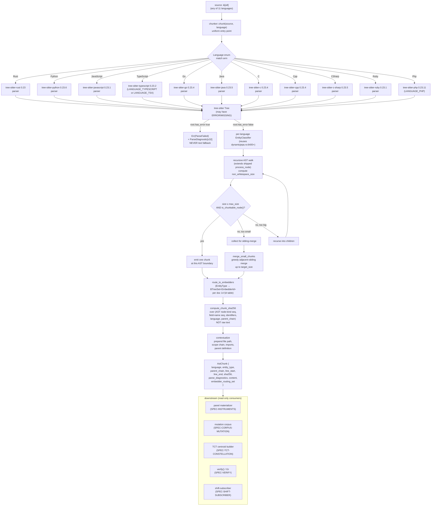

# TECH-AST-CHUNKING — Multi-Language AST-Perfect Atomic Chunker (Technical Spec)

> **📊 2026-05-10 STATUS:** PARTIAL — see ../implementation-plan.md for the full Phase 1 status.

> **Level 3 (technical spec).** Defines HOW to implement SPEC-AST-CHUNKING. The
> companion Level 2 functional spec (`docs/ruvectorfindings/specs/functional/
> SPEC-AST-CHUNKING.md`) defines WHAT. Conflicts resolve per `constitution.md`
> `<spec_authority_order>`.
>
> **Authority sources:** doc 14 (`14_AST_AWARE_CHUNKING_FOR_EMBEDDERS.md`), doc 14
> companion (`14_AST_AWARE_CHUNKING_FOR_EMBEDDERS.md`), doc 09 §2.2 + §3.1, the
> shipped Rust chunker at `crates/context-graph-core/src/memory/ast_chunker.rs`
> (1216 LOC, the source of truth for current state), the existing 11-language
> tree-sitter dispatcher at `crates/context-graph-cli/src/commands/dynamicjepa.rs:6454-6464`,
> and the shipped semantic extractor at `dynamicjepa.rs:6400+` (per-language
> node-classification reused here). Constitution governs error codes,
> performance budgets, FSV protocol, security rules.

```xml
<technical_spec id="TECH-AST-CHUNKING" version="1.0" implements="SPEC-AST-CHUNKING">

<metadata>
  <title>Multi-Language AST-Perfect Atomic Chunker — Implementation</title>
  <status>partial</status>
  <owner>cc-reality (outer-loop optimizer); ME-JEPA Phase 1, build-plan item 6</owner>
  <created_date>2026-05-09</created_date>
  <last_updated>2026-05-10</last_updated>
  <related_specs>
    <spec_ref>TECH-EMBEDDERS</spec_ref>
    <spec_ref>TECH-INSTRUMENTS</spec_ref>
    <spec_ref>TECH-CORPUS-MUTATION</spec_ref>
    <spec_ref>TECH-TCT-CONSTELLATION</spec_ref>
  </related_specs>
</metadata>

<architecture_diagram>


</architecture_diagram>

<data_models>
  <model name="Language">
    <field name="enum_variants" type="enum #[non_exhaustive]" constraints="exactly 11 variants"/>
    <field name="Rust" type="variant" constraints="dispatches to tree-sitter-rust 0.23 LANGUAGE"/>
    <field name="Python" type="variant" constraints="dispatches to tree-sitter-python 0.23.6 LANGUAGE"/>
    <field name="JavaScript" type="variant" constraints="dispatches to tree-sitter-javascript 0.23.1 LANGUAGE"/>
    <field name="TypeScript" type="variant" constraints="dispatches to tree-sitter-typescript 0.23.2 LANGUAGE_TYPESCRIPT (TSX uses a sibling variant or callsite-detected via filename)"/>
    <field name="Go" type="variant" constraints="dispatches to tree-sitter-go 0.23.4 LANGUAGE"/>
    <field name="Java" type="variant" constraints="dispatches to tree-sitter-java 0.23.5 LANGUAGE"/>
    <field name="C" type="variant" constraints="dispatches to tree-sitter-c 0.23.4 LANGUAGE"/>
    <field name="Cpp" type="variant" constraints="dispatches to tree-sitter-cpp 0.23.4 LANGUAGE"/>
    <field name="CSharp" type="variant" constraints="dispatches to tree-sitter-c-sharp 0.23.5 LANGUAGE"/>
    <field name="Ruby" type="variant" constraints="dispatches to tree-sitter-ruby 0.23.1 LANGUAGE"/>
    <field name="Php" type="variant" constraints="dispatches to tree-sitter-php 0.23.11 LANGUAGE_PHP"/>
  </model>

  <model name="EntityType">
    <field name="Function" type="variant" constraints="top-level free function or arrow-function bound to const (JS/TS); NOT inside a class/impl"/>
    <field name="Method" type="variant" constraints="function inside a class/impl/trait body"/>
    <field name="Class" type="variant" constraints="class_definition (Python), class_declaration (JS/TS/Java/C#/PHP), class_specifier (C++), class (Ruby)"/>
    <field name="Struct" type="variant" constraints="struct_item (Rust), struct_specifier (C/C++), struct_declaration (C#), type_declaration (Go struct)"/>
    <field name="Enum" type="variant" constraints="enum_item (Rust), enum_specifier (C/C++), enum_declaration (C#/TS/Java)"/>
    <field name="TraitOrInterface" type="variant" constraints="trait_item (Rust), interface_declaration (TS/Java/C#/PHP/Go), protocol_definition (Python 3.12+)"/>
    <field name="Impl" type="variant" constraints="impl_item (Rust); other languages return Method directly without an Impl wrapper"/>
    <field name="Module" type="variant" constraints="mod_item (Rust), module (Python/Ruby), program (JS/TS top-level)"/>
    <field name="Namespace" type="variant" constraints="namespace_definition (C++), namespace_declaration (C#), package_clause (Go — open Q-AST-04), package_declaration (Java)"/>
    <field name="TestFunction" type="variant" constraints="per REQ-AST-12 detection rules"/>
    <field name="Import" type="variant" constraints="use_declaration (Rust), import_statement (Python/JS/TS/Java), import_declaration (Go/Java), preproc_include (C/C++), using_directive (C#), require/require_relative (Ruby), namespace_use_declaration (PHP)"/>
    <field name="CommentBlock" type="variant" constraints="line_comment / block_comment / block_documentation_comment when not attached to an entity"/>
    <field name="Docstring" type="variant" constraints="Python: string immediately following function_definition/class_definition; Rust: //! and /** ... */; JS/TS: /** ... */ JSDoc; Java: Javadoc; C#: /// triple-slash; Ruby: =begin ... =end"/>
  </model>

  <model name="ParseDiagnostic">
    <field name="kind" type="String" constraints="non-empty; tree-sitter node kind (commonly 'ERROR' or the missing token kind)"/>
    <field name="is_error" type="bool" constraints="true for tree-sitter ERROR nodes"/>
    <field name="is_missing" type="bool" constraints="true for tree-sitter MISSING (recovery-inserted) nodes"/>
    <field name="start_byte" type="usize" constraints="≤ source.len()"/>
    <field name="end_byte" type="usize" constraints="≥ start_byte; ≤ source.len()"/>
    <field name="start_line" type="u32" constraints="1-based; ≥ 1"/>
    <field name="start_column" type="u32" constraints="0-based"/>
    <field name="end_line" type="u32" constraints="≥ start_line"/>
    <field name="end_column" type="u32" constraints="0-based"/>
    <field name="excerpt" type="String" constraints="0-128 chars; line context around the diagnostic"/>
  </model>

  <model name="AstChunk">
    <field name="language" type="Language" constraints="non-default; matches the dispatch language"/>
    <field name="entity_type" type="EntityType" constraints="one of 13 variants"/>
    <field name="parent_chain" type="String" constraints="'::'-joined; empty for root entities"/>
    <field name="line_start" type="u32" constraints="1-based; ≥ 1"/>
    <field name="line_end" type="u32" constraints="≥ line_start"/>
    <field name="sha256" type="[u8; 32]" constraints="reformat-invariant; deterministic; SHA-256 over (AST-id-sequence, language, parent_chain)"/>
    <field name="parse_diagnostics" type="Vec&lt;ParseDiagnostic&gt;" constraints="length 0-32; empty on success Ok variant; warning-level diagnostics permitted (e.g. chunk-too-large)"/>
    <field name="content" type="Vec&lt;u8&gt;" constraints="contextualized: prepended file path + scope chain + relevant imports + parent definition + raw chunk bytes"/>
    <field name="embedder_routing_set" type="BTreeSet&lt;EmbedderId&gt;" constraints="non-empty; sorted; matches doc 14 §4 routing table for entity_type"/>
  </model>

  <model name="AstChunkerError">
    <field name="ParseFailed" type="variant" constraints="{ file_path: String, language: Language, reason: String, diagnostics: Vec&lt;ParseDiagnostic&gt; }; emits MEJEPA_CHUNKER_PARSE_FAILED"/>
    <field name="UnsupportedLanguage" type="variant" constraints="{ requested: String }; emits MEJEPA_CHUNKER_UNSUPPORTED_LANGUAGE"/>
    <field name="EmptySource" type="variant" constraints="emits MEJEPA_CHUNKER_EMPTY_SOURCE"/>
    <field name="MixedLanguage" type="variant" constraints="{ primary: Language, embedded: String }; emits MEJEPA_CHUNKER_MIXED_LANGUAGE"/>
    <field name="LanguageSetFailed" type="variant" constraints="{ language: String, reason: String }; emitted when tree-sitter parser.set_language fails (defense-in-depth; impossible if Cargo.toml versions are pinned correctly)"/>
  </model>

  <model name="EmbedderRoutingTable">
    <field name="map" type="BTreeMap&lt;EntityType, BTreeSet&lt;EmbedderId&gt;&gt;" constraints="static const at compile time; encodes doc 14 §4 routing"/>
    <field name="Function" type="BTreeSet&lt;EmbedderId&gt;" constraints="{ E7, E14 } — function/method body routing"/>
    <field name="Method" type="BTreeSet&lt;EmbedderId&gt;" constraints="{ E7, E14 } — same as Function"/>
    <field name="Class" type="BTreeSet&lt;EmbedderId&gt;" constraints="{ E11, E7 } — entity-graph + structural code"/>
    <field name="Struct" type="BTreeSet&lt;EmbedderId&gt;" constraints="{ E11, E7 } — same as Class"/>
    <field name="Enum" type="BTreeSet&lt;EmbedderId&gt;" constraints="{ E11, E7 } — same as Class"/>
    <field name="TraitOrInterface" type="BTreeSet&lt;EmbedderId&gt;" constraints="{ E11, E7 } — same as Class"/>
    <field name="Impl" type="BTreeSet&lt;EmbedderId&gt;" constraints="{ E11, E7 } — same as Class"/>
    <field name="Module" type="BTreeSet&lt;EmbedderId&gt;" constraints="{ E1, E8 } — semantic + graph"/>
    <field name="Namespace" type="BTreeSet&lt;EmbedderId&gt;" constraints="{ E1, E8 } — same as Module"/>
    <field name="TestFunction" type="BTreeSet&lt;EmbedderId&gt;" constraints="{ E1, E7 } — semantic intent + structural code"/>
    <field name="Import" type="BTreeSet&lt;EmbedderId&gt;" constraints="{ E11, E13 } — entity graph + sparse keyword"/>
    <field name="CommentBlock" type="BTreeSet&lt;EmbedderId&gt;" constraints="{ E1, E10 } — pure NL"/>
    <field name="Docstring" type="BTreeSet&lt;EmbedderId&gt;" constraints="{ E1, E10 } — pure NL"/>
  </model>

  <model name="PerLanguageNodeKindTable">
    <field name="rust" type="static lookup" constraints="function_item, impl_item, struct_item, enum_item, trait_item, mod_item, const_item, static_item, type_item, macro_definition, macro_rules, attribute_item, line_comment, block_comment, use_declaration"/>
    <field name="python" type="static lookup" constraints="function_definition, class_definition, decorated_definition, async_function_definition, import_statement, import_from_statement, expression_statement (for module-level docstring), comment"/>
    <field name="javascript" type="static lookup" constraints="function_declaration, function_expression, arrow_function, method_definition, class_declaration, class_expression, generator_function_declaration, import_statement, import_clause, comment, block_comment"/>
    <field name="typescript" type="static lookup" constraints="JS set + interface_declaration, type_alias_declaration, enum_declaration, namespace_declaration, abstract_class_declaration, internal_module"/>
    <field name="go" type="static lookup" constraints="function_declaration, method_declaration, type_declaration (struct/interface), package_clause, import_declaration, import_spec, comment"/>
    <field name="java" type="static lookup" constraints="method_declaration, class_declaration, interface_declaration, enum_declaration, annotation_type_declaration, record_declaration, package_declaration, import_declaration, line_comment, block_comment"/>
    <field name="c" type="static lookup" constraints="function_definition, declaration (with declarator-aware extraction per doc 09 §3.1), struct_specifier, enum_specifier, union_specifier, preproc_def, preproc_function_def, preproc_include, comment"/>
    <field name="cpp" type="static lookup" constraints="C set + class_specifier, namespace_definition, template_declaration, function_definition with qualified_identifier, operator_name, destructor_name"/>
    <field name="csharp" type="static lookup" constraints="method_declaration (incl. operator_declaration, conversion_operator_declaration, destructor_declaration), class_declaration, interface_declaration, struct_declaration, record_declaration, namespace_declaration, using_directive, comment"/>
    <field name="ruby" type="static lookup" constraints="method, singleton_method, class, module, alias, comment; RSpec/Minitest detection at call-expression level"/>
    <field name="php" type="static lookup" constraints="function_definition, method_declaration, class_declaration, interface_declaration, trait_declaration, namespace_definition, namespace_use_declaration, comment"/>
  </model>
</data_models>

<api_contracts>
  <endpoint path="rust::context_graph_core::memory::ast_chunker::chunk" method="public function">
    <implements>REQ-AST-01, REQ-AST-02, REQ-AST-08, REQ-AST-09, REQ-AST-10, REQ-AST-11</implements>
    <signature>pub fn chunk(source: &amp;[u8], language: Language) -&gt; Result&lt;Vec&lt;AstChunk&gt;, AstChunkerError&gt;</signature>
    <inputs>
      source: byte slice (NOT &amp;str — preserves non-UTF-8 byte sequences in legacy C/Latin-1 comments; tree-sitter handles bytes natively)
      language: Language enum variant (one of 11)
    </inputs>
    <outputs>
      Ok(Vec&lt;AstChunk&gt;): one or more chunks per file, every field populated per REQ-AST-02; Vec is empty ONLY if source contains exclusively whitespace post-comment-stripping which would have returned EmptySource — so Ok is always non-empty
      Err(AstChunkerError): one of {ParseFailed, UnsupportedLanguage, EmptySource, MixedLanguage, LanguageSetFailed}
    </outputs>
    <preconditions>
      - source is the raw file bytes (no preprocessing)
      - language has been validated by the caller (panel materializer, mutation generator, etc.) to match the file extension
    </preconditions>
    <postconditions>
      - On Ok: every chunk has reformat-invariant sha256 (REQ-AST-04), valid metadata (REQ-AST-02), and routing_set per the doc 14 §4 table
      - On Err: no chunks emitted; structured error with diagnostic context where applicable
    </postconditions>
  </endpoint>

  <endpoint path="rust::context_graph_core::memory::ast_chunker::AstCodeChunker::chunk" method="public method (legacy/Rust-only API)">
    <implements>REQ-AST-14 (backwards-compat)</implements>
    <signature>pub fn chunk(&amp;mut self, source: &amp;str, file_path: &amp;str) -&gt; Result&lt;Vec&lt;CodeChunk&gt;, AstChunkerError&gt;</signature>
    <inputs>
      source: &amp;str (the legacy API uses str; bytes-only callers use the uniform chunk() above)
      file_path: &amp;str (for metadata / contextualization)
    </inputs>
    <outputs>
      Ok(Vec&lt;CodeChunk&gt;): the legacy CodeChunk type with `metadata: CodeChunkMetadata` (existing shipped struct)
      Err: same as the uniform API
    </outputs>
    <preconditions>
      - The chunker was constructed via `AstCodeChunker::new_rust(config)` or `AstCodeChunker::default_rust()`
    </preconditions>
    <postconditions>
      - Output is identical to the pre-refactor shipped chunker; existing tests pass unchanged (REQ-AST-14)
    </postconditions>
  </endpoint>

  <endpoint path="rust::context_graph_core::memory::ast_chunker::EntityClassifier::classify" method="public function">
    <implements>REQ-AST-03, REQ-AST-12, BR-AST-04</implements>
    <signature>pub fn classify(node: &amp;Node, source: &amp;[u8], language: Language, classification_context: &amp;ClassificationContext) -&gt; EntityType</signature>
    <inputs>
      node: tree-sitter Node
      source: original byte slice
      language: Language enum
      classification_context: { inside_class: bool, inside_impl: bool, inside_test_module: bool, parent_named_chain: &amp;[String] }
    </inputs>
    <outputs>
      EntityType variant per the per-language node-kind table and the test-detection rules in REQ-AST-12
    </outputs>
    <preconditions>
      - node is from a tree-sitter parse with no ERROR/MISSING (else chunker would have returned ParseFailed earlier)
    </preconditions>
    <postconditions>
      - Returns deterministic EntityType for the same (node, source, language, ctx) tuple
      - For ambiguous test/production functions: defaults to Function/Method (BR-AST-04)
    </postconditions>
  </endpoint>

  <endpoint path="rust::context_graph_core::memory::ast_chunker::compute_chunk_sha256" method="private function">
    <implements>REQ-AST-04, BR-AST-01</implements>
    <signature>fn compute_chunk_sha256(node: &amp;Node, source: &amp;[u8], language: Language, parent_chain: &amp;str) -&gt; [u8; 32]</signature>
    <inputs>
      node: chunk's root tree-sitter Node
      source: original byte slice
      language: Language enum
      parent_chain: "::"-joined parent named entities
    </inputs>
    <outputs>
      [u8; 32] SHA-256 digest computed over a stable serialization of (UTF-8 language tag) || (UTF-8 parent_chain) || (BFS-walk over node's subtree emitting each child's `kind()` and field-name, comments and whitespace tokens excluded) || (named-identifier strings extracted in walk order)
    </outputs>
    <preconditions>
      - node is from a tree-sitter parse with no ERROR/MISSING
    </preconditions>
    <postconditions>
      - Reformat-invariant: same logical code reformatted by the canonical formatter produces the same digest
      - Deterministic across runs and machines on identical input (NFR-AST-02)
    </postconditions>
  </endpoint>

  <endpoint path="rust::context_graph_core::memory::ast_chunker::route_to_embedders" method="private function">
    <implements>REQ-AST-06, BR-AST-05</implements>
    <signature>fn route_to_embedders(entity_type: EntityType) -&gt; BTreeSet&lt;EmbedderId&gt;</signature>
    <inputs>
      entity_type: one of 13 EntityType variants
    </inputs>
    <outputs>
      BTreeSet&lt;EmbedderId&gt; per the EmbedderRoutingTable static constant; matches doc 14 §4 routing table
    </outputs>
    <preconditions>
      - SPEC-EMBEDDERS has defined EmbedderId with at minimum E1, E7, E8, E10, E11, E13, E14 variants
    </preconditions>
    <postconditions>
      - Returns a non-empty BTreeSet
      - Routing is total over all 13 EntityType variants (compile-time exhaustive match)
    </postconditions>
  </endpoint>
</api_contracts>

<component_contracts>
  <component name="AstChunker (top-level facade)" path="crates/context-graph-core/src/memory/ast_chunker/mod.rs">
    <method name="chunk">
      <signature>pub fn chunk(source: &amp;[u8], language: Language) -&gt; Result&lt;Vec&lt;AstChunk&gt;, AstChunkerError&gt;</signature>
      <implements>REQ-AST-01, REQ-AST-02, REQ-AST-08, REQ-AST-09, REQ-AST-10, REQ-AST-11, REQ-AST-13</implements>
      <behavior>
        1. Validate source.is_empty() OR source contains only whitespace bytes → return Err(EmptySource) (REQ-AST-10)
        2. Match language to one of 11 dispatch arms; on default arm → return Err(UnsupportedLanguage) (REQ-AST-09)
        3. For PHP: scan for inline-HTML markers (`?&gt;` followed by non-PHP, then `&lt;?php`); for HTML-extension files attempted as JS/TS: scan for &lt;style&gt;/&lt;script&gt; non-component blocks → return Err(MixedLanguage) (REQ-AST-11) per per-language heuristic in private fn detect_mixed_language()
        4. Construct a per-language tree_sitter::Parser; call set_language() with the corresponding LANGUAGE constant; on failure → return Err(LanguageSetFailed)
        5. Call parser.parse(source, None); on None → return Err(ParseFailed { reason: "tree-sitter returned None", diagnostics: vec![] })
        6. Inspect tree.root_node(); if root.has_error() → collect parse_diagnostics(root, source) capped at 32; return Err(ParseFailed { diagnostics }) (REQ-AST-08, BR-AST-02)
        7. Extract imports via per-language extract_imports() (reuses dynamicjepa.rs:6400+ pattern)
        8. Walk the tree via process_node() (extends shipped algorithm at ast_chunker.rs:328)
        9. Per-node: invoke EntityClassifier::classify() to determine EntityType; track inside_class / inside_impl / inside_test_module via ClassificationContext
        10. Apply chunkability + size policy: size ≤ max_size + is_chunkable_node() → emit; size &gt; max_size → recurse into children; size &lt; min_size → defer to merge_small_chunks
        11. After the walk: greedy merge_small_chunks (extends shipped algorithm)
        12. Per chunk: compute_chunk_sha256() → set chunk.sha256 (REQ-AST-04, BR-AST-01)
        13. Per chunk: route_to_embedders(chunk.entity_type) → set chunk.embedder_routing_set (REQ-AST-06)
        14. Per chunk: contextualize() prepends file-path-implied scope chain, imports, parent definition (extends shipped contextualize() at ast_chunker.rs:448)
        15. Emit warning-level diagnostics for chunk-too-large (size &gt; 4 × target_size) per EC-AST-02
        16. Return Ok(Vec&lt;AstChunk&gt;)
      </behavior>
      <throws>
        AstChunkerError::EmptySource, ::UnsupportedLanguage, ::MixedLanguage, ::LanguageSetFailed, ::ParseFailed
      </throws>
    </method>
  </component>

  <component name="LanguageDispatcher" path="crates/context-graph-core/src/memory/ast_chunker/dispatch.rs">
    <method name="parser_for_language">
      <signature>fn parser_for_language(language: Language) -&gt; Result&lt;Parser, AstChunkerError&gt;</signature>
      <implements>REQ-AST-01, REQ-AST-09</implements>
      <behavior>
        1. Match language to one of 11 LANGUAGE constants:
           - Language::Rust → tree_sitter_rust::LANGUAGE
           - Language::Python → tree_sitter_python::LANGUAGE
           - Language::JavaScript → tree_sitter_javascript::LANGUAGE
           - Language::TypeScript → tree_sitter_typescript::LANGUAGE_TYPESCRIPT
           - Language::Go → tree_sitter_go::LANGUAGE
           - Language::Java → tree_sitter_java::LANGUAGE
           - Language::C → tree_sitter_c::LANGUAGE
           - Language::Cpp → tree_sitter_cpp::LANGUAGE
           - Language::CSharp → tree_sitter_c_sharp::LANGUAGE
           - Language::Ruby → tree_sitter_ruby::LANGUAGE
           - Language::Php → tree_sitter_php::LANGUAGE_PHP
        2. Construct Parser::new()
        3. parser.set_language(&amp;LANGUAGE.into()); on failure → return Err(LanguageSetFailed)
        4. Return Ok(parser)
      </behavior>
      <throws>AstChunkerError::LanguageSetFailed, ::UnsupportedLanguage (compile-time exhaustive match prevents the latter at this layer)</throws>
    </method>
  </component>

  <component name="EntityClassifier" path="crates/context-graph-core/src/memory/ast_chunker/classifier.rs">
    <method name="classify">
      <signature>pub fn classify(node: &amp;Node, source: &amp;[u8], language: Language, ctx: &amp;ClassificationContext) -&gt; EntityType</signature>
      <implements>REQ-AST-03, REQ-AST-12, BR-AST-04</implements>
      <behavior>
        1. Match (language, node.kind()) against the per-language node-kind table (PerLanguageNodeKindTable model)
        2. For Function/Method ambiguity: if ctx.inside_class || ctx.inside_impl → Method; else → Function
        3. For TestFunction detection per language:
           - Python: name starts with `test_` AND (ctx.inside_test_module OR class name starts with `Test`); OR decorated with @pytest.fixture / @pytest.mark.*
           - Rust: function_item with attribute_item child whose name is `test`, `tokio::test`, `async_std::test`, `tracing_test::traced_test`, etc.; OR ctx.inside_test_module
           - JS/TS: call_expression with callee identifier in {it, test, describe, before, after, beforeEach, afterEach, suite, fixture}; emit the call's lambda argument as TestFunction
           - Go: function_declaration with name matching regex `^Test[A-Z]` AND first parameter type is `*testing.T`; similar for `^Benchmark[A-Z]` (`*testing.B`) and `^Example[A-Z]`
           - Java: method_declaration with annotation `@Test`, `@ParameterizedTest`, `@RepeatedTest`, `@TestFactory`, `@TestTemplate` (JUnit 5)
           - C: no native convention; never returns TestFunction (deferred per doc 09 §3.1)
           - C++: same as C; future work could detect Catch2 `TEST_CASE` macro
           - C#: method_declaration with attribute_list containing `[Test]`, `[Fact]`, `[Theory]`, `[TestMethod]`
           - Ruby: method named `test_*` (Minitest); call_expression to `it`, `describe`, `context`, `specify` emitting block as TestFunction
           - PHP: method_declaration named `test*` AND class extends `TestCase` OR PHPDoc annotation `@test`
        4. For Import detection: per-language import_node-kind list per PerLanguageNodeKindTable
        5. For Docstring detection: Python expression_statement immediately following function_definition/class_definition with first child being string; Rust /** ... */ outer doc + //! inner doc; JS/TS /** ... */ JSDoc preceding function_declaration; Java Javadoc; C# triple-slash; Ruby =begin/=end
        6. For CommentBlock: line_comment / block_comment / comment NOT attached to an entity (no preceding entity within 1 line)
        7. Default: EntityType::Function for unmatched function-shaped nodes; EntityType::Class for unmatched class-shaped nodes; never default to Unknown (Unknown is filtered before reaching this classifier)
      </behavior>
      <throws>None — total function</throws>
    </method>

    <method name="extract_imports">
      <signature>pub fn extract_imports(root: &amp;Node, source: &amp;[u8], language: Language) -&gt; Vec&lt;String&gt;</signature>
      <implements>REQ-AST-02 (chunk.content's prepended imports)</implements>
      <behavior>
        Walk root's direct children; for each whose kind matches the language's import node-kind set, append source[start_byte..end_byte] (UTF-8 best-effort decode) to the result. Reuses dynamicjepa.rs:6400+ pattern.
      </behavior>
      <throws>None</throws>
    </method>
  </component>

  <component name="ChunkSha256Hasher" path="crates/context-graph-core/src/memory/ast_chunker/hash.rs">
    <method name="compute_chunk_sha256">
      <signature>pub fn compute_chunk_sha256(node: &amp;Node, source: &amp;[u8], language: Language, parent_chain: &amp;str) -&gt; [u8; 32]</signature>
      <implements>REQ-AST-04, BR-AST-01</implements>
      <behavior>
        1. Initialize Sha256 hasher
        2. Update with language tag UTF-8 bytes (e.g. b"rust\x00", b"python\x00", with NUL separator)
        3. Update with parent_chain UTF-8 bytes followed by NUL
        4. BFS-walk node's subtree; for each visited node:
           a. Skip whitespace tokens, and for non-comment chunks, skip comment-kind nodes
           b. Update hasher with node.kind() bytes followed by 0x01 separator
           c. If parent has named field for this child: update hasher with field name bytes followed by 0x02 separator
           d. If node is a named-identifier kind (`identifier`, `type_identifier`, `field_identifier`, language-specific): update hasher with source[node.start_byte..node.end_byte] followed by 0x03 separator
        5. Finalize hasher → [u8; 32]
        6. Return digest

        Note: this approach is reformat-invariant because:
        - Whitespace is excluded (skipped at step 4a)
        - Comments are excluded for non-comment chunks (formatters move comments)
        - Token line/column positions are NOT input
        - Identifier names ARE input (renaming a variable IS a semantic change → SHA changes; this is intentional)
      </behavior>
      <throws>None</throws>
    </method>
  </component>

  <component name="EmbedderRouter" path="crates/context-graph-core/src/memory/ast_chunker/router.rs">
    <method name="route_to_embedders">
      <signature>pub fn route_to_embedders(entity_type: EntityType) -&gt; BTreeSet&lt;EmbedderId&gt;</signature>
      <implements>REQ-AST-06, BR-AST-05</implements>
      <behavior>
        Compile-time exhaustive match over EntityType, returning the static-const BTreeSet per the doc 14 §4 routing table:
          Function | Method => { E7, E14 }
          Class | Struct | Enum | TraitOrInterface | Impl => { E11, E7 }
          Module | Namespace => { E1, E8 }
          TestFunction => { E1, E7 }
          Import => { E11, E13 }
          CommentBlock | Docstring => { E1, E10 }
        BTreeSet is constructed once per EntityType variant via a static OnceLock or const fn, returning a borrowed reference clone for hot-path performance.
      </behavior>
      <throws>None — total function over EntityType</throws>
    </method>
  </component>

  <component name="ChunkBoundaryEngine" path="crates/context-graph-core/src/memory/ast_chunker/boundary.rs">
    <method name="process_node">
      <signature>pub fn process_node(node: &amp;Node, source: &amp;[u8], language: Language, file_path: &amp;str, imports: &amp;[String], scope_chain: &amp;mut Vec&lt;String&gt;, parent_def: Option&lt;&amp;str&gt;, ctx: &amp;mut ClassificationContext, chunks: &amp;mut Vec&lt;AstChunk&gt;, config: &amp;AstChunkConfig)</signature>
      <implements>REQ-AST-05, REQ-AST-02, EC-AST-02, EC-AST-12</implements>
      <behavior>
        Generalizes the shipped Rust process_node (ast_chunker.rs:328) to dispatch language-aware EntityClassifier and chunkability checks:
        1. Compute non_whitespace_size(node, source) — same as shipped helper
        2. If size == 0 → return
        3. If size ≤ config.max_size AND EntityClassifier::is_chunkable(node, language) → invoke node_to_chunk() and push to chunks; return
        4. Else (too large or non-chunkable container) → recurse into children:
           a. For each child: compute its name via per-language get_node_name()
           b. If is_named_named: push to scope_chain
           c. Update ctx.inside_class / ctx.inside_impl / ctx.inside_test_module per language-specific rules (e.g. Python class_definition with name matching `Test*` → ctx.inside_test_module = true within scope)
           d. Recurse into process_node()
           e. Pop scope_chain entry
        5. Per shipped pattern: track parent definition for methods via get_abbreviated_definition()
        6. Size warnings: if size &gt; 4 × config.target_size, on emission attach a warning ParseDiagnostic per EC-AST-02
      </behavior>
      <throws>None — populates chunks Vec by side effect</throws>
    </method>

    <method name="merge_small_chunks">
      <signature>pub fn merge_small_chunks(chunks: Vec&lt;AstChunk&gt;, config: &amp;AstChunkConfig) -&gt; Vec&lt;AstChunk&gt;</signature>
      <implements>REQ-AST-05, EC-AST-12</implements>
      <behavior>
        Generalizes the shipped Rust merge_small_chunks. Greedy left-to-right pass:
        1. Iterate chunks in emission order (already sorted by line_start)
        2. Maintain a "current group" starting from the first below-min chunk
        3. For each subsequent chunk: if it is a sibling at the same parent_chain depth AND combined non_whitespace_size ≤ config.target_size → append to group
        4. Else → emit the current group as one merged chunk (concatenate content; entity_type = first member's type if homogeneous, else EntityType::Module per BR-AST-05; recompute sha256 over the merged AST node-id sequence; recompute routing_set per the merged entity_type)
        5. Continue until end of chunks
        6. Below-minimum chunks at the end of a file with no sibling are emitted as-is (REQ-AST-05 constraint)
      </behavior>
      <throws>None</throws>
    </method>
  </component>

  <component name="MixedLanguageDetector" path="crates/context-graph-core/src/memory/ast_chunker/mixed_lang.rs">
    <method name="detect_mixed_language">
      <signature>pub fn detect_mixed_language(source: &amp;[u8], language: Language) -&gt; Result&lt;(), AstChunkerError&gt;</signature>
      <implements>REQ-AST-11, EC-AST-05</implements>
      <behavior>
        Per-language heuristic:
          - Language::Php: scan for `?&gt;` followed by any non-whitespace bytes followed by `&lt;?php`; if found → return Err(MixedLanguage { primary: Php, embedded: "html".into() })
          - Language::JavaScript / TypeScript: scan for `&lt;script` or `&lt;style` outside string-literal context (heuristic: no preceding unmatched single/double/backtick quote on the same line); if found → return Err(MixedLanguage { primary, embedded: "html".into() })
          - All other languages: return Ok(())
        The heuristic is intentionally conservative — only obvious markers trigger detection, to avoid false positives on string literals containing `?&gt;` or `&lt;script`.
      </behavior>
      <throws>AstChunkerError::MixedLanguage</throws>
    </method>
  </component>

  <component name="ParseDiagnosticCollector" path="crates/context-graph-core/src/memory/ast_chunker/diagnostics.rs">
    <method name="parse_diagnostics">
      <signature>pub fn parse_diagnostics(root: Node, source: &amp;[u8]) -&gt; Vec&lt;ParseDiagnostic&gt;</signature>
      <implements>REQ-AST-08</implements>
      <behavior>
        Generalizes the shipped Rust parse_diagnostics function. BFS walk over root's subtree:
        1. For each node where node.is_error() OR node.is_missing(): construct ParseDiagnostic with kind, is_error, is_missing, byte/line/column ranges, and ~80-char excerpt around start_line
        2. Cap at MAX_PARSE_DIAGNOSTICS (32 per shipped constant)
        3. Return Vec&lt;ParseDiagnostic&gt;
      </behavior>
      <throws>None</throws>
    </method>
  </component>

  <component name="FsvHarness (per-language binary)" path="crates/context-graph-core/examples/{lang}_ast_chunker_fsv.rs (11 binaries)">
    <method name="main">
      <signature>fn main() -&gt; std::process::ExitCode</signature>
      <implements>REQ-AST-07, NFR-AST-03, AC-06</implements>
      <behavior>
        Per-language FSV harness (one binary per language). The binary:
        1. Create /tmp/contextgraph-{lang}-ast-chunker-fsv/ with mode 0o700 (NFR-AST-03)
        2. Write a real source file containing at minimum:
           - 1 Function or Method with non-trivial body (≥ 10 lines)
           - 1 Class/Struct/Module declaration
           - 1 TestFunction per the language's idiom
           - 1 import or use statement
           - 1 docstring or comment block
        3. Invoke the language toolchain to confirm syntactic validity (NEVER mock):
           - rust: `rustc --edition 2021 --crate-type lib --emit=metadata -o /tmp/..//.rmeta`
           - python: `python3 -m py_compile`
           - javascript: `node --check`
           - typescript: `tsc --noEmit`
           - go: `go build -o /dev/null` (within a temp module init)
           - java: `javac -d /tmp/...`
           - c: `gcc -fsyntax-only -x c`
           - cpp: `g++ -fsyntax-only -x c++ -std=c++17`
           - csharp: `dotnet build` (within a temp project)
           - ruby: `ruby -c`
           - php: `php -l`
           If the toolchain is missing on the host: WARN to stderr explicitly with the missing tool name; do NOT silently skip (CLAUDE.md fail-closed).
        4. Invoke crate::chunk(source.as_bytes(), Language::variant)
        5. Serialize the Vec&lt;AstChunk&gt; to ast-chunker-evidence.json (canonical JSON via serde_json with sorted keys for determinism)
        6. Re-read the JSON file
        7. Assert: chunks.len() &gt; 0; every chunk's sha256 is hex-32-byte; every chunk's language matches Language::variant; the union of (line_start, line_end) ranges covers the fixture's top-level entities; the BTreeSet of sha256 values has chunks.len() distinct entries (no duplicates)
        8. Reformat-invariance step (NFR-AST-04): if the canonical formatter is installed, run it on the source, chunk both forms, assert sha256 sets are identical
        9. On all asserts pass: return ExitCode::SUCCESS
        10. On any assert fail: write detail to stderr with the failing condition, return ExitCode::FAILURE (exit 1)
      </behavior>
      <throws>Process exit code 1 on failure; never panics</throws>
    </method>
  </component>
</component_contracts>

<implementation_notes>

  <note category="current_state">
    The shipped Rust chunker at `crates/context-graph-core/src/memory/ast_chunker.rs:262`
    (the `AstCodeChunker::chunk(&amp;mut self, source: &amp;str, file_path: &amp;str)` method)
    is the source-of-truth implementation for the algorithm. The Phase 1 work is to:
    (a) factor the Rust-specific bits (`tree_sitter_rust::LANGUAGE`, the
    `is_chunkable_node` Rust node-kind set, `EntityType::from_rust_node_kind`,
    `extract_signature` Rust-only logic) into per-language modules,
    (b) introduce the uniform `chunk(source: &amp;[u8], language: Language)` facade
    that dispatches to per-language implementations, and (c) migrate chunk SHA
    computation from raw-text to AST-node-id hashing per REQ-AST-04. The existing
    1216 LOC stay; new files are added under `ast_chunker/` directory module per
    coding-standards rule "files under 500 lines" (constitution
    `&lt;file_organization&gt;`).
  </note>

  <note category="dependency_reuse">
    The 11-language tree-sitter dispatcher already exists at
    `crates/context-graph-cli/src/commands/dynamicjepa.rs:6454-6464`. The
    `semantic_extract_tree_sitter_source_facts` function at line 6400 has working
    per-language node classification logic. **Do NOT reimplement.** Extract the
    classification rules into a shared crate (or a `chunker_classifier` module)
    that both `ast_chunker` and `dynamicjepa` consume. This unifies the two
    AST-aware capabilities per doc 14 companion §0 ("the gap: these two AST
    capabilities are not connected"). The shared module lives under
    `context-graph-core` so `dynamicjepa` (in `context-graph-cli`) imports
    it as a dependency.
  </note>

  <note category="security">
    - `AstChunk.content` is contextualized source bytes. Per `SEC-MEJEPA-06`, comments
      and docstrings are part of training corpus but MUST NOT be echoed verbatim
      in MCP tool responses (CoT artifacts are encoded via E17, not echoed). The
      chunker itself does not violate this — it produces the chunks; downstream
      response shaping is SPEC-MCP-TOOLS' responsibility.
    - FSV directories `/tmp/contextgraph-{lang}-ast-chunker-fsv/` MUST be created
      with mode 0o700 per `SEC-MEJEPA-07` (NFR-AST-03). Use `std::os::unix::fs::
      DirBuilderExt::mode(0o700)` on Linux; document Windows fallback.
    - tree-sitter parsers are memory-safe pure-Rust crates; no FFI risks. The
      input byte slice is treated as untrusted; all operations are bounded
      (max_size cap, MAX_PARSE_DIAGNOSTICS cap, 4× target_size warning cap).
  </note>

  <note category="performance">
    - Parser instances are NOT thread-safe (`tree_sitter::Parser` is `!Send` on
      the parsing operation itself). The chunker constructs a fresh Parser per
      `chunk()` call. For multi-file workloads, the caller (panel materializer)
      parallelizes via `rayon::par_iter` over file paths, with each thread
      independently invoking `chunk()`. This is the same threading model as
      the shipped Rust chunker.
    - SHA-256 over AST node-id sequences for a 10,000-line file is dominated
      by the BFS walk, not the hashing itself. Performance budget per NFR-AST-01
      is &lt; 200 ms p99 — measured on the shipped Rust chunker as ~50-80 ms for
      typical files; per-language extensions should hit similar numbers.
    - Memory budget per NFR-AST-07: chunker peak heap should be ~3× source size
      (tree-sitter Tree itself is ~1× source; chunk Vec is &lt; 1× source; transient
      buffers ≈ 0.5× source).
  </note>

  <note category="determinism">
    - The chunker MUST be deterministic across runs and machines (NFR-AST-02,
      REQ-AST-13). Anti-pattern `Determinism/no random initialization in
      instrument outputs` applies.
    - tree-sitter parses are deterministic given pinned grammar version
      (constitution `&lt;tech_stack&gt;&lt;ast_parser&gt;`). Internal HashMap iteration
      orders are NOT stable across processes; the chunker therefore uses
      `BTreeMap` and `BTreeSet` exclusively and emits chunks in source-order
      (line_start ascending) which is a tree-sitter-deterministic ordering.
    - JSON serialization for FSV evidence MUST use sorted keys (serde_json
      with `serde(rename_all)` and explicit field ordering, OR a custom
      Serializer that sorts keys at every Map/Object level).
  </note>

  <note category="error_handling">
    - Every Err path of `chunk()` corresponds to one constitution
      `&lt;failure_taxonomy&gt;` code:
      ParseFailed → `MEJEPA_CHUNKER_PARSE_FAILED`
      UnsupportedLanguage → `MEJEPA_CHUNKER_UNSUPPORTED_LANGUAGE`
      EmptySource → `MEJEPA_CHUNKER_EMPTY_SOURCE`
      MixedLanguage → `MEJEPA_CHUNKER_MIXED_LANGUAGE`
      LanguageSetFailed → `MEJEPA_CHUNKER_PARSE_FAILED` (with reason="language_set_failed")
    - Error context (file_path, language, byte/line ranges) MUST be in the error
      variant's structured fields, NOT formatted into the message string.
      Constitution `&lt;error_handling&gt;` rule: "Robust error logging: every
      failure logs context (input shapes, file paths, SHAs) before returning."
    - Per `tracing::error!` macro at `ast_chunker.rs:289-293` (shipped
      pattern): emit a structured log line with `file_path`, `diagnostics`,
      and a human-readable explanation BEFORE returning the Err.
  </note>

  <note category="determinism_test">
    - The determinism test (TC-AST-08) MUST run in two distinct processes (e.g.
      via `std::process::Command` invoking the same FSV binary twice with
      identical input) to catch HashMap-iteration-order or thread-id leakage.
      An in-process double-call is insufficient because some non-determinism
      sources (process-lifecycle entropy) only surface across processes.
  </note>

  <note category="reformat_invariance">
    - Per BR-AST-01, chunk SHAs MUST be stable under canonical formatter
      passes. The implementation at REQ-AST-04 (AST-node-id hashing) achieves
      this for whitespace and comment-position changes. **Identifier renames
      and operator-precedence changes are deliberately NOT reformat-invariant**
      because they are semantic changes and SHOULD be detected by the shift-
      subscriber as new chunks. The reformatter test (TC-AST-02) MUST use a
      formatter run that does NOT rename identifiers or restructure operators
      (i.e. the canonical zero-config run: `rustfmt`, `black`, `prettier
      --no-config`, `gofmt`, `google-java-format -i`, `clang-format -i
      --style=Google`, `dotnet format`, `rubocop -a`, `php-cs-fixer fix`).
    - For Python `black`, the `--skip-string-normalization` flag is OFF for
      our test suite — string-literal quote normalization (single → double)
      changes the AST identifier strings, which is intentionally NOT
      reformat-invariant. Document this in the per-language reformat-invariance
      test: "black changes string quotes; SHA may change for chunks
      containing strings; this is expected."
  </note>

  <note category="phase_1_roadmap">
    Per doc 14 §6 (companion) the 13-item roadmap:
    1. Refactor `EntityType` to be language-tagged enum (~1 day) — REQ-AST-03
    2. Per-language node-type classifier — Python (~1 day) — REQ-AST-12
    3. Per-language node-type classifier — JS/TS, Go, Java (~3 days)
    4. Per-language node-type classifier — C/C++, C#, Ruby, PHP (~4 days)
    5. Cross-language test harness — chunk every fixture and assert AST-aligned boundaries (~2 days)
    6. Embedder router: chunk → embedder set based on EntityType (~1 day) — REQ-AST-06
    7. `Instrument` trait wrapper that consumes chunks (~1 day) — TECH-INSTRUMENTS hand-off
    8. Per-chunk-type constellation centroid construction (~2 days) — TECH-TCT-CONSTELLATION hand-off
    9. Per-chunk-type Gτ verification (~1 day) — TECH-TCT-CONSTELLATION hand-off
    10. E_AST instrument as AST-token-sequence transformer over chunks (~3 days) — TECH-INSTRUMENTS
    11. E_CFG + E_DataFlow as graph-attention over per-chunk control/data graphs (~5 days) — TECH-INSTRUMENTS
    12. E_Diff as AST-diff-edge encoder over chunk-pairs (~2 days) — TECH-INSTRUMENTS
    13. Real-data FSV harness — SHA-pinned chunk boundaries persisted per fixture (~1 day) — REQ-AST-07

    Items 1-6 + 13 are in scope for THIS spec (~12 days). Items 7-12 are
    cross-cutting with TECH-INSTRUMENTS / TECH-TCT-CONSTELLATION; this spec
    is the substrate they consume. Total scope here: 12 days for the
    11-language unification + per-language FSV.
  </note>

  <note category="instrument_trait_handoff">
    Per Phase 1 instrument trait pattern (already shipped at
    `crates/context-graph-mejepa-instruments/`): each Instrument has an
    `encode(&amp;self, input: &amp;InstrumentInput) -&gt; Result&lt;InstrumentOutput,
    InstrumentError&gt;` method. The chunker's output (Vec&lt;AstChunk&gt;) is one
    of the variants of `InstrumentInput::CodeChunks(Vec&lt;AstChunk&gt;)` —
    `E_AST`, `E_CFG`, `E_DataFlow`, `E_Diff` instruments consume this variant.
    The exact `InstrumentInput` enum variant addition is TECH-INSTRUMENTS'
    responsibility; this spec exposes `AstChunk` as the public API for that
    consumption.
  </note>

  <note category="tsx_dispatch">
    `tree-sitter-typescript` exposes two LANGUAGE constants: `LANGUAGE_TYPESCRIPT`
    (`.ts`, `.mts`, `.cts`) and `LANGUAGE_TSX` (`.tsx`). The `Language` enum has
    a single `TypeScript` variant; the dispatcher MAY accept an optional
    `is_tsx: bool` companion (or a separate `Language::Tsx` variant — open
    question for operator). For Phase 1, default to `LANGUAGE_TYPESCRIPT`;
    callers needing TSX route through a dedicated `chunk_tsx()` overload OR
    detect the file extension at the call site. Document the limitation in
    the Phase 1 ship note.
  </note>

  <note category="constitution_compliance">
    Compliance verification:
    - `&lt;tech_stack&gt;&lt;ast_parser version="0.23.x"&gt;` — every Cargo.toml
      dependency pinned per the constitution; verified via `cargo metadata`.
    - `&lt;file_organization&gt;` rule "files under 500 lines" — the existing
      1216-LOC `ast_chunker.rs` is over the limit; the Phase 1 split into
      `ast_chunker/{mod,dispatch,classifier,hash,router,boundary,
      mixed_lang,diagnostics}.rs` brings each file under 500 lines.
    - `&lt;error_handling&gt;` rules — fail-closed at boundaries; structured Error
      enum with code(); robust logging.
    - `&lt;fsv_protocol&gt;` rules — per-language FSV examples writing to /tmp/
      and asserting; real toolchain invocation; real source files (not mocks).
    - Anti-pattern `Architecture/no raw-text chunking` — fail-closed REQ-AST-08.
    - Anti-pattern `Determinism/no random initialization` — REQ-AST-13 +
      NFR-AST-02.
    - `&lt;testing_requirements&gt;` rules — unit tests for every public function;
      integration tests for panel materialization across all 11 languages
      (cross-cutting test); FSV harness per shipped primitive (per language).
  </note>

</implementation_notes>

</technical_spec>
```
