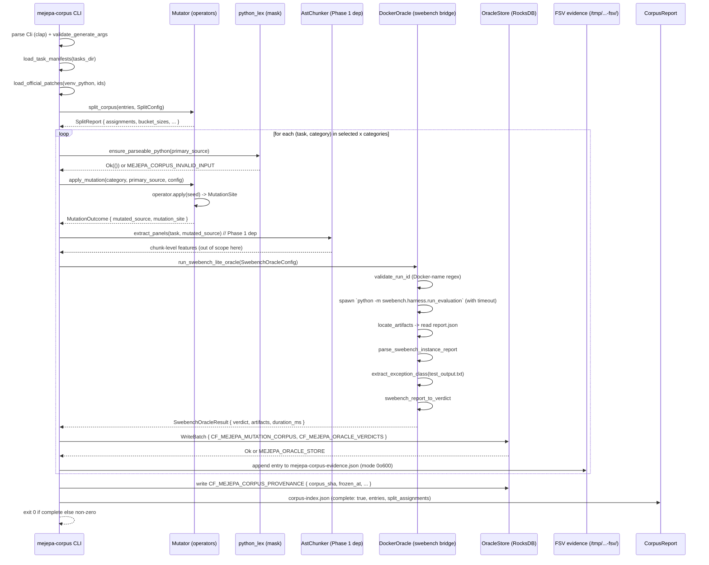

# TECH-CORPUS — ME-JEPA Phase 0 Mutation Corpus + Docker Oracle Bridge (Technical Spec)

> **📊 2026-05-10 STATUS:** PARTIAL — see ../implementation-plan.md for the full Phase 0 status.

> **Level 3.** Captures **HOW** to build the Phase 0 corpus domain. Implements the requirements
> in `../functional/SPEC-CORPUS.md`. When this spec conflicts with the constitution or with
> SPEC-CORPUS, the higher-authority document wins per `constitution.md` §spec_authority_order.

```xml
<technical_spec id="TECH-CORPUS" version="1.0" implements="SPEC-CORPUS">

<metadata>
  <title>ME-JEPA Phase 0 Corpus Implementation</title>
  <status>partial</status>
  <owner>cc-reality-optimizer (Claude Code outer loop)</owner>
  <last_updated>2026-05-10</last_updated>
  <related_specs>
    <spec_ref>SPEC-CORPUS (Level 2 — what to build)</spec_ref>
    <spec_ref>SPEC-CONSTITUTION (Level 1 — immutable rules)</spec_ref>
    <spec_ref>TECH-INSTRUMENTS (Phase 1 — provides OracleVerdict / ExceptionClass /
    PerTestOutcome consumed here)</spec_ref>
  </related_specs>
  <implementation_state>
    <shipped>8 Python mutation operators; split helper (InstanceAtomic + RepoAtomic);
    one-instance SWE-bench Docker bridge (gold + custom); RocksDB CFs for mutations + verdicts;
    `mejepa-corpus generate/verify/stats` CLI scaffolding; FSV harnesses for corpus + split;
    Docker-name-safe run_id validator; tree-sitter-python parser-backed input gate; full FSV
    against `swebench/sweb.eval.x86_64.sympy_1776_sympy-20590:latest` (gold mode 23.7s; custom
    mode 23.0s).</shipped>
    <pending>Per-language operators for Rust, JS, TS, Go, Java, C, C++, C#, Ruby, PHP;
    full-300-task batch generation; CF_MEJEPA_CORPUS_PROVENANCE; SIGINT trap for graceful
    interruption; `--sample-fraction` flag wiring on `verify`.</pending>
  </implementation_state>
</metadata>

<architecture_diagram>

</architecture_diagram>

<data_models>

<model name="MutationCategory">
  <field name="variant" type="enum" constraints="rename_all=snake_case, derive(Serialize,
  Deserialize, Hash, Eq, PartialEq, Copy, Clone, Debug)"/>
  <variants>KnownGood | SubtleFlip | OffByOne | SwapVariable | DeleteTestCall |
  WrongFile | OverEngineer | CompileError</variants>
  <storage>Embedded in keys for `CF_MEJEPA_MUTATION_CORPUS` and
  `CF_MEJEPA_ORACLE_VERDICTS`.</storage>
</model>

<model name="MutationConfig">
  <field name="seed" type="u64" constraints="required, default=0; selects the candidate
  site when an operator finds multiple"/>
  <field name="alternate_source" type="Option&lt;String&gt;" constraints="REQUIRED iff
  category=WrongFile, ignored otherwise"/>
</model>

<model name="MutationSite">
  <field name="byte_offset" type="usize" constraints="required, ≤ source.len()"/>
  <field name="byte_length" type="usize" constraints="required, byte_offset + byte_length
  ≤ source.len(); must NOT overflow usize"/>
  <field name="original_text" type="String" constraints="required, equals
  source[byte_offset..byte_offset+byte_length]"/>
  <field name="replacement_text" type="String" constraints="required"/>
  <field name="note" type="String" constraints="required, human-readable explanation of
  the mutation (e.g., 'flipped > to <')"/>
</model>

<model name="MutationOutcome">
  <field name="category" type="MutationCategory" constraints="required"/>
  <field name="mutated_source" type="String" constraints="required, non-empty,
  byte-equal-to-input for KnownGood"/>
  <field name="seed" type="u64" constraints="echoed from MutationConfig.seed"/>
  <field name="mutation_site" type="Option&lt;MutationSite&gt;"
  constraints="skip_serializing_if=Option::is_none; None for KnownGood + WrongFile"/>
</model>

<model name="OracleVerdict (re-exported from context-graph-mejepa-instruments)">
  <field name="per_test" type="Vec&lt;PerTestOutcome&gt;" constraints="required;
  empty when patch did not apply"/>
  <field name="exception" type="Option&lt;ExceptionClass&gt;" constraints="None when all
  tests passed AND patch applied; Some(class) otherwise per BR-CORPUS-02"/>
  <field name="resolved" type="bool" constraints="mirrors swebench harness's
  resolved field"/>
  <field name="runtime_seconds" type="f64" constraints="non-negative finite"/>
</model>

<model name="PerTestOutcome (re-exported)">
  <field name="test_id" type="String" constraints="required, unique within a
  verdict"/>
  <field name="outcome" type="TestOutcome (Pass | Fail | Skip | Error)"
  constraints="required"/>
</model>

<model name="ExceptionClass (re-exported)">
  <variants>Other | AssertionError | TypeError | ValueError | KeyError | IndexError |
  AttributeError | NameError | ImportError | RuntimeError | SyntaxError</variants>
  <storage>Optional within OracleVerdict.</storage>
</model>

<model name="CorpusEntry">
  <field name="task_id" type="String" constraints="non-empty; matches
  tasks/swebench-lite/*.json instance_id"/>
  <field name="repo" type="String" constraints="non-empty; consistent across same-repo
  tasks"/>
</model>

<model name="SplitMode">
  <field name="variant" type="enum" constraints="rename_all=snake_case"/>
  <variants>InstanceAtomic | RepoAtomic</variants>
</model>

<model name="SplitConfig">
  <field name="train_fraction" type="f64" constraints="default 0.8; sum with cal +
  hold == 1.0 ± 1e-9"/>
  <field name="calibration_fraction" type="f64" constraints="default 0.1"/>
  <field name="holdout_fraction" type="f64" constraints="default 0.1"/>
  <field name="seed" type="u64" constraints="default 0"/>
  <field name="mode" type="SplitMode" constraints="default InstanceAtomic"/>
</model>

<model name="SplitBucket">
  <variants>Train | Calibration | Holdout</variants>
</model>

<model name="TaskAssignment">
  <field name="task_id" type="String" constraints="echoes CorpusEntry.task_id"/>
  <field name="repo" type="String" constraints="echoes CorpusEntry.repo"/>
  <field name="bucket" type="SplitBucket"/>
</model>

<model name="RepoAssignment">
  <field name="repo" type="String"/>
  <field name="bucket" type="SplitBucket"/>
  <field name="task_count" type="usize"/>
</model>

<model name="SplitReport">
  <field name="assignments" type="Vec&lt;TaskAssignment&gt;"/>
  <field name="bucket_sizes" type="[usize; 3]" constraints="canonical
  [train,cal,hold] order"/>
  <field name="bucket_fractions" type="[f64; 3]"/>
  <field name="repo_assignments" type="Vec&lt;RepoAssignment&gt;"
  constraints="empty in InstanceAtomic mode"/>
  <field name="leakage_check_passed" type="bool" constraints="true iff
  no-cross-bucket-repo invariant holds (RepoAtomic) OR always-true (InstanceAtomic)"/>
</model>

<model name="CorpusProvenance">
  <field name="corpus_sha" type="String" constraints="64-char lowercase hex SHA-256
  over sorted concat of (task_id, category.slug(), mutated_source) tuples"/>
  <field name="embedder_version" type="u32" constraints="frozen tag; bumped on
  instrument-set change"/>
  <field name="frozen_at" type="String" constraints="ISO 8601 UTC, regex
  `\d{4}-\d{2}-\d{2}T\d{2}:\d{2}:\d{2}Z`"/>
  <field name="entry_count" type="u32" constraints="equals 8 × |selected_tasks|"/>
  <field name="code_version" type="String" constraints="40-char lowercase hex git
  SHA"/>
  <field name="language_set" type="Vec&lt;Language&gt;" constraints="non-empty
  subset of the 11-language matrix"/>
</model>

<model name="Language">
  <variants>Rust | Python | JavaScript | TypeScript | Go | Java | C | Cpp | CSharp |
  Ruby | Php</variants>
  <storage>Phase 0 v1 supports only `Python`; all others
  return MEJEPA_CHUNKER_UNSUPPORTED_LANGUAGE.</storage>
</model>

<model name="SwebenchPrediction">
  <field name="instance_id" type="String"/>
  <field name="model_name_or_path" type="String" constraints="non-empty; used as
  artifact-namespace directory"/>
  <field name="model_patch" type="String" constraints="unified diff"/>
</model>

<model name="SwebenchPredictionMode">
  <variants>Gold | Custom(SwebenchPrediction)</variants>
</model>

<model name="SwebenchOracleConfig">
  <field name="instance_id" type="String"/>
  <field name="mode" type="SwebenchPredictionMode"/>
  <field name="run_id" type="String" constraints="MUST match Docker-name regex
  `^[a-zA-Z0-9][a-zA-Z0-9_.-]*$`"/>
  <field name="run_root" type="PathBuf" constraints="parent must be writable"/>
  <field name="venv_python" type="PathBuf" constraints="must exist; points at swebench
  venv's python3"/>
  <field name="dataset_name" type="String" constraints="default
  princeton-nlp/SWE-bench_Lite"/>
  <field name="split" type="String" constraints="default test"/>
  <field name="namespace" type="String" constraints="default swebench (Docker namespace
  prefix)"/>
  <field name="instance_timeout" type="Duration" constraints="default 1800s"/>
  <field name="overall_timeout" type="Duration" constraints="default 3600s"/>
</model>

<model name="TransitionBucket">
  <field name="success" type="Vec&lt;String&gt;"/>
  <field name="failure" type="Vec&lt;String&gt;"/>
</model>

<model name="TestsStatus">
  <field name="fail_to_pass" type="TransitionBucket"/>
  <field name="pass_to_pass" type="TransitionBucket"/>
  <field name="fail_to_fail" type="TransitionBucket"/>
  <field name="pass_to_fail" type="TransitionBucket"/>
</model>

<model name="SwebenchInstanceReport">
  <field name="instance_id" type="String"/>
  <field name="patch_is_none" type="bool" constraints="JSON key 'patch_is_None'"/>
  <field name="patch_exists" type="bool"/>
  <field name="patch_successfully_applied" type="bool"/>
  <field name="resolved" type="bool"/>
  <field name="tests_status" type="Option&lt;TestsStatus&gt;" constraints="None when
  patch did not run"/>
</model>

<model name="SwebenchOracleArtifacts">
  <field name="overall_report" type="PathBuf"/>
  <field name="instance_report" type="PathBuf"/>
  <field name="run_log" type="PathBuf"/>
  <field name="test_output" type="PathBuf"/>
  <field name="patch" type="PathBuf"/>
  <field name="predictions_jsonl" type="Option&lt;PathBuf&gt;" constraints="Some only
  in Custom mode"/>
</model>

<model name="SwebenchOracleResult">
  <field name="instance_report" type="SwebenchInstanceReport"/>
  <field name="verdict" type="OracleVerdict"/>
  <field name="artifacts" type="SwebenchOracleArtifacts"/>
  <field name="command" type="Vec&lt;String&gt;" constraints="argv used to spawn the
  harness"/>
  <field name="duration_ms" type="u128"/>
</model>

<model name="CorpusIndex (corpus-index.json on disk)">
  <field name="schema_version" type="u32" constraints="= 1; bumped on schema change"/>
  <field name="complete" type="bool" constraints="true iff all selected entries
  succeeded"/>
  <field name="generated_at_unix_ms" type="u128"/>
  <field name="tasks_dir" type="String"/>
  <field name="store_path" type="String"/>
  <field name="entries" type="Vec&lt;GeneratedEntry&gt;"/>
  <field name="split_assignments" type="Vec&lt;TaskAssignment&gt;"/>
</model>

<model name="GeneratedEntry">
  <field name="task_id" type="String"/>
  <field name="repo" type="String"/>
  <field name="category" type="MutationCategory"/>
  <field name="bucket" type="String" constraints="train|calibration|holdout"/>
  <field name="patch_path" type="String" constraints="filesystem path to the unified
  diff produced for this entry"/>
  <field name="patch_sha256" type="String"/>
  <field name="oracle_verdict_sha256" type="String"/>
  <field name="oracle_all_passed" type="bool"/>
  <field name="oracle_exception" type="Option&lt;String&gt;"/>
  <field name="oracle_per_test_count" type="usize"/>
</model>

</data_models>

<rocksdb_column_families>

<cf name="CF_MEJEPA_MUTATION_CORPUS" implements="REQ-CORPUS-08">
  <key_schema>bincode::serialize(&amp;(task_id: String, category: MutationCategory))</key_schema>
  <value_schema>serde_json::to_vec(&amp;MutationOutcome)</value_schema>
  <write_pattern>WriteBatch alongside CF_MEJEPA_ORACLE_VERDICTS (atomic; partial-write
  rollback). Write happens once per (task_id, category) during `generate`; never
  updated.</write_pattern>
  <read_pattern>Iterated by Phase 3 trainer; point-read by `verify` and
  `stats`.</read_pattern>
</cf>

<cf name="CF_MEJEPA_ORACLE_VERDICTS" implements="REQ-CORPUS-08">
  <key_schema>bincode::serialize(&amp;(task_id: String, category: MutationCategory))</key_schema>
  <value_schema>serde_json::to_vec(&amp;OracleVerdict)</value_schema>
  <write_pattern>Same WriteBatch as above; same atomicity contract.</write_pattern>
  <read_pattern>Joined with CF_MEJEPA_MUTATION_CORPUS by Phase 3 trainer; sample-read by
  `verify`.</read_pattern>
</cf>

<cf name="CF_MEJEPA_CORPUS_PROVENANCE" implements="REQ-CORPUS-12">
  <key_schema>bincode::serialize(&amp;(corpus_version: u32, embedder_version: u32))</key_schema>
  <value_schema>serde_json::to_vec(&amp;CorpusProvenance)</value_schema>
  <write_pattern>Written exactly once per `generate` invocation, AFTER all 2,400 entries
  commit AND `complete: true`. Never updated.</write_pattern>
  <read_pattern>Read once at `verify` start (to derive sample seed) and at Phase 3
  training start (to assert corpus version compatibility).</read_pattern>
</cf>

</rocksdb_column_families>

<api_contracts>

<endpoint name="apply_mutation" surface="library" path="context_graph_mejepa_corpus::apply_mutation">
  <implements>REQ-CORPUS-02, REQ-CORPUS-11</implements>
  <signature>pub fn apply_mutation(category: MutationCategory, primary_source: &amp;str,
  config: MutationConfig) -&gt; MutationResult&lt;MutationOutcome&gt;</signature>
  <preconditions>
    - primary_source is non-empty.
    - tree-sitter parses primary_source without error
      (python_lex::ensure_parseable_python).
    - config.alternate_source is Some(_) iff category == WrongFile.
  </preconditions>
  <postconditions>
    - Ok(outcome): outcome.mutated_source is non-empty; outcome.mutation_site (if Some)
      is byte- and UTF-8-aligned and original_text matches.
    - Err(MEJEPA_CORPUS_INVALID_INPUT | MEJEPA_CORPUS_NO_MUTATION_SITE |
      MEJEPA_CORPUS_OPERATOR_FAILED) on the documented failure modes.
  </postconditions>
</endpoint>

<endpoint name="run_swebench_lite_oracle" surface="library"
path="context_graph_mejepa_corpus::swebench::run_swebench_lite_oracle">
  <implements>REQ-CORPUS-03, REQ-CORPUS-04, REQ-CORPUS-05, REQ-CORPUS-14</implements>
  <signature>pub fn run_swebench_lite_oracle(config: &amp;SwebenchOracleConfig)
  -&gt; OracleResult&lt;SwebenchOracleResult&gt;</signature>
  <preconditions>
    - config.run_id matches Docker name regex.
    - config.venv_python exists and is a Python 3 with `swebench` installed.
    - config.run_root parent is writable.
    - Docker daemon is reachable.
  </preconditions>
  <postconditions>
    - Ok(result): result.artifacts paths all exist on disk; result.verdict obeys
      BR-CORPUS-02 mapping rules; result.duration_ms is finite.
    - Err: typed OracleError with .code() in
      { MEJEPA_ORACLE_INVALID_INPUT, MEJEPA_ORACLE_IO, MEJEPA_ORACLE_COMMAND_FAILED,
        MEJEPA_ORACLE_TIMEOUT, MEJEPA_ORACLE_JSON_PARSE,
        MEJEPA_ORACLE_REPORT_INVALID, MEJEPA_ORACLE_STORE,
        MEJEPA_CORPUS_DOCKER_RUN_ID_UNSAFE }.
  </postconditions>
</endpoint>

<endpoint name="parse_swebench_instance_report" surface="library"
path="context_graph_mejepa_corpus::swebench::parse_swebench_instance_report">
  <implements>REQ-CORPUS-04</implements>
  <signature>pub fn parse_swebench_instance_report(instance_id: &amp;str, text: &amp;str)
  -&gt; OracleResult&lt;SwebenchInstanceReport&gt;</signature>
  <preconditions>text is non-empty; text is the verbatim contents of one
  per-instance report.json.</preconditions>
  <postconditions>
    - Ok(report): report.instance_id == instance_id; required boolean fields populated.
    - Err(MEJEPA_ORACLE_REPORT_INVALID) if root has != 1 key, key mismatches
      instance_id, or required field types are wrong.
    - Err(MEJEPA_ORACLE_JSON_PARSE) if text is not valid JSON.
  </postconditions>
</endpoint>

<endpoint name="swebench_report_to_verdict" surface="library"
path="context_graph_mejepa_corpus::swebench::swebench_report_to_verdict">
  <implements>REQ-CORPUS-04</implements>
  <signature>pub fn swebench_report_to_verdict(report: &amp;SwebenchInstanceReport,
  exception_hint: Option&lt;ExceptionClass&gt;) -&gt;
  OracleResult&lt;OracleVerdict&gt;</signature>
  <preconditions>report is well-formed (already passed
  parse_swebench_instance_report).</preconditions>
  <postconditions>
    - When patch_is_None || !patch_exists || !patch_successfully_applied: verdict.per_test
      = []; verdict.exception = Some(Other); verdict.resolved = report.resolved.
    - Otherwise: per_test rows synthesized per BR-CORPUS-02 mapping; exception is
      exception_hint.or(None).
  </postconditions>
</endpoint>

<endpoint name="split_corpus" surface="library"
path="context_graph_mejepa_corpus::split::split_corpus">
  <implements>REQ-CORPUS-06</implements>
  <signature>pub fn split_corpus(entries: &amp;[CorpusEntry], config: &amp;SplitConfig)
  -&gt; MutationResult&lt;SplitReport&gt;</signature>
  <preconditions>
    - entries is non-empty.
    - No duplicate task_ids (case-sensitive).
    - config fractions sum to 1.0 ± 1e-9, are non-negative, finite.
  </preconditions>
  <postconditions>
    - Ok(report): every input entry maps to one assignment; bucket_sizes sums to
      entries.len(); leakage_check_passed reflects the structural invariant for the
      mode.
    - Err(MEJEPA_CORPUS_INVALID_INPUT) on validation failure.
  </postconditions>
</endpoint>

<endpoint name="assert_no_test_patch_leakage" surface="library"
path="context_graph_mejepa_corpus::split::assert_no_test_patch_leakage">
  <implements>REQ-CORPUS-07</implements>
  <signature>pub fn assert_no_test_patch_leakage(assignments: &amp;[TaskAssignment],
  test_patch_shas: &amp;BTreeMap&lt;String, String&gt;) -&gt;
  MutationResult&lt;()&gt;</signature>
  <preconditions>test_patch_shas covers every task_id in assignments.</preconditions>
  <postconditions>
    - Ok(()): no test_patch_sha256 appears in two different buckets.
    - Err(MEJEPA_CORPUS_LEAKAGE_DETECTED) with offending sha and collisions.
  </postconditions>
</endpoint>

<endpoint name="generate_swe_bench_mutation_corpus" surface="library"
path="context_graph_mejepa_corpus::generate_swe_bench_mutation_corpus">
  <implements>REQ-CORPUS-01, REQ-CORPUS-12, REQ-CORPUS-13, REQ-CORPUS-16</implements>
  <signature>pub fn generate_swe_bench_mutation_corpus(swe_bench_lite_root: &amp;Path,
  output_root: &amp;Path, categories: &amp;[MutationCategory], languages:
  &amp;[Language]) -&gt; Result&lt;CorpusReport, MejepaCorpusError&gt;</signature>
  <preconditions>
    - swe_bench_lite_root contains tasks/swebench-lite/*.json manifests.
    - output_root parent is writable.
    - Every language ∈ {Language::Python} (others return
      MEJEPA_CHUNKER_UNSUPPORTED_LANGUAGE).
    - Docker daemon is reachable; swebench venv is configured.
  </preconditions>
  <postconditions>
    - Ok(report): RocksDB at output_root/store/ contains 8 × |selected_tasks| entries
      across CF_MEJEPA_MUTATION_CORPUS + CF_MEJEPA_ORACLE_VERDICTS; one row in
      CF_MEJEPA_CORPUS_PROVENANCE; corpus-index.json with complete=true.
    - Err: structured error; corpus-index.json (if any) has complete=false.
  </postconditions>
</endpoint>

<endpoint name="mejepa-corpus generate" surface="cli"
path="cargo run --release -p context-graph-mejepa-corpus -- generate">
  <implements>REQ-CORPUS-09</implements>
  <flags>
    --output &lt;path&gt;                              required; corpus root
    --tasks-dir &lt;path&gt;                           default tasks/swebench-lite
    --venv-python &lt;path&gt;                         required; swebench venv python
    --languages &lt;lang,...&gt;                       required; today only `python`
    --instance-id &lt;id&gt;                           repeatable; selects subset
    --category &lt;cat&gt;                             repeatable; selects subset
    --max-tasks &lt;n&gt;                              optional; caps for smoke
    --seed &lt;u64&gt;                                 default 0; per-mutation seed
    --run-id-prefix &lt;str&gt;                        default mejepa-corpus
    --instance-timeout-secs &lt;u64&gt;                default 1800
    --overall-timeout-secs &lt;u64&gt;                 default 3600
    --alternate-wrong-file-path &lt;path&gt;           required iff WrongFile selected
    --sample-fraction &lt;f64&gt;                      ignored on generate
  </flags>
  <exit_codes>0 on complete=true; non-zero on any failure.</exit_codes>
</endpoint>

<endpoint name="mejepa-corpus verify" surface="cli"
path="cargo run --release -p context-graph-mejepa-corpus -- verify">
  <implements>REQ-CORPUS-15</implements>
  <flags>
    --corpus &lt;path&gt;                              required
    --sample-fraction &lt;f64&gt;                      default 0.05
  </flags>
  <exit_codes>0 iff every sampled row matches; non-zero with stdout JSON diff
  otherwise.</exit_codes>
</endpoint>

<endpoint name="mejepa-corpus stats" surface="cli"
path="cargo run --release -p context-graph-mejepa-corpus -- stats">
  <implements>REQ-CORPUS-09</implements>
  <flags>
    --corpus &lt;path&gt;                              required
  </flags>
  <exit_codes>Always 0; read-only inspector.</exit_codes>
</endpoint>

</api_contracts>

<component_contracts>

<component name="MutationOperator (Python today)"
path="crates/context-graph-mejepa-corpus/src/{known_good,subtle_flip,off_by_one,swap_variable,delete_test_call,wrong_file,over_engineer,compile_error}.rs">
  <method name="apply">
    <signature>pub(crate) fn apply(primary_source: &amp;str, seed: u64) -&gt;
    MutationResult&lt;MutationSite&gt;</signature>
    <implements>REQ-CORPUS-02</implements>
    <behavior>
      1. Build a Python lexical mask via `python_lex::mask_python(primary_source)` that
         excludes comment ranges, ordinary strings, triple-quoted strings, prefixed
         strings, and f-string literal text from the candidate set; f-string
         replacement-field code IS included.
      2. Scan the unmasked code for category-specific tokens (boolean operators for
         SubtleFlip; integer/float numeric literals for OffByOne; identifier
         occurrences referencing local variables for SwapVariable; assertion calls for
         DeleteTestCall; etc.). KnownGood and WrongFile bypass the scan.
      3. If zero candidate sites: return MEJEPA_CORPUS_NO_MUTATION_SITE.
      4. Pick one candidate via `prng::pick_index_or_fail(seed, candidates.len())`
         (SplitMix64).
      5. Build MutationSite { byte_offset, byte_length, original_text, replacement_text,
         note }; lib.rs::apply_site validates bounds, UTF-8 alignment, and original_text
         readback.
    </behavior>
    <throws>MEJEPA_CORPUS_NO_MUTATION_SITE | MEJEPA_CORPUS_OPERATOR_FAILED</throws>
  </method>
</component>

<component name="python_lex"
path="crates/context-graph-mejepa-corpus/src/python_lex.rs">
  <method name="ensure_parseable_python">
    <signature>pub(crate) fn ensure_parseable_python(source: &amp;str, field: &amp;'static
    str) -&gt; MutationResult&lt;()&gt;</signature>
    <implements>REQ-CORPUS-11</implements>
    <behavior>Run tree-sitter-python parse. If root.has_error(): walk tree to first
    ERROR or MISSING node; return MEJEPA_CORPUS_INVALID_INPUT with byte offset, line,
    and node-kind in the message.</behavior>
    <throws>MEJEPA_CORPUS_INVALID_INPUT</throws>
  </method>
  <method name="mask_python">
    <signature>pub(crate) fn mask_python(source: &amp;str) -&gt; LexicalMask</signature>
    <behavior>Returns a LexicalMask exposing `is_code(byte_offset)` and
    `is_code_range(start, end)`. Triple-quoted strings, prefixed strings, comments, and
    f-string literal text are masked. F-string replacement fields are exposed as
    code.</behavior>
  </method>
</component>

<component name="OracleStore"
path="crates/context-graph-mejepa-corpus/src/oracle.rs">
  <method name="open">
    <signature>pub fn open(path: &amp;Path) -&gt; OracleResult&lt;Self&gt;</signature>
    <implements>REQ-CORPUS-08</implements>
    <behavior>Open or create the RocksDB at path with three CF descriptors
    [CF_MEJEPA_MUTATION_CORPUS, CF_MEJEPA_ORACLE_VERDICTS, CF_MEJEPA_CORPUS_PROVENANCE].
    Tune block_cache, write_buffer_size, and compression per
    `context-graph-storage`-aligned defaults.</behavior>
  </method>
  <method name="put_corpus_row">
    <signature>pub fn put_corpus_row(&amp;self, task_id: &amp;str, category:
    MutationCategory, outcome: &amp;MutationOutcome, verdict: &amp;OracleVerdict)
    -&gt; OracleResult&lt;()&gt;</signature>
    <implements>REQ-CORPUS-08, EC-CORPUS-09</implements>
    <behavior>Build one rocksdb::WriteBatch with both CF puts; commit atomically.
    Failure returns MEJEPA_ORACLE_STORE; partial state is impossible because the
    batch is the unit of durability.</behavior>
    <throws>MEJEPA_ORACLE_STORE</throws>
  </method>
  <method name="put_provenance">
    <signature>pub fn put_provenance(&amp;self, prov: &amp;CorpusProvenance) -&gt;
    OracleResult&lt;()&gt;</signature>
    <implements>REQ-CORPUS-12</implements>
    <behavior>Write the single provenance row keyed by (corpus_version=1,
    prov.embedder_version) into CF_MEJEPA_CORPUS_PROVENANCE.</behavior>
  </method>
  <method name="get_corpus_row">
    <signature>pub fn get_corpus_row(&amp;self, task_id: &amp;str, category:
    MutationCategory) -&gt; OracleResult&lt;Option&lt;(MutationOutcome,
    OracleVerdict)&gt;&gt;</signature>
    <behavior>Point-read both CFs by the same composite key; return None if either is
    absent.</behavior>
  </method>
  <method name="iter_corpus_rows">
    <signature>pub fn iter_corpus_rows(&amp;self) -&gt; impl
    Iterator&lt;Item=OracleResult&lt;(String, MutationCategory, MutationOutcome,
    OracleVerdict)&gt;&gt;</signature>
    <behavior>Stream all rows for the trainer; uses RocksDB's ReadOptions with
    snapshot for consistency.</behavior>
  </method>
</component>

<component name="DockerRunIdValidator"
path="crates/context-graph-mejepa-corpus/src/swebench.rs (helper)">
  <method name="validate_run_id">
    <signature>pub(crate) fn validate_run_id(run_id: &amp;str) -&gt;
    OracleResult&lt;()&gt;</signature>
    <implements>REQ-CORPUS-05, BR-CORPUS-03</implements>
    <behavior>
      1. If run_id is empty: MEJEPA_CORPUS_DOCKER_RUN_ID_UNSAFE.
      2. If first char does not match `[a-zA-Z0-9]`: same error with position 0
         cited.
      3. Iterate remaining chars; first violator of `[a-zA-Z0-9_.-]` -&gt; same
         error with position cited.
      4. Else Ok(()).
    </behavior>
    <throws>MEJEPA_CORPUS_DOCKER_RUN_ID_UNSAFE</throws>
  </method>
</component>

<component name="DockerOracle"
path="crates/context-graph-mejepa-corpus/src/swebench.rs">
  <method name="run_swebench_lite_oracle">
    <signature>pub fn run_swebench_lite_oracle(config: &amp;SwebenchOracleConfig) -&gt;
    OracleResult&lt;SwebenchOracleResult&gt;</signature>
    <implements>REQ-CORPUS-03, REQ-CORPUS-04, REQ-CORPUS-05, REQ-CORPUS-14</implements>
    <behavior>
      1. validate_config(config) — runs validate_run_id; checks venv_python exists; etc.
      2. If mode is Custom: write_predictions_jsonl(config) and capture path.
      3. Build harness command: [venv_python, "-m", "swebench.harness.run_evaluation",
         "--dataset_name", ds, "--split", sp, "--predictions_path", path_or_"gold",
         "--run_id", run_id, "--namespace", ns, "--instance_ids", instance_id,
         "--timeout", instance_timeout_secs, ...].
      4. fs::create_dir_all(run_root); spawn Command with stdout/stderr piped;
         wait_with_timeout(child, overall_timeout, "swebench-harness").
      5. If exit non-zero: MEJEPA_ORACLE_COMMAND_FAILED with stdout/stderr tails.
      6. locate_artifacts(config, jsonl_path?) -&gt; SwebenchOracleArtifacts.
      7. Read instance_report = parse_swebench_instance_report(instance_id,
         fs::read_to_string(artifacts.instance_report)?).
      8. Read test_output_text = fs::read_to_string(artifacts.test_output)?.
      9. exception_hint = extract_exception_class(&amp;test_output_text).
      10. verdict = swebench_report_to_verdict(&amp;instance_report, exception_hint)?.
      11. Return SwebenchOracleResult { instance_report, verdict, artifacts, command,
          duration_ms }.
    </behavior>
    <throws>MEJEPA_ORACLE_INVALID_INPUT | MEJEPA_ORACLE_IO |
    MEJEPA_ORACLE_COMMAND_FAILED | MEJEPA_ORACLE_TIMEOUT |
    MEJEPA_ORACLE_JSON_PARSE | MEJEPA_ORACLE_REPORT_INVALID |
    MEJEPA_CORPUS_DOCKER_RUN_ID_UNSAFE</throws>
  </method>
  <method name="extract_exception_class">
    <signature>fn extract_exception_class(test_output: &amp;str) -&gt;
    Option&lt;ExceptionClass&gt;</signature>
    <behavior>Regex-match against canonical Python exception class names in the
    test_output.txt tail; first match wins; None when no recognized class is
    found.</behavior>
  </method>
</component>

<component name="SplitEngine"
path="crates/context-graph-mejepa-corpus/src/split.rs">
  <method name="split_corpus">
    <signature>pub fn split_corpus(entries: &amp;[CorpusEntry], config:
    &amp;SplitConfig) -&gt; MutationResult&lt;SplitReport&gt;</signature>
    <implements>REQ-CORPUS-06</implements>
    <behavior>
      1. validate_config(config): fractions sum to 1±1e-9; non-negative; finite.
      2. validate_entries(entries): non-empty; no duplicate task_ids; non-empty
         repo+task_id strings.
      3. Build assignment units: instances (mode=InstanceAtomic) or repos
         (mode=RepoAtomic) each carrying a size.
      4. SplitMix64-shuffle units by config.seed.
      5. LPT pre-sort units by descending size (no-op for InstanceAtomic).
      6. For each unit in order: pick the bucket with the lowest
         current_count/target_count ratio; assign.
      7. Build SplitReport: bucket_sizes, bucket_fractions, repo_assignments (if
         RepoAtomic), leakage_check_passed (RepoAtomic invariant; always true
         for InstanceAtomic).
      8. Emit stderr warning if RepoAtomic ratios deviate &gt; 5% from target.
    </behavior>
    <throws>MEJEPA_CORPUS_INVALID_INPUT</throws>
  </method>
  <method name="assert_no_test_patch_leakage">
    <signature>pub fn assert_no_test_patch_leakage(assignments:
    &amp;[TaskAssignment], test_patch_shas: &amp;BTreeMap&lt;String, String&gt;)
    -&gt; MutationResult&lt;()&gt;</signature>
    <implements>REQ-CORPUS-07</implements>
    <behavior>
      1. Build a `BTreeMap&lt;sha, BTreeMap&lt;bucket, Vec&lt;task_id&gt;&gt;&gt;`
         from assignments + test_patch_shas.
      2. For each sha: if its inner map has &gt; 1 distinct bucket → return
         MEJEPA_CORPUS_LEAKAGE_DETECTED with the offending sha and the colliding
         (task_id, bucket) pairs.
      3. Else Ok(()).
    </behavior>
    <throws>MEJEPA_CORPUS_LEAKAGE_DETECTED</throws>
  </method>
</component>

<component name="MejepaCorpusCli"
path="crates/context-graph-mejepa-corpus/src/bin/mejepa-corpus.rs">
  <method name="main">
    <signature>fn main() -&gt; CliResult&lt;()&gt;</signature>
    <implements>REQ-CORPUS-09, REQ-CORPUS-15, REQ-CORPUS-16</implements>
    <behavior>
      1. clap::Cli::parse() into one of {Generate, Verify, Stats}.
      2. Generate → validate args (run_id_prefix passes validate_run_id; languages ⊆
         {python}); load_task_manifests; load_official_patches via venv_python;
         split_corpus; for each (task,category): apply_mutation → run_swebench_lite_oracle
         → store.put_corpus_row → append GeneratedEntry to corpus-index.json.
      3. On any error: persist corpus-index.json with complete=false; non-zero
         exit; print structured error to stderr.
      4. On success: store.put_provenance(corpus_provenance); persist
         corpus-index.json with complete=true; FSV evidence to
         /mnt/d/contextgraph/fsv/context-graph-mejepa-corpus/{mejepa-corpus-evidence.json,
         split-evidence.json, split-assignments.json} with mode 0o600; exit 0.
      5. Verify → open OracleStore; read provenance; compute deterministic
         5%-sample seed = first 8 bytes of corpus_sha; for each sampled row:
         re-run run_swebench_lite_oracle; compare four invariant fields; collect
         diffs; print JSON; exit 0 iff zero diffs.
      6. Stats → open OracleStore; iterate; aggregate by_category, by_oracle,
         by_bucket, leakage_check; print JSON; exit 0.
    </behavior>
  </method>
  <method name="parse_categories">
    <signature>fn parse_categories(raw: &amp;[String]) -&gt;
    CliResult&lt;Vec&lt;MutationCategory&gt;&gt;</signature>
    <behavior>Map each `--category` flag value to MutationCategory via
    MutationCategory::all().iter().find(|c| c.slug() == raw); error on
    unrecognized.</behavior>
  </method>
  <method name="validate_generate_args">
    <signature>fn validate_generate_args(args: &amp;GenerateArgs) -&gt;
    CliResult&lt;()&gt;</signature>
    <implements>REQ-CORPUS-05, REQ-CORPUS-13, BR-CORPUS-01</implements>
    <behavior>
      1. validate_run_id(&amp;args.run_id_prefix).
      2. parse_languages(&amp;args.languages); reject any language ≠ python with
         MEJEPA_CHUNKER_UNSUPPORTED_LANGUAGE.
      3. If any --category includes WrongFile but --alternate-wrong-file-path is
         None: error.
      4. Verify --venv-python exists and is executable.
    </behavior>
  </method>
</component>

<component name="MejepaCorpusFsv"
path="crates/context-graph-mejepa-corpus/examples/mejepa_corpus_fsv.rs">
  <method name="main">
    <signature>fn main()</signature>
    <implements>REQ-CORPUS-10, NFR-CORPUS-06</implements>
    <behavior>
      1. Build an in-memory fixture: 1-3 real Python sources from
         tasks/swebench-lite/{first,middle,last}.json's gold patch.
      2. For each (source, category) combination: apply_mutation →
         persist mutated source under /mnt/d/contextgraph/fsv/context-graph-mejepa-corpus/sources/
         (mode 0o600) → run `python3 -m py_compile` against it (real toolchain) →
         capture exit code + .pyc presence.
      3. Append a row to /mnt/d/contextgraph/fsv/context-graph-mejepa-corpus/mejepa-corpus-evidence.json
         with category, mutated_source_sha256, py_compile_passed, expected_outcome.
      4. Re-read the evidence file and assert every row's mutated_source_sha256
         matches the on-disk file's hash; assert expected_outcome agrees with
         observed.
      5. Print "FSV PASSED: N rows" on success; non-zero exit on assertion
         failure.
    </behavior>
  </method>
</component>

<component name="SplitFsv"
path="crates/context-graph-mejepa-corpus/examples/split_fsv.rs">
  <method name="main">
    <signature>fn main()</signature>
    <implements>REQ-CORPUS-10</implements>
    <behavior>
      1. Load entries from tasks/swebench-lite/*.json into Vec&lt;CorpusEntry&gt;.
      2. Run split_corpus twice (InstanceAtomic and RepoAtomic).
      3. Write split-evidence.json with both reports' bucket_sizes, bucket_fractions,
         leakage_check_passed.
      4. Write split-assignments.json with the per-task TaskAssignment list for the
         InstanceAtomic mode.
      5. Re-read both files; assert byte-equality with what was written.
      6. Verify file mode is 0o600.
    </behavior>
  </method>
</component>

</component_contracts>

<error_taxonomy>

| code | source | wraps | recovery |
|---|---|---|---|
| MEJEPA_CORPUS_INVALID_INPUT | MutationError::InvalidInput | python_lex parse-error / empty source / missing alternate_source | caller fixes input |
| MEJEPA_CORPUS_NO_MUTATION_SITE | MutationError::NoMutationSite | operator found zero candidates | caller picks a different category or source |
| MEJEPA_CORPUS_OPERATOR_FAILED | MutationError::OperatorFailed | site-bound or original_text-mismatch operator bug | bug report; abort |
| MEJEPA_CORPUS_LEAKAGE_DETECTED | MutationError (split-extension variant) | assert_no_test_patch_leakage | regenerate split |
| MEJEPA_CHUNKER_UNSUPPORTED_LANGUAGE | propagated from constitution failure_taxonomy | unsupported `--languages` | drop unsupported flag values |
| MEJEPA_ORACLE_INVALID_INPUT | OracleError::InvalidInput | config validation | caller fixes config |
| MEJEPA_ORACLE_IO | OracleError::Io | filesystem | caller addresses fs issue |
| MEJEPA_ORACLE_COMMAND_FAILED | OracleError::CommandFailed | non-zero harness exit | inspect Docker / harness output |
| MEJEPA_ORACLE_TIMEOUT | OracleError::Timeout | wait_with_timeout SIGKILL | increase timeout or fix Docker |
| MEJEPA_ORACLE_JSON_PARSE | OracleError::JsonParse | serde_json on report.json | preserve file; debug harness |
| MEJEPA_ORACLE_REPORT_INVALID | OracleError::ReportInvalid | structural report.json check | do not edit harness output |
| MEJEPA_ORACLE_STORE | OracleError::Store | RocksDB write/get | fix disk / CF config |
| MEJEPA_CORPUS_DOCKER_RUN_ID_UNSAFE | OracleError variant added by REQ-CORPUS-05 | validate_run_id | replace `+` etc. with `-` |
| MEJEPA_CORPUS_REPORT_PARSE_FAIL | alias for MEJEPA_ORACLE_JSON_PARSE / REPORT_INVALID at the corpus surface | corpus-level CLI error | as above |

</error_taxonomy>

<concurrency_model>

  <rule>Corpus generation is single-process, sequential per (task, category) within a
  single CLI invocation. The Docker oracle is the bottleneck (~30s per call); inner
  parallelism is deferred to a future optimization (Q-CORPUS-01-adjacent).</rule>
  <rule>RocksDB OracleStore is opened once per CLI invocation; closed on drop. WriteBatch
  is the unit of atomicity for paired (mutation, verdict) writes.</rule>
  <rule>The oracle subprocess lifecycle is bounded by `wait_with_timeout`. If the timeout
  fires, the child is SIGKILLed and the call returns MEJEPA_ORACLE_TIMEOUT. Zombie
  detection: `wait_with_timeout` confirms child reap via `try_wait`.</rule>
  <rule>FSV evidence files are written with `O_CREAT | O_TRUNC | O_EXCL` semantics where
  applicable; appended-to files use `O_APPEND` to prevent racing writers from
  overlapping.</rule>

</concurrency_model>

<determinism_contract>

  <rule>Mutation operators MUST be byte-equal across runs given the same (category,
  primary_source, MutationConfig.seed). Verified by TC-CORPUS-01.</rule>
  <rule>Split assignments MUST be byte-equal across runs given the same (entries,
  SplitConfig). Verified by NFR-CORPUS-04.</rule>
  <rule>The corpus_sha is reproducible: same input set + same operator outputs + same
  sort order → byte-equal SHA-256. Verified by TC-CORPUS-16.</rule>
  <rule>Docker oracle invocations are NOT byte-deterministic in `runtime_seconds`
  (stochastic) but ARE deterministic in (resolved, FAIL_TO_PASS.success.len(),
  PASS_TO_PASS.success.len(), exception_class) for a given image SHA + harness
  version + mutated_source. The four-tuple is what `verify` compares.</rule>

</determinism_contract>

<implementation_notes>

  <note category="security">SEC-MEJEPA-05 (constitution) — every Docker run_id is
  validated against `^[a-zA-Z0-9][a-zA-Z0-9_.-]*$` BEFORE subprocess spawn. The
  validator is callable from CLI argument parsing and from
  run_swebench_lite_oracle as a defense-in-depth pair.</note>

  <note category="security">SEC-MEJEPA-07 (constitution) — FSV evidence files in
  /mnt/d/contextgraph/fsv/context-graph-mejepa-corpus/ MUST be mode 0o600. The FSV harness uses
  `OpenOptions::new().mode(0o600)` on Unix; non-Unix is unsupported for FSV.</note>

  <note category="performance">Docker oracle invocations dominate corpus generation
  cost. Baseline: 23.7s gold / 23.0s custom on `sympy__sympy-20590` (22 tests).
  Full 2,400-entry batch ≈ 20 hours wall-clock single-process. Parallelism via
  `--concurrency N` is deferred to a later spec; Docker daemon contention,
  network bandwidth on first image pull, and disk pressure from per-instance
  artifact trees would need profiling first.</note>

  <note category="performance">RocksDB OracleStore writes are batched: one
  WriteBatch per (task_id, category) row covering both CFs. Provenance is one
  additional point-write at end of run.</note>

  <note category="integration">The SWE-bench harness is the only acceptable
  oracle (constitution `<tech_stack>`). NEVER substitute a Rust reimplementation
  of the test runner; verdict semantics are defined by the upstream
  `swebench/harness/grading.py` and any drift would invalidate the labels.</note>

  <note category="integration">The corpus crate depends on
  `context-graph-mejepa-instruments` for OracleVerdict / ExceptionClass /
  PerTestOutcome / TestOutcome type definitions; this crate must NOT redefine
  them.</note>

  <note category="integration">The corpus crate depends on
  `context-graph-mincut` for the Stoer-Wagner mincut used in the RepoAtomic
  split's structural fairness check. The mincut crate is shipped (per
  constitution `<directory_structure>`) and stable.</note>

  <note category="determinism">SplitMix64 PRNG is the only PRNG used in this
  crate. Operator seeds and split seeds are independent (no shared state). PRNG
  state is created fresh per call; seeds are not advanced across calls.</note>

  <note category="data-integrity">The WriteBatch atomic-pair contract for
  CF_MEJEPA_MUTATION_CORPUS + CF_MEJEPA_ORACLE_VERDICTS is the only structural
  guarantee against corpus-row partial writes. Tests in EC-CORPUS-09 verify the
  contract under simulated rocksdb failure.</note>

  <note category="forward-compat">The `Language` enum's `match` arms in
  apply_mutation / generate_swe_bench_mutation_corpus are exhaustive. When a
  new per-language operator ships (e.g., Rust mutations), the corresponding
  arm activates; until then it returns
  MEJEPA_CHUNKER_UNSUPPORTED_LANGUAGE. The Rust compiler enforces
  exhaustiveness at compile time per EC-CORPUS-13.</note>

  <note category="reality-boundary">The corpus crate MUST NOT modify any path
  in constitution `<anti_patterns reason="Reality-Boundary">` (.env, swebench/**,
  tests/oracle_**, crates/*/src/reward_specs/**, crates/*/src/verifiers/**,
  *.pem, *.key, **/credentials.json). The harness invocation only READS from
  the swebench Python venv; it never writes into the swebench package
  tree.</note>

  <note category="generic-only">Per constitution `<anti_patterns
  reason="Generic-Only">`, every mutation operator MUST be agnostic to the
  specific SWE-bench task. No per-repo branches, no per-task heuristics. The
  same operator runs on `astropy__astropy-12907`, `psf__requests-2317`,
  `django__django-12286`, `sympy__sympy-13895`, and any future SWE-bench
  task.</note>

  <note category="provenance">Per constitution `<provenance>`, every persistent
  artifact carries provenance metadata. CorpusProvenance binds (corpus_sha,
  embedder_version, frozen_at, code_version, language_set) into one row; the
  Phase 3 trainer reads this on startup and refuses to consume a corpus whose
  embedder_version drifts from its expected dependency.</note>

  <note category="testing">Constitution `<testing_requirements>` mandates 80%
  line coverage on shipped crates and 90% for safety-critical paths. The
  WriteBatch atomic-pair path, the run_id validator, and the
  swebench_report_to_verdict mapping are safety-critical and require
  90%.</note>

  <note category="fsv">Constitution `<fsv_protocol>` mandates physical
  evidence at /mnt/d/contextgraph/fsv/context-graph-mejepa-corpus/. The FSV harness invokes
  `python3 -m py_compile` against every emitted Python artifact (real
  toolchain, no mock). Equivalent toolchains for the 10 deferred
  languages will be wired as those operators ship: rustc, javac,
  gcc, g++, dotnet build, node, tsc, ruby -c, go build, php -l per
  constitution `<fsv_protocol>` rule 3.</note>

  <note category="upstream-reference-only">Per constitution `<anti_patterns
  reason="LockedDecision">`, this crate is a clean-room reimplementation of
  the conceptual approach (mutation testing with Mothra/MuJava/mutmut as
  inspirational reference); NO upstream code is vendored or path-depended.
  The operator implementations are original.</note>

</implementation_notes>

<traceability_matrix>

| FunctionalReq | TechSurface | Component | Test |
|---|---|---|---|
| REQ-CORPUS-01 | generate_swe_bench_mutation_corpus + CLI generate | MejepaCorpusCli, OracleStore | TC-CORPUS-11 |
| REQ-CORPUS-02 | apply_mutation | MutationOperator (8 files), python_lex | TC-CORPUS-01..03 |
| REQ-CORPUS-03 | run_swebench_lite_oracle | DockerOracle | TC-CORPUS-09 |
| REQ-CORPUS-04 | swebench_report_to_verdict, parse_swebench_instance_report | DockerOracle | TC-CORPUS-04 |
| REQ-CORPUS-05 | validate_run_id | DockerRunIdValidator | TC-CORPUS-05 |
| REQ-CORPUS-06 | split_corpus | SplitEngine | TC-CORPUS-06,07 |
| REQ-CORPUS-07 | assert_no_test_patch_leakage | SplitEngine | TC-CORPUS-08 |
| REQ-CORPUS-08 | OracleStore CFs | OracleStore | TC-CORPUS-10 |
| REQ-CORPUS-09 | CLI subcommands | MejepaCorpusCli | TC-CORPUS-11,12,14 |
| REQ-CORPUS-10 | FSV examples | MejepaCorpusFsv, SplitFsv | TC-CORPUS-18 |
| REQ-CORPUS-11 | ensure_parseable_python | python_lex | TC-CORPUS-15 |
| REQ-CORPUS-12 | put_provenance, CorpusProvenance | OracleStore | TC-CORPUS-16 |
| REQ-CORPUS-13 | Language enum, validate_generate_args | MejepaCorpusCli | TC-CORPUS-14 |
| REQ-CORPUS-14 | wait_with_timeout in oracle.rs | DockerOracle | TC-CORPUS-17 |
| REQ-CORPUS-15 | mejepa-corpus verify | MejepaCorpusCli | TC-CORPUS-12,13 |
| REQ-CORPUS-16 | corpus-index.json complete flag | MejepaCorpusCli | TC-CORPUS-11 (negative path) |

</traceability_matrix>

</technical_spec>
```
