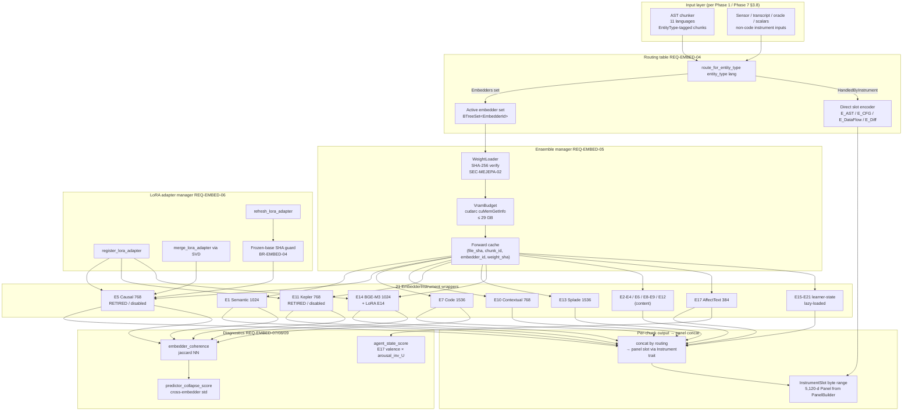

# TECH-EMBEDDERS — Technical Specification

> **📊 2026-05-10 HARDENING STATUS:** CONTROL SURFACE HARDENED / NEURAL FORWARD PENDING. Current code verifies real artifact digests, active/retired policy, VRAM budget, E17 calibration, and AST routing coverage; it does not yet instantiate every per-embedder neural forward wrapper. E5 and E11 are retired/disabled and must not appear in active routing. See `../implementation-plan.md` and `../../15_PHASE_1_5_HARDENING_FSV_2026_05_10.md`.

> **Level 3 (technical spec).** Implements `SPEC-EMBEDDERS` (functional). Defines HOW the 21-embedder ensemble is wrapped, routed, budgeted, and fine-tuned. Constitution (Level 1) wins on conflict. Functional spec (Level 2) wins over this on conflict.

```xml
<technical_spec id="TECH-EMBEDDERS" version="1.0" implements="SPEC-EMBEDDERS">

<metadata>
  <title>EMBEDDERS — Technical Implementation</title>
  <status>control_surface_hardened_forward_pending</status>
  <owner>ME-JEPA Phase 1 working group</owner>
  <created_date>2026-05-09</created_date>
  <last_updated>2026-05-10</last_updated>
  <implements_spec>SPEC-EMBEDDERS v1.0</implements_spec>
  <governing_docs>
    <doc>docs/ruvectorfindings/specs/constitution.md</doc>
    <doc>docs/ruvectorfindings/12_EMBEDDER_INTEGRATION.md</doc>
    <doc>docs/ruvectorfindings/12_EMBEDDER_INTEGRATION.md</doc>
    <doc>docs/ruvectorfindings/14_AST_AWARE_CHUNKING_FOR_EMBEDDERS.md</doc>
  </governing_docs>
</metadata>

<architecture_diagram>



The flow per shift / per panel materialization:

1. AST chunker produces EntityType-tagged chunks; non-code inputs (oracle / scalars / transcript) bypass the chunker.
2. Routing table dispatches each chunk to its active embedder set OR to a direct-instrument slot encoder.
3. Ensemble manager checks VRAM budget, loads weights (digest-verified), executes forward.
4. Each embedder's output flows through the EmbedderInstrument wrapper into its destination panel slot via PanelBuilder::set_slot.
5. Diagnostics (coherence / collapse / agent_state) are computed on the assembled panel.

</architecture_diagram>

<data_models>

<model name="EmbedderId">
  <field name="variant" type="enum" constraints="serde-tagged, 21 variants E1..E21"/>
  <variant_table>
    E1=Semantic, E2=TemporalRecent, E3=TemporalPeriodic, E4=TemporalPositional,
    E5=Causal, E6=Sparse, E7=Code, E8=Graph, E9=Hdc, E10=Contextual,
    E11=Kepler (legacy alias `Entity` for read-only deserialization), E12=LateInteraction,
    E13=Splade, E14=BgeM3Dense, E15=AffectSpeech, E16=AffectFace, E17=AffectText,
    E18=PPG, E19=EDA, E20=EEG, E21=EegArtifactRobust
  </variant_table>
</model>

<model name="EmbedderInput">
  <field name="kind" type="enum(Text, Temporal, Hdc, Learner)" constraints="discriminated union"/>
  <field name="text" type="Option&lt;String&gt;" constraints="UTF-8; non-empty when kind=Text"/>
  <field name="temporal" type="Option&lt;TemporalContext&gt;" constraints="Unix ts &gt; 0; decay constants finite"/>
  <field name="hdc" type="Option&lt;HdcInput&gt;" constraints="non-empty payload"/>
  <field name="learner" type="Option&lt;LearnerEmbedderInput&gt;" constraints="modality matches embedder"/>
  <field name="seed" type="u64" constraints="default 0; only consumed in LoRA training mode"/>
</model>

<model name="EmbedderOutput">
  <field name="vector" type="Vec&lt;f32&gt;" constraints="length=projected_dimension; all finite"/>
  <field name="scalars" type="BTreeMap&lt;String, f32&gt;" constraints="non-empty for E15-E21 only"/>
  <field name="embedder_id" type="EmbedderId" constraints="not_null"/>
  <field name="embedder_version" type="String" constraints="non-empty"/>
  <field name="weight_sha" type="String" constraints="64 hex chars"/>
  <field name="latency_ms" type="u32" constraints="0..=60_000"/>
  <field name="precision_class" type="enum(Bf16, Fp32)" constraints="default Bf16"/>
  <field name="truncated_input" type="bool" constraints="—"/>
</model>

<model name="EmbedderRegistration">
  <field name="embedder_id" type="EmbedderId" constraints="primary_key"/>
  <field name="weight_files" type="Vec&lt;PathBuf&gt;" constraints="non-empty; canonicalized; under operator-controlled models dir"/>
  <field name="weight_sha256" type="String" constraints="64 hex; manifest-digest for multi-shard"/>
  <field name="version" type="String" constraints="frozen tag (e.g. 'e5-large-v2-2024-11-15')"/>
  <field name="vram_estimate_bytes" type="u64" constraints="bf16-loaded estimate; checked at load"/>
  <field name="latency_budget_ms" type="u32" constraints="from ModelId::latency_budget_ms()"/>
</model>

<model name="RoutingResult">
  <field name="kind" type="enum(Embedders, HandledByInstrument)" constraints="exactly_one"/>
  <field name="embedders" type="Option&lt;BTreeSet&lt;EmbedderId&gt;&gt;" constraints="non-empty when kind=Embedders"/>
  <field name="handled_by_instrument" type="Option&lt;InstrumentSlot&gt;" constraints="set when kind=HandledByInstrument"/>
</model>

<model name="LoraAdapterRegistration">
  <field name="adapter_id" type="Uuid" constraints="primary_key"/>
  <field name="embedder_id" type="EmbedderId" constraints="indexed; foreign_key to EmbedderRegistration"/>
  <field name="rank" type="usize" constraints="default 32"/>
  <field name="alpha" type="f32" constraints="default 32.0"/>
  <field name="dropout" type="f32" constraints="default 0.05; in [0.0, 0.5]"/>
  <field name="kind" type="enum(Base, Delta)" constraints="exactly one Base per embedder; up to 4 Delta"/>
  <field name="created_at" type="DateTime" constraints="UTC ISO-8601"/>
  <field name="frozen_base_sha_pre" type="String" constraints="64 hex"/>
  <field name="frozen_base_sha_post" type="String" constraints="64 hex; must equal pre after every fit"/>
  <field name="parent_adapter_id" type="Option&lt;Uuid&gt;" constraints="set on Delta; references the Base"/>
</model>

<model name="VramBudgetReport">
  <field name="resident_total_bytes" type="u64" constraints="≤ 29 * 2^30"/>
  <field name="per_embedder_bytes" type="BTreeMap&lt;EmbedderId, u64&gt;" constraints="—"/>
  <field name="lora_adapters_bytes" type="u64" constraints="≤ 4 MB total at ≤ 5 adapters/embedder"/>
  <field name="cuda_driver_overhead_bytes" type="u64" constraints="from cudarc cuMemGetInfo"/>
  <field name="captured_at" type="DateTime" constraints="UTC"/>
</model>

<model name="CalibrationCertificate">
  <field name="embedder_id" type="EmbedderId" constraints="primary_key (composite with corpus_sha)"/>
  <field name="corpus_sha" type="String" constraints="64 hex; identifies calibration set"/>
  <field name="sample_count" type="usize" constraints="≥ 100 (E17 minimum); recommend 250"/>
  <field name="calibration_method" type="String" constraints="e.g. 'operator-rated valence/arousal in {-1, -0.5, 0, +0.5, +1}'"/>
  <field name="signed_at" type="DateTime" constraints="UTC"/>
  <field name="signed_by_ed25519" type="String" constraints="hex; per SEC-MEJEPA-03"/>
</model>

</data_models>

<api_contracts>

<endpoint path="mcp__cgreality__mejepa_load_learner_state" method="MCP_TOOL">
  <implements>REQ-EMBED-11</implements>
  <request_body>
    slot: EmbedderId (required, must be one of E15..E21)
  </request_body>
  <responses>
    200: {loaded: true, embedder_id, vram_resident_bytes, vram_remaining_bytes, weight_sha, version}
    412: MEJEPA_EMBED_VRAM_BUDGET_EXCEEDED {needed_bytes, available_bytes, currently_loaded: Vec&lt;EmbedderId&gt;}
    500: MEJEPA_EMBED_DIGEST_MISMATCH {expected_sha, actual_sha, file_path}
  </responses>
</endpoint>

<endpoint path="mcp__cgreality__mejepa_compute_panel" method="MCP_TOOL">
  <implements>REQ-EMBED-11, REQ-EMBED-12</implements>
  <request_body>
    file_sha: String (required, 64 hex)
    chunk_filter: Option&lt;ChunkFilter&gt; (optional; default = all chunks)
    use_cache: bool (default true)
  </request_body>
  <responses>
    200: {panel: Panel (5,120-d), per_slot_latency_ms: BTreeMap&lt;InstrumentSlot, u32&gt;, embedder_versions: BTreeMap&lt;EmbedderId, String&gt;, total_latency_ms: u32, cache_hits: u32, cache_misses: u32}
    400: MEJEPA_EMBED_INVALID_INPUT {reason}
    404: MEJEPA_EMBED_ROUTING_MISSING {entity_type, language, chunk_sha}
    500: MEJEPA_CHUNKER_PARSE_FAILED {file_sha, byte_offset, line, node_kind}
  </responses>
</endpoint>

<endpoint path="mcp__cgreality__mejepa_audit_pairwise_mi" method="MCP_TOOL">
  <implements>REQ-EMBED-11</implements>
  <request_body>
    corpus_id: String (required)
    embedder_subset: Option&lt;Vec&lt;EmbedderId&gt;&gt; (default = E1..E14 content set)
  </request_body>
  <responses>
    200: {mi_matrix: Array2&lt;f32&gt;, embedder_order: Vec&lt;EmbedderId&gt;, corpus_sha, computed_at, cache_hit: bool}
    412: MEJEPA_CALIBRATION_INSUFFICIENT_SAMPLES {required: 1000, actual}
  </responses>
</endpoint>

<endpoint path="EmbedderInstrument::encode" method="RUST_API">
  <implements>REQ-EMBED-01, REQ-EMBED-10</implements>
  <signature>fn encode(&amp;self, input: &amp;EmbedderInput) -&gt; InstrumentResult&lt;EmbedderOutput&gt;</signature>
  <behavior>
    1. Validate input.kind matches self.embedder_id() expected kind; else MEJEPA_EMBED_INVALID_INPUT.
    2. Validate input is non-empty for text-based embedders; else MEJEPA_EMBED_INVALID_INPUT.
    3. Truncate to embedder.max_tokens() if needed; set output.truncated_input.
    4. Run forward pass on candle-CUDA bf16 (default) under the seeded RNG context.
    5. Validate output: length == projected_dimension; all finite; else MEJEPA_EMBED_NUMERICAL_INVARIANT.
    6. Stamp embedder_id, version, weight_sha, latency_ms, precision_class.
    7. Return EmbedderOutput.
  </behavior>
  <throws>MEJEPA_EMBED_INVALID_INPUT, MEJEPA_EMBED_NUMERICAL_INVARIANT, MEJEPA_EMBED_DIGEST_MISMATCH</throws>
</endpoint>

<endpoint path="Ensemble::load_content_set" method="RUST_API">
  <implements>REQ-EMBED-05</implements>
  <signature>async fn load_content_set(&amp;mut self) -&gt; InstrumentResult&lt;VramBudgetReport&gt;</signature>
  <behavior>
    1. Read config/models_config.toml; build EmbedderRegistration table.
    2. For each E1..E14 in production() order:
       a. Compute per-embedder VRAM estimate.
       b. Query cudarc cuMemGetInfo; if budget exceeded, fail closed.
       c. Verify SHA-256 of weight files against pin; fail closed on mismatch.
       d. Load weights to candle Device::Cuda(0); register tokenizer.
    3. Run a one-shot warmup encode on a synthetic input per embedder (caches CUDA kernels).
    4. Return VramBudgetReport.
  </behavior>
  <throws>MEJEPA_EMBED_VRAM_BUDGET_EXCEEDED, MEJEPA_EMBED_DIGEST_MISMATCH</throws>
</endpoint>

<endpoint path="Ensemble::load_learner_state" method="RUST_API">
  <implements>REQ-EMBED-05</implements>
  <signature>async fn load_learner_state(&amp;mut self, slot: EmbedderId) -&gt; InstrumentResult&lt;VramBudgetReport&gt;</signature>
  <behavior>
    1. Validate slot ∈ {E15..E21}; else MEJEPA_EMBED_INVALID_INPUT.
    2. If already resident, return current VramBudgetReport.
    3. cuMemGetInfo + 512 MB safety margin pre-flight; refuse if needed_bytes &gt; available.
    4. cudaMalloc probe-then-free for fragmentation pre-check (EC-EMBED-10).
    5. Verify weight digest; load; register.
    6. Return updated VramBudgetReport.
  </behavior>
  <throws>MEJEPA_EMBED_VRAM_BUDGET_EXCEEDED, MEJEPA_EMBED_DIGEST_MISMATCH, MEJEPA_EMBED_INVALID_INPUT</throws>
</endpoint>

<endpoint path="LoraAdapterManager::register" method="RUST_API">
  <implements>REQ-EMBED-06</implements>
  <signature>fn register(&amp;mut self, embedder_id: EmbedderId, kind: AdapterKind, cfg: LoraConfig) -&gt; InstrumentResult&lt;Uuid&gt;</signature>
  <behavior>
    1. Look up registered adapters for embedder_id.
    2. If kind=Base and base already exists, fail closed (one base per embedder).
    3. If kind=Delta and adapters already at cap (5 = 1 base + 4 delta), invoke merge_oldest_delta first (BR-EMBED-07), then register.
    4. Capture base-weight SHA-256 (frozen_base_sha_pre).
    5. Allocate LoraAdapter A,B vars on candle Device::Cuda(0).
    6. Persist registration to RocksDB CF_MEJEPA_LORA_ADAPTERS.
    7. Return adapter UUID.
  </behavior>
  <throws>MEJEPA_EMBED_FROZEN_BASE_VIOLATION (if base SHA captured doesn't match config), MEJEPA_EMBED_INVALID_INPUT</throws>
</endpoint>

<endpoint path="LoraAdapterManager::refresh" method="RUST_API">
  <implements>REQ-EMBED-06</implements>
  <signature>async fn refresh(&amp;mut self, adapter_id: Uuid, corpus_slice: &amp;[CausalTrainingPair], epochs: u32) -&gt; InstrumentResult&lt;LoraFitReport&gt;</signature>
  <behavior>
    1. Load adapter; capture frozen_base_sha_pre on the embedder's base buffer.
    2. Wrap forward pass with adapter so gradient flows ONLY into A, B vars.
    3. Run AdamW + InfoNCE training for `epochs` epochs (reuses crates/context-graph-embeddings/src/training/optimizer.rs and loss.rs).
    4. Capture frozen_base_sha_post; assert equals pre; else BR-EMBED-04 → roll back, fail closed.
    5. Persist updated A, B weights + LoraFitReport to RocksDB.
    6. Return fit report (loss curve, final loss, walltime).
  </behavior>
  <throws>MEJEPA_EMBED_FROZEN_BASE_VIOLATION, MEJEPA_OBSERVE_BATCH_NAN</throws>
</endpoint>

<endpoint path="diagnostics::embedder_coherence" method="RUST_API">
  <implements>REQ-EMBED-07</implements>
  <signature>fn embedder_coherence(panel: &amp;Panel, corpus_index: &amp;CorpusAnnIndex) -&gt; InstrumentResult&lt;CoherenceResult&gt;</signature>
  <behavior>
    1. If corpus_index.entry_count() &lt; 1000, return CoherenceResult { score: 0.5, low_corpus_size: true }.
    2. For each pair (i,j) in content embedders × content embedders, i &lt; j:
       a. NN_i = corpus_index.knn(panel.slot_for(E_i), k=20).
       b. NN_j = corpus_index.knn(panel.slot_for(E_j), k=20).
       c. j_ij = jaccard(NN_i, NN_j) ∈ [0, 1].
    3. Score = mean(j_ij over all pairs); clamp [0,1].
    4. Return CoherenceResult { score, low_corpus_size: false, pair_count }.
  </behavior>
  <throws>MEJEPA_INFER_DIM_MISMATCH (if panel slot doesn't match expected embedder dim)</throws>
</endpoint>

<endpoint path="diagnostics::predictor_collapse_score" method="RUST_API">
  <implements>REQ-EMBED-08</implements>
  <signature>fn predictor_collapse_score(predicted: &amp;Panel, target: &amp;Panel) -&gt; InstrumentResult&lt;f32&gt;</signature>
  <behavior>
    1. For each E_i ∈ E1..E14:
       a. cos_i = cosine(predicted.slot_for(E_i), target.slot_for(E_i)).
    2. s = sample_std([cos_1..cos_14]) (n-1 denominator).
    3. Return clamp(1.0 - s, 0.0, 1.0).
  </behavior>
  <throws>MEJEPA_INFER_DIM_MISMATCH</throws>
</endpoint>

<endpoint path="diagnostics::agent_state_score" method="RUST_API">
  <implements>REQ-EMBED-09</implements>
  <signature>fn agent_state_score(transcript_window: &amp;str, allow_uncalibrated: bool) -&gt; InstrumentResult&lt;f32&gt;</signature>
  <behavior>
    1. If E17 calibration certificate absent in memory/decisions/ AND !allow_uncalibrated, return MEJEPA_EMBED_E17_UNCALIBRATED.
    2. encoded = E17.encode(transcript_window).
    3. valence = encoded.scalars["valence"]; arousal = encoded.scalars["arousal"].
    4. valence_clamped = clamp((valence + 1) / 2, 0, 1) (assumes E17 valence is in [-1, +1]).
    5. arousal_inv_u = 4 * arousal_clamped * (1 - arousal_clamped).
    6. Return clamp(valence_clamped * arousal_inv_u, 0, 1).
  </behavior>
  <throws>MEJEPA_EMBED_E17_UNCALIBRATED</throws>
</endpoint>

<endpoint path="routing::route_for_entity_type" method="RUST_API">
  <implements>REQ-EMBED-04</implements>
  <signature>fn route_for_entity_type(entity_type: &amp;EntityType, language: Option&lt;Language&gt;) -&gt; InstrumentResult&lt;RoutingResult&gt;</signature>
  <behavior>
    1. Look up (entity_type, language) in the static const ROUTING_TABLE.
    2. If present, return RoutingResult.
    3. Try (entity_type, None) language-default.
    4. If still absent, return MEJEPA_EMBED_ROUTING_MISSING.
  </behavior>
  <throws>MEJEPA_EMBED_ROUTING_MISSING</throws>
</endpoint>

</api_contracts>

<component_contracts>

<component name="EmbedderInstrument" path="crates/context-graph-mejepa-embedders/src/instrument.rs">
  <method name="new">
    <signature>pub fn new(embedder_id: EmbedderId, ensemble: Arc&lt;Ensemble&gt;, slot: InstrumentSlot) -&gt; InstrumentResult&lt;Self&gt;</signature>
    <implements>REQ-EMBED-01, REQ-EMBED-03</implements>
    <behavior>
      1. Validate that ensemble has registered weights for embedder_id (digest verified).
      2. Validate that slot.dim() == embedder_id.projected_dimension() OR that downstream projection head exists.
      3. Cache (slot, embedder_id, weight_sha, version) on the instance for fast access during encode.
    </behavior>
    <throws>MEJEPA_EMBED_DIGEST_MISMATCH, MEJEPA_INFER_DIM_MISMATCH</throws>
  </method>

  <method name="encode" trait_impl="Instrument">
    <signature>fn encode(&amp;self, input: &amp;EmbedderInput) -&gt; InstrumentResult&lt;Vec&lt;f32&gt;&gt;</signature>
    <implements>REQ-EMBED-01, REQ-EMBED-10</implements>
    <behavior>
      1. Look up cached EmbedderOutput by (input.sha256, embedder_id, weight_sha); on hit, return vector.
      2. Dispatch input.kind → embedder.forward (text → tokenizer + transformer; temporal → custom; hdc → custom; learner → modality-specific).
      3. Validate output (length, finite); fail closed otherwise.
      4. Cache; return.
    </behavior>
    <throws>MEJEPA_EMBED_INVALID_INPUT, MEJEPA_EMBED_NUMERICAL_INVARIANT</throws>
  </method>

  <method name="embedder_id">
    <signature>fn embedder_id(&amp;self) -&gt; Option&lt;EmbedderId&gt;</signature>
    <behavior>Return Some(self.embedder_id).</behavior>
  </method>

  <method name="version">
    <signature>fn version(&amp;self) -&gt; &amp;str</signature>
    <behavior>Return self.cached_version.</behavior>
  </method>

  <method name="weight_sha">
    <signature>fn weight_sha(&amp;self) -&gt; Option&lt;&amp;str&gt;</signature>
    <behavior>Return Some(&amp;self.cached_weight_sha).</behavior>
  </method>
</component>

<component name="Ensemble" path="crates/context-graph-mejepa-embedders/src/ensemble.rs">
  <method name="new">
    <signature>pub fn new(config_path: &amp;Path, device: candle_core::Device) -&gt; InstrumentResult&lt;Self&gt;</signature>
    <implements>REQ-EMBED-02, REQ-EMBED-05</implements>
    <behavior>
      1. Parse config/models_config.toml into EmbedderRegistration table.
      2. Build empty in-memory caches; do NOT load weights yet.
      3. Construct VramBudget with cap = 29 * 2^30 - 512 * 2^20.
      4. Hold an Arc&lt;Mutex&gt; for serializing concurrent loads (EC-EMBED-04).
    </behavior>
    <throws>config parse error variants</throws>
  </method>

  <method name="load_content_set">
    <signature>pub async fn load_content_set(&amp;mut self) -&gt; InstrumentResult&lt;VramBudgetReport&gt;</signature>
    <implements>REQ-EMBED-05</implements>
    <behavior>
      1. For each embedder in ModelId::production() order, call load_one(embedder).
      2. After all 14 succeed, run warmup encodes (1 dummy input each).
      3. Return VramBudgetReport snapshot.
      Failure mode: if any load fails, prior loads remain (partial loads are idempotent — caller can retry or unload).
    </behavior>
    <throws>MEJEPA_EMBED_VRAM_BUDGET_EXCEEDED, MEJEPA_EMBED_DIGEST_MISMATCH</throws>
  </method>

  <method name="load_one">
    <signature>async fn load_one(&amp;mut self, embedder_id: EmbedderId) -&gt; InstrumentResult&lt;()&gt;</signature>
    <behavior>
      1. Acquire load_mutex (serialize concurrent loads).
      2. If already resident, return Ok(()).
      3. Read EmbedderRegistration; compute on-disk SHA-256 via streaming hash.
      4. Compare to weight_sha256 pin; fail closed on mismatch (REQ-EMBED-02 / SEC-MEJEPA-02).
      5. cuMemGetInfo; verify needed_bytes ≤ available_bytes - 512 MB; refuse if not.
      6. cudaMalloc probe-then-free pre-check (EC-EMBED-10).
      7. Load weights via candle-nn::VarBuilder::from_pth or from_safetensors.
      8. Register tokenizer (per ModelId::tokenizer_family()).
      9. Update vram_resident_bytes, per_embedder_bytes.
      10. Release load_mutex.
    </behavior>
    <throws>MEJEPA_EMBED_VRAM_BUDGET_EXCEEDED, MEJEPA_EMBED_DIGEST_MISMATCH</throws>
  </method>

  <method name="encode">
    <signature>pub fn encode(&amp;self, embedder_id: EmbedderId, input: &amp;EmbedderInput) -&gt; InstrumentResult&lt;EmbedderOutput&gt;</signature>
    <implements>REQ-EMBED-01, REQ-EMBED-10, REQ-EMBED-12</implements>
    <behavior>
      1. Compute input_sha via SHA-256 over the canonical-byte serialization.
      2. Look up forward_cache[(input_sha, embedder_id, weight_sha)]; on hit, return clone.
      3. Dispatch by embedder_id to the per-embedder forward implementation.
      4. Validate output (length, finite).
      5. Cache result; return.
    </behavior>
    <throws>MEJEPA_EMBED_INVALID_INPUT, MEJEPA_EMBED_NUMERICAL_INVARIANT, MEJEPA_EMBED_VRAM_BUDGET_EXCEEDED (if embedder not loaded and lazy-load fails)</throws>
  </method>
</component>

<component name="LoraAdapterManager" path="crates/context-graph-mejepa-embedders/src/lora_manager.rs">
  <method name="register">
    <signature>pub fn register(&amp;mut self, embedder_id: EmbedderId, kind: AdapterKind, cfg: LoraConfig) -&gt; InstrumentResult&lt;Uuid&gt;</signature>
    <implements>REQ-EMBED-06</implements>
    <behavior>See api_contracts::LoraAdapterManager::register.</behavior>
    <throws>MEJEPA_EMBED_FROZEN_BASE_VIOLATION, MEJEPA_EMBED_INVALID_INPUT</throws>
  </method>

  <method name="refresh">
    <signature>pub async fn refresh(&amp;mut self, adapter_id: Uuid, corpus_slice: &amp;[CausalTrainingPair], epochs: u32) -&gt; InstrumentResult&lt;LoraFitReport&gt;</signature>
    <implements>REQ-EMBED-06, BR-EMBED-04</implements>
    <behavior>See api_contracts::LoraAdapterManager::refresh.</behavior>
    <throws>MEJEPA_EMBED_FROZEN_BASE_VIOLATION, MEJEPA_OBSERVE_BATCH_NAN</throws>
  </method>

  <method name="merge_oldest_delta">
    <signature>fn merge_oldest_delta(&amp;mut self, embedder_id: EmbedderId) -&gt; InstrumentResult&lt;Uuid&gt;</signature>
    <implements>REQ-EMBED-06, BR-EMBED-07</implements>
    <behavior>
      1. Sort registered Delta adapters for embedder by created_at ascending.
      2. Take the oldest. Let A_d, B_d be its low-rank tensors, A_b, B_b the base LoRA.
      3. Compute composed update U = α_d / r_d · (A_d @ B_d) + α_b / r_b · (A_b @ B_b).
      4. SVD-truncate U to rank r_b → updated A_b', B_b'.
      5. Replace base adapter A,B with A_b', B_b'; drop the oldest Delta from the registry.
      6. Persist; return the new base adapter_id.
    </behavior>
    <throws>numerical errors only</throws>
  </method>
</component>

<component name="RoutingTable" path="crates/context-graph-mejepa-embedders/src/routing.rs">
  <method name="route_for_entity_type">
    <signature>pub fn route_for_entity_type(entity_type: &amp;EntityType, language: Option&lt;Language&gt;) -&gt; InstrumentResult&lt;RoutingResult&gt;</signature>
    <implements>REQ-EMBED-04, BR-EMBED-02</implements>
    <behavior>
      const ROUTING_TABLE: &amp;[(EntityTypeKey, Option&lt;Language&gt;, RoutingResult)] = &amp;[
        // Function body (non-test)
        (Function{is_test:false, signature_only:false}, None, Embedders({E7, E14})),
        // Function signature only
        (Function{signature_only:true}, None, Embedders({E1, E10})),
        // Test function
        (Function{is_test:true}, None, Embedders({E1, E7})),
        // Class / struct definition
        (Class, None, Embedders({E11, E7})),
        (Struct, None, Embedders({E11, E7})),
        // Module / namespace
        (Module, None, Embedders({E1, E8})),
        // Import
        (Import, None, Embedders({E11, E13})),
        // Comment block
        (Comment, None, Embedders({E1, E10})),
        // Docstring
        (Docstring, None, Embedders({E1, E10})),
        // Test assertion
        (TestAssertion, None, Embedders({E5, E1})),
        // Slot-internal — never go through embedders directly
        (DiffHunk, None, HandledByInstrument(EDiff)),
        (AstNodeSequence, None, HandledByInstrument(EAst)),
        (CfgBasicBlock, None, HandledByInstrument(ECfg)),
        (DefUseEdge, None, HandledByInstrument(EDataFlow)),
      ];

      1. Iterate ROUTING_TABLE, looking for exact (entity_type_key, language) match first.
      2. Fall back to (entity_type_key, None).
      3. If none matched, return MEJEPA_EMBED_ROUTING_MISSING.
    </behavior>
    <throws>MEJEPA_EMBED_ROUTING_MISSING</throws>
  </method>
</component>

<component name="VramBudget" path="crates/context-graph-mejepa-embedders/src/vram_budget.rs">
  <method name="new">
    <signature>pub fn new(cap_bytes: u64, safety_margin_bytes: u64) -&gt; Self</signature>
    <behavior>Constructs with cap = 29 GB - 512 MB by default.</behavior>
  </method>

  <method name="reserve">
    <signature>pub fn reserve(&amp;mut self, embedder_id: EmbedderId, bytes: u64) -&gt; InstrumentResult&lt;()&gt;</signature>
    <implements>REQ-EMBED-05, BR-EMBED-03</implements>
    <behavior>
      1. cuMemGetInfo → (free_bytes, total_bytes).
      2. Effective budget = min(self.cap_bytes - self.resident_total, free_bytes - self.safety_margin).
      3. If bytes &gt; effective_budget, return MEJEPA_EMBED_VRAM_BUDGET_EXCEEDED.
      4. cudaMalloc(bytes); cudaFree(bytes) probe to detect fragmentation; if fails, refuse.
      5. Update self.resident_total, self.per_embedder_bytes[embedder_id].
    </behavior>
    <throws>MEJEPA_EMBED_VRAM_BUDGET_EXCEEDED</throws>
  </method>

  <method name="release">
    <signature>pub fn release(&amp;mut self, embedder_id: EmbedderId)</signature>
    <behavior>Subtract per_embedder_bytes[embedder_id] from resident_total; remove entry.</behavior>
  </method>

  <method name="report">
    <signature>pub fn report(&amp;self) -&gt; VramBudgetReport</signature>
    <behavior>Snapshot resident_total + per_embedder_bytes + lora_adapters_bytes + cuMemGetInfo overhead.</behavior>
  </method>
</component>

<component name="DiagnosticsModule" path="crates/context-graph-mejepa-embedders/src/diagnostics.rs">
  <method name="embedder_coherence">
    <signature>pub fn embedder_coherence(panel: &amp;Panel, corpus_index: &amp;CorpusAnnIndex) -&gt; InstrumentResult&lt;CoherenceResult&gt;</signature>
    <implements>REQ-EMBED-07</implements>
    <behavior>See api_contracts::diagnostics::embedder_coherence.</behavior>
  </method>

  <method name="predictor_collapse_score">
    <signature>pub fn predictor_collapse_score(predicted: &amp;Panel, target: &amp;Panel) -&gt; InstrumentResult&lt;f32&gt;</signature>
    <implements>REQ-EMBED-08</implements>
    <behavior>See api_contracts::diagnostics::predictor_collapse_score.</behavior>
  </method>

  <method name="agent_state_score">
    <signature>pub fn agent_state_score(transcript_window: &amp;str, e17: &amp;EmbedderInstrument&lt;E17AffectText&gt;, allow_uncalibrated: bool) -&gt; InstrumentResult&lt;f32&gt;</signature>
    <implements>REQ-EMBED-09</implements>
    <behavior>See api_contracts::diagnostics::agent_state_score.</behavior>
  </method>
</component>

</component_contracts>

<vram_budget_table>

Per doc 12 §4 (target steady state on RTX 5090, ~29 GB usable):

| Component | bf16 footprint | Notes |
|---|---:|---|
| E1 Semantic (e5-large-v2, 1024D) | ~650 MB | bf16 of 1.3 GB fp32 |
| E2 TemporalRecent (custom) | &lt; 1 MB | basis-only |
| E3 TemporalPeriodic (custom) | &lt; 1 MB | basis-only |
| E4 TemporalPositional (custom) | &lt; 1 MB | basis-only |
| E5 Causal (nomic-embed-v1.5, 768D) | ~290 MB | bf16 of 574 MB fp32 |
| E6 Sparse (SPLADE-cocondenser) | ~340 MB | bf16 of 687 MB fp32 |
| E7 Code (Qodo-Embed-1-1.5B, 1536D) | ~2.9 GB | bf16 of 5.8 GB fp32; the heaviest single embedder |
| E8 Graph (e5-large-v2 graph use, 1024D) | ~44 MB | reuses E1 weights — counted at first load |
| E9 HDC (custom, 10K-bit) | ~4 KB | basis projection |
| E10 Contextual (e5-base-v2, 768D) | ~210 MB | bf16 of 419 MB fp32 |
| E11 Kepler (RoBERTa+TransE, 768D) | ~240 MB | bf16 of 481 MB fp32 |
| E12 LateInteraction (ColBERTv2, 128/token) | ~210 MB | bf16 of 419 MB fp32 |
| E13 Splade v3 (~30K sparse) | ~340 MB | bf16 of 688 MB fp32 |
| E14 BgeM3Dense (BGE-M3, 1024D) | ~2.2 GB | bf16 of 4.3 GB fp32; multilingual + 8K context |
| **Subtotal E1-E14 (content set)** | **~7.5 GB bf16 + ~6.5 GB headroom for activations / kernels** | hard-warm always |
| E15 AffectSpeech (Wav2Vec2-large MSP-DIM) | ~315 MB | lazy |
| E16 AffectFace (OpenFace 3.0 + MTL) | ~330 MB | lazy |
| E17 AffectText (MiniLM + EmoBank) | ~470 MB | lazy; promoted to "warm" once calibrated |
| E18 PPG (PaPaGei) | ~12 MB | lazy |
| E19 EDA (WESAD) | ~50 KB | lazy |
| E20 EEG (LaBraM) | ~12 MB | lazy |
| E21 EegArtifactRobust (EEGPT) | ~50 MB | lazy |
| **Subtotal E15-E21** | **~3-5 GB lazy** | on-demand |
| ME-JEPA predictor (6-layer transformer, hidden 1024, 8 heads, bf16) | ~3 GB | Phase 2 |
| Frozen target-readback buffers | &lt; 1 GB | cached panel outputs, not re-trained |
| Activation memory (batch 64) | ~5 GB | Phase 3 forward+backward |
| Optimizer state (AdamW, momentum + variance) | ~2 GB | Phase 3 |
| LoRA adapters (rank 32, all 21 embedders, max 5 each) | ~0.5 GB | Phase 5 |
| KV-cache + scratch | ~1 GB | inference path |
| **Total target** | **~28-29 GB** | fits with ~3-4 GB driver/system overhead |

Lazy-load policy:
- E15-E21 NOT loaded by `Ensemble::load_content_set()`.
- Triggered explicitly via `mcp__cgreality__mejepa_load_learner_state {slot}` (REQ-EMBED-11).
- Triggered automatically on first observation of a learner-state input in a panel materialization request.
- Auto-unloaded after 5 minutes of idle if VRAM headroom &lt; 1 GB.

</vram_budget_table>

<implementation_notes>

<note category="security">SHA-256 digest verification (REQ-EMBED-02) MUST stream the file contents — never load full file into RAM (some embedders are 5+ GB). Use `sha2::Sha256::update` with 4 MB chunks. Store digests in `config/models_config.toml`; commit the toml to the repo so digest changes are auditable.</note>

<note category="security">The `signed_by_ed25519` field on CalibrationCertificate MUST sign the `(corpus_sha, sample_count, calibration_method)` tuple per SEC-MEJEPA-03. Calibration certs land in `memory/decisions/` so future agents inherit them.</note>

<note category="performance">The forward-pass cache key is `(input_sha, embedder_id, weight_sha)` — NOT `(input_sha, embedder_id)`. A weight update (LoRA fit) MUST invalidate cache entries whose `weight_sha` no longer matches; the manager updates `weight_sha` on every refresh and increments a generation counter that the cache uses.</note>

<note category="performance">Per doc 12 §9 latency budget, parallel embedder inference uses tokio::join! across the routed-active set. With routed sets typically 2 embedders per chunk, the hot path is dominated by the slowest embedder (E14 BGE-M3 at ~50ms p50, or E7 Qodo at ~10ms). For test functions {E1, E7}, the panel materialization wall-clock is ~10ms; for function bodies {E7, E14}, ~50ms.</note>

<note category="performance">VRAM accounting via cudarc `cuMemGetInfo` is the source of truth (EC-EMBED-10). Do NOT rely on per-tensor Rust-side bookkeeping — driver fragmentation makes that unreliable.</note>

<note category="reliability">The `EmbedderInstrument::encode` MUST validate output finiteness BEFORE returning. Use `vector.iter().all(|v| v.is_finite())` per encode; the cost is ~1 µs per 1024-dim vector and is non-negotiable per constitution `&lt;coding_standards&gt;` error_handling.</note>

<note category="reliability">The `frozen_base_sha_pre` / `frozen_base_sha_post` invariant (BR-EMBED-04) is checked AFTER every LoRA fit step, not just at the end. A 10-epoch fit checks 10 times. The per-step check is cheap because the base buffer is cudaMalloc'd, contiguous, and SHAed via cudarc → CPU pipe in ~50ms for the largest (E7 at ~3 GB). Adds ~500ms total to a 10-epoch fit — acceptable.</note>

<note category="determinism">Per REQ-EMBED-10 + EC-EMBED-08, `code_version` is the SHA-256 of the concatenated `Cargo.lock` versions for: candle-core, candle-nn, candle-transformers, cudarc, tokenizers, sha2, ed25519-dalek. Computed at process start. Embedded in every EmbedderOutput's `version` field.</note>

<note category="determinism">bf16 GPU non-determinism arises from CUBLAS reduction order varying with batch size or driver internals. The `--strict-fp32-replay` mode disables bf16 paths, runs the full forward in fp32, and is used for byte-equal verification. Default inference path stays bf16 for speed.</note>

<note category="integration">The `EmbedderInstrument` does NOT directly own its slot in the panel. The panel slot owners (E_AST = Qodo+head; E_Test = E1+head; etc.) are separate Instrument impls that internally hold one or more `EmbedderInstrument`s + a small projection/sequence-transformer head (per doc 12 §3 mapping table). This keeps "raw embedder access" separate from "panel-slot encoder" — layered, not entangled.</note>

<note category="integration">The legacy `Entity` enum variant (E11=MiniLM-384D) is a serde alias for backward-compatible reads of pre-2026-05 panels. New writes always use `Kepler` (E11=RoBERTa-768). On load, panels with `Entity` get a "version: legacy" tag in their EmbedderOutput.embedder_version.</note>

<note category="integration">Per doc 14 §4, AST chunker output flows through the routing table. The `EntityType` enum lives in `crates/context-graph-core/src/memory/ast_chunker.rs` (Rust today; extending to all 11 languages in Phase 1). The routing table imports `EntityType` from there — single source of truth.</note>

<note category="storage">RocksDB column families added by this domain:
- `CF_MEJEPA_EMBEDDER_REGISTRATIONS` — keyed on `EmbedderId`; value = registration JSON.
- `CF_MEJEPA_LORA_ADAPTERS` — keyed on `Uuid`; value = adapter weights + metadata.
- `CF_MEJEPA_FORWARD_CACHE` — keyed on `(input_sha, embedder_id, weight_sha)`; value = serialized EmbedderOutput. TTL = 24h or until weight rotation.
- `CF_MEJEPA_CALIBRATION_CERTS` — keyed on `(EmbedderId, corpus_sha)`; value = CalibrationCertificate.
- `CF_MEJEPA_VRAM_REPORTS` — keyed on UTC timestamp; value = VramBudgetReport. Tier-compressed (Tier-3 5-bit) per doc 09 §6.2.</note>

<note category="testing">FSV evidence path: `/tmp/contextgraph-mejepa-embedders-fsv/`. Required artifacts:
- `vram_budget_report.json` — post `load_content_set()` + 1 lazy load.
- `routing_coverage.json` — every (EntityType × Language) → RoutingResult.
- `digest_mismatch_evidence.json` — corruption test artifact.
- `lora_frozen_base_invariance.json` — pre/post SHA equality across 10-epoch fit.
- `determinism_evidence.json` — 100 byte-equal encodes per embedder.
- `latency_benchmark.json` — p50/p99 per embedder + per panel.
- `coherence_collapse_evidence.json` — coherence + collapse_score on synthetic panels.</note>

<note category="testing">Real data only (per constitution `&lt;anti_patterns&gt;` DataIntegrity). LoRA fine-tune FSV uses real causal-pair training data from the existing E5 training corpus, not synthetic mocks. Calibration of E17 uses real Claude Code conversation transcripts captured from prior /loop turns.</note>

<note category="phase_dependency">This crate is Phase 1; ships after `context-graph-mejepa-instruments` (Phase 1 partial — already shipped). Phase 2 predictor consumes this crate's `Ensemble`. Phase 5 self-healing consumes this crate's `LoraAdapterManager`. Phase 7 shift-subscriber consumes `Ensemble::encode` and the diagnostics module.</note>

<note category="provenance">Per constitution `&lt;coding_standards&gt;` provenance, every shipped file in this crate carries:
```
// Inspired by `crates/context-graph-embeddings/src/types/model_id/core.rs` HEAD ef5274c2.
// Clean-room reimplementation; no upstream code copied.
```
The wrapping crate (this) is downstream of `context-graph-embeddings`; we're not vendoring upstream — we're authoring our own wrapper. The provenance comment makes that explicit.</note>

</implementation_notes>

<crate_layout>

```
crates/context-graph-mejepa-embedders/
├── Cargo.toml
├── README.md
├── src/
│   ├── lib.rs                    # re-exports + EmbedderId + EmbedderInput / Output
│   ├── instrument.rs             # EmbedderInstrument&lt;E&gt; + Instrument impl
│   ├── ensemble.rs               # Ensemble manager + load_content_set / load_learner_state
│   ├── routing.rs                # RoutingTable + route_for_entity_type
│   ├── lora_manager.rs           # LoraAdapterManager + register / refresh / merge
│   ├── vram_budget.rs            # VramBudget + cudarc cuMemGetInfo wrapper
│   ├── diagnostics.rs            # embedder_coherence + predictor_collapse_score + agent_state_score
│   ├── cache.rs                  # forward-pass cache (input_sha, embedder_id, weight_sha)
│   ├── digest.rs                 # streaming SHA-256 weight verification
│   ├── error.rs                  # InstrumentError variants for this crate
│   └── tests/
│       ├── routing_tests.rs
│       ├── digest_tests.rs
│       ├── lora_tests.rs
│       └── vram_tests.rs
├── examples/
│   └── embedders_fsv.rs          # Forensic Source Verification harness (REQ-EMBED-01..12)
└── benches/
    └── encode_latency.rs         # NFR-EMBED-01 / NFR-EMBED-02 benchmark
```

Files target &lt; 500 lines per constitution `&lt;coding_standards&gt;`. Routing table compiles to a const PHF map; static lookup is O(1).

</crate_layout>

<failure_mode_to_error_code_map>

| Failure | Error code | Where raised |
|---|---|---|
| Empty / wrong-kind input | MEJEPA_EMBED_INVALID_INPUT | EmbedderInstrument::encode |
| Output non-finite | MEJEPA_EMBED_NUMERICAL_INVARIANT | EmbedderInstrument::encode (post-validation) |
| Weight digest mismatch | MEJEPA_EMBED_DIGEST_MISMATCH | Ensemble::load_one |
| VRAM budget exceeded | MEJEPA_EMBED_VRAM_BUDGET_EXCEEDED | VramBudget::reserve |
| Routing entry missing | MEJEPA_EMBED_ROUTING_MISSING | RoutingTable::route_for_entity_type |
| LoRA fit altered base weights | MEJEPA_EMBED_FROZEN_BASE_VIOLATION | LoraAdapterManager::refresh post-check |
| E17 not calibrated | MEJEPA_EMBED_E17_UNCALIBRATED | DiagnosticsModule::agent_state_score |
| bf16 / fp32 disagreement &gt; 1-ULP | MEJEPA_EMBED_DETERMINISM_VIOLATION | strict-fp32-replay verification path |
| Panel slot dim doesn't match embedder | MEJEPA_INFER_DIM_MISMATCH | EmbedderInstrument::new (constitution `&lt;failure_taxonomy&gt;`) |
| Required learner-state embedder not loaded for input | MEJEPA_INFER_INSTRUMENT_MISSING | Ensemble::encode (lazy-load fail-through) |

All codes are SCREAMING_SNAKE per constitution `&lt;coding_standards&gt;` naming_conventions/error_codes.

</failure_mode_to_error_code_map>

<dependency_graph>

```
context-graph-mejepa-embedders
├── context-graph-mejepa-instruments     # Instrument trait + InstrumentSlot + Panel
├── context-graph-embeddings             # E1-E21 forward implementations + LoRA + training infra
├── context-graph-core                   # EntityType from ast_chunker
├── context-graph-storage                # RocksDB CF accessors
├── candle-core / candle-nn              # forward pass + tensor ops
├── cudarc                               # cuMemGetInfo + cudaMalloc probe
├── tokenizers                           # text tokenization
├── sha2                                 # weight digest
├── ed25519-dalek                        # calibration cert signing
├── tokio                                # async loads
├── thiserror                            # error definitions
└── serde / serde_json                   # serialization
```

</dependency_graph>

<test_strategy>

Three layers:

1. **Unit tests** (in `src/tests/`): isolated logic — routing table coverage, digest streaming, LoRA SVD merge math, jaccard / cosine / std numeric correctness on hand-computed mini-fixtures.

2. **Integration tests** (under `tests/`): exercise multiple components together — `Ensemble::load_content_set` with a fixture toml + stub weight files; LoRA register + refresh round-trip; cache hit / miss; full `Instrument::encode` through real candle forward.

3. **FSV examples** (under `examples/embedders_fsv.rs`): operator-runnable end-to-end harness writing artifacts to `/tmp/contextgraph-mejepa-embedders-fsv/`, re-reading and asserting before reporting success. Includes a real GPU run when available (gated behind `--feature gpu`); CPU fallback runs on smaller embedder set for CI.

Coverage target: 90% on safety-critical paths (LoRA frozen-base check, digest verification, VRAM budget, routing, finite-output check); 80% elsewhere. Per constitution `&lt;testing_requirements&gt;`.

</test_strategy>

</technical_spec>
```
