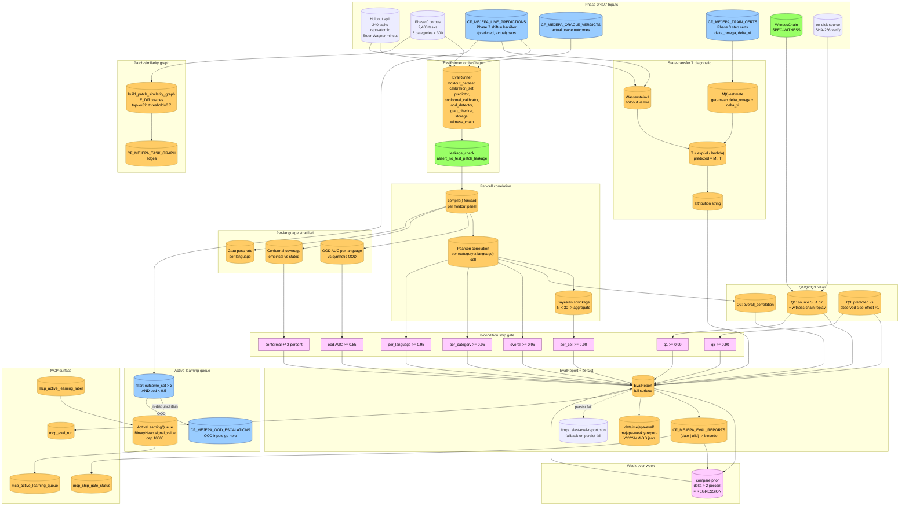
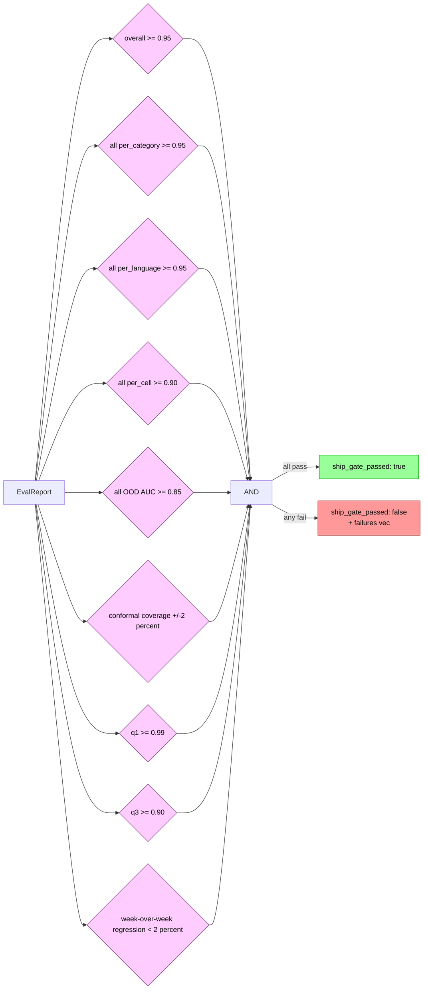
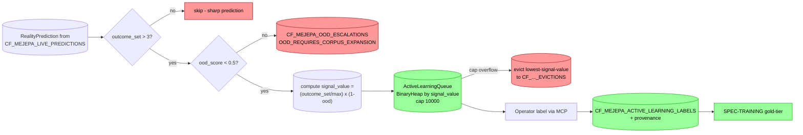
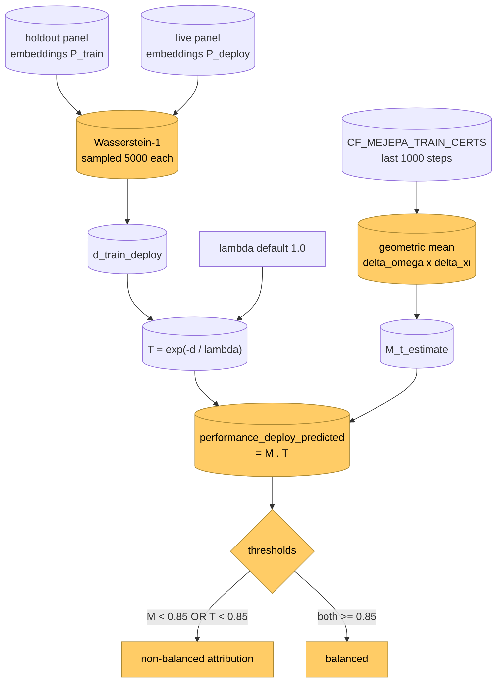

# TECH-EVALUATION — ME-JEPA-Code Phase 8 Evaluation, Ship Gate, Active Learning (Implementation)

> **Level 3 — Technical Specification.** Implements `SPEC-EVALUATION.md`. Defines HOW the evaluation domain (Phase 8) is built. Conflicts with constitution / functional spec resolve to those.

```xml
<technical_spec id="TECH-EVALUATION" version="1.0" implements="SPEC-EVALUATION">

<metadata>
  <title>ME-JEPA-Code Phase 8 Evaluation — Implementation</title>
  <status>draft</status>
  <owner>Phase 8 ME-JEPA implementation team</owner>
  <last_updated>2026-05-09</last_updated>
  <related_specs>
    <spec_ref>SPEC-EVALUATION</spec_ref>
    <spec_ref>SPEC-CORPUS</spec_ref>
    <spec_ref>TECH-CORPUS</spec_ref>
    <spec_ref>SPEC-INFERENCE</spec_ref>
    <spec_ref>TECH-INFERENCE</spec_ref>
    <spec_ref>SPEC-INSTRUMENTS</spec_ref>
    <spec_ref>TECH-INSTRUMENTS</spec_ref>
    <spec_ref>SPEC-PREDICTOR</spec_ref>
    <spec_ref>TECH-PREDICTOR</spec_ref>
    <spec_ref>SPEC-TRAINING</spec_ref>
    <spec_ref>TECH-TRAINING</spec_ref>
    <spec_ref>SPEC-TCT</spec_ref>
    <spec_ref>SPEC-WITNESS</spec_ref>
    <spec_ref>SPEC-SELF-HEALING</spec_ref>
    <spec_ref>SPEC-SHIFT-SUBSCRIBER</spec_ref>
    <spec_ref>SPEC-HYGIENE</spec_ref>
    <spec_ref>SPEC-UTML</spec_ref>
  </related_specs>
</metadata>

<architecture_diagram>



</architecture_diagram>

<eval_run_sequence_diagram>

```mermaid
sequenceDiagram
    participant Sched as Weekly scheduler
    participant MCP as mcp__cgreality__mejepa_eval_run
    participant ER as EvalRunner
    participant Split as HoldoutSplit
    participant Comp as MeJepaCompiler
    participant Cf as CF_MEJEPA_EVAL_REPORTS
    participant Disk as data/mejepa-eval/
    participant Op as Operator

    Sched->>MCP: eval_run(window_days=7, include_per_cell=true)
    MCP->>MCP: validate path canonicalize / additionalProperties:false
    MCP->>ER: run_holdout_eval(7, true)

    ER->>Split: load holdout split (repo-atomic)
    Split-->>ER: 240 tasks
    ER->>ER: assert_no_test_patch_leakage(train, holdout)
    alt leakage detected
        ER-->>MCP: Err(HoldoutLeakage)
        MCP-->>Sched: VerifyVerdict
    end

    loop per holdout panel (parallel batched)
        ER->>Comp: compile(patch, context)
        Comp-->>ER: RealityPrediction
        ER->>ER: read CF_MEJEPA_ORACLE_VERDICTS for actual
        ER->>ER: accumulate (predicted, actual) per cell
    end

    ER->>ER: compute per_cell, per_category, per_language correlations
    ER->>ER: apply Bayesian shrinkage on N < 30 cells (if enabled)
    ER->>ER: compute ood_calibration_health per language
    ER->>ER: compute conformal_coverage_health per language
    ER->>ER: compute gtau_pass_rate per language
    ER->>ER: Q1: source_sha + witness_chain replay per panel
    ER->>ER: Q3: F1 (predicted side_effect_set, observed shifts)
    ER->>ER: state_transfer_diagnostic (Wasserstein vs CF_MEJEPA_LIVE_PREDICTIONS)
    ER->>ER: read prior week's report; compute regression deltas
    ER->>ER: build EvalReport with provenance binding

    ER->>ER: check_ship_gate(report) -> ShipGateStatus
    ER->>Cf: put((date_iso8601 | ulid), bincode(report))
    alt persist fail
        ER->>Disk: write fallback /tmp/.../last-eval-report.json
        ER-->>MCP: Err(ReportPersistFail)
    end
    ER->>Disk: write data/mejepa-eval/mejepa-weekly-report-YYYY-MM-DD.json
    ER-->>MCP: EvalReport
    MCP-->>Sched: { report, ship_gate_passed, blockers }
    Sched-->>Op: surface report
```

</eval_run_sequence_diagram>

<ship_gate_decision_diagram>



</ship_gate_decision_diagram>

<active_learning_diagram>



</active_learning_diagram>

<state_transfer_diagram>



</state_transfer_diagram>

<data_models>

  <model name="EvalRunner">
    <field name="holdout_dataset" type="Arc&lt;HoldoutDataset&gt;" constraints="loaded from SPEC-CORPUS holdout split; repo-atomic per Stoer-Wagner mincut"/>
    <field name="calibration_set" type="Arc&lt;CalibrationDataset&gt;" constraints="loaded from SPEC-CORPUS calibration split; per-language stratified"/>
    <field name="predictor" type="Arc&lt;Predictor&gt;" constraints="frozen at eval; Phase 2 trained checkpoint"/>
    <field name="frozen_target" type="Arc&lt;FrozenTarget&gt;" constraints="zero trainable parameters per constitution utml_v1_invariants ΔΞ.target_collapse=0"/>
    <field name="conformal_calibrator" type="Arc&lt;CalibrationStore&gt;" constraints="reads CF_MEJEPA_CALIBRATION_HISTORY"/>
    <field name="ood_detector" type="Arc&lt;OodDetector&gt;" constraints="ood_score = 1 - exp(-‖g_φ-f_ξ‖²/σ²) per SPEC-INFERENCE"/>
    <field name="gtau_checker" type="Arc&lt;ConstellationGuard&gt;" constraints="reads CF_MEJEPA_CONSTELLATION; SPEC-TCT-owned"/>
    <field name="storage" type="Arc&lt;RocksDbStore&gt;" constraints="reads CF_MEJEPA_TRAIN_CERTS, CF_MEJEPA_LIVE_PREDICTIONS, CF_MEJEPA_ORACLE_VERDICTS; writes CF_MEJEPA_EVAL_REPORTS, CF_MEJEPA_TASK_GRAPH, CF_MEJEPA_ACTIVE_LEARNING_QUEUE, CF_MEJEPA_ACTIVE_LEARNING_LABELS, CF_MEJEPA_OOD_ESCALATIONS"/>
    <field name="witness_chain" type="Arc&lt;WitnessChainReader&gt;" constraints="SHAKE-256 73-byte segments; replay-only"/>
    <field name="active_learning_queue" type="Arc&lt;parking_lot::Mutex&lt;ActiveLearningQueueState&gt;&gt;" constraints="BinaryHeap ordered by signal_value descending; capacity 10_000"/>
    <field name="config" type="EvalConfig" constraints="thresholds + per-language min_samples + λ + transfer-bandwidth"/>
    <description>Top-level evaluation orchestrator. Inference fields (predictor, frozen_target, conformal_calibrator, ood_detector, gtau_checker) are Arc-wrapped and immutable for `&self` access on `run_holdout_eval` and `check_ship_gate`. Only `enqueue_uncertain` mutates queue state via `&mut self` (or interior `Mutex` for thread-safe access).</description>
  </model>

  <model name="EvalConfig">
    <field name="alpha" type="f32" constraints="default 0.10; range [0.01, 0.50]"/>
    <field name="thresholds" type="ShipGateThresholds" constraints="overall=0.95, per_category=0.95, per_language=0.95, per_cell=0.90, ood_auc=0.85, conformal_band_pct=2.0, q1=0.99, q3=0.90, weekly_regression_pct=2.0"/>
    <field name="min_samples_per_cell" type="usize" constraints="default 30"/>
    <field name="min_samples_per_language" type="usize" constraints="default 30"/>
    <field name="enable_bayesian_shrinkage" type="bool" constraints="default true"/>
    <field name="active_learning_queue_capacity" type="usize" constraints="default 10_000"/>
    <field name="task_graph_top_k" type="usize" constraints="default 32"/>
    <field name="task_graph_cosine_threshold" type="f32" constraints="default 0.7"/>
    <field name="state_transfer_lambda" type="f32" constraints="default 1.0; cannot be altered without operator approval per Q-EVAL-03"/>
    <field name="state_transfer_wasserstein_samples" type="usize" constraints="default 5_000 per side"/>
    <field name="ood_drift_window_weeks" type="usize" constraints="default 4"/>
    <field name="ood_drift_threshold" type="f32" constraints="default 0.10"/>
    <field name="m_t_window_steps" type="usize" constraints="default 1_000"/>
    <field name="auto_route_docker_rerun" type="bool" constraints="default false (operator opt-in)"/>
    <field name="auto_route_top_n_per_day" type="usize" constraints="default 5; only applies when auto_route_docker_rerun=true"/>
    <field name="active_learning_corpus_growth_target_pct" type="f32" constraints="default 1.0"/>
    <field name="aux_head_divergence_threshold" type="f32" constraints="default 0.20"/>
  </model>

  <model name="EvalReport">
    <field name="report_date" type="chrono::NaiveDate" constraints="ISO 8601"/>
    <field name="corpus_sha" type="[u8; 32]"/>
    <field name="model_weights_sha" type="[u8; 32]"/>
    <field name="calibration_version" type="String" constraints="ULID; matches SPEC-INFERENCE record"/>
    <field name="constellation_version" type="String" constraints="ULID; matches SPEC-TCT record"/>
    <field name="code_version" type="String" constraints="`git describe --always --dirty`"/>
    <field name="holdout_split_sha" type="[u8; 32]" constraints="SHA-256 of holdout task list"/>
    <field name="rolling_window_size" type="usize"/>
    <field name="overall_correlation" type="f32" constraints="finite; clamped [-1, 1]"/>
    <field name="per_category" type="HashMap&lt;MutationCategory, f32&gt;" constraints="exactly 8 keys"/>
    <field name="per_language" type="HashMap&lt;Language, Option&lt;f32&gt;&gt;" constraints="exactly 11 keys; Go and PHP None until corpus catches up"/>
    <field name="per_cell" type="Option&lt;HashMap&lt;(MutationCategory, Language), Option&lt;f32&gt;&gt;&gt;" constraints="up to 88 entries when include_per_cell=true; None on insufficient samples"/>
    <field name="ship_gate_passed" type="bool"/>
    <field name="ship_gate_failures" type="Vec&lt;String&gt;" constraints="SCREAMING_SNAKE-tagged"/>
    <field name="ship_gate_thresholds" type="ShipGateThresholds" constraints="audit record of active thresholds"/>
    <field name="ood_calibration_health" type="HashMap&lt;Language, f32&gt;"/>
    <field name="ood_calibration_health_history" type="Vec&lt;(NaiveDate, HashMap&lt;Language, f32&gt;)&gt;" constraints="last 4 weeks for drift detection"/>
    <field name="conformal_coverage_health" type="HashMap&lt;Language, ConformalHealthEntry&gt;"/>
    <field name="gtau_pass_rate" type="HashMap&lt;Language, f32&gt;"/>
    <field name="q1_pass_rate" type="f32" constraints="finite; clamped [0, 1]"/>
    <field name="q2_correlation" type="f32" constraints="==overall_correlation"/>
    <field name="q3_side_effect_agreement" type="Option&lt;f32&gt;" constraints="None when shift-subscriber unavailable; else F1 in [0, 1]"/>
    <field name="active_learning" type="ActiveLearningSummary"/>
    <field name="drift_severity_history" type="Vec&lt;DriftSeverityEntry&gt;" constraints="last 4 weeks"/>
    <field name="model_promotion_history" type="Vec&lt;ModelPromotionEntry&gt;" constraints="rolling 12 months"/>
    <field name="state_transfer_diagnostic" type="Option&lt;StateTransferDiagnostic&gt;" constraints="None when CF_MEJEPA_LIVE_PREDICTIONS &lt; 100 entries"/>
    <field name="aux_head_distillation" type="Option&lt;AuxHeadDistillationSummary&gt;" constraints="None when no distillation step recorded"/>
    <field name="open_research_questions" type="Vec&lt;OpenResearchQuestionStatus&gt;" constraints="exactly 8 entries per doc 09 §8"/>
    <field name="per_cell_warnings" type="Vec&lt;String&gt;"/>
    <field name="shrinkage_applied" type="Vec&lt;String&gt;"/>
    <field name="split_mode" type="SplitMode"/>
    <field name="latency_budget_exceeded" type="bool"/>
    <field name="wall_clock_seconds" type="f64" constraints="finite; non-negative"/>
    <field name="unsupported_languages" type="Vec&lt;Language&gt;" constraints="languages with no holdout samples this run"/>
    <field name="regression_check" type="RegressionCheck" constraints="enum {NoPriorReport, Compared{prior_date, deltas}, CorpusShaChanged}"/>
    <description>Constructed only via `EvalReport::try_new(builder)` which validates all invariants at boundary; never via raw struct literal.</description>
  </model>

  <model name="ShipGateThresholds">
    <field name="overall_min" type="f32" constraints="0.95 default; pinned by constitution"/>
    <field name="per_category_min" type="f32" constraints="0.95"/>
    <field name="per_language_min" type="f32" constraints="0.95"/>
    <field name="per_cell_min" type="f32" constraints="0.90"/>
    <field name="ood_auc_min" type="f32" constraints="0.85"/>
    <field name="conformal_band_pct" type="f32" constraints="2.0"/>
    <field name="q1_min" type="f32" constraints="0.99"/>
    <field name="q3_min" type="f32" constraints="0.90"/>
    <field name="weekly_regression_pct" type="f32" constraints="2.0"/>
  </model>

  <model name="ConformalHealthEntry">
    <field name="stated" type="f32" constraints="default 0.90 == 1−α"/>
    <field name="empirical" type="f32" constraints="finite; [0, 1]"/>
    <field name="delta_pct" type="f32" constraints="(empirical − stated) × 100"/>
    <field name="num_samples" type="usize"/>
    <field name="passes_band" type="bool" constraints="abs(delta_pct) <= 2.0"/>
  </model>

  <model name="ActiveLearningSummary">
    <field name="queue_depth" type="usize"/>
    <field name="labels_added_this_week" type="usize"/>
    <field name="corpus_growth_pct" type="f32" constraints="finite"/>
    <field name="below_target" type="bool"/>
    <field name="ood_escalations_pending" type="usize"/>
    <field name="label_method_distribution" type="HashMap&lt;LabelMethod, usize&gt;"/>
  </model>

  <model name="DriftSeverityEntry">
    <field name="week" type="NaiveDate"/>
    <field name="severity" type="DriftSeverity" constraints="enum Healthy|Soft|Hard|Critical"/>
  </model>

  <model name="ModelPromotionEntry">
    <field name="date" type="NaiveDate"/>
    <field name="mode_winner" type="ModelMode" constraints="enum A|B|C"/>
    <field name="weights_sha" type="[u8; 32]"/>
    <field name="calibration_version" type="String"/>
    <field name="overall_correlation" type="f32"/>
    <field name="regression_triggered" type="bool"/>
    <field name="regressed_cells" type="Vec&lt;(MutationCategory, Language)&gt;"/>
  </model>

  <model name="StateTransferDiagnostic">
    <field name="d_train_deploy" type="f32" constraints="finite; non-negative"/>
    <field name="lambda" type="f32" constraints="finite; positive"/>
    <field name="t_value" type="f32" constraints="finite; [0, 1]"/>
    <field name="m_t_estimate" type="f32" constraints="finite; [0, 1]"/>
    <field name="performance_deploy_predicted" type="f32" constraints="finite; [0, 1]"/>
    <field name="attribution" type="String" constraints="one of canonical strings"/>
    <field name="wasserstein_samples_used" type="usize"/>
  </model>

  <model name="AuxHeadDistillationSummary">
    <field name="last_distillation_step" type="u64"/>
    <field name="distillation_loss" type="f32" constraints="finite; non-negative"/>
    <field name="aux_heads_in_consensus" type="Vec&lt;String&gt;"/>
    <field name="aux_heads_diverged" type="Vec&lt;String&gt;"/>
  </model>

  <model name="OpenResearchQuestionStatus">
    <field name="question_id" type="ResearchQuestionId" constraints="enum Q1..Q8 per doc 09 §8"/>
    <field name="question_text" type="String" constraints="canonical text per doc 09"/>
    <field name="mitigation_state" type="MitigationState" constraints="enum Active|Resolved|Deferred"/>
    <field name="evidence_pointers" type="Vec&lt;String&gt;" constraints="paths to FSV evidence; canonicalized; no traversal"/>
    <field name="last_updated" type="NaiveDate"/>
  </model>

  <model name="ShipGateStatus">
    <field name="passed" type="bool"/>
    <field name="per_category" type="HashMap&lt;MutationCategory, f32&gt;"/>
    <field name="per_language" type="HashMap&lt;Language, Option&lt;f32&gt;&gt;"/>
    <field name="blockers" type="Vec&lt;String&gt;"/>
    <field name="report_date" type="NaiveDate"/>
    <field name="overall_correlation" type="f32"/>
    <description>Subset of EvalReport returned by mcp__cgreality__mejepa_eval_ship_gate_status; lighter-weight than the full EvalReport.</description>
  </model>

  <model name="ActiveLearningQueueState">
    <field name="heap" type="BinaryHeap&lt;ActiveLearningQueueEntry&gt;" constraints="ordered by signal_value descending; cap config.active_learning_queue_capacity"/>
    <field name="entries_by_panel_sha" type="HashMap&lt;[u8; 32], usize&gt;" constraints="dedup by panel_sha"/>
    <field name="max_observed_outcome_set_len" type="usize" constraints="rolling max over recent enqueues; min 4"/>
  </model>

  <model name="ActiveLearningQueueEntry">
    <field name="panel_sha" type="[u8; 32]"/>
    <field name="prediction_id" type="u64" constraints="witness_chain_offset of the source RealityPrediction"/>
    <field name="conformal_set_size" type="usize" constraints="&gt; 3 by filter"/>
    <field name="ood_score" type="f32" constraints="&lt; 0.5 by filter; finite"/>
    <field name="signal_value" type="f32" constraints="finite; [0, 1]"/>
    <field name="enqueued_at" type="i64" constraints="Unix timestamp seconds"/>
    <field name="language" type="Language"/>
    <field name="suggested_label_method" type="LabelMethod"/>
    <description>Implements `Ord` by signal_value descending for BinaryHeap.</description>
  </model>

  <model name="LabelMethod">
    <field name="variant" type="enum" constraints="Manual | DockerRerun | AdjacentTestRerun"/>
  </model>

  <model name="ActiveLearningLabel">
    <field name="panel_sha" type="[u8; 32]"/>
    <field name="oracle_outcome" type="OracleOutcome"/>
    <field name="label_method" type="LabelMethod"/>
    <field name="operator_id" type="String" constraints="from MCP context; canonical operator identifier"/>
    <field name="labelled_at" type="i64" constraints="Unix timestamp seconds"/>
    <field name="provenance" type="LabelProvenance" constraints="corpus_sha + code_version + calibration_version at label time"/>
  </model>

  <model name="PatchGraph">
    <field name="edges" type="Vec&lt;PatchGraphEdge&gt;" constraints="all cosine &gt; 0.7"/>
    <field name="adjacency" type="HashMap&lt;[u8; 32], Vec&lt;([u8; 32], f32)&gt;&gt;" constraints="top-k=32 per source node"/>
    <field name="corpus_sha" type="[u8; 32]" constraints="binds graph to corpus version"/>
    <field name="built_at" type="i64" constraints="Unix timestamp seconds"/>
  </model>

  <model name="PatchGraphEdge">
    <field name="source_task_sha" type="[u8; 32]"/>
    <field name="target_task_sha" type="[u8; 32]"/>
    <field name="cosine" type="f32" constraints="&gt; 0.7; finite; [-1, 1]"/>
  </model>

  <model name="MutationCategory">
    <field name="variant" type="enum" constraints="KnownGood|SubtleFlip|OffByOne|SwapVariable|DeleteTestCall|WrongFile|OverEngineer|CompileError"/>
  </model>

  <model name="ResearchQuestionId">
    <field name="variant" type="enum" constraints="Q1..Q8 per doc 09 §8"/>
  </model>

  <model name="MitigationState">
    <field name="variant" type="enum" constraints="Active | Resolved | Deferred"/>
  </model>

  <model name="DriftSeverity">
    <field name="variant" type="enum" constraints="Healthy | Soft | Hard | Critical"/>
  </model>

  <model name="ModelMode">
    <field name="variant" type="enum" constraints="A | B | C"/>
  </model>

  <model name="SplitMode">
    <field name="variant" type="enum" constraints="RepoAtomic (default) | InstanceAtomic"/>
  </model>

  <model name="RegressionCheck">
    <field name="variant" type="enum" constraints="NoPriorReport | Compared{prior_date: NaiveDate, deltas: Vec&lt;CellDelta&gt;} | CorpusShaChanged{prior_corpus_sha, current_corpus_sha}"/>
  </model>

  <model name="CellDelta">
    <field name="cell" type="(MutationCategory, Language)"/>
    <field name="prior" type="f32"/>
    <field name="current" type="f32"/>
    <field name="delta_pct" type="f32"/>
    <field name="is_regression" type="bool" constraints="delta_pct &lt; -2.0"/>
  </model>

  <model name="EvalError">
    <field name="variant" type="enum" constraints="EmptyHoldout | HoldoutLeakage{task_id: TaskId, found_in: Vec&lt;String&gt;} | InsufficientSamples{cell, required: usize, observed: usize} | ShipGateRegression{cell, prior: f32, current: f32, delta_pct: f32} | LanguageOodDrift{language, prior_auc: f32, current_auc: f32, delta: f32, window_weeks: usize} | LanguageConformalDrift{language, stated: f32, empirical: f32, delta_pct: f32} | ReportPersistFail{cf: String, backend_error: String} | NoReportAvailable | TaskGraphRebuildFail{corpus_sha, failed_at_task: Option&lt;TaskId&gt;, reason: String} | ActiveLearningBelowTarget{growth_pct: f32, target_pct: f32} | NanDetected{field: String, cell: Option&lt;String&gt;} | EmptyHoldoutLanguage{language} | InsufficientLiveData{count: usize, required: usize} | TaskGraphSkip{task_id: TaskId, reason: String}"/>
    <field name="code_method" type="fn" constraints=".code() returns SCREAMING_SNAKE per constitution failure_taxonomy extension"/>
  </model>

  <model name="QueueError">
    <field name="variant" type="enum" constraints="OodPanelRejected{ood_score: f32} | NotUncertain{outcome_set_size: usize} | DuplicatePanel{panel_sha} | NanDetected{field: String}"/>
    <field name="code_method" type="fn" constraints=".code() returns SCREAMING_SNAKE"/>
  </model>

  <model name="GraphError">
    <field name="variant" type="enum" constraints="EmptyCorpus | EmbedderUnavailable{embedder: String} | DimMismatch{expected: usize, actual: usize} | CorpusShaUnchanged{cached_at} | TaskSkip{task_id, reason}"/>
    <field name="code_method" type="fn" constraints=".code() returns SCREAMING_SNAKE"/>
  </model>

</data_models>

<api_contracts>

  <endpoint path="mcp__cgreality__mejepa_eval_run" method="MCP_TOOL">
    <implements>REQ-EVAL-08, REQ-EVAL-15</implements>
    <request_body>
      window_days: u32 (required; range [1, 365])
      include_per_cell: bool (optional, default false)
      enable_bayesian_shrinkage: bool (optional, default true)
    </request_body>
    <responses>
      success: { eval_report: EvalReport, ship_gate_status: ShipGateStatus, report_path: "file:..." }
      error: { error_code: "MEJEPA_EVAL_*", message: string, payload: {...} }
    </responses>
    <schema_constraints>
      additionalProperties: false on all object schemas
      window_days &gt;= 1 AND &lt;= 365
    </schema_constraints>
    <latency>up to 30 minutes p50; client must use long-poll or async pattern</latency>
  </endpoint>

  <endpoint path="mcp__cgreality__mejepa_eval_ship_gate_status" method="MCP_TOOL">
    <implements>REQ-EVAL-08</implements>
    <request_body>
      include_per_cell: bool (optional, default false)
    </request_body>
    <responses>
      success: { ship_gate_status: ShipGateStatus }
      error_no_report: { error_code: "MEJEPA_EVAL_NO_REPORT_AVAILABLE" }
    </responses>
  </endpoint>

  <endpoint path="mcp__cgreality__mejepa_active_learning_queue" method="MCP_TOOL">
    <implements>REQ-EVAL-05, REQ-EVAL-08</implements>
    <request_body>
      limit: u32 (optional, default 10; max 100)
      language_filter: Option&lt;Language&gt; (optional)
    </request_body>
    <responses>
      success: { queue: Vec&lt;ActiveLearningQueueEntry&gt;, total_depth: usize }
    </responses>
  </endpoint>

  <endpoint path="mcp__cgreality__mejepa_active_learning_label" method="MCP_TOOL">
    <implements>REQ-EVAL-05</implements>
    <request_body>
      panel_sha: [u8; 32] (required)
      oracle_outcome: OracleOutcome (required)
      label_method: enum {Manual, DockerRerun, AdjacentTestRerun} (required)
    </request_body>
    <responses>
      success: { label_id: ULID, queue_depth_after: usize }
      error_not_in_queue: { error_code: "MEJEPA_EVAL_PANEL_NOT_IN_QUEUE" }
    </responses>
    <schema_constraints>panel_sha must exist in queue; reject with structured error otherwise</schema_constraints>
  </endpoint>

  <cli path="cargo run --release -p context-graph-mejepa -- eval-run" method="CLI">
    <implements>REQ-EVAL-15</implements>
    <request_body>
      --window-days: u32 (default 7)
      --include-per-cell: bool flag (default false)
      --output: PathBuf (default ./data/mejepa-eval/)
      --enable-bayesian-shrinkage: bool flag (default true)
      --output-fsv: PathBuf (default /tmp/contextgraph-mejepa-evaluation-fsv/)
    </request_body>
    <responses>
      stdout JSON: EvalReport
      exit: 0 on ship gate pass; 1 on ship gate fail; 2 on hard error (leakage / persistence / NaN)
    </responses>
  </cli>

  <cli path="cargo run --release -p context-graph-mejepa -- eval-build-graph" method="CLI">
    <implements>REQ-EVAL-07</implements>
    <request_body>
      --force: bool flag (rebuild even if corpus_sha unchanged; default false)
      --top-k: usize (default 32)
      --cosine-threshold: f32 (default 0.7)
      --output-fsv: PathBuf
    </request_body>
    <responses>
      stdout JSON: { edges: usize, nodes: usize, max_degree: usize, build_time_seconds: f64 }
      exit: 0 on success; 1 on failure
    </responses>
  </cli>

</api_contracts>

<component_contracts>

  <component name="EvalRunner" path="crates/context-graph-mejepa/src/eval/runner.rs">

    <method name="new">
      <signature>pub fn new(holdout_dataset: Arc&lt;HoldoutDataset&gt;, calibration_set: Arc&lt;CalibrationDataset&gt;, predictor: Arc&lt;Predictor&gt;, frozen_target: Arc&lt;FrozenTarget&gt;, conformal_calibrator: Arc&lt;CalibrationStore&gt;, ood_detector: Arc&lt;OodDetector&gt;, gtau_checker: Arc&lt;ConstellationGuard&gt;, storage: Arc&lt;RocksDbStore&gt;, witness_chain: Arc&lt;WitnessChainReader&gt;, config: EvalConfig) -&gt; Result&lt;Self, EvalError&gt;</signature>
      <implements>REQ-EVAL-01</implements>
      <behavior>
        1. Verify holdout dataset is non-empty (else EmptyHoldout).
        2. Verify config thresholds are within sane bounds (overall_min ≤ 1.0, etc.).
        3. Verify calibration store has at least one record (else CalibrationStale propagates).
        4. Initialize ActiveLearningQueueState with capacity = config.active_learning_queue_capacity; load existing entries from CF_MEJEPA_ACTIVE_LEARNING_QUEUE.
      </behavior>
      <throws>EmptyHoldout</throws>
    </method>

    <method name="run_holdout_eval">
      <signature>pub fn run_holdout_eval(&amp;self, window_days: u32, include_per_cell: bool) -&gt; Result&lt;EvalReport, EvalError&gt;</signature>
      <implements>REQ-EVAL-01, REQ-EVAL-02, REQ-EVAL-03, REQ-EVAL-04, REQ-EVAL-09, REQ-EVAL-10, REQ-EVAL-11, REQ-EVAL-12, REQ-EVAL-14, REQ-EVAL-15, REQ-EVAL-16, REQ-EVAL-17, REQ-EVAL-18, REQ-EVAL-19, REQ-EVAL-20</implements>
      <behavior>
        1. Capture wall-clock start; set seed from `code_version` for determinism.
        2. **Leakage check**: call `assert_no_test_patch_leakage(train_split, holdout_split)`; on any duplicate, return `Err(HoldoutLeakage { task_id, found_in })`.
        3. **Per-panel forward pass**: for each holdout panel (parallel batched on RTX 5090):
           a. Call `predictor.compile(&panel.patch, &panel.context)` → RealityPrediction.
           b. Read actual oracle outcome from CF_MEJEPA_ORACLE_VERDICTS keyed by `(panel.task_id, panel.mutation_category)`.
           c. Append `(predicted_oracle_pass, actual_oracle_pass, language, mutation_category)` to accumulators.
        4. **Compute correlations**:
           a. `overall_correlation` = Pearson over all accumulator entries.
           b. `per_category[c]` = Pearson over entries where mutation_category == c (8 categories).
           c. `per_language[l]` = Pearson over entries where language == l (Option::None when N < 30).
           d. `per_cell[(c, l)]` = Pearson per cell when `include_per_cell == true`; apply Bayesian shrinkage when N < 30 AND `config.enable_bayesian_shrinkage == true`; record in `shrinkage_applied`.
        5. **Per-language stratification**:
           a. `ood_calibration_health[l]`: ROC AUC between in-distribution panels (label 1) and synthetic OOD panels for language l (label 0); load synthetic OOD from SPEC-CORPUS held-out repo. None when N < 50 in-distribution.
           b. `conformal_coverage_health[l]`: count holdout examples whose actual oracle outcome ∈ predicted outcome_set; divide by N. Construct `ConformalHealthEntry`.
           c. `gtau_pass_rate[l]`: fraction of holdout panels that `gtau_checker.gtau_test(panel)` returns Approve.
        6. **Three-operator-question rollup**:
           a. Q1: for each holdout panel, run SPEC-INFERENCE Gate 6 (SourceShaDrift) + Gate 5 (WitnessChainBroken); fraction passing both = `q1_pass_rate`.
           b. Q2: `q2_correlation = overall_correlation`.
           c. Q3: for each holdout panel with corresponding shift-log entry, compute F1 between `predicted_side_effect_set` and `observed_side_effect_set`; macro-average. `Option::None` when no shift-log entries exist.
        7. **State-transfer T diagnostic**:
           a. Sample `config.state_transfer_wasserstein_samples` panel embeddings from holdout (P_train proxy) and from CF_MEJEPA_LIVE_PREDICTIONS (P_deploy proxy).
           b. If live count < 100, set `state_transfer_diagnostic = None`; else compute `d = wasserstein_1(holdout_samples, live_samples)`.
           c. Read last `config.m_t_window_steps` certs from CF_MEJEPA_TRAIN_CERTS; compute `M_t_estimate = geometric_mean(delta_omega × delta_xi)`.
           d. `T = exp(-d / config.state_transfer_lambda)`.
           e. `performance_deploy_predicted = M_t_estimate × T`.
           f. Compute `attribution`: "balanced" when M ≥ 0.85 AND T ≥ 0.85; "training_quality_dominated (M low)" when M < 0.85 ≤ T; "distribution_shift_dominated (T low)" when T < 0.85 ≤ M; "both low" when both < 0.85.
        8. **Read prior week's report** from CF_MEJEPA_EVAL_REPORTS; compute regression deltas per cell. If corpus_sha changed, set `regression_check = CorpusShaChanged{...}` else `Compared{...}`.
        9. **Aux-head distillation**: read latest cert from CF_MEJEPA_TRAIN_CERTS that recorded a distillation step (per doc 09 §3.7.6); populate `AuxHeadDistillationSummary` with diverged heads (predictions differ from trunk by &gt; `config.aux_head_divergence_threshold`).
        10. **Drift severity history**: read last 4 weeks from CF_MEJEPA_EVAL_REPORTS.
        11. **Model promotion history**: read last 12 months from CF_MEJEPA_MODEL_PROMOTIONS.
        12. **Active learning summary**: count CF_MEJEPA_ACTIVE_LEARNING_QUEUE depth; count CF_MEJEPA_ACTIVE_LEARNING_LABELS added in window; compute `corpus_growth_pct`.
        13. **Open research questions**: load from CF_MEJEPA_RESEARCH_QUESTIONS; if absent, seed initial 8 per doc 09 §8 with `mitigation_state = Active`.
        14. **Build EvalReport**: `EvalReport::try_new(builder)` validates all invariants (NaN, finite, length, etc.); return `Err(NanDetected)` on violation.
        15. **Ship gate**: call `self.check_ship_gate(&report)` to compute `ship_gate_passed` + `ship_gate_failures`.
        16. **Persist**: bincode-serialize report; write to CF_MEJEPA_EVAL_REPORTS keyed by `(report_date_iso8601 | report_ulid)`; on persist fail, write fallback to /tmp/contextgraph-mejepa-evaluation-fsv/last-eval-report.json AND return `Err(ReportPersistFail)`.
        17. **Write canonical file**: serde_json-serialize to `data/mejepa-eval/mejepa-weekly-report-{report_date}.json` (mode 0o600 per SEC-MEJEPA-07).
        18. Capture wall-clock end; set `latency_budget_exceeded` if &gt; 1,800 s.
        19. Return Ok(report).
      </behavior>
      <throws>
        EmptyHoldout, HoldoutLeakage, InsufficientSamples (informational; embedded as None in per_cell), ReportPersistFail, NanDetected
      </throws>
      <determinism>byte-equal output for identical (corpus_sha, model_weights_sha, calibration_version, constellation_version, code_version, holdout_split_sha) modulo report_date per NFR-EVAL-03; stochastic operations seeded from code_version</determinism>
      <latency_budget>p50 &lt; 1,800 s on 240-task holdout, RTX 5090 instruments cached per NFR-EVAL-01; longer cold runs flag latency_budget_exceeded</latency_budget>
      <concurrency>parallel batched compile() over holdout panels; Wasserstein sampling parallelized via rayon; queue mutations via parking_lot::Mutex (single writer at a time)</concurrency>
    </method>

    <method name="check_ship_gate">
      <signature>pub fn check_ship_gate(&amp;self, report: &amp;EvalReport) -&gt; ShipGateStatus</signature>
      <implements>REQ-EVAL-03, REQ-EVAL-04</implements>
      <behavior>
        1. Initialize empty `failures: Vec&lt;String&gt;`.
        2. Check (i) `overall_correlation &gt;= self.config.thresholds.overall_min`; on fail, push descriptive failure string with SCREAMING_SNAKE prefix.
        3. Check (ii) all per_category values &gt;= per_category_min; push per-category failure for each violation.
        4. Check (iii) all non-None per_language values &gt;= per_language_min.
        5. Check (iv) all non-None per_cell values &gt;= per_cell_min (skip shrunk cells per REQ-EVAL-20).
        6. Check (v) all ood_calibration_health values &gt;= ood_auc_min.
        7. Check (vi) all conformal_coverage_health entries `passes_band == true` (|delta_pct| &lt;= conformal_band_pct).
        8. Check (vii) `q1_pass_rate &gt;= q1_min`.
        9. Check (viii) `q3_side_effect_agreement` &gt;= q3_min if Some; if None (Phase 7 not shipped), skip.
        10. Check week-over-week regression: for each `CellDelta` in `report.regression_check`, if `is_regression == true`, push `MEJEPA_EVAL_SHIP_GATE_REGRESSION` failure.
        11. `passed = failures.is_empty()`.
        12. Build ShipGateStatus { passed, per_category, per_language, blockers: failures, report_date, overall_correlation }.
      </behavior>
      <determinism>pure function over &report; byte-equal output for byte-equal input</determinism>
      <latency_budget>&lt; 1 ms (no IO)</latency_budget>
    </method>

    <method name="enqueue_uncertain">
      <signature>pub fn enqueue_uncertain(&amp;mut self, panel: &amp;Panel, conformal_set: &amp;ConformalSet, ood_score: f32) -&gt; Result&lt;(), QueueError&gt;</signature>
      <implements>REQ-EVAL-05, BR-EVAL-03</implements>
      <behavior>
        1. Validate `ood_score` finite and in [0, 1]; else return `Err(NanDetected)`.
        2. **OOD reject**: if `ood_score &gt;= 0.5`: write to CF_MEJEPA_OOD_ESCALATIONS with reason "OOD_REQUIRES_CORPUS_EXPANSION"; return `Err(OodPanelRejected)`.
        3. **Uncertainty filter**: if `conformal_set.outcome_set.len() &lt;= 3`: return `Err(NotUncertain)`.
        4. Compute `panel_sha = sha256(panel.bytes())`; lock the queue Mutex.
        5. **Dedup**: if `entries_by_panel_sha.contains_key(&panel_sha)`: return `Err(DuplicatePanel)`.
        6. Update `max_observed_outcome_set_len = max(max_observed, conformal_set.outcome_set.len())`.
        7. Compute `signal_value = (conformal_set.outcome_set.len() as f32 / max_observed as f32) * (1.0 - ood_score)`.
        8. Construct `ActiveLearningQueueEntry { panel_sha, prediction_id, conformal_set_size, ood_score, signal_value, enqueued_at: now_unix(), language: panel.language, suggested_label_method: heuristic(panel) }`.
        9. **Capacity check**: if heap.len() &gt;= capacity, evict the lowest-signal_value entry: pop_min via secondary heap-of-min; record eviction in CF_MEJEPA_ACTIVE_LEARNING_EVICTIONS.
        10. Push entry into heap; update `entries_by_panel_sha` index.
        11. Persist updated queue snapshot to CF_MEJEPA_ACTIVE_LEARNING_QUEUE keyed by `(panel_sha)`.
        12. Return Ok(()).
      </behavior>
      <throws>OodPanelRejected, NotUncertain, DuplicatePanel, NanDetected</throws>
      <concurrency>locks `active_learning_queue` Mutex; release before persist write to avoid serializing IO</concurrency>
    </method>

    <method name="build_patch_similarity_graph">
      <signature>pub fn build_patch_similarity_graph(corpus: &amp;Corpus, config: &amp;EvalConfig) -&gt; Result&lt;PatchGraph, GraphError&gt;</signature>
      <implements>REQ-EVAL-07, BR-EVAL-07</implements>
      <behavior>
        1. Validate corpus is non-empty.
        2. **Idempotency**: read CF_MEJEPA_TASK_GRAPH metadata; if existing graph has `corpus_sha == corpus.sha()`, return cached graph (no rebuild) unless `--force`.
        3. **Embedder check**: verify E_Diff embedder is loadable; else return `EmbedderUnavailable`.
        4. **Compute embeddings**: for each task in corpus, materialize E_Diff slot embedding; collect into `Vec<(TaskSha, Vec<f32>)>`. Skip tasks with parse errors; log `TaskSkip { task_id, reason }`.
        5. **Pairwise cosine** (parallel via rayon): for each pair (T_i, T_j), compute cosine; emit edges with `cosine &gt; config.task_graph_cosine_threshold`.
        6. **Top-k cap per source**: for each source node, sort outgoing edges by cosine descending; truncate to `config.task_graph_top_k`.
        7. **Persist**: archive prior graph version to CF_MEJEPA_TASK_GRAPH_HISTORY keyed by `(corpus_sha)`; write new graph to CF_MEJEPA_TASK_GRAPH keyed by `(source_task_sha | target_task_sha)` value `f32_be(cosine)`.
        8. Emit info-level structured log `MEJEPA_EVAL_TASK_GRAPH_REBUILT` with edge count + node count + build time.
        9. Return Ok(PatchGraph).
      </behavior>
      <throws>EmptyCorpus, EmbedderUnavailable, DimMismatch, CorpusShaUnchanged (when not force)</throws>
      <complexity>O(N² · d_diff) for pairwise cosines; parallelized via rayon; O(E log E) for top-k truncation; with N=2,400 and d_diff=512, completes in &lt; 30 minutes on RTX 5090 per NFR-EVAL-02</complexity>
      <determinism>byte-equal output for identical corpus_sha; deterministic rayon ordering via stable sort</determinism>
    </method>

    <method name="apply_active_learning_label">
      <signature>pub fn apply_active_learning_label(&amp;mut self, panel_sha: &amp;[u8; 32], oracle_outcome: &amp;OracleOutcome, label_method: LabelMethod, operator_id: &amp;str) -&gt; Result&lt;ULID, EvalError&gt;</signature>
      <implements>REQ-EVAL-05, REQ-EVAL-06</implements>
      <behavior>
        1. Validate panel_sha exists in active_learning_queue; else return PanelNotInQueue.
        2. Build `ActiveLearningLabel { panel_sha, oracle_outcome, label_method, operator_id, labelled_at: now_unix(), provenance: capture_current() }`.
        3. Persist to CF_MEJEPA_ACTIVE_LEARNING_LABELS keyed by `(label_ulid)`.
        4. Remove from queue; update entries_by_panel_sha index.
        5. Persist queue snapshot to CF_MEJEPA_ACTIVE_LEARNING_QUEUE.
        6. Return label_ulid.
      </behavior>
      <throws>PanelNotInQueue, ReportPersistFail</throws>
    </method>

    <method name="compute_pearson_correlation">
      <signature>fn compute_pearson_correlation(predicted: &amp;[f32], actual: &amp;[f32]) -&gt; Result&lt;f32, EvalError&gt;</signature>
      <implements>REQ-EVAL-02 (per-cell, per-category, per-language correlations)</implements>
      <behavior>
        1. Validate slices non-empty and same length.
        2. Compute means; if zero variance, return 0.0 (degenerate but well-defined).
        3. Compute Pearson r = cov(P, A) / (σ_P · σ_A); validate finite.
        4. Clamp to [-1, 1] for numerical safety.
      </behavior>
      <throws>NanDetected on non-finite intermediate</throws>
    </method>

    <method name="compute_bayesian_shrinkage">
      <signature>fn compute_bayesian_shrinkage(cell_correlation: f32, cell_n: usize, language_aggregate_correlation: f32, language_n: usize) -&gt; f32</signature>
      <implements>REQ-EVAL-20</implements>
      <behavior>
        1. Compute shrinkage weight `w = cell_n / (cell_n + language_n)`.
        2. Return `w · cell_correlation + (1 − w) · language_aggregate_correlation`.
      </behavior>
    </method>

    <method name="compute_ood_auc_per_language">
      <signature>fn compute_ood_auc_per_language(&amp;self, language: Language, in_dist_panels: &amp;[Panel], ood_panels: &amp;[Panel]) -&gt; Result&lt;Option&lt;f32&gt;, EvalError&gt;</signature>
      <implements>REQ-EVAL-10</implements>
      <behavior>
        1. Validate in_dist_panels.len() &gt;= 50; else return Ok(None) and log InsufficientSamples.
        2. For each panel compute ood_score via self.ood_detector.
        3. Build labels: 1 for in-dist, 0 for OOD.
        4. Compute ROC AUC via trapezoidal integration over sorted-by-score thresholds.
        5. Validate finite; clamp [0, 1].
      </behavior>
      <throws>NanDetected</throws>
    </method>

    <method name="compute_q3_f1">
      <signature>fn compute_q3_f1(predicted_set: &amp;[SideEffect], observed_set: &amp;[SideEffect]) -&gt; f32</signature>
      <implements>REQ-EVAL-11</implements>
      <behavior>
        1. Compute true_positives = |predicted ∩ observed|.
        2. precision = tp / |predicted| (0 if predicted empty).
        3. recall = tp / |observed| (0 if observed empty).
        4. F1 = 2 · precision · recall / (precision + recall) (0 if both 0).
        5. Validate finite; clamp [0, 1].
      </behavior>
    </method>

    <method name="wasserstein_1_sampled">
      <signature>fn wasserstein_1_sampled(samples_p: &amp;[Vec&lt;f32&gt;], samples_q: &amp;[Vec&lt;f32&gt;]) -&gt; Result&lt;f32, EvalError&gt;</signature>
      <implements>REQ-EVAL-09</implements>
      <behavior>
        1. Validate both non-empty and same dim.
        2. Project to scalar via panel_norm or first principal component (project_to_scalar helper); for 5,120-d panels use the L2 norm projection by default.
        3. Sort scalar samples_p and samples_q; compute the L1 distance between sorted sequences (sliced-Wasserstein-1 approximation).
        4. Validate finite; non-negative.
      </behavior>
      <throws>NanDetected</throws>
      <complexity>O(N log N) per dim per side</complexity>
    </method>

    <method name="seed_initial_research_questions">
      <signature>fn seed_initial_research_questions() -&gt; Vec&lt;OpenResearchQuestionStatus&gt;</signature>
      <implements>REQ-EVAL-19</implements>
      <behavior>Constructs the canonical 8 entries Q1..Q8 with text from doc 09 §8, mitigation_state=Active, evidence_pointers=[].</behavior>
    </method>

  </component>

  <component name="EvalReport" path="crates/context-graph-mejepa/src/eval/report.rs">

    <method name="try_new">
      <signature>pub fn try_new(builder: EvalReportBuilder) -&gt; Result&lt;Self, EvalError&gt;</signature>
      <implements>REQ-EVAL-02, REQ-EVAL-17, REQ-EVAL-18</implements>
      <behavior>
        1. Validate every f32 field is finite (NaN/Inf check); reject with NanDetected.
        2. Validate `overall_correlation`, every `per_category`, every `per_language[Some]`, every `per_cell[Some]` is in [-1, 1]; clamp at construction.
        3. Validate `q1_pass_rate`, `q3_side_effect_agreement` (when Some) in [0, 1].
        4. Validate provenance fields present (corpus_sha, model_weights_sha, calibration_version, constellation_version, code_version, holdout_split_sha).
        5. Validate `per_category` has exactly 8 keys (the 8 mutation categories); `per_language` has exactly 11 keys (the 11 supported languages).
        6. Validate `open_research_questions.len() == 8`.
        7. Construct EvalReport.
      </behavior>
      <throws>NanDetected, MissingProvenance (variant of EvalError)</throws>
    </method>

    <method name="serialize_canonical">
      <signature>pub fn serialize_canonical(&amp;self) -&gt; Result&lt;Vec&lt;u8&gt;, EvalError&gt;</signature>
      <implements>REQ-EVAL-17 (determinism), REQ-EVAL-18 (provenance)</implements>
      <behavior>
        1. Serialize via serde_json with sorted-keys for determinism (`serde_json::to_vec` with BTreeMap-backed maps).
        2. EXCLUDE `report_date` field from the deterministic SHA computation (as required by determinism test).
        3. Validate length ≤ 1 MiB per NFR-EVAL-09; else return ReportTooLarge variant.
      </behavior>
    </method>

    <method name="hash_for_determinism">
      <signature>pub fn hash_for_determinism(&amp;self) -&gt; [u8; 32]</signature>
      <implements>REQ-EVAL-17</implements>
      <behavior>
        1. Serialize canonical (sorted keys); strip `report_date` field bytes.
        2. SHA-256 the result.
      </behavior>
    </method>

  </component>

  <component name="ActiveLearningQueueState" path="crates/context-graph-mejepa/src/eval/queue.rs">

    <method name="new">
      <signature>pub fn new(capacity: usize) -&gt; Self</signature>
      <behavior>Constructs an empty heap with capacity hint; entries_by_panel_sha empty; max_observed_outcome_set_len=4 (lower bound).</behavior>
    </method>

    <method name="load_from_storage">
      <signature>pub fn load_from_storage(storage: &amp;RocksDbStore, capacity: usize) -&gt; Result&lt;Self, EvalError&gt;</signature>
      <behavior>Reads CF_MEJEPA_ACTIVE_LEARNING_QUEUE; deserializes entries; rebuilds heap + index.</behavior>
    </method>

    <method name="enqueue">
      <signature>pub fn enqueue(&amp;mut self, entry: ActiveLearningQueueEntry) -&gt; Result&lt;Option&lt;ActiveLearningQueueEntry&gt;, QueueError&gt;</signature>
      <behavior>
        1. Dedup check via entries_by_panel_sha.
        2. Capacity check; if exceeded, evict the min-signal_value entry (returns Some(evicted)) else None.
        3. Push new entry.
      </behavior>
    </method>

    <method name="top_n">
      <signature>pub fn top_n(&amp;self, n: usize, language_filter: Option&lt;Language&gt;) -&gt; Vec&lt;ActiveLearningQueueEntry&gt;</signature>
      <behavior>Returns the top-n entries by signal_value descending, optionally filtered by language. O(n log N) via heap traversal.</behavior>
    </method>

    <method name="remove">
      <signature>pub fn remove(&amp;mut self, panel_sha: &amp;[u8; 32]) -&gt; Option&lt;ActiveLearningQueueEntry&gt;</signature>
      <behavior>Look up index; rebuild heap without that entry (O(N log N)). Acceptable given queue size ≤ 10,000.</behavior>
    </method>

  </component>

  <component name="EvalError" path="crates/context-graph-mejepa/src/eval/error.rs">

    <method name="code">
      <signature>pub fn code(&amp;self) -&gt; &amp;'static str</signature>
      <implements>REQ-EVAL-13, NFR-EVAL-07</implements>
      <behavior>
        Returns the SCREAMING_SNAKE error tag per constitution failure_taxonomy extension:
        - EmptyHoldout → "MEJEPA_EVAL_EMPTY_HOLDOUT"
        - HoldoutLeakage → "MEJEPA_EVAL_HOLDOUT_LEAKAGE"
        - InsufficientSamples → "MEJEPA_EVAL_INSUFFICIENT_SAMPLES"
        - ShipGateRegression → "MEJEPA_EVAL_SHIP_GATE_REGRESSION"
        - LanguageOodDrift → "MEJEPA_EVAL_LANGUAGE_OOD_DRIFT"
        - LanguageConformalDrift → "MEJEPA_EVAL_LANGUAGE_CONFORMAL_DRIFT"
        - ReportPersistFail → "MEJEPA_EVAL_REPORT_PERSIST_FAIL"
        - NoReportAvailable → "MEJEPA_EVAL_NO_REPORT_AVAILABLE"
        - TaskGraphRebuildFail → "MEJEPA_EVAL_TASK_GRAPH_REBUILD_FAIL"
        - ActiveLearningBelowTarget → "MEJEPA_EVAL_ACTIVE_LEARNING_BELOW_TARGET"
        - NanDetected → "MEJEPA_EVAL_NAN_DETECTED"
        - EmptyHoldoutLanguage → "MEJEPA_EVAL_EMPTY_HOLDOUT_LANGUAGE"
        - InsufficientLiveData → "MEJEPA_EVAL_INSUFFICIENT_LIVE_DATA"
        - TaskGraphSkip → "MEJEPA_EVAL_TASK_GRAPH_SKIP"
      </behavior>
    </method>

    <method name="log_context">
      <signature>pub fn log_context(&amp;self, log_target: &amp;str) -&gt; ()</signature>
      <implements>NFR-EVAL-07; constitution &lt;error_handling&gt; "robust error logging"</implements>
      <behavior>Emits a structured tracing event with payload fields (cell, language, delta_pct, report_date, etc.); called inside `?` propagation via `.map_err(|e| { e.log_context(target); e })?`.</behavior>
    </method>

  </component>

</component_contracts>

<rocksdb_column_families>

  <cf name="CF_MEJEPA_EVAL_REPORTS">
    <key_format>(report_date_iso8601_be(8) | report_ulid(16))</key_format>
    <value_format>bincode-serialized EvalReport (≤ 1 MiB per NFR-EVAL-09)</value_format>
    <retention>Phase 6 hygiene: tier-compress reports older than 30 days; evict tier-3 reports older than 1 year (keep only rolling 12-month promotion history).</retention>
    <implements>REQ-EVAL-18</implements>
  </cf>

  <cf name="CF_MEJEPA_TASK_GRAPH">
    <key_format>(source_task_sha(32) | target_task_sha(32))</key_format>
    <value_format>f32_be(cosine)</value_format>
    <retention>Permanent for active corpus_sha; rebuilds replace prior version atomically.</retention>
    <implements>REQ-EVAL-07</implements>
  </cf>

  <cf name="CF_MEJEPA_TASK_GRAPH_HISTORY">
    <key_format>(corpus_sha(32) | source_task_sha(32) | target_task_sha(32))</key_format>
    <value_format>f32_be(cosine)</value_format>
    <retention>Phase 6 hygiene: keep last 3 corpus versions; evict older.</retention>
    <implements>REQ-EVAL-07, BR-EVAL-07</implements>
  </cf>

  <cf name="CF_MEJEPA_ACTIVE_LEARNING_QUEUE">
    <key_format>panel_sha(32)</key_format>
    <value_format>bincode-serialized ActiveLearningQueueEntry</value_format>
    <retention>Until labelled (entry removed) OR evicted (capacity overflow); cap config.active_learning_queue_capacity (default 10,000).</retention>
    <implements>REQ-EVAL-05</implements>
  </cf>

  <cf name="CF_MEJEPA_ACTIVE_LEARNING_LABELS">
    <key_format>label_ulid(16)</key_format>
    <value_format>bincode-serialized ActiveLearningLabel</value_format>
    <retention>Permanent (gold supervision; consumed by SPEC-TRAINING).</retention>
    <implements>REQ-EVAL-05, REQ-EVAL-06</implements>
  </cf>

  <cf name="CF_MEJEPA_ACTIVE_LEARNING_EVICTIONS">
    <key_format>(evicted_at_be(8) | panel_sha(32))</key_format>
    <value_format>bincode-serialized ActiveLearningQueueEntry (the evicted)</value_format>
    <retention>Phase 6 hygiene: evict after 90 days.</retention>
    <implements>EC-EVAL-04</implements>
  </cf>

  <cf name="CF_MEJEPA_OOD_ESCALATIONS">
    <key_format>(panel_sha(32))</key_format>
    <value_format>bincode-serialized { panel_sha, ood_score, language, reason: String, escalated_at: i64 }</value_format>
    <retention>Permanent (informs operator about corpus expansion needs).</retention>
    <implements>BR-EVAL-03</implements>
  </cf>

  <cf name="CF_MEJEPA_RESEARCH_QUESTIONS">
    <key_format>question_id_byte(1)</key_format>
    <value_format>bincode-serialized OpenResearchQuestionStatus</value_format>
    <retention>Permanent (only 8 entries).</retention>
    <implements>REQ-EVAL-19</implements>
  </cf>

  <cf name="CF_MEJEPA_MODEL_PROMOTIONS">
    <key_format>(promoted_at_be(8) | weights_sha(32))</key_format>
    <value_format>bincode-serialized ModelPromotionEntry</value_format>
    <retention>Permanent (audit trail; small).</retention>
    <implements>REQ-EVAL-02 (model_promotion_history field)</implements>
  </cf>

  <cf name="CF_MEJEPA_LIVE_PREDICTIONS">
    <key_format>(session_id_bytes(16) | witness_chain_offset_be(8))</key_format>
    <value_format>bincode-serialized RealityPrediction</value_format>
    <retention>Owned by SPEC-INFERENCE; eval reads only.</retention>
    <implements>REQ-EVAL-09 (state-transfer T from live data)</implements>
  </cf>

  <cf name="CF_MEJEPA_ORACLE_VERDICTS">
    <key_format>(task_id_bytes | mutation_category_byte(1))</key_format>
    <value_format>bincode-serialized OracleOutcome</value_format>
    <retention>Owned by SPEC-CORPUS; eval reads only.</retention>
    <implements>REQ-EVAL-01 (actual oracle outcomes for correlation)</implements>
  </cf>

  <cf name="CF_MEJEPA_TRAIN_CERTS">
    <key_format>step_be(8)</key_format>
    <value_format>per-step training certificate (UTML factors)</value_format>
    <retention>Owned by SPEC-TRAINING; eval reads only.</retention>
    <implements>REQ-EVAL-09 (M(t) estimate from ΔΩ × ΔΞ)</implements>
  </cf>

  <cf name="CF_MEJEPA_CONSTELLATION">
    <key_format>frozen_at_be(8) | version_ulid(16)</key_format>
    <value_format>per SPEC-TCT</value_format>
    <retention>Owned by SPEC-TCT; eval reads only.</retention>
    <implements>REQ-EVAL-10 (gtau_pass_rate per language)</implements>
  </cf>

</rocksdb_column_families>

<implementation_notes>

  <note category="performance">
    The 240-task holdout split with 15-slot panels and cached instruments completes ~30 minutes p50 on RTX 5090. Parallel batched compile() across panels (16-way batching on candle-cuda) is the latency hinge. Use `rayon::par_iter` over panels with a thread pool sized to GPU concurrency (typically 4-way for memory headroom). When latency exceeds 30 minutes, the report flags `latency_budget_exceeded: true` (informational; not write-blocking per EC-EVAL-12).
  </note>

  <note category="performance">
    `build_patch_similarity_graph` is N²; with N=2,400 the pairwise count is ~2.88M cosines. Each cosine over 512-d E_Diff embedding is ~1μs on candle-cuda batch=1024 → ~3 s total. Top-k truncation adds O(E log k); with E=2.4M edges and k=32, ~10 s. Total well under 30-minute budget per NFR-EVAL-02.
  </note>

  <note category="security">
    Path canonicalization at MCP boundary (SEC-MEJEPA-01). The `--output` parameter for `eval-run` and `--output-fsv` MUST be canonicalized; reject paths whose canonical form is not under repo root; reject paths containing `..`.
  </note>

  <note category="security">
    FSV evidence files at /tmp/contextgraph-mejepa-evaluation-fsv/* MUST be created with mode 0o600 per SEC-MEJEPA-07. Use `std::fs::OpenOptions::new().mode(0o600).create(true).write(true)`.
  </note>

  <note category="security">
    Operator label MCP tool input: validate `panel_sha` exists in queue before accepting; validate `oracle_outcome` is well-formed (per SPEC-INSTRUMENTS OracleOutcome); reject any control characters in `operator_id`.
  </note>

  <note category="reliability">
    Determinism (NFR-EVAL-03) requires byte-exact reproducibility. All Tensor ops on candle must use deterministic kernels. Wasserstein sampling MUST seed from `code_version` (hashed to u64). The serialized hash for determinism tests EXCLUDES `report_date` and any wall-clock-dependent fields (built_at, enqueued_at, labelled_at).
  </note>

  <note category="reliability">
    Persist failure recovery: if RocksDB write to CF_MEJEPA_EVAL_REPORTS fails, write the bincode-serialized report to a fallback `/tmp/contextgraph-mejepa-evaluation-fsv/last-eval-report.json` so the report bytes are not lost; surface MEJEPA_EVAL_REPORT_PERSIST_FAIL to operator. The next successful eval can read the fallback file and replay-persist.
  </note>

  <note category="reliability">
    The `assert_no_test_patch_leakage` helper from SPEC-CORPUS is the canonical leakage check. It is invoked on every `run_holdout_eval` call (NOT cached) because train/holdout splits can change between runs (operator may add active-learning labels mid-week).
  </note>

  <note category="integration">
    SPEC-INFERENCE compile() is invoked for every holdout panel; we re-use the InstrumentCache from SPEC-INFERENCE so per-panel forward pass is fast. NO duplicate cache; share the Arc&lt;InstrumentCache&gt;.
  </note>

  <note category="integration">
    SPEC-SHIFT-SUBSCRIBER (Phase 7) is consumed read-only via CF_MEJEPA_LIVE_PREDICTIONS + CF_MEJEPA_ORACLE_VERDICTS. When Phase 7 not shipped, those CFs are empty; state_transfer_diagnostic is None; q3_side_effect_agreement is None. The eval still runs on the static holdout slice.
  </note>

  <note category="integration">
    SPEC-SELF-HEALING (Phase 5) consumes `eval_report.ship_gate_failures` to trigger Mode B retrain on regressed cells. This spec only WRITES the failures; SPEC-SELF-HEALING reads them and decides retrain shape. No direct call from Phase 8 → Phase 5; communication via the CF_MEJEPA_EVAL_REPORTS CF.
  </note>

  <note category="integration">
    SPEC-TRAINING (Phase 3) consumes `mejepa-task-graph` edges from CF_MEJEPA_TASK_GRAPH to upweight similar tasks. This spec writes the graph; SPEC-TRAINING reads it. The graph rebuild trigger is corpus_sha change (BR-EVAL-07); SPEC-TRAINING transparently picks up the new graph on next epoch.
  </note>

  <note category="error_handling">
    Per &lt;error_handling&gt; constitution rule "robust error logging: every failure logs context (input shapes, file paths, SHAs) before returning" — every `Err(...)` return site is wrapped with `.map_err(|e| { e.log_context(__FILE__); e })`. Verified by code review.
  </note>

  <note category="error_handling">
    No `unwrap_or(0.5)` on cell correlations. No `unwrap_or_default()` in the eval path. Constructor returns Result; every f32 field validated finite-and-clamped at construction.
  </note>

  <note category="determinism">
    `serde_json::to_vec` with default ordering is NOT deterministic over HashMap (Rust HashMap iteration order is randomized). Use `BTreeMap` for the wire-format serialization (the `EvalReport` HashMap fields are converted to BTreeMap at serialization boundary).
  </note>

  <note category="determinism">
    Wasserstein sliced approximation: project to scalar via L2 norm of panel embedding (not first principal component, which is non-deterministic across runs without a fixed PCA basis). Project, sort, compute L1 distance between sorted sequences. Deterministic given seeded sampling.
  </note>

  <note category="storage">
    Per CLAUDE.md §11.13 artifact layout, CF_MEJEPA_EVAL_REPORTS is the canonical sink for weekly eval reports. Per SPEC-HYGIENE Phase 6, retention policy: tier-1 (uncompressed) for 30 days; tier-2 (8-bit) for 90 days; tier-3 (3-bit) for 1 year.
  </note>

  <note category="storage">
    The canonical filesystem path `data/mejepa-eval/mejepa-weekly-report-YYYY-MM-DD.json` is the operator-facing artifact; the CF_MEJEPA_EVAL_REPORTS RocksDB row is the structured-replay artifact. Both ship; on persist conflict (e.g., two eval runs on the same date), the second one wins the canonical path AND both rows persist in CF_MEJEPA_EVAL_REPORTS distinguished by ULID.
  </note>

  <note category="anti_patterns">
    Per &lt;anti_patterns&gt; "No silent OOD fallback": OOD-flagged panels NEVER enter active learning queue (BR-EVAL-03). They go to CF_MEJEPA_OOD_ESCALATIONS where the operator sees them and decides corpus expansion.
  </note>

  <note category="anti_patterns">
    Per &lt;anti_patterns&gt; Generic-Only: per-cell metrics span ALL 8 mutation categories × ALL 11 supported languages = 88 cells. NO per-task overfit; the report must support any future language without code change.
  </note>

  <note category="anti_patterns">
    Per &lt;anti_patterns&gt; "No reintroduction of inner-actor LLM": this spec depends on SPEC-INFERENCE compile()/verify() (a JEPA-class model with frozen instrument target), NOT a generative LLM. Any code path that prompts a generative LLM here is a CRITICAL bug.
  </note>

  <note category="testing">
    FSV harness at `crates/context-graph-mejepa/examples/evaluation_fsv.rs`:
    - writes holdout-eval-evidence.json with the full EvalReport from a synthetic-holdout run
    - writes weekly-report.json (the canonical operator-facing artifact, copy of the EvalReport)
    - writes active-learning-queue.json with one in-distribution-uncertain (enqueued) + one OOD-uncertain (rejected)
    - writes ship-gate-evidence.json with one passing + one failing example per ship-gate condition
    - writes patch-similarity-graph-evidence.json with edge histogram + node degree distribution + total edge count
    - writes regression-evidence.json with prior + current week comparison
    - writes ood-evidence.json with per-language ROC curves + AUCs + 4-week trend
    - writes q1q2q3-evidence.json with one example per question
    - writes state-transfer-evidence.json with d, λ, T, M_t_estimate, attribution
    - writes aux-head-distillation-evidence.json
    - writes open-research-questions-evidence.json
    - writes leakage-check-evidence.json (the deliberate-leakage rejection case)
    - writes bayesian-shrinkage-evidence.json
    - writes provenance-evidence.json with all binding fields
    - writes latency-evidence.json with wall-clock timings
    - writes mcp-roundtrip-evidence.json with MCP-call vs in-process-call equivalence
    All files mode 0o600 per SEC-MEJEPA-07. All re-read after write and parsed via canonical struct's serde Deserialize; round-trip equality asserted.
  </note>

  <note category="testing">
    Determinism harness (TC-EVAL-15): fixture `fixtures/eval/sample_holdout_subset.json` (24-task subset) + frozen weights / calibration; run `run_holdout_eval` 3× in a tight loop; `EvalReport.hash_for_determinism()` SHA-256-equal across all 3.
  </note>

  <note category="testing">
    Leakage drill (TC-EVAL-13): synthetic `train_split` and `holdout_split` with one duplicate task_id; assert `assert_no_test_patch_leakage` returns the offending task; assert `run_holdout_eval` returns `Err(HoldoutLeakage)`.
  </note>

</implementation_notes>

<file_layout>
  <crate name="context-graph-mejepa" path="crates/context-graph-mejepa">
    <file path="src/eval/mod.rs" purpose="public exports of EvalRunner, EvalReport, ShipGateStatus, EvalError"/>
    <file path="src/eval/runner.rs" purpose="EvalRunner impl (run_holdout_eval, check_ship_gate, enqueue_uncertain, build_patch_similarity_graph, apply_active_learning_label)"/>
    <file path="src/eval/report.rs" purpose="EvalReport, EvalReportBuilder, try_new, serialize_canonical, hash_for_determinism"/>
    <file path="src/eval/queue.rs" purpose="ActiveLearningQueueState (heap + index + load/save)"/>
    <file path="src/eval/correlation.rs" purpose="compute_pearson_correlation + Bayesian shrinkage helpers"/>
    <file path="src/eval/ood_health.rs" purpose="compute_ood_auc_per_language + 4-week drift detection"/>
    <file path="src/eval/conformal_health.rs" purpose="empirical coverage per language + ±2 % band check"/>
    <file path="src/eval/three_questions.rs" purpose="Q1 source SHA + chain replay; Q2 correlation; Q3 F1 over side-effect sets"/>
    <file path="src/eval/state_transfer.rs" purpose="Wasserstein-1 sampled + M(t) estimate + T computation + attribution"/>
    <file path="src/eval/regression.rs" purpose="week-over-week cell regression detection"/>
    <file path="src/eval/ship_gate.rs" purpose="8-condition gate decision logic"/>
    <file path="src/eval/task_graph.rs" purpose="build_patch_similarity_graph + top-k truncation + persistence"/>
    <file path="src/eval/types.rs" purpose="EvalReport, ShipGateStatus, ConformalHealthEntry, StateTransferDiagnostic, ActiveLearningQueueEntry, ModelPromotionEntry, OpenResearchQuestionStatus, MutationCategory, ResearchQuestionId, MitigationState, DriftSeverity, ModelMode, SplitMode, RegressionCheck, CellDelta, LabelMethod, ActiveLearningLabel, PatchGraph, PatchGraphEdge"/>
    <file path="src/eval/error.rs" purpose="EvalError + .code() + .log_context(); QueueError; GraphError"/>
    <file path="src/eval/config.rs" purpose="EvalConfig + ShipGateThresholds"/>
    <file path="src/eval/cli.rs" purpose="`eval-run` and `eval-build-graph` subcommand impls"/>
    <file path="examples/evaluation_fsv.rs" purpose="FSV harness writing /tmp/contextgraph-mejepa-evaluation-fsv/*"/>
    <file path="tests/integration_eval_holdout.rs" purpose="TC-EVAL-04 + TC-EVAL-13 + TC-EVAL-14 + TC-EVAL-20"/>
    <file path="tests/integration_eval_active_learning.rs" purpose="TC-EVAL-05 + TC-EVAL-06"/>
    <file path="tests/integration_eval_ship_gate.rs" purpose="TC-EVAL-03"/>
    <file path="tests/integration_eval_regression.rs" purpose="TC-EVAL-04"/>
    <file path="tests/integration_eval_task_graph.rs" purpose="TC-EVAL-07"/>
    <file path="tests/integration_eval_state_transfer.rs" purpose="TC-EVAL-09"/>
    <file path="tests/integration_eval_ood_drift.rs" purpose="TC-EVAL-10"/>
    <file path="tests/integration_eval_three_questions.rs" purpose="TC-EVAL-11"/>
    <file path="tests/integration_eval_determinism.rs" purpose="TC-EVAL-15"/>
    <file path="tests/integration_eval_aux_head.rs" purpose="TC-EVAL-19"/>
    <file path="tests/integration_eval_research_questions.rs" purpose="TC-EVAL-18"/>
    <file path="tests/integration_eval_mcp_roundtrip.rs" purpose="TC-EVAL-08"/>
    <file path="tests/integration_eval_shrinkage.rs" purpose="TC-EVAL-17"/>
    <file path="fixtures/eval/sample_holdout_subset.json" purpose="determinism + integration fixture"/>
    <file path="fixtures/eval/sample_prior_week_report.json" purpose="regression-detection fixture"/>
    <file path="fixtures/eval/sample_synthetic_ood_panels_per_language.json" purpose="OOD AUC fixture"/>
  </crate>
  <crate name="context-graph-mcp" path="crates/context-graph-mcp">
    <file path="src/handlers/tools/mejepa_eval.rs" purpose="mcp__cgreality__mejepa_eval_run + mejepa_eval_ship_gate_status + mejepa_active_learning_queue + mejepa_active_learning_label tool handlers (thin wrappers)"/>
  </crate>
</file_layout>

<dependencies>
  <internal>
    <dep crate="context-graph-mejepa-instruments">Instrument trait + 15 slot encoders (E_Diff for patch-similarity graph; E_Oracle for actual outcomes)</dep>
    <dep crate="context-graph-mejepa-corpus">Holdout split + Stoer-Wagner mincut + assert_no_test_patch_leakage helper + Docker oracle bridge</dep>
    <dep crate="context-graph-witness">replay_segment for Q1 evaluation</dep>
    <dep crate="context-graph-solver">Granger F-test + MMR + conformal helpers (re-used from SPEC-INFERENCE)</dep>
    <dep crate="context-graph-mincut">Stoer-Wagner mincut (used by SPEC-CORPUS, indirectly required for split)</dep>
    <dep crate="context-graph-storage">RocksDB CF wrappers</dep>
    <dep crate="context-graph-embeddings">21-embedder substrate (E_Diff for graph cosines)</dep>
    <dep crate="context-graph-tier-compression">Phase 6 tier compression for retained reports</dep>
    <dep crate="context-graph-core">AST chunker (when re-encoding panels for graph)</dep>
  </internal>
  <external>
    <dep name="candle-core" version="0.9.x"/>
    <dep name="candle-nn" version="0.9.x"/>
    <dep name="cudarc" version="latest matching candle"/>
    <dep name="rocksdb" version="0.21.x"/>
    <dep name="serde" version="1.x" features="derive"/>
    <dep name="serde_json" version="1.x"/>
    <dep name="bincode" version="1.x" reason="CF value serde for EvalReport"/>
    <dep name="tokio" version="1.x" features="full"/>
    <dep name="rayon" version="1.x" reason="parallel batched compile() across holdout panels; pairwise cosines"/>
    <dep name="parking_lot" version="0.12.x" reason="Mutex for ActiveLearningQueueState"/>
    <dep name="sha2" version="0.10.x" reason="SHA-256 for panel hashing + provenance binding"/>
    <dep name="tracing" version="0.1.x" reason="structured logging in error log_context"/>
    <dep name="thiserror" version="1.x"/>
    <dep name="ulid" version="1.x" reason="report_ulid + label_ulid"/>
    <dep name="chrono" version="0.4.x" reason="NaiveDate for report_date"/>
    <dep name="statrs" version="0.16.x" reason="Pearson correlation primitives + ROC AUC integration"/>
  </external>
</dependencies>

<failure_modes_runtime>

  <runtime_failure code="MEJEPA_EVAL_HOLDOUT_LEAKAGE">
    <trigger>assert_no_test_patch_leakage detected duplicate task_id across train and holdout splits</trigger>
    <recovery>Operator: regenerate split via `mejepa-corpus split --mode repo-atomic`; verify via FSV harness.</recovery>
    <surface>run_holdout_eval returns Err immediately; no report produced; CRITICAL blocker logged to memory/blockers/.</surface>
  </runtime_failure>

  <runtime_failure code="MEJEPA_EVAL_INSUFFICIENT_SAMPLES">
    <trigger>(category × language) cell has &lt; 30 samples in holdout</trigger>
    <recovery>Operator: enable Bayesian shrinkage (config.enable_bayesian_shrinkage=true) OR expand corpus via active learning.</recovery>
    <surface>Cell entry is None in per_cell; informational; eval still completes.</surface>
  </runtime_failure>

  <runtime_failure code="MEJEPA_EVAL_SHIP_GATE_REGRESSION">
    <trigger>Cell correlation dropped &gt; 2 % week-over-week</trigger>
    <recovery>SPEC-SELF-HEALING auto-triggers Mode B retrain on regressed stratum; operator may run targeted training manually.</recovery>
    <surface>ship_gate_failures contains the entry; ship_gate_passed=false.</surface>
  </runtime_failure>

  <runtime_failure code="MEJEPA_EVAL_LANGUAGE_OOD_DRIFT">
    <trigger>Per-language OOD AUC dropped &gt; 0.10 over 4-week rolling window</trigger>
    <recovery>Operator: investigate recent embedder upgrades / corpus changes affecting that language; SPEC-SELF-HEALING may auto-trigger Mode B retrain.</recovery>
  </runtime_failure>

  <runtime_failure code="MEJEPA_EVAL_LANGUAGE_CONFORMAL_DRIFT">
    <trigger>Per-language conformal coverage drifted outside ±2 % band</trigger>
    <recovery>Operator: re-run conformal calibration via `mejepa infer-test --calibration ...`; verify per-language stratum has min_samples.</recovery>
  </runtime_failure>

  <runtime_failure code="MEJEPA_EVAL_REPORT_PERSIST_FAIL">
    <trigger>RocksDB write to CF_MEJEPA_EVAL_REPORTS failed</trigger>
    <recovery>Report saved to fallback /tmp/.../last-eval-report.json; operator investigates disk / RocksDB health; re-replay from fallback.</recovery>
  </runtime_failure>

  <runtime_failure code="MEJEPA_EVAL_NO_REPORT_AVAILABLE">
    <trigger>mcp__cgreality__mejepa_eval_ship_gate_status() called when no eval report has been persisted yet</trigger>
    <recovery>Operator: run `mejepa eval-run --window-days 7`; or wait for nightly scheduler.</recovery>
  </runtime_failure>

  <runtime_failure code="MEJEPA_EVAL_TASK_GRAPH_REBUILD_FAIL">
    <trigger>build_patch_similarity_graph failed (e.g., E_Diff embedder unavailable, dim mismatch, dispatch error)</trigger>
    <recovery>Operator: investigate embedder health; re-run `mejepa eval-build-graph --force`; previous graph version remains active for training samplers.</recovery>
  </runtime_failure>

  <runtime_failure code="MEJEPA_EVAL_ACTIVE_LEARNING_BELOW_TARGET">
    <trigger>(Info-level) Active learning corpus growth this week below 1 % target</trigger>
    <recovery>Operator: label top-N entries from queue via `mcp__cgreality__mejepa_active_learning_label`; consider enabling auto_route_docker_rerun.</recovery>
  </runtime_failure>

  <runtime_failure code="MEJEPA_EVAL_NAN_DETECTED">
    <trigger>Any EvalReport f32 field non-finite at construction</trigger>
    <recovery>Halt; investigate predictor / calibration health; rollback to last known-good checkpoint.</recovery>
  </runtime_failure>

  <runtime_failure code="MEJEPA_EVAL_EMPTY_HOLDOUT">
    <trigger>SPEC-CORPUS holdout split is empty (corpus generation not run)</trigger>
    <recovery>Operator: run `mejepa-corpus generate --split` first.</recovery>
  </runtime_failure>

  <runtime_failure code="MEJEPA_EVAL_INSUFFICIENT_LIVE_DATA">
    <trigger>CF_MEJEPA_LIVE_PREDICTIONS has &lt; 100 entries; state-transfer T cannot be estimated</trigger>
    <recovery>Wait for SPEC-SHIFT-SUBSCRIBER to accumulate live attempts; report still ships with state_transfer_diagnostic=None.</recovery>
  </runtime_failure>

  <runtime_failure code="MEJEPA_EVAL_TASK_GRAPH_SKIP">
    <trigger>A task in corpus had unparseable AST diff during graph build</trigger>
    <recovery>Skipped task is logged; remaining tasks build the graph; FSV writes a skipped_tasks list.</recovery>
  </runtime_failure>

  <runtime_failure code="CCREALITY_ENGINE_RETIRED">
    <trigger>Caller invoked retired pre-pivot tool</trigger>
    <recovery>Switch caller to mcp__cgreality__mejepa_eval_run per doc 10 §F.</recovery>
  </runtime_failure>

</failure_modes_runtime>

<fsv_protocol>

  <evidence_path>/tmp/contextgraph-mejepa-evaluation-fsv/holdout-eval-evidence.json</evidence_path>
  <evidence_path>/tmp/contextgraph-mejepa-evaluation-fsv/weekly-report.json</evidence_path>
  <evidence_path>/tmp/contextgraph-mejepa-evaluation-fsv/active-learning-queue.json</evidence_path>
  <evidence_path>/tmp/contextgraph-mejepa-evaluation-fsv/ship-gate-evidence.json</evidence_path>
  <evidence_path>/tmp/contextgraph-mejepa-evaluation-fsv/patch-similarity-graph-evidence.json</evidence_path>
  <evidence_path>/tmp/contextgraph-mejepa-evaluation-fsv/regression-evidence.json</evidence_path>
  <evidence_path>/tmp/contextgraph-mejepa-evaluation-fsv/ood-evidence.json</evidence_path>
  <evidence_path>/tmp/contextgraph-mejepa-evaluation-fsv/q1q2q3-evidence.json</evidence_path>
  <evidence_path>/tmp/contextgraph-mejepa-evaluation-fsv/state-transfer-evidence.json</evidence_path>
  <evidence_path>/tmp/contextgraph-mejepa-evaluation-fsv/aux-head-distillation-evidence.json</evidence_path>
  <evidence_path>/tmp/contextgraph-mejepa-evaluation-fsv/open-research-questions-evidence.json</evidence_path>
  <evidence_path>/tmp/contextgraph-mejepa-evaluation-fsv/leakage-check-evidence.json</evidence_path>
  <evidence_path>/tmp/contextgraph-mejepa-evaluation-fsv/bayesian-shrinkage-evidence.json</evidence_path>
  <evidence_path>/tmp/contextgraph-mejepa-evaluation-fsv/provenance-evidence.json</evidence_path>
  <evidence_path>/tmp/contextgraph-mejepa-evaluation-fsv/latency-evidence.json</evidence_path>
  <evidence_path>/tmp/contextgraph-mejepa-evaluation-fsv/mcp-roundtrip-evidence.json</evidence_path>

  <evidence_content>
    holdout-eval-evidence.json: complete EvalReport from a synthetic-holdout run with all fields populated; SHA-256 of canonical bytes recorded for replay.
    weekly-report.json: copy of the canonical operator-facing report with mode 0o600.
    active-learning-queue.json: one in-distribution-uncertain entry (enqueued, signal_value &gt; 0.6) + one OOD-uncertain (rejected to CF_MEJEPA_OOD_ESCALATIONS) + queue snapshot.
    ship-gate-evidence.json: 9 examples — 8 failure cases (one per gate condition) + 1 passing case; each carries the synthesized EvalReport that triggers it.
    patch-similarity-graph-evidence.json: edge-weight histogram (binned 0.7→1.0); per-node degree distribution; total edge count; build wall-clock seconds.
    regression-evidence.json: prior week + current week reports; computed CellDeltas; one is_regression=true entry.
    ood-evidence.json: per-language ROC curves + AUCs; 4-week trend showing one drift trigger; in-dist vs OOD score histograms.
    q1q2q3-evidence.json: one panel passing all three questions + one panel failing each; q1_pass_rate, q2_correlation, q3_side_effect_agreement metrics rolled up.
    state-transfer-evidence.json: d_train_deploy, λ, T, M_t_estimate, performance_deploy_predicted, attribution string.
    aux-head-distillation-evidence.json: synthetic aux-head outputs with one diverged head; distillation_loss; aux_heads_in_consensus / aux_heads_diverged lists.
    open-research-questions-evidence.json: 8 entries Q1..Q8 with initial mitigation_state=Active; one synthetic Resolved transition.
    leakage-check-evidence.json: deliberately-leaked split + assertion fail.
    bayesian-shrinkage-evidence.json: cell at N=12 with shrinkage applied + cell at N=200 without; comparison.
    provenance-evidence.json: corpus_sha, model_weights_sha, calibration_version, constellation_version, code_version, holdout_split_sha all populated.
    latency-evidence.json: 1 full-eval wall-clock + 1 build_patch_similarity_graph wall-clock.
    mcp-roundtrip-evidence.json: MCP-call EvalReport vs in-process-call EvalReport; SHA-256 of canonical bytes equal.
  </evidence_content>

  <re_read_assertion>
    Every FSV file is re-read after write and parsed via the canonical struct's serde Deserialize; round-trip equality asserted before reporting success per constitution &lt;fsv_protocol&gt; rule.
  </re_read_assertion>

  <permissions>0o600 per SEC-MEJEPA-07; verified by FSV harness via `stat`</permissions>

</fsv_protocol>

<phase_gate>

  <phase8_dod>
    Per doc 09 §7 Phase 8 + the operator's spec-dev brief verbatim:
    - Weekly evaluation report tracked + surfaced to operator (mejepa-weekly-report-YYYY-MM-DD.json).
    - Ship gate metric stably &gt; 0.95 across all 8 categories AND all supported languages on the holdout split AND on live reality-loop attempts.
    - Active learning loop adds ≥ 1 % corpus per week as gold supervision.
    - Per-language conformal coverage within 2 % of stated across all 9 supported languages.
    - `cargo run --release -p context-graph-mejepa -- eval-run --window-days 7 --include-per-cell` exits 0 when ship gate passes.
    - `mcp__cgreality__mejepa_eval_run`, `mejepa_eval_ship_gate_status`, `mejepa_active_learning_queue`, `mejepa_active_learning_label` MCP tools shipped.
    - `build_patch_similarity_graph` shipped; SPEC-TRAINING reads CF_MEJEPA_TASK_GRAPH for cross-task transfer.
  </phase8_dod>

  <phase7_dependency>
    Phase 8's live-attempt slice + state-transfer T diagnostic + Q3 require Phase 7 (SPEC-SHIFT-SUBSCRIBER) to be at least partially shipped — specifically, CF_MEJEPA_LIVE_PREDICTIONS and CF_MEJEPA_ORACLE_VERDICTS must be populated. Phase 8 ships the static-holdout slice without Phase 7 (state_transfer_diagnostic=None, q3_side_effect_agreement=None); ship gate skips the q3 condition. Once Phase 7 ships, Phase 8 picks up the live data automatically (no API change required).
  </phase7_dependency>

  <phase5_handoff>
    Phase 5 (Self-Healing) consumes `eval_report.ship_gate_failures` to trigger Mode B/C retrain on regressed cells. Phase 8 produces the failures; Phase 5 reads them. No direct call coupling.
  </phase5_handoff>

  <phase3_handoff>
    Phase 3 (Training) consumes CF_MEJEPA_TASK_GRAPH for cross-task transfer mini-batch sampling. Phase 8 produces the graph via `build_patch_similarity_graph`; Phase 3 reads it. The graph rebuild trigger is corpus_sha change.
  </phase3_handoff>

</phase_gate>

</technical_spec>
```
