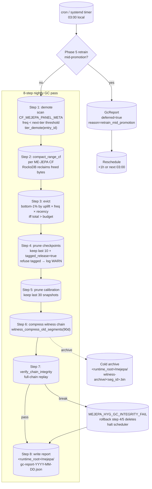
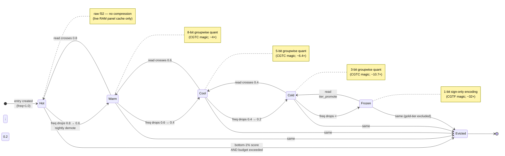
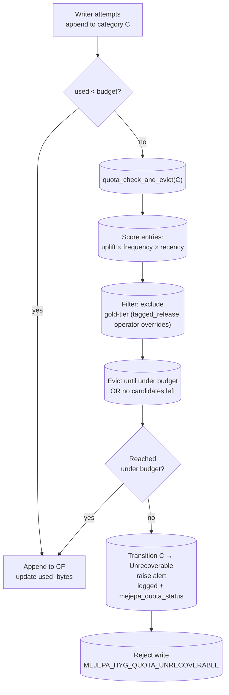

# TECH-HYGIENE — ME-JEPA-Code Disk and Memory Hygiene (Implementation)

> **📊 2026-05-10 STATUS:** PARTIAL — see ../implementation-plan.md for the full Phase 6 status.

> **Level 3 — Technical Specification.** Implements `SPEC-HYGIENE.md`. Defines HOW the hygiene domain (Phase 6) is built. Conflicts with constitution / functional spec resolve to those.

```xml
<technical_spec id="TECH-HYGIENE" version="1.0" implements="SPEC-HYGIENE">

<metadata>
  <title>ME-JEPA-Code Disk and Memory Hygiene — Implementation</title>
  <status>partial</status>
  <owner>Phase 6 ME-JEPA implementation team</owner>
  <last_updated>2026-05-10</last_updated>
  <related_specs>
    <spec_ref>SPEC-HYGIENE</spec_ref>
    <spec_ref>SPEC-CORPUS</spec_ref>
    <spec_ref>TECH-CORPUS</spec_ref>
    <spec_ref>SPEC-INSTRUMENTS</spec_ref>
    <spec_ref>TECH-INSTRUMENTS</spec_ref>
    <spec_ref>SPEC-PREDICTOR</spec_ref>
    <spec_ref>SPEC-TRAINING</spec_ref>
    <spec_ref>SPEC-INFERENCE</spec_ref>
    <spec_ref>TECH-INFERENCE</spec_ref>
    <spec_ref>SPEC-TCT</spec_ref>
    <spec_ref>SPEC-WITNESS</spec_ref>
    <spec_ref>SPEC-SELF-HEALING</spec_ref>
  </related_specs>
</metadata>

<architecture_diagram>

## Diagram 1 — Nightly GC pass (8-step pipeline)



## Diagram 2 — Tier policy state machine + emergency eviction



## Diagram 3 — Quota enforcement (emergency path)



## Diagram 4 — Witness-chain Merkle compression

```mermaid
sequenceDiagram
    participant Op as Operator / nightly GC
    participant WC as witness_compress_<br/>old_segments
    participant Live as Live witness chain<br/>(73-byte entries)
    participant Cold as Cold archive
    participant Verify as verify_chain_integrity

    Op->>WC: invoke (threshold=90d)
    WC->>Live: scan; find segments<br/>older than threshold<br/>(group by 1024 entries)
    loop For each 1024-entry segment
        WC->>WC: compute MerkleTree<br/>leaf_tag, node_tag<br/>(from cert.rs)
        WC->>Cold: archive original<br/>1024 × 73 B = 74,752 B<br/>provenance: corpus_sha,<br/>start_ts, end_ts
        Cold-->>WC: archive_path
        WC->>WC: build compressed-<br/>segment entry<br/>(73 B with witness_type=0x80,<br/>action_hash=merkle_root)
        WC->>Live: atomic replace<br/>(prev_hash links preserved)
    end
    WC->>Verify: verify_chain_integrity()
    Verify-->>WC: passed=true | break_offset=N
    WC-->>Op: CompressReport<br/>{segments, ratios,<br/>merkle_roots, archive_paths}

    Note over Cold: Auditor can later<br/>re-fetch archive,<br/>recompute Merkle root,<br/>byte-equal stored root → verified
```

</architecture_diagram>

<crate_layout>

```text
crates/
  context-graph-mejepa-hygiene/                NEW — Phase 6 deliverable
    Cargo.toml
    src/
      lib.rs                                   pub mod re-exports
      ops.rs                                   me_jepa::ops::* (8 primitives)
      gc.rs                                    nightly GC orchestrator + GcReport types
      gc_steps/
        mod.rs
        step1_demote.rs
        step2_compact.rs
        step3_evict.rs
        step4_prune_checkpoints.rs
        step5_prune_calibration.rs
        step6_compress_witness.rs
        step7_verify_integrity.rs
        step8_report.rs
      tier.rs                                  tier_demote / tier_promote + Tier enum + frequency math
      tier_frozen.rs                           1-bit sign-only encoding (CGTF magic)
      quota.rs                                 quota_check_and_evict + QuotaStatus + DegradationStatus
      witness_compress.rs                      witness_compress_old_segments + cold-archive write + Merkle build
      categories.rs                            9-category enum + budget table + CG_MEJEPA_DISK_QUOTA_GB parser
      error.rs                                 OpsError + structured error codes
      mcp.rs                                   MCP tool dispatch shims (called from context-graph-mcp)
    examples/
      gc_stress_fsv.rs                         FSV writer for /tmp/contextgraph-mejepa-hygiene-fsv/gc-stress-evidence.json
      merkle_compression_fsv.rs                FSV writer for merkle-compression-evidence.json
      quota_overflow_fsv.rs                    FSV writer for quota-overflow-evidence.json
    tests/
      integration_gc.rs
      integration_merkle.rs
      integration_quota.rs

crates/
  context-graph-mcp/
    src/handlers/tools/mejepa_hygiene/         NEW
      mod.rs
      gc_run.rs                                mcp__cgreality__mejepa_gc_run
      quota_status.rs                          mcp__cgreality__mejepa_quota_status
      witness_compress.rs                      mcp__cgreality__mejepa_witness_compress
      schema.rs                                JSON schemas (additionalProperties:false)

crates/
  context-graph-mejepa/                        existing crate (Phase 2-4)
    src/
      bin/
        mejepa.rs                              ADD `stress` subcommand (Phase 6 DoD)
```

Files under 500 lines (per CLAUDE.md §4); split via `file-length-manager` if any module exceeds.

</crate_layout>

<data_models>

  <model name="OpsError" location="crates/context-graph-mejepa-hygiene/src/error.rs">
    <field name="code" type="&'static str" constraints="SCREAMING_SNAKE per failure_taxonomy"/>
    <field name="kind" type="OpsErrorKind enum" constraints="QuotaExceeded | QuotaUnrecoverable | TierDecompressFail | GcIntegrityFail | MerkleVerifyFail | CheckpointPruneRefused | CrossCuttingDeferred | Internal"/>
    <field name="context" type="serde_json::Value" constraints="structured payload (entry_id, category, segment_id, etc.)"/>
    <field name="source" type="Option&lt;Box&lt;dyn std::error::Error&gt;&gt;" constraints="upstream cause (e.g., RocksDB error, witness error)"/>
  </model>

  <model name="GcReport" location="crates/context-graph-mejepa-hygiene/src/gc.rs">
    <field name="gc_run_id" type="uuid::Uuid" constraints="generated at start_of_pass"/>
    <field name="started_at" type="chrono::DateTime&lt;Utc&gt;" constraints="ISO 8601"/>
    <field name="completed_at" type="Option&lt;chrono::DateTime&lt;Utc&gt;&gt;" constraints="None when aborted"/>
    <field name="deferred" type="bool" constraints="default false"/>
    <field name="deferred_reason" type="Option&lt;String&gt;" constraints="required when deferred=true"/>
    <field name="aborted" type="bool" constraints="default false"/>
    <field name="abort_reason" type="Option&lt;String&gt;" constraints="required when aborted=true"/>
    <field name="step_reports" type="Vec&lt;GcStepReport&gt;" constraints="length 1-8 ordered by step_index"/>
    <field name="total_disk_used_gb_before" type="f64" constraints="≥ 0.0"/>
    <field name="total_disk_used_gb_after" type="f64" constraints="≥ 0.0"/>
    <field name="integrity_check_passed" type="bool" constraints="false ⟹ aborted=true"/>
  </model>

  <model name="GcStepReport" location="crates/context-graph-mejepa-hygiene/src/gc.rs">
    <field name="step_index" type="u8" constraints="1..=8"/>
    <field name="step_name" type="String" constraints="snake_case enum: demote | compact | evict | prune_checkpoints | prune_calibration | compress_witness | verify_integrity | report"/>
    <field name="duration_ms" type="u64" constraints="non-negative"/>
    <field name="entries_processed" type="u64" constraints="non-negative"/>
    <field name="bytes_freed" type="i64" constraints="signed (compress_witness can be negative in-flight)"/>
    <field name="errors_encountered" type="Vec&lt;String&gt;" constraints="non-aborting structured codes"/>
  </model>

  <model name="QuotaStatus" location="crates/context-graph-mejepa-hygiene/src/quota.rs">
    <field name="effective_quota_gb" type="f64" constraints="positive; CG_MEJEPA_DISK_QUOTA_GB or 115 default"/>
    <field name="total_disk_used_gb" type="f64" constraints="≥ 0.0"/>
    <field name="categories" type="Vec&lt;CategoryStatus&gt;" constraints="length == 9 (one per Category enum variant)"/>
    <field name="system_accepts_new_data_in_categories" type="HashSet&lt;Category&gt;" constraints="excludes Unrecoverable categories"/>
    <field name="snapshot_at" type="chrono::DateTime&lt;Utc&gt;" constraints="ISO 8601"/>
  </model>

  <model name="CategoryStatus" location="crates/context-graph-mejepa-hygiene/src/quota.rs">
    <field name="category" type="Category" constraints="enum 9 variants"/>
    <field name="budget_bytes" type="u64" constraints="positive; from BUDGETS table"/>
    <field name="used_bytes" type="u64" constraints="non-negative"/>
    <field name="degradation_status" type="DegradationStatus" constraints="Healthy | Approaching | OverBudget | Unrecoverable"/>
    <field name="tier_distribution" type="HashMap&lt;Tier, u64&gt;" constraints="empty for non-tiered categories"/>
    <field name="oldest_entry_age_seconds" type="Option&lt;u64&gt;" constraints="None if empty"/>
    <field name="last_gc_attempt_ts" type="Option&lt;chrono::DateTime&lt;Utc&gt;&gt;" constraints="None if no GC has run"/>
    <field name="last_gc_outcome" type="Option&lt;String&gt;" constraints="freed_N_bytes | no_progress | deferred"/>
  </model>

  <model name="Category" location="crates/context-graph-mejepa-hygiene/src/categories.rs">
    <field name="enum" type="MutationCorpus | LiveAttemptCorpus | ModelCheckpoints | WitnessChains | LivePanelCacheRam | LivePanelDiskOverflow | CalibrationSnapshots | AuxSignalsOverrides | ShiftLogSubscriberState" constraints="9 variants exactly per doc 09 §6.1"/>
  </model>

  <model name="Tier" location="crates/context-graph-mejepa-hygiene/src/tier.rs">
    <field name="enum" type="Hot | Warm | Cool | Cold | Frozen" constraints="5 variants; Hot=raw f32, Warm=8-bit, Cool=5-bit, Cold=3-bit, Frozen=1-bit sign"/>
    <field name="threshold_lower" type="fn() -&gt; f32" constraints="Hot 0.8, Warm 0.6, Cool 0.4, Cold 0.2, Frozen -inf"/>
    <field name="bit_width_for_quant" type="fn() -&gt; Option&lt;BitWidth&gt;" constraints="None for Hot (raw f32) and Frozen (separate CGTF)"/>
  </model>

  <model name="DegradationStatus" location="crates/context-graph-mejepa-hygiene/src/quota.rs">
    <field name="enum" type="Healthy | Approaching | OverBudget | Unrecoverable" constraints="Healthy &lt; 80%, Approaching 80-95%, OverBudget 95-100%, Unrecoverable post-failed-GC sticky"/>
  </model>

  <model name="CompressReport" location="crates/context-graph-mejepa-hygiene/src/witness_compress.rs">
    <field name="threshold_days" type="u32" constraints="1..=36500"/>
    <field name="segments_compressed" type="u64" constraints="non-negative"/>
    <field name="entries_compressed" type="u64" constraints="== segments_compressed * 1024"/>
    <field name="bytes_before" type="u64" constraints="non-negative"/>
    <field name="bytes_after" type="u64" constraints="non-negative"/>
    <field name="compression_ratio" type="f64" constraints="≥ 1.0; bytes_before / bytes_after.max(1)"/>
    <field name="merkle_roots" type="Vec&lt;[u8; 32]&gt;" constraints="length == segments_compressed"/>
    <field name="cold_archive_paths" type="Vec&lt;String&gt;" constraints="length == segments_compressed; resolvable filesystem paths"/>
    <field name="integrity_check_passed" type="bool" constraints="post-compression verify_chain_integrity"/>
  </model>

  <model name="EvictReport" location="crates/context-graph-mejepa-hygiene/src/quota.rs">
    <field name="trigger" type="EvictTrigger" constraints="EmergencyOverBudget | NightlyBottom1Pct | OperatorManual"/>
    <field name="category" type="Category" constraints="one of 9"/>
    <field name="entries_evicted" type="u64" constraints="non-negative"/>
    <field name="bytes_freed" type="u64" constraints="non-negative"/>
    <field name="reached_under_budget" type="bool" constraints="false ⟹ Unrecoverable transition on EmergencyOverBudget"/>
    <field name="duration_ms" type="u64" constraints="non-negative"/>
  </model>

  <model name="ChainIntegrityReport" location="crates/context-graph-mejepa-hygiene/src/witness_compress.rs">
    <field name="entries_verified" type="u64" constraints="non-negative"/>
    <field name="passed" type="bool" constraints="boolean"/>
    <field name="break_offset" type="Option&lt;usize&gt;" constraints="required when passed=false"/>
    <field name="duration_ms" type="u64" constraints="non-negative"/>
  </model>

  <model name="EntryId" location="crates/context-graph-mejepa-hygiene/src/tier.rs">
    <field name="cf_name" type="String" constraints="must match a registered CF_MEJEPA_* name"/>
    <field name="key" type="Vec&lt;u8&gt;" constraints="non-empty"/>
  </model>

  <model name="CompressedSegmentEntry on-disk format" location="73-byte witness format">
    <field name="prev_hash" type="[u8; 32]" constraints="bytes 0..32; chains to previous live or compressed entry"/>
    <field name="action_hash" type="[u8; 32]" constraints="bytes 32..64; carries the Merkle root of the original 1024-entry segment"/>
    <field name="timestamp_ns" type="u64" constraints="bytes 64..72 big-endian; equals end_timestamp_ns of the segment"/>
    <field name="witness_type" type="u8" constraints="byte 72; WITNESS_TYPE_COMPRESSED_SEGMENT = 0x80 (high-bit-set keeps low range for live entries)"/>
  </model>

  <model name="CompressedSegmentMetadata sidecar" location="CF_MEJEPA_WITNESS_SEGMENT_META">
    <field name="segment_id" type="u64" constraints="monotonic per chain; key in CF"/>
    <field name="merkle_root" type="[u8; 32]" constraints="byte-equals action_hash of the compressed-segment entry"/>
    <field name="start_timestamp_ns" type="u64" constraints="timestamp of original entry 0 in segment"/>
    <field name="end_timestamp_ns" type="u64" constraints="timestamp of original entry 1023 in segment"/>
    <field name="entry_count" type="u32" constraints="== 1024"/>
    <field name="cold_archive_path" type="String" constraints="filesystem path to original 73 × 1024 = 74,752 B blob"/>
    <field name="archive_sha256" type="[u8; 32]" constraints="SHA-256 of the archived file for tamper-detect"/>
    <field name="corpus_sha" type="[u8; 32]" constraints="provenance binding to the corpus active at compression time"/>
  </model>

  <model name="BUDGETS table" location="crates/context-graph-mejepa-hygiene/src/categories.rs">
    <field name="MUTATION_CORPUS_BYTES" type="u64" constraints="5 * 1024^3 = 5_368_709_120"/>
    <field name="LIVE_ATTEMPT_CORPUS_BYTES" type="u64" constraints="50 * 1024^3"/>
    <field name="MODEL_CHECKPOINTS_BYTES" type="u64" constraints="10 * 1024^3"/>
    <field name="WITNESS_CHAINS_BYTES" type="u64" constraints="20 * 1024^3"/>
    <field name="LIVE_PANEL_CACHE_RAM_BYTES" type="u64" constraints="4 * 1024^3"/>
    <field name="LIVE_PANEL_DISK_OVERFLOW_BYTES" type="u64" constraints="20 * 1024^3"/>
    <field name="CALIBRATION_SNAPSHOTS_BYTES" type="u64" constraints="5 * 1024^3"/>
    <field name="AUX_SIGNALS_OVERRIDES_BYTES" type="u64" constraints="2 * 1024^3"/>
    <field name="SHIFT_LOG_SUBSCRIBER_STATE_BYTES" type="u64" constraints="(0.5 * 1024^3) as u64 = 536_870_912"/>
    <field name="DEFAULT_TOTAL_QUOTA_BYTES" type="u64" constraints="115 * 1024^3"/>
  </model>

</data_models>

<api_contracts>

  <endpoint path="mcp__cgreality__mejepa_gc_run" method="MCP-tool" implements="REQ-HYG-03,REQ-HYG-07">
    <request_body>
      confirm_run: bool (required, MUST be true; rejected otherwise to prevent accidental triggers)
    </request_body>
    <responses>
      success: GcReport (JSON-serialized; pretty)
      400: { error: "MEJEPA_HYG_GC_REJECTED", message: "confirm_run=true required" }
      503: { error: "MEJEPA_HYG_GC_DEFERRED", deferred_reason: "retrain_mid_promotion" }
      500: { error: "MEJEPA_HYG_GC_INTEGRITY_FAIL", abort_reason, gc_run_id }
    </responses>
    <schema>additionalProperties: false; required: [confirm_run]</schema>
  </endpoint>

  <endpoint path="mcp__cgreality__mejepa_quota_status" method="MCP-tool" implements="REQ-HYG-04,REQ-HYG-07,REQ-HYG-10">
    <request_body>
      (empty; no params)
    </request_body>
    <responses>
      success: QuotaStatus (JSON-serialized; pretty)
    </responses>
    <schema>additionalProperties: false; required: []</schema>
  </endpoint>

  <endpoint path="mcp__cgreality__mejepa_witness_compress" method="MCP-tool" implements="REQ-HYG-04,REQ-HYG-07">
    <request_body>
      threshold_days: u32 (required, 1 ≤ x ≤ 36500)
    </request_body>
    <responses>
      success: CompressReport
      400: { error: "MEJEPA_HYG_INVALID_THRESHOLD", message }
      500: { error: "MEJEPA_HYG_MERKLE_VERIFY_FAIL", segment_id, stored_root, recomputed_root }
      507: { error: "MEJEPA_HYG_QUOTA_EXCEEDED", category: "WitnessChains" or archive_path-related }
    </responses>
    <schema>additionalProperties: false; required: [threshold_days]; threshold_days: { type: integer, minimum: 1, maximum: 36500 }</schema>
  </endpoint>

</api_contracts>

<component_contracts>

  <component name="ops" path="crates/context-graph-mejepa-hygiene/src/ops.rs" implements="REQ-HYG-08">
    <method name="gc_run_nightly">
      <signature>pub fn gc_run_nightly(env: &amp;HygieneEnv) -&gt; Result&lt;GcReport, OpsError&gt;</signature>
      <implements>REQ-HYG-03</implements>
      <behavior>
        1. Acquire global GC lock (flock on `~/.cache/cgreality/mejepa-gc.lock`); fail-closed on contention with `OpsError::Internal { reason: "gc_already_running" }`
        2. Check Phase 5 retrain mid-promotion (call SPEC-SELF-HEALING `is_retrain_in_progress()`; if Phase 5 deferred, treat as "not in progress")
        3. If mid-promotion: return `GcReport { deferred: true, deferred_reason: "retrain_mid_promotion", ... }`
        4. Otherwise execute steps 1-8 in order via `gc_steps::step{N}::run(env, &amp;mut report)`
        5. Step 7 abort halts the pipeline; step 4/5 deletes are staged in a RocksDB write-batch and committed only after step 7 passes (atomic per NFR-HYG-04)
        6. Step 8 always runs (even on abort) to emit the report
        7. Release GC lock
      </behavior>
      <throws>OpsError::QuotaExceeded, OpsError::GcIntegrityFail, OpsError::Internal</throws>
    </method>

    <method name="quota_check_and_evict">
      <signature>pub fn quota_check_and_evict(env: &amp;HygieneEnv, category: Category) -&gt; Result&lt;EvictReport, OpsError&gt;</signature>
      <implements>REQ-HYG-05</implements>
      <behavior>
        1. Read current usage of `category` from RocksDB metadata (size_of_cf or sum-of-keys cache)
        2. If under budget: return `EvictReport { entries_evicted: 0, reached_under_budget: true, ... }`
        3. Build candidate set: all entries in `category`'s CFs EXCLUDING gold-tier (tagged_release on checkpoints; explicit operator-tagged overrides on aux_signals)
        4. Score each candidate: `score = uplift × access_frequency × recency` (formula in `quota::score_for_eviction`)
        5. Sort ascending; evict from lowest-score until under budget OR no more candidates
        6. If reached under budget: return EvictReport
        7. If exhausted candidates: transition `category` → Unrecoverable (write to CF_MEJEPA_QUOTA_STATE); raise alert via `tracing::error!`; return `EvictReport { reached_under_budget: false, ... }` AND propagate `OpsError::QuotaUnrecoverable` to caller
      </behavior>
      <throws>OpsError::QuotaUnrecoverable</throws>
    </method>

    <method name="heal_detect_drift">
      <signature>pub fn heal_detect_drift(env: &amp;HygieneEnv) -&gt; Result&lt;DriftSeverity, OpsError&gt;</signature>
      <implements>REQ-HYG-08</implements>
      <behavior>
        1. If feature flag `mejepa-self-healing` is disabled OR Phase 5 crate `context-graph-mejepa-self-healing` is not linked: return `OpsError::CrossCuttingDeferred { spec: "SPEC-SELF-HEALING" }`
        2. Otherwise forward to `mejepa_self_healing::detect_drift(env.into())`
      </behavior>
      <throws>OpsError::CrossCuttingDeferred</throws>
    </method>

    <method name="heal_retrain_if_needed">
      <signature>pub fn heal_retrain_if_needed(env: &amp;HygieneEnv) -&gt; Result&lt;HealReport, OpsError&gt;</signature>
      <implements>REQ-HYG-08</implements>
      <behavior>Same fail-closed deferral pattern as `heal_detect_drift`</behavior>
      <throws>OpsError::CrossCuttingDeferred</throws>
    </method>

    <method name="witness_compress_old_segments">
      <signature>pub fn witness_compress_old_segments(env: &amp;HygieneEnv, threshold_age: Duration) -&gt; Result&lt;CompressReport, OpsError&gt;</signature>
      <implements>REQ-HYG-04</implements>
      <behavior>
        1. Validate `threshold_age &gt;= Duration::days(1)` (refuse 0 or sub-day to prevent compressing live activity)
        2. Iterate witness chain in order; group consecutive entries by 1024-entry segments where every entry's `timestamp_ns &lt; (now - threshold_age)`
        3. For each candidate segment:
           a. Build a `MerkleTree` using `context_graph_witness::cert::MerkleTree::from_leaves` over the 1024 entries' bytes (canonical leaf order)
           b. Atomically: archive original 73 × 1024 bytes to `cold_archive_root/&lt;segment_id&gt;.bin` with header `(corpus_sha, start_ts, end_ts, entry_count, archive_sha256)` sidecar
           c. Construct compressed-segment WitnessEntry with `witness_type=0x80, action_hash=merkle_root, prev_hash=&lt;previous entry's hash&gt;, timestamp_ns=end_ts`
           d. Build a RocksDB write-batch: replace original 1024 entries with the single compressed-segment entry; update CF_MEJEPA_WITNESS_SEGMENT_META; commit batch
           e. On any failure (archive write fails, batch commit fails): roll back atomically (the archive was written first; remove archive file; do NOT replace live chain); propagate error
        4. After all segments processed: invoke `verify_chain_integrity()`
        5. Return CompressReport with merkle_roots + cold_archive_paths
      </behavior>
      <throws>OpsError::QuotaExceeded (archive disk full), OpsError::MerkleVerifyFail, OpsError::Internal</throws>
    </method>

    <method name="witness_verify_integrity">
      <signature>pub fn witness_verify_integrity(env: &amp;HygieneEnv) -&gt; Result&lt;ChainIntegrityReport, OpsError&gt;</signature>
      <implements>REQ-HYG-03 step 7</implements>
      <behavior>
        1. Iterate live chain entries in order; for each entry verify `entry.prev_hash == hash(prev_entry.to_bytes())`
        2. For compressed-segment entries (witness_type=0x80): verify metadata sidecar exists in CF_MEJEPA_WITNESS_SEGMENT_META; do NOT recompute Merkle root (that's verifier-on-demand work via `audit_verify_old_entry`)
        3. Return ChainIntegrityReport { passed, break_offset, entries_verified, duration_ms }
      </behavior>
      <throws>None — returns Result with ChainIntegrityReport.passed=false on break</throws>
    </method>

    <method name="tier_demote">
      <signature>pub fn tier_demote(env: &amp;HygieneEnv, entry_id: &amp;EntryId) -&gt; Result&lt;(), OpsError&gt;</signature>
      <implements>REQ-HYG-06</implements>
      <behavior>
        1. Read entry from CF identified by `entry_id.cf_name` at `entry_id.key`
        2. Read panel meta sidecar to determine current tier + access frequency
        3. Compute new tier: next-colder per the threshold table
        4. If current is Hot (raw f32): encode at `BitWidth::Eight` via `context_graph_tier_compression::encode`
        5. If current is Warm (8-bit): decode then encode at `BitWidth::Five` (Cool)
        6. If current is Cool (5-bit): decode then encode at `BitWidth::Three` (Cold)
        7. If current is Cold (3-bit): decode then encode via `tier_frozen::encode_sign_only` (Frozen, CGTF magic)
        8. If current is Frozen: no-op (already coldest)
        9. Write batch: replace entry with new blob; update panel meta with new tier + new freq + transition timestamp
      </behavior>
      <throws>OpsError::TierDecompressFail (source corrupt), OpsError::Internal</throws>
    </method>

    <method name="tier_promote">
      <signature>pub fn tier_promote(env: &amp;HygieneEnv, entry_id: &amp;EntryId) -&gt; Result&lt;(), OpsError&gt;</signature>
      <implements>REQ-HYG-06</implements>
      <behavior>
        1. Read entry + panel meta
        2. Increment access frequency: `freq = (freq * decay_factor(elapsed_24h_units) + 1.0).min(1.0)`
        3. If new freq crosses next-warmer threshold: re-encode at hotter tier (mirror of tier_demote in reverse)
        4. Write batch: persist updated freq + (if tier changed) new blob + meta
        5. If decompression fails: do NOT silently zero-fill; mark entry corrupt in meta; return `OpsError::TierDecompressFail` with offending bytes
      </behavior>
      <throws>OpsError::TierDecompressFail</throws>
    </method>
  </component>

  <component name="gc_steps::step1_demote" path="crates/context-graph-mejepa-hygiene/src/gc_steps/step1_demote.rs" implements="REQ-HYG-03 step 1">
    <method name="run">
      <signature>pub fn run(env: &amp;HygieneEnv, report: &amp;mut GcReport) -&gt; Result&lt;(), OpsError&gt;</signature>
      <behavior>
        1. Iterate CF_MEJEPA_PANEL_META; for each entry compute decayed frequency
        2. If decayed freq &lt; current tier's lower bound: invoke `tier_demote(env, &amp;entry_id)`
        3. Accumulate counts into a GcStepReport; push into `report.step_reports`
      </behavior>
    </method>
  </component>

  <component name="gc_steps::step2_compact" path="crates/context-graph-mejepa-hygiene/src/gc_steps/step2_compact.rs" implements="REQ-HYG-03 step 2">
    <method name="run">
      <signature>pub fn run(env: &amp;HygieneEnv, report: &amp;mut GcStepReport) -&gt; Result&lt;(), OpsError&gt;</signature>
      <behavior>For each ME-JEPA CF in `env.mejepa_cfs()`: call `db.compact_range_cf(cf, None, None)`; sum bytes_freed = (size_before - size_after).max(0)</behavior>
    </method>
  </component>

  <component name="gc_steps::step3_evict" path="crates/context-graph-mejepa-hygiene/src/gc_steps/step3_evict.rs" implements="REQ-HYG-03 step 3">
    <method name="run">
      <signature>pub fn run(env: &amp;HygieneEnv, report: &amp;mut GcStepReport) -&gt; Result&lt;(), OpsError&gt;</signature>
      <behavior>
        1. For each tiered category: if total &gt; budget, score all entries by `uplift × frequency × recency`
        2. Sort ascending; evict bottom 1% (or until under budget if exceeded)
        3. Skip gold-tier entries
        4. Update report with entries_evicted + bytes_freed
      </behavior>
    </method>
  </component>

  <component name="gc_steps::step4_prune_checkpoints" path="crates/context-graph-mejepa-hygiene/src/gc_steps/step4_prune_checkpoints.rs" implements="REQ-HYG-09">
    <method name="run">
      <signature>pub fn run(env: &amp;HygieneEnv, report: &amp;mut GcStepReport) -&gt; Result&lt;(), OpsError&gt;</signature>
      <behavior>
        1. List all checkpoints in CF_MEJEPA_WEIGHT_BLOBS metadata
        2. Sort by created_at descending; partition: keep newest 10 + all `tagged_release: true`
        3. For each non-kept candidate: stage delete in write-batch; if `tagged_release: true` slipped in (race), record `MEJEPA_HYG_CHECKPOINT_PRUNE_REFUSED` in report.errors_encountered (non-aborting)
        4. Stage write-batch (committed in step 7 only if integrity passes)
      </behavior>
    </method>
  </component>

  <component name="gc_steps::step5_prune_calibration" path="crates/context-graph-mejepa-hygiene/src/gc_steps/step5_prune_calibration.rs" implements="REQ-HYG-03 step 5">
    <method name="run">
      <signature>pub fn run(env: &amp;HygieneEnv, report: &amp;mut GcStepReport) -&gt; Result&lt;(), OpsError&gt;</signature>
      <behavior>List CF_MEJEPA_CALIBRATION_HISTORY; sort by frozen_at desc; keep newest 30; stage deletes for the rest</behavior>
    </method>
  </component>

  <component name="gc_steps::step6_compress_witness" path="crates/context-graph-mejepa-hygiene/src/gc_steps/step6_compress_witness.rs" implements="REQ-HYG-04">
    <method name="run">
      <signature>pub fn run(env: &amp;HygieneEnv, report: &amp;mut GcStepReport) -&gt; Result&lt;(), OpsError&gt;</signature>
      <behavior>Call `witness_compress_old_segments(env, Duration::days(env.witness_threshold_days as i64))`; merge CompressReport counts into GcStepReport</behavior>
    </method>
  </component>

  <component name="gc_steps::step7_verify_integrity" path="crates/context-graph-mejepa-hygiene/src/gc_steps/step7_verify_integrity.rs" implements="REQ-HYG-03 step 7,BR-HYG-02">
    <method name="run">
      <signature>pub fn run(env: &amp;HygieneEnv, report: &amp;mut GcReport, staged_batch: &amp;mut WriteBatch) -&gt; Result&lt;(), OpsError&gt;</signature>
      <behavior>
        1. Call `witness_verify_integrity(env)`
        2. If `passed=true`: commit `staged_batch` (steps 4 + 5 deletes)
        3. If `passed=false`: do NOT commit; set `report.aborted=true`, `abort_reason="MEJEPA_HYG_GC_INTEGRITY_FAIL"`; return `OpsError::GcIntegrityFail`
      </behavior>
    </method>
  </component>

  <component name="gc_steps::step8_report" path="crates/context-graph-mejepa-hygiene/src/gc_steps/step8_report.rs" implements="REQ-HYG-03 step 8">
    <method name="run">
      <signature>pub fn run(env: &amp;HygieneEnv, report: &amp;mut GcReport) -&gt; Result&lt;(), OpsError&gt;</signature>
      <behavior>
        1. Compute total_disk_used_gb_after via per-CF size sum
        2. Set completed_at
        3. Serialize GcReport to JSON pretty (2-space indent per NFR-HYG-07)
        4. Write to `&lt;runtime_root&gt;/mejepa/gc-report-&lt;YYYY-MM-DD&gt;.json` with mode 0o600 per NFR-HYG-06
      </behavior>
    </method>
  </component>

  <component name="quota" path="crates/context-graph-mejepa-hygiene/src/quota.rs" implements="REQ-HYG-04,REQ-HYG-05,REQ-HYG-10">
    <method name="snapshot">
      <signature>pub fn snapshot(env: &amp;HygieneEnv) -&gt; Result&lt;QuotaStatus, OpsError&gt;</signature>
      <implements>REQ-HYG-04,REQ-HYG-10</implements>
      <behavior>
        1. For each Category variant: read CF size via `db.get_property_cf_int(cf, "rocksdb.estimate-num-keys")` + sum-of-value-sizes (cached)
        2. Compute degradation_status from used/budget ratio
        3. Read CF_MEJEPA_QUOTA_STATE for per-category Unrecoverable flags
        4. Build QuotaStatus; latency target &lt; 50 ms p50
      </behavior>
      <throws>OpsError::Internal</throws>
    </method>

    <method name="score_for_eviction">
      <signature>fn score_for_eviction(uplift: f32, access_freq: f32, recency_seconds: u64) -&gt; f32</signature>
      <behavior>
        Returns `uplift × access_freq × recency_factor` where `recency_factor = exp(-recency_seconds / SECONDS_PER_30_DAYS)`. Lowest score evicted first. Pure function; no I/O
      </behavior>
    </method>

    <method name="degradation_for">
      <signature>fn degradation_for(used: u64, budget: u64, unrecoverable: bool) -&gt; DegradationStatus</signature>
      <behavior>
        if unrecoverable: Unrecoverable
        else if used &gt;= budget: OverBudget
        else if used &gt;= budget * 95 / 100: Approaching // 95-100% (effectively merged with OverBudget at 95%)
        else if used &gt;= budget * 80 / 100: Approaching
        else: Healthy
        Per REQ-HYG-10 thresholds
      </behavior>
    </method>
  </component>

  <component name="tier" path="crates/context-graph-mejepa-hygiene/src/tier.rs" implements="REQ-HYG-02,REQ-HYG-06">
    <method name="decay_factor">
      <signature>pub fn decay_factor(elapsed_24h_units: f64) -&gt; f64</signature>
      <behavior>Returns `0.99_f64.powf(elapsed_24h_units)` per doc 09 §6.2</behavior>
    </method>

    <method name="tier_for_frequency">
      <signature>pub fn tier_for_frequency(freq: f32) -&gt; Tier</signature>
      <behavior>Maps freq to Tier per the §6.2 table; ≥0.8 Hot, 0.6-0.8 Warm, 0.4-0.6 Cool, 0.2-0.4 Cold, &lt;0.2 Frozen</behavior>
    </method>

    <method name="encode_for_tier">
      <signature>pub fn encode_for_tier(values: &amp;[f32], tier: Tier) -&gt; Result&lt;Vec&lt;u8&gt;, OpsError&gt;</signature>
      <behavior>
        Hot → return raw f32 bytes (`bytemuck::cast_slice(values).to_vec()`)
        Warm → `context_graph_tier_compression::encode(values, BitWidth::Eight).serialize()`
        Cool → `BitWidth::Five`
        Cold → `BitWidth::Three`
        Frozen → `tier_frozen::encode_sign_only(values)` (CGTF magic)
        Magic byte dispatch on decode (see `decode_for_tier`)
      </behavior>
      <throws>OpsError::TierDecompressFail (downstream encode failures)</throws>
    </method>

    <method name="decode_for_tier">
      <signature>pub fn decode_for_tier(blob: &amp;[u8]) -&gt; Result&lt;Vec&lt;f32&gt;, OpsError&gt;</signature>
      <behavior>
        1. Read magic bytes (first 4)
        2. If `CGTC`: dispatch to `context_graph_tier_compression::deserialize` then `decode`
        3. If `CGTF`: dispatch to `tier_frozen::decode_sign_only`
        4. Otherwise: return `OpsError::TierDecompressFail { code: "MEJEPA_HYG_TIER_DECOMPRESS_FAIL", expected_magic: "CGTC|CGTF", actual_magic: hex(first 4), entry_id_optional }`
        5. NEVER silently zero-fill on failure
      </behavior>
      <throws>OpsError::TierDecompressFail</throws>
    </method>
  </component>

  <component name="tier_frozen" path="crates/context-graph-mejepa-hygiene/src/tier_frozen.rs" implements="REQ-HYG-02 (Frozen)">
    <method name="encode_sign_only">
      <signature>pub fn encode_sign_only(values: &amp;[f32]) -&gt; Result&lt;Vec&lt;u8&gt;, OpsError&gt;</signature>
      <behavior>
        Header: 22 bytes mirroring CGTC layout but with magic `CGTF` (0x43 0x47 0x54 0x46), version=1, bits=1, n=values.len(), min=actual_min, max=actual_max
        Payload: ceil(n/8) bytes; bit i set iff values[i] &gt;= 0.0
        Reject empty input + non-finite values fail-closed
      </behavior>
    </method>

    <method name="decode_sign_only">
      <signature>pub fn decode_sign_only(blob: &amp;[u8]) -&gt; Result&lt;Vec&lt;f32&gt;, OpsError&gt;</signature>
      <behavior>
        Validate header (magic CGTF, version 1, bits 1, n bounded)
        Reconstruct: bit 1 → +max/2 (or +sigma_estimate), bit 0 → -max/2; mark `fidelity_lost: true` in caller's panel meta
      </behavior>
      <throws>OpsError::TierDecompressFail</throws>
    </method>
  </component>

  <component name="witness_compress" path="crates/context-graph-mejepa-hygiene/src/witness_compress.rs" implements="REQ-HYG-04">
    <method name="compress_segments">
      <signature>pub fn compress_segments(env: &amp;HygieneEnv, threshold_age: Duration) -&gt; Result&lt;CompressReport, OpsError&gt;</signature>
      <behavior>Per `ops::witness_compress_old_segments` behavior above. Uses `context_graph_witness::cert::MerkleTree::from_leaves` for root computation; canonical leaf order is byte-order of original 73-byte entries</behavior>
    </method>

    <method name="archive_segment_atomic">
      <signature>fn archive_segment_atomic(archive_root: &amp;Path, segment_id: u64, segment_bytes: &amp;[u8], meta: &amp;CompressedSegmentMetadata) -&gt; Result&lt;String, OpsError&gt;</signature>
      <behavior>
        1. Write to `&lt;archive_root&gt;/&lt;segment_id&gt;.bin.tmp`
        2. fsync
        3. Rename to `&lt;archive_root&gt;/&lt;segment_id&gt;.bin` (atomic on POSIX)
        4. Write sidecar `&lt;segment_id&gt;.meta.json` with corpus_sha + start_ts + end_ts + entry_count + archive_sha256
        5. Return final path string
        6. On any IO failure: clean up partial tmp file; return `OpsError::QuotaExceeded { reason: "archive_disk_full" }` or `OpsError::Internal`
      </behavior>
    </method>

    <method name="audit_verify_old_entry">
      <signature>pub fn audit_verify_old_entry(env: &amp;HygieneEnv, segment_id: u64, offset: u32) -&gt; Result&lt;(), OpsError&gt;</signature>
      <behavior>
        1. Read CF_MEJEPA_WITNESS_SEGMENT_META for `segment_id`
        2. Read original 1024-entry segment from `cold_archive_path`
        3. Verify SHA-256 of file matches `archive_sha256`
        4. Recompute Merkle root via `MerkleTree::from_leaves`
        5. Compare against stored `merkle_root`; on mismatch return `OpsError::MerkleVerifyFail { segment_id, stored, recomputed }`
        6. Return Ok(()) on success
      </behavior>
      <throws>OpsError::MerkleVerifyFail</throws>
    </method>
  </component>

  <component name="categories" path="crates/context-graph-mejepa-hygiene/src/categories.rs" implements="REQ-HYG-01">
    <method name="effective_quota_bytes">
      <signature>pub fn effective_quota_bytes() -&gt; u64</signature>
      <behavior>
        1. Read env `CG_MEJEPA_DISK_QUOTA_GB` if set
        2. Validate (positive, finite, &gt;= 1, &lt;= u64::MAX / GB)
        3. If invalid: log WARN; fall back to `DEFAULT_TOTAL_QUOTA_BYTES`
        4. If env value &lt; sum of category budgets (115 GB): proportionally scale all category budgets via `effective_budget_for(category)` per EC-HYG-08 (logged at WARN)
      </behavior>
    </method>

    <method name="budget_for">
      <signature>pub fn budget_for(category: Category) -&gt; u64</signature>
      <behavior>Looks up the BUDGETS table; returns the proportionally-scaled budget if env override is below the default sum</behavior>
    </method>
  </component>

  <component name="mcp" path="crates/context-graph-mejepa-hygiene/src/mcp.rs" implements="REQ-HYG-07">
    <method name="dispatch_gc_run">
      <signature>pub fn dispatch_gc_run(env: &amp;HygieneEnv, params: GcRunParams) -&gt; Result&lt;serde_json::Value, OpsError&gt;</signature>
      <behavior>Validate `params.confirm_run == true` else fail-closed; call `ops::gc_run_nightly`; serialize GcReport to JSON</behavior>
    </method>

    <method name="dispatch_quota_status">
      <signature>pub fn dispatch_quota_status(env: &amp;HygieneEnv) -&gt; Result&lt;serde_json::Value, OpsError&gt;</signature>
      <behavior>Call `quota::snapshot`; serialize</behavior>
    </method>

    <method name="dispatch_witness_compress">
      <signature>pub fn dispatch_witness_compress(env: &amp;HygieneEnv, params: WitnessCompressParams) -&gt; Result&lt;serde_json::Value, OpsError&gt;</signature>
      <behavior>Validate `1 &lt;= threshold_days &lt;= 36500`; call `ops::witness_compress_old_segments`; serialize CompressReport</behavior>
    </method>
  </component>

  <component name="HygieneEnv" path="crates/context-graph-mejepa-hygiene/src/lib.rs" implements="lifecycle">
    <field>db: Arc&lt;rocksdb::DB&gt;</field>
    <field>runtime_root: PathBuf</field>
    <field>cold_archive_root: PathBuf</field>
    <field>witness_threshold_days: u32  // default 90</field>
    <field>self_healing_handle: Option&lt;Arc&lt;dyn SelfHealingHandle&gt;&gt;  // None until Phase 5</field>
    <field>now_fn: Arc&lt;dyn Fn() -&gt; DateTime&lt;Utc&gt; + Send + Sync&gt;  // injectable for testing</field>
    <method name="from_runtime_config">
      <signature>pub fn from_runtime_config(cfg: &amp;RuntimeConfig) -&gt; Result&lt;Self, OpsError&gt;</signature>
      <behavior>Reads `CG_MEJEPA_DISK_QUOTA_GB` env, runtime_root, archive root; constructs HygieneEnv</behavior>
    </method>
  </component>

</component_contracts>

<rocksdb_column_families>

  <cf name="CF_MEJEPA_PANEL_META" implements="REQ-HYG-02,REQ-HYG-06">
    <key_layout>panel_id: [u8; 32] (entry SHA)</key_layout>
    <value_layout>PanelMeta { tier: Tier, access_frequency: f32, last_read_ts: u64, last_demote_ts: u64, last_promote_ts: u64, corrupt: bool, fidelity_lost: bool, transition_log: Vec&lt;TierTransition&gt; }</value_layout>
  </cf>

  <cf name="CF_MEJEPA_QUOTA_STATE" implements="REQ-HYG-05">
    <key_layout>category_name: String</key_layout>
    <value_layout>{ unrecoverable_since_ts: Option&lt;u64&gt;, last_gc_attempt_ts: u64, last_gc_outcome: String }</value_layout>
  </cf>

  <cf name="CF_MEJEPA_WITNESS_SEGMENT_META" implements="REQ-HYG-04">
    <key_layout>segment_id: u64 big-endian</key_layout>
    <value_layout>CompressedSegmentMetadata { merkle_root, start_ts, end_ts, entry_count, cold_archive_path, archive_sha256, corpus_sha }</value_layout>
  </cf>

  <cf name="CF_MEJEPA_GC_HISTORY" implements="REQ-HYG-03">
    <key_layout>gc_run_id: Uuid bytes</key_layout>
    <value_layout>GcReport (last 365 reports retained; older pruned by GC step 5-equivalent for self-hygiene)</value_layout>
  </cf>

</rocksdb_column_families>

<implementation_notes>

  <note category="reuse">
    Tier compression encode/decode reuses the shipped `context-graph-tier-compression` crate (✅; 21 tests; FSV at /tmp/contextgraph-tier-compression-fsv/{blob_8,blob_7,blob_5,blob_3}.bin with cosines 0.99999/0.99997/0.99960/0.99192). No new quantizer is written. Frozen 1-bit tier is implemented separately in `tier_frozen.rs` with `CGTF` magic to keep the shipped crate's contract unchanged (pre-production policy: no backwards-compat shims unless operator requests, but the shipped crate is shared with other domains so we add new magic rather than extend BitWidth).
  </note>

  <note category="reuse">
    Stoer-Wagner mincut from `context-graph-mincut` (✅) is consumed in `gc_steps::step3_evict::run` when the eviction candidate set spans repos that are split-paired (training/holdout). The eviction scoring includes a "leakage penalty" component that uses mincut to find the cut minimizing cross-set edge weight; entries on the heavy side of the cut are deprioritized for eviction. This reuses Phase 0 SPEC-CORPUS's split machinery. Acceptable simplification for v1.0: skip the leakage penalty in the very first impl cut and add it after the FSV stress run is green; this is a Phase 6 internal refinement not exposed in the API.
  </note>

  <note category="reuse">
    Merkle tree for witness compression reuses `context_graph_witness::cert::MerkleTree::from_leaves` with `MERKLE_LEAF_TAG` and `MERKLE_NODE_TAG` constants from the shipped `cert.rs`. No new Merkle implementation. Cross-host determinism (NFR-HYG-05) inherited from cert.rs.
  </note>

  <note category="security">
    SEC-MEJEPA-07 mandates 0o600 on FSV evidence; enforced via `OpenOptions::new().mode(0o600).create_new(true).write(true)` on the FSV writer.
  </note>

  <note category="security">
    `mejepa_gc_run` requires `confirm_run: true` (REQ-HYG-07 constraint) — accidental triggers from a misconfigured agent are blocked at the schema layer. The schema also rejects `additionalProperties` per the project pattern (MEMORY.md "additionalProperties:false blocks unlisted params").
  </note>

  <note category="performance">
    Step 2 `compact_range_cf` is the single biggest contributor to NFR-HYG-01 (60 min p95). On 100 GB-scale CFs this can take 20-40 min on NVMe. Mitigation: parallel compaction via `tokio::task::spawn_blocking` per CF (RocksDB compactions are thread-safe across distinct CFs).
  </note>

  <note category="performance">
    `mejepa_quota_status` (NFR-HYG-03 &lt; 50 ms p50) caches per-CF size estimates in CF_MEJEPA_QUOTA_STATE refreshed at the end of each GC pass + on every emergency eviction. The MCP read path queries the cache, not RocksDB metadata directly, to hit the latency budget.
  </note>

  <note category="reliability">
    NFR-HYG-04 atomic-per-step: step 4 + step 5 both stage their deletes into a single `WriteBatch` that is held until step 7 commits. RocksDB `WriteBatch::commit` is atomic. On step 7 failure the batch is dropped (no commit) and the integrity-broken state is preserved for operator inspection.
  </note>

  <note category="cross-cutting">
    `heal_detect_drift` and `heal_retrain_if_needed` ship as fail-closed deferred ops in Phase 6. When SPEC-SELF-HEALING (Phase 5) lands, replace the `OpsError::CrossCuttingDeferred` body with a `forward_to_phase5(env, op_name)` call. This spec MUST NOT specify drift detection algorithms or retrain semantics — those are Phase 5 deliverables. The MCP shim contract is permanent; the body changes.
  </note>

  <note category="testing">
    Phase 6 DoD verification command: `cargo run --release -p context-graph-mejepa -- stress --entries 10000 --duration 7d`. The `stress` subcommand lives in `crates/context-graph-mejepa/src/bin/mejepa.rs`; it generates synthetic entries, advances simulated time by 1 day per second (or operator-configured rate), invokes `gc_run_nightly` at simulated 03:00, and writes evidence to /tmp/contextgraph-mejepa-hygiene-fsv/gc-stress-evidence.json. The 7-day, 10,000-entry run completes in &lt; 10 min wall-clock at default rate.
  </note>

  <note category="testing">
    FSV evidence files (per constitution.md fsv_protocol):
    - /tmp/contextgraph-mejepa-hygiene-fsv/gc-stress-evidence.json (Phase 6 DoD: 7 GC reports + final disk usage)
    - /tmp/contextgraph-mejepa-hygiene-fsv/merkle-compression-evidence.json (100,000-entry chain compressed; ratios + sample re-verification)
    - /tmp/contextgraph-mejepa-hygiene-fsv/quota-overflow-evidence.json (emergency eviction + Unrecoverable transition cases)
  </note>

  <note category="provenance">
    Each shipped file in `crates/context-graph-mejepa-hygiene/src/` carries the constitution's provenance comment: `// Inspired by ruvnet/RuVector crates/ruvector-temporal-tensor/src/&lt;file&gt; at HEAD ef5274c2 (read 2026-05-08). Clean-room reimplementation; no code copied. See memory/decisions/agent-141-coordinator--upstream-reference-only-clean-room.md`.
  </note>

  <note category="error-handling">
    `OpsError` carries a SCREAMING_SNAKE `.code()` per the constitution's `error_handling` rule. The 6 specific codes from the failure_taxonomy + this spec's error_states map 1:1 to OpsErrorKind variants. No unwrap_or, no silent fallback, no zero-fill on decompression failure.
  </note>

  <note category="locking">
    Global GC lock at `~/.cache/cgreality/mejepa-gc.lock` (`flock`); tier_demote/tier_promote take a per-entry lock keyed on `(cf_name, key)` via a sharded `DashMap&lt;EntryKey, Mutex&lt;()&gt;&gt;` to prevent concurrent re-encoding of the same entry. Quota check is lock-free read of cached metadata; emergency eviction takes the GC lock to prevent overlapping evictions.
  </note>

  <note category="frozen-tier-fidelity">
    1-bit Frozen tier reconstructs values to ±max/2 only; this is honest "we lost the magnitude" representation. The panel meta records `fidelity_lost: true`. Callers (e.g., the predictor at inference time) MUST check this flag and either re-materialize from upstream source if available, OR include a degraded-input warning in the verdict. This is an explicit fail-honest contract — not a silent fallback.
  </note>

  <note category="cron">
    The 03:00-local trigger is implemented as a `tokio_cron_scheduler::JobScheduler` job inside the `context-graph-mcp` server process (long-running). On startup the scheduler reads `&lt;runtime_root&gt;/mejepa/last-gc-ts` to detect missed runs (e.g., MCP was offline overnight); if &gt; 24h have elapsed since last GC, it runs a catch-up pass immediately. Operator can also invoke via `mcp__cgreality__mejepa_gc_run` at any time.
  </note>

  <note category="quota-env-override">
    `CG_MEJEPA_DISK_QUOTA_GB` parsing: `let raw = env::var("CG_MEJEPA_DISK_QUOTA_GB").ok();` → parse as `f64` → multiply by 1024^3 → clamp to `[1 * GB, u64::MAX / 2]`. Invalid values log WARN and fall back to default. EC-HYG-08 (override below 115): proportional scaling per category; logged at WARN at startup; surfaced in `mejepa_quota_status.effective_quota_gb` for transparency. Q-HYG-01 may revise this to fail-fast at operator preference.
  </note>

  <note category="archive-root">
    Default cold archive root: `&lt;runtime_root&gt;/mejepa/witness-archive/`. Operator can override via `CG_MEJEPA_WITNESS_ARCHIVE_ROOT` env var (Q-HYG-03 to confirm). Atomic write uses `tempfile-then-rename` per `archive_segment_atomic`. Disk-full during archive write is fail-closed: the original segment remains in the live chain unchanged (EC-HYG-04).
  </note>

</implementation_notes>

<verification_protocol>

  <step name="unit_tests">cargo test -p context-graph-mejepa-hygiene</step>
  <step name="integration_tests">cargo test -p context-graph-mejepa-hygiene --test integration_gc --test integration_merkle --test integration_quota</step>

  <step name="fsv_gc_stress">
    cargo run --release -p context-graph-mejepa-hygiene --example gc_stress_fsv
    Expected: writes /tmp/contextgraph-mejepa-hygiene-fsv/gc-stress-evidence.json with 7 GcReports; total_disk_used_gb_after &lt;= 110
  </step>

  <step name="fsv_merkle_compression">
    cargo run --release -p context-graph-mejepa-hygiene --example merkle_compression_fsv
    Expected: writes merkle-compression-evidence.json with 100,000-entry case; bytes_before ~7MB; bytes_after ~10KB; sample re-verification 100% match
  </step>

  <step name="fsv_quota_overflow">
    cargo run --release -p context-graph-mejepa-hygiene --example quota_overflow_fsv
    Expected: writes quota-overflow-evidence.json showing both emergency eviction (recovers) and Unrecoverable transition (gold-tier-only) cases
  </step>

  <step name="phase6_dod_stress">
    cargo run --release -p context-graph-mejepa -- stress --entries 10000 --duration 7d
    Expected:
      total_disk_used_gb: ≤110
      gc_passes_completed: 7
      witness_chain_compressed: yes
      quota_violations: 0 (after final GC)
  </step>

  <step name="mcp_smoke_test">
    Spawn MCP server in test mode; call mejepa_gc_run + mejepa_quota_status + mejepa_witness_compress; verify JSON-schema-validated responses; verify additionalProperties:false rejects unknown params
  </step>

  <step name="cross_host_determinism">
    Run merkle_compression_fsv on host A and host B with identical inputs; diff the merkle_roots arrays; expect byte-equal
  </step>

  <step name="constitution_compliance">
    grep -r "// Inspired by" crates/context-graph-mejepa-hygiene/src/ → every .rs file has the provenance comment
    grep -r "unwrap_or" crates/context-graph-mejepa-hygiene/src/ → zero hits on confidence/quota paths
    Files under 500 lines: find crates/context-graph-mejepa-hygiene/src -name "*.rs" -exec wc -l {} \; → max ≤ 500
    File modes on FSV: stat -c "%a" /tmp/contextgraph-mejepa-hygiene-fsv/*.json → 600
  </step>

</verification_protocol>

</technical_spec>
```
