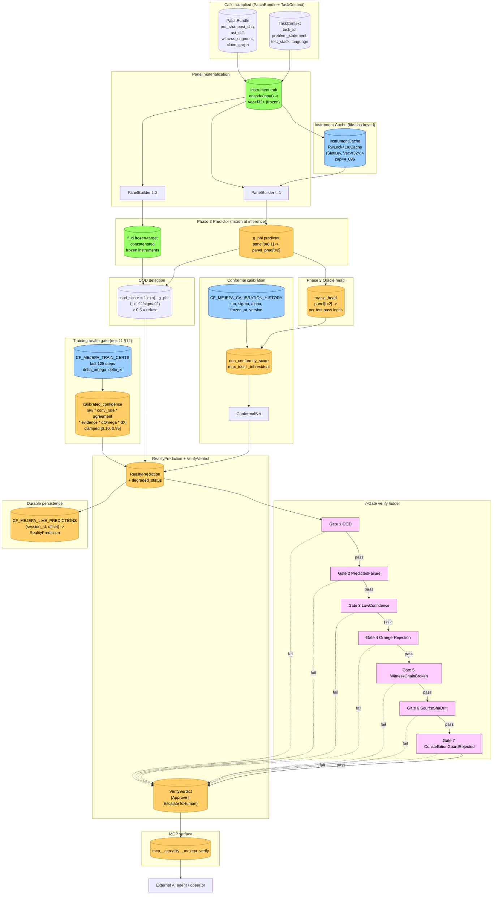
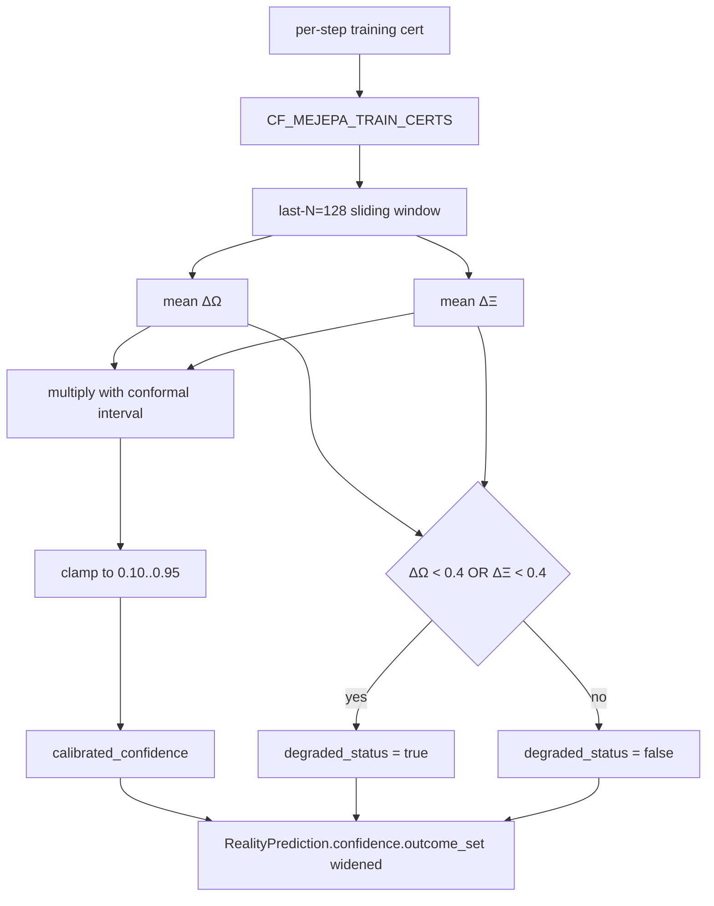

# TECH-INFERENCE — ME-JEPA-Code Inference + Conformal Calibration + OOD Detection (Implementation)

> **📊 2026-05-10 STATUS:** SHIPPED — see ../implementation-plan.md for the full Phase 4a status.

> **Level 3 — Technical Specification.** Implements `SPEC-INFERENCE.md`. Defines HOW the inference domain (Phase 4a) is built. Conflicts with constitution / functional spec resolve to those.

```xml
<technical_spec id="TECH-INFERENCE" version="1.0" implements="SPEC-INFERENCE">

<metadata>
  <title>ME-JEPA-Code Inference + Conformal Calibration + OOD Detection — Implementation</title>
  <status>shipped</status>
  <owner>Phase 4a ME-JEPA implementation team</owner>
  <last_updated>2026-05-10</last_updated>
  <related_specs>
    <spec_ref>SPEC-INFERENCE</spec_ref>
    <spec_ref>SPEC-INSTRUMENTS</spec_ref>
    <spec_ref>TECH-INSTRUMENTS</spec_ref>
    <spec_ref>SPEC-PREDICTOR</spec_ref>
    <spec_ref>TECH-PREDICTOR</spec_ref>
    <spec_ref>SPEC-TRAINING</spec_ref>
    <spec_ref>TECH-TRAINING</spec_ref>
    <spec_ref>SPEC-CORPUS</spec_ref>
    <spec_ref>TECH-CORPUS</spec_ref>
    <spec_ref>SPEC-TCT</spec_ref>
    <spec_ref>SPEC-WITNESS</spec_ref>
    <spec_ref>SPEC-SELF-HEALING</spec_ref>
    <spec_ref>SPEC-UTML</spec_ref>
  </related_specs>
</metadata>

<architecture_diagram>



</architecture_diagram>

<verify_sequence_diagram>

```mermaid
sequenceDiagram
    participant Caller as External agent (UT-01)
    participant MCP as mcp__cgreality__mejepa_verify
    participant Comp as MeJepaCompiler
    participant Cache as InstrumentCache
    participant Inst as Instrument trait
    participant Pred as Predictor g_phi
    participant Tgt as f_xi (frozen target)
    participant Calib as CalibrationStore
    participant TCT as TCT Gtau guard
    participant Chain as WitnessChain
    participant Disk as on-disk source
    participant Cf as CF_MEJEPA_LIVE_PREDICTIONS

    Caller->>MCP: verify(patch, context, include_provenance=false)
    MCP->>MCP: validate_path_canonicalize / additionalProperties:false
    MCP->>Comp: verify(&PatchBundle, &TaskContext)

    Comp->>Comp: read CF_MEJEPA_TRAIN_CERTS last 128 steps
    Note over Comp: compute delta_omega_mean, delta_xi_mean<br/>set degraded_status if < 0.4

    Comp->>Cache: get((file_sha, slot_id))
    alt cache miss
        Cache->>Inst: encode(slot_input)
        Inst-->>Cache: Vec<f32>
        Cache-->>Comp: Vec<f32>
    else cache hit
        Cache-->>Comp: Vec<f32>
    end

    Comp->>Comp: PanelBuilder t=0, t=1 from inputs
    Comp->>Pred: forward(panel[t=0,1])
    Pred-->>Comp: panel_pred[t=2]
    Comp->>Tgt: forward(panel[t=1])
    Tgt-->>Comp: panel_target_t1

    Note over Comp: Gate 1 OOD
    Comp->>Comp: ood_score = 1 - exp(-||g_phi - f_xi||^2 / sigma^2)
    alt ood_score > 0.5
        Comp-->>MCP: EscalateToHuman { OutOfDistribution { score } }
        MCP-->>Caller: VerifyVerdict
    end

    Note over Comp: Gate 2 PredictedFailure
    Comp->>Comp: oracle_head(panel_pred[t=2]) -> per-test logits
    alt predicted_oracle_pass <= 0.95
        Comp-->>MCP: EscalateToHuman { PredictedFailure { failing_tests } }
        MCP-->>Caller: VerifyVerdict
    end

    Note over Comp: Gate 3 LowConfidence
    Comp->>Calib: load(active_calibration_version)
    Calib-->>Comp: tau, alpha
    Comp->>Comp: outcome_set = {o : non_conf(o) <= tau}<br/>multiply by delta_omega * delta_xi
    alt outcome_set.len() > 2
        Comp-->>MCP: EscalateToHuman { LowConfidence { entropy } }
        MCP-->>Caller: VerifyVerdict
    end

    Note over Comp: Gate 4 GrangerRejection
    Comp->>Comp: granger_attestations = F-test per claim_graph skill
    alt any p_value > p_threshold
        Comp-->>MCP: EscalateToHuman { GrangerRejection { skill, p_value } }
        MCP-->>Caller: VerifyVerdict
    end

    Note over Comp: Gate 5 WitnessChainBroken
    Comp->>Chain: replay(patch.witness_chain_segment)
    alt replay broken
        Comp-->>MCP: EscalateToHuman { WitnessChainBroken }
        MCP-->>Caller: VerifyVerdict
    end

    Note over Comp: Gate 6 SourceShaDrift
    Comp->>Disk: read each path; compute SHA-256
    Disk-->>Comp: observed SHAs
    alt any SHA mismatch
        Comp-->>MCP: EscalateToHuman { SourceShaDrift { path } }
        MCP-->>Caller: VerifyVerdict
    end

    Note over Comp: Gate 7 ConstellationGuardRejected
    Comp->>TCT: gtau_test(panel_pred[t=2])
    TCT-->>Comp: Approve | Reject { violating_embedders, violating_chunks }
    alt rejected
        Comp-->>MCP: EscalateToHuman { ConstellationGuardRejected { ... } }
        MCP-->>Caller: VerifyVerdict
    end

    Comp->>Cf: put((session_id, witness_chain_offset), reality_prediction)
    Comp-->>MCP: Approve { reality_prediction, gates_passed: 7 }
    MCP-->>Caller: VerifyVerdict
```

</verify_sequence_diagram>

<conformal_calibration_diagram>

```mermaid
graph LR
    subgraph "Calibration phase (offline)"
        CSplit[("calibration split<br/>~240 examples<br/>stratified by language")]
        CFwd[per-example forward pass]
        ScrFn[("non_conf(i) =<br/>max_test |pred_t - actual_t|")]
        Sort[sort scores ascending]
        Quant[("tau = score at<br/>ceil((N+1)*(1-alpha))/N")]
        SigmaTune[("sigma^2 tuned so<br/>calibration ood_score < 0.30")]
        Persist[("CF_MEJEPA_CALIBRATION_HISTORY<br/>{tau, sigma, alpha, corpus_sha,<br/>embedder_versions, frozen_at}")]
    end

    subgraph "Inference phase (online)"
        Q[query panel]
        Fwd[forward + reconstruct]
        Score[non_conf(candidate outcome)]
        Cmp[score <= tau ?]
        Out[outcome_set]
        OodInf[ood_score check]
    end

    CSplit --> CFwd --> ScrFn --> Sort --> Quant --> Persist
    CSplit --> SigmaTune --> Persist
    Q --> Fwd --> Score --> Cmp -->|yes| Out
    Q --> OodInf
    Persist -->|tau| Cmp
    Persist -->|sigma| OodInf
```

</conformal_calibration_diagram>

<ood_diagram>

```mermaid
graph LR
    P[panel] --> GP1[g_phi(panel)]
    P --> FX1[f_xi(panel)]
    GP1 --> Diff[difference]
    FX1 --> Diff
    Diff --> SqNorm[squared L2 norm]
    SqNorm --> Bw[divide by sigma^2]
    Bw --> Exp[exp(-x)]
    Exp --> Sub[1 - exp]
    Sub --> Score[ood_score in 0..1]
    Score --> Gate{score > 0.5}
    Gate -->|yes verify| Esc[EscalateToHuman OOD]
    Gate -->|yes compile| Err[Err MEJEPA_INFER_OOD_REFUSE]
    Gate -->|no| Pass[continue]

    classDef refuse fill:#f99,stroke:#900,color:#000
    classDef ok fill:#9f9,stroke:#090,color:#000
    class Esc,Err refuse
    class Pass ok
```

</ood_diagram>

<degraded_state_diagram>



</degraded_state_diagram>

<data_models>

  <model name="MeJepaCompiler">
    <field name="predictor" type="Arc&lt;Predictor&gt;" constraints="frozen at inference; Phase 2 trained checkpoint loaded from disk"/>
    <field name="frozen_target" type="Arc&lt;FrozenTarget&gt;" constraints="zero trainable parameters per constitution utml_v1_invariants rule on ΔΞ.target_collapse=0"/>
    <field name="oracle_head" type="Arc&lt;OracleHead&gt;" constraints="Phase 3 trained head; logits per test"/>
    <field name="calibration" type="Arc&lt;CalibrationStore&gt;" constraints="reads CF_MEJEPA_CALIBRATION_HISTORY"/>
    <field name="constellation" type="Arc&lt;ConstellationGuard&gt;" constraints="reads CF_MEJEPA_CONSTELLATION; SPEC-TCT-owned"/>
    <field name="instrument_cache" type="Arc&lt;InstrumentCache&gt;" constraints="LruCache(file_sha + slot_id) -&gt; Vec&lt;f32&gt;; cap = 4_096"/>
    <field name="storage" type="Arc&lt;RocksDbStore&gt;" constraints="reads CF_MEJEPA_TRAIN_CERTS; writes CF_MEJEPA_LIVE_PREDICTIONS"/>
    <field name="witness_chain" type="Arc&lt;WitnessChainReader&gt;" constraints="SHAKE-256 73-byte segments; replay-only"/>
    <field name="config" type="MeJepaInferConfig" constraints="alpha, p_threshold, max_age_days, p_test_threshold"/>
    <description>Top-level inference compiler. All fields Arc-wrapped for lock-free shared reads from concurrent Tokio tasks (NFR-INFER-09). `&amp;self` on compile/verify; `&amp;mut self` on observe (delegated to SPEC-SELF-HEALING).</description>
  </model>

  <model name="MeJepaInferConfig">
    <field name="alpha" type="f32" constraints="default 0.10; range [0.01, 0.50]"/>
    <field name="p_threshold" type="f32" constraints="default 0.01; range [0.0001, 0.05]; cannot be loosened above 0.05"/>
    <field name="max_calibration_age_days" type="u32" constraints="default 30"/>
    <field name="max_constellation_age_days" type="u32" constraints="default 90"/>
    <field name="p_test_threshold" type="f32" constraints="default 0.80; per-test pass probability below this surfaces in failing_tests"/>
    <field name="ood_refuse_threshold" type="f32" constraints="default 0.5"/>
    <field name="outcome_set_max" type="usize" constraints="default 2 per Gate 3 LowConfidence"/>
    <field name="bootstrap_delta_omega" type="f32" constraints="default 0.5 per EC-INFER-09"/>
    <field name="bootstrap_delta_xi" type="f32" constraints="default 0.5 per EC-INFER-09"/>
    <field name="train_cert_window_steps" type="usize" constraints="default 128"/>
    <field name="instrument_cache_capacity" type="usize" constraints="default 4_096"/>
  </model>

  <model name="RealityPrediction">
    <field name="predicted_oracle_pass" type="f32" constraints="finite; clamped [0,1] at construction"/>
    <field name="predicted_failing_tests" type="Vec&lt;TestId&gt;"/>
    <field name="predicted_runtime_trace_summary" type="Vec&lt;f32&gt;" constraints="length == 32 (E_Trace projection dim); all finite"/>
    <field name="predicted_side_effect_set" type="Vec&lt;SideEffect&gt;"/>
    <field name="confidence" type="ConformalSet"/>
    <field name="out_of_distribution_score" type="f32" constraints="finite; clamped [0,1]"/>
    <field name="granger_attestations" type="HashMap&lt;SkillId, f32&gt;" constraints="every value finite, [0,1]"/>
    <field name="witness_chain_offset" type="u64" constraints="&lt; current chain length"/>
    <field name="degraded_status" type="bool"/>
    <field name="delta_omega_mean" type="f32" constraints="finite; clamped [0,1]"/>
    <field name="delta_xi_mean" type="f32" constraints="finite; clamped [0,1]"/>
    <description>Constructed only via `RealityPrediction::try_new(builder)` which validates all invariants at the boundary; never via raw struct literal.</description>
  </model>

  <model name="ConformalSet">
    <field name="alpha" type="f32" constraints="[0.01, 0.50]"/>
    <field name="outcome_set" type="Vec&lt;OracleOutcome&gt;" constraints="non-empty; all distinct"/>
  </model>

  <model name="VerifyVerdict">
    <field name="variant" type="enum" constraints="Approve { reality_prediction: RealityPrediction, gates_passed: u8 (==7) } | EscalateToHuman { failed_gate: FailedGate, reality_prediction: RealityPrediction }"/>
  </model>

  <model name="FailedGate">
    <field name="variant" type="enum" constraints="OutOfDistribution { score: f32 } | LowConfidence { entropy: f32 } | PredictedFailure { failing_tests: Vec&lt;TestId&gt; } | GrangerRejection { skill: SkillId, p_value: f32 } | WitnessChainBroken | SourceShaDrift { path: PathBuf } | ConstellationGuardRejected { violating_embedders: Vec&lt;EmbedderId&gt;, violating_chunks: Vec&lt;ChunkId&gt; }"/>
  </model>

  <model name="PatchBundle">
    <field name="pre_patch_sha" type="[u8; 32]"/>
    <field name="post_patch_sha" type="[u8; 32]"/>
    <field name="ast_diff" type="AstDiff"/>
    <field name="witness_chain_segment" type="WitnessSegment" constraints="len % 73 == 0; len &lt;= MAX_SEGMENT_BYTES (73 * 8192)"/>
    <field name="claim_graph" type="ClaimGraph"/>
  </model>

  <model name="TaskContext">
    <field name="task_id" type="TaskId"/>
    <field name="problem_statement" type="String" constraints="UTF-8; bounded 64 KiB"/>
    <field name="test_stack" type="Vec&lt;TestId&gt;"/>
    <field name="environment" type="TaskEnvironment"/>
    <field name="language" type="Language" constraints="rust|python|javascript|typescript|go|java|c|cpp|csharp|ruby|php"/>
  </model>

  <model name="ClaimGraph">
    <field name="skills" type="Vec&lt;SkillCitation&gt;" constraints="bounded 256"/>
    <field name="touched_files" type="Vec&lt;PathBuf&gt;" constraints="canonicalized; no traversal"/>
  </model>

  <model name="SkillCitation">
    <field name="skill" type="SkillId" constraints="closed enum drawn from canonical taxonomy"/>
    <field name="path" type="PathBuf"/>
    <field name="expected_outcome" type="String"/>
  </model>

  <model name="CalibrationRecord">
    <field name="version" type="String" constraints="ULID"/>
    <field name="alpha" type="f32"/>
    <field name="tau" type="f32" constraints="conformal threshold; [0,1]"/>
    <field name="sigma_squared" type="f32" constraints="OOD bandwidth; &gt; 0"/>
    <field name="calibration_corpus_sha" type="[u8; 32]"/>
    <field name="embedder_versions" type="HashMap&lt;EmbedderId, String&gt;"/>
    <field name="frozen_at" type="i64" constraints="Unix timestamp seconds"/>
    <field name="num_samples" type="usize"/>
    <field name="empirical_coverage" type="f32" constraints="[0,1]; sanity equals stated by construction on calibration set"/>
  </model>

  <model name="ProvenanceBundle">
    <field name="panel_sha" type="[u8; 32]"/>
    <field name="embedder_versions" type="HashMap&lt;EmbedderId, String&gt;"/>
    <field name="calibration_version" type="Option&lt;String&gt;" constraints="None when unloadable; warning emitted"/>
    <field name="training_cert_chain_offset" type="u64"/>
    <field name="constellation_version" type="Option&lt;String&gt;" constraints="None when unloadable; warning emitted"/>
    <field name="code_version" type="String" constraints="`git describe --always --dirty`"/>
    <field name="provenance_warnings" type="Vec&lt;String&gt;"/>
  </model>

  <model name="MejepaInferError">
    <field name="variant" type="enum" constraints="OodRefuse{score:f32, panel_sha:[u8;32]} | DimMismatch{expected:usize, actual:usize} | InstrumentMissing{instrument:String, language:Language} | NanDetected{field:String, witness_chain_offset:u64} | CalibrationStale{version:String, age_days:u32} | ConformalInsufficientSamples{required:usize, observed:usize, language:Language} | WitnessChainBroken{offset:u64} | SourceShaDrift{path:PathBuf, claimed:[u8;32], observed:[u8;32]} | GtauStaleConstellation{version:String, age_days:u32}"/>
    <field name="code_method" type="fn" constraints=".code() returns SCREAMING_SNAKE per constitution failure_taxonomy"/>
  </model>

  <model name="InstrumentCache">
    <field name="lru" type="RwLock&lt;LruCache&lt;SlotKey, Arc&lt;Vec&lt;f32&gt;&gt;&gt;&gt;"/>
    <field name="capacity" type="usize" constraints="default 4_096"/>
    <description>Read-mostly cache; Arc to avoid clone on cache hit. Eviction on capacity overflow.</description>
  </model>

  <model name="SlotKey">
    <field name="file_sha" type="[u8; 32]"/>
    <field name="slot_id" type="InstrumentSlot"/>
    <field name="code_version" type="String" constraints="captured to invalidate cache on code_version change"/>
  </model>

</data_models>

<api_contracts>

  <endpoint path="mcp__cgreality__mejepa_verify" method="MCP_TOOL">
    <implements>REQ-INFER-16</implements>
    <request_body>
      patch: PatchBundle (required)
      context: TaskContext (required)
      include_provenance: bool (optional, default false)
    </request_body>
    <responses>
      success_approve: { verdict: "approve", reality_prediction: {...}, gates_passed: 7, provenance?: ProvenanceBundle }
      success_escalate: { verdict: "escalate_to_human", failed_gate: { variant: "...", payload: {...} }, reality_prediction: {...}, provenance?: ProvenanceBundle }
      error: { error_code: "MEJEPA_INFER_*", message: string, payload: {...} }
    </responses>
    <schema_constraints>
      additionalProperties: false on all object schemas (per audit-9 lesson)
      path canonicalization at boundary (rejects `../`, control chars per SEC-MEJEPA-01)
      problem_statement length ≤ 64 KiB
    </schema_constraints>
  </endpoint>

  <endpoint path="mcp__cgreality__mejepa_predict_latest" method="MCP_TOOL">
    <implements>REQ-INFER-19</implements>
    <request_body>
      session_id: string (required)
      limit: u32 (optional, default 10)
    </request_body>
    <responses>
      success: { predictions: [RealityPrediction] }
    </responses>
  </endpoint>

  <cli path="cargo run --release -p context-graph-mejepa -- infer-test" method="CLI">
    <implements>REQ-INFER-20</implements>
    <request_body>
      --calibration: path to calibration directory
      --alpha: f32 (default 0.10)
      --output-fsv: path (default /tmp/contextgraph-mejepa-infer-fsv/)
    </request_body>
    <responses>
      stdout JSON: { stated_coverage, empirical_coverage, prediction_latency_p50_ms, ood_separation_auc }
      exit: 0 on all metrics within bounds; non-zero otherwise
    </responses>
  </cli>

</api_contracts>

<component_contracts>

  <component name="MeJepaCompiler" path="crates/context-graph-mejepa/src/compiler.rs">

    <method name="new">
      <signature>pub fn new(predictor: Arc&lt;Predictor&gt;, frozen_target: Arc&lt;FrozenTarget&gt;, oracle_head: Arc&lt;OracleHead&gt;, calibration: Arc&lt;CalibrationStore&gt;, constellation: Arc&lt;ConstellationGuard&gt;, instrument_cache: Arc&lt;InstrumentCache&gt;, storage: Arc&lt;RocksDbStore&gt;, witness_chain: Arc&lt;WitnessChainReader&gt;, config: MeJepaInferConfig) -&gt; Result&lt;Self, MejepaInferError&gt;</signature>
      <implements>REQ-INFER-01</implements>
      <behavior>
        1. Verify predictor checkpoint loaded; reject if not.
        2. Verify oracle_head matches predictor architecture.
        3. Verify calibration store has at least one record (else return CalibrationStale).
        4. Verify constellation has at least one record (else return GtauStaleConstellation if Gate 7 active).
        5. Verify config.alpha ∈ [0.01, 0.50], config.p_threshold ∈ [0.0001, 0.05].
      </behavior>
      <throws>MejepaInferError::CalibrationStale, GtauStaleConstellation, DimMismatch</throws>
    </method>

    <method name="compile">
      <signature>pub fn compile(&amp;self, patch: &amp;PatchBundle, context: &amp;TaskContext) -&gt; Result&lt;RealityPrediction, MejepaInferError&gt;</signature>
      <implements>REQ-INFER-01, REQ-INFER-02, REQ-INFER-07, REQ-INFER-08</implements>
      <behavior>
        1. Validate inputs (`validate_patch_bundle`, `validate_task_context`); reject malformed paths.
        2. Read training health: load last `config.train_cert_window_steps` certs from CF_MEJEPA_TRAIN_CERTS; compute `delta_omega_mean`, `delta_xi_mean`. If empty, use bootstrap defaults (0.5 / 0.5) and set `degraded_status = true`.
        3. Materialize panels (`materialize_panel_t0`, `materialize_panel_t1`) with cache lookup per slot via `instrument_cache.get_or_encode(SlotKey, instrument, input)`.
        4. Forward pass: `predicted_t2 = predictor.forward(panel_t0, panel_t1)`; `target_t1 = frozen_target.forward(panel_t1)`.
        5. Compute `ood_score = 1.0 - (-((predicted_t2 - target_t1).norm_squared() / sigma_squared)).exp()`.
        6. If `ood_score &gt; config.ood_refuse_threshold`: return `Err(MejepaInferError::OodRefuse)` (compile path is fail-closed; verify path returns EscalateToHuman per gate ladder).
        7. Compute `oracle_logits = oracle_head.forward(predicted_t2)`; soft-max → per-test pass probabilities.
        8. Compute `predicted_oracle_pass = aggregate(per_test_probs)`; populate `predicted_failing_tests` (probs &lt; `p_test_threshold`).
        9. Build `outcome_set`: enumerate candidate OracleOutcomes; for each compute `non_conformity_score = max_test |pred_test_pass[t] - candidate_test_pass[t]|`; keep those with `score &lt;= tau`.
        10. Apply ΔΩ × ΔΞ multiplicative gating per doc 11 §12: `multiplier = (delta_omega_mean * delta_xi_mean).clamp(0.10, 0.95)`; widen outcome_set proportionally (effective alpha shifts to `alpha / multiplier` clamped).
        11. Compute granger_attestations: for each skill in `claim_graph.skills`, run F-test from context-graph-solver/granger.rs.
        12. Compute predicted_runtime_trace_summary: project E_Trace slot onto its 32-d summary projection.
        13. Compute predicted_side_effect_set: read panel slots E_StaticAnalysis + E_Runtime aux head outputs.
        14. Read `witness_chain_offset = witness_chain.current_offset()`.
        15. Construct `RealityPrediction::try_new(...)` (validates NaN/Inf, dims).
        16. Return Ok(RealityPrediction).
      </behavior>
      <throws>
        OodRefuse (when called via compile, not verify)
        DimMismatch
        InstrumentMissing
        NanDetected
        CalibrationStale
        ConformalInsufficientSamples
      </throws>
      <determinism>byte-equal output for identical (patch, context, frozen_weights, calibration_version, constellation_version, code_version) per NFR-INFER-08</determinism>
      <latency_budget>p50 &lt; 100 ms instruments-cached; p99 &lt; 500 ms cold per NFR-INFER-01/02</latency_budget>
    </method>

    <method name="verify">
      <signature>pub fn verify(&amp;self, patch: &amp;PatchBundle, context: &amp;TaskContext) -&gt; Result&lt;VerifyVerdict, MejepaInferError&gt;</signature>
      <implements>REQ-INFER-01, REQ-INFER-03, REQ-INFER-04, REQ-INFER-09 through REQ-INFER-15</implements>
      <behavior>
        1. Validate inputs at boundary.
        2. Run cheapest gates first (short-circuit ladder):
           a. **Gate 6 SourceShaDrift** (cheapest — local file IO; no model forward): for each path in `ast_diff`, canonicalize, read, SHA-256, compare. On mismatch return `EscalateToHuman { SourceShaDrift { path } }`.
           b. **Gate 5 WitnessChainBroken**: replay `patch.witness_chain_segment` against the durable chain. On break return `EscalateToHuman { WitnessChainBroken }`.
           c. Now call `self.compile(patch, context)?` to get RealityPrediction. (compile internally fails OOD; we catch that and convert to `EscalateToHuman { OutOfDistribution { score } }` here so verify never returns OodRefuse — only compile does.)
           d. **Gate 1 OOD** (already computed in compile): if reality_prediction.out_of_distribution_score &gt; threshold, return EscalateToHuman.
           e. **Gate 2 PredictedFailure**: if predicted_oracle_pass &lt;= 0.95, return EscalateToHuman.
           f. **Gate 3 LowConfidence**: if outcome_set.len() &gt; outcome_set_max, return EscalateToHuman with computed entropy.
           g. **Gate 4 GrangerRejection**: any granger_attestations p &gt; p_threshold → EscalateToHuman.
           h. **Gate 7 ConstellationGuardRejected**: invoke `constellation.gtau_test(predicted_panel)`; on Reject return EscalateToHuman.
        3. All 7 gates passed: persist reality_prediction to CF_MEJEPA_LIVE_PREDICTIONS keyed by (session_id, witness_chain_offset).
        4. Return `Approve { reality_prediction, gates_passed: 7 }`.
      </behavior>
      <gate_ordering>
        Gate 6 (SourceShaDrift) and Gate 5 (WitnessChainBroken) run BEFORE compile() because they are the cheapest and most likely-to-fail-on-bogus-input. Gates 1-4 + 7 require the model forward pass.
      </gate_ordering>
      <throws>
        DimMismatch, InstrumentMissing, NanDetected, CalibrationStale, ConformalInsufficientSamples, GtauStaleConstellation
        (Note: OodRefuse is converted to EscalateToHuman internally; verify() does not propagate OodRefuse as Err.)
      </throws>
      <determinism>byte-equal output for identical inputs per NFR-INFER-08</determinism>
    </method>

    <method name="observe">
      <signature>pub fn observe(&amp;mut self, panel: &amp;Panel, oracle_outcome: &amp;OracleOutcome) -&gt; Result&lt;(), MejepaInferError&gt;</signature>
      <implements>REQ-INFER-01 (signature only); body owned by SPEC-SELF-HEALING</implements>
      <behavior>Body specified in SPEC-SELF-HEALING (Phase 5). This crate provides only the trait signature + a no-op stub gated behind `#[cfg(not(feature = "self-healing"))]` that returns `Err(MejepaInferError::FeatureDisabled)`.</behavior>
      <throws>MejepaInferError variants per SPEC-SELF-HEALING</throws>
    </method>

    <method name="materialize_panel_t0">
      <signature>fn materialize_panel_t0(&amp;self, patch: &amp;PatchBundle, context: &amp;TaskContext) -&gt; Result&lt;Panel, MejepaInferError&gt;</signature>
      <implements>REQ-INFER-02, internal</implements>
      <behavior>
        1. Read AST-perfect chunks for pre-patch source (per SPEC-AST-CHUNKING).
        2. For each slot in {EAst, ECfg, EDataFlow, ETypeGraph, ETest, EProblem}: cache lookup; on miss call `instrument.encode(input)` and store.
        3. Other slots (EDiff, ECommitMsg, EWitness, EOracle, ETrace, EStaticAnalysis, ERuntime, EReasoning, Scalars) are zero-filled at t=0 per SPEC-INSTRUMENTS time-step protocol.
        4. PanelBuilder::set_slot for the populated slots; `try_build()` returns Panel with valid filled_mask.
      </behavior>
      <throws>InstrumentMissing, DimMismatch</throws>
    </method>

    <method name="materialize_panel_t1">
      <signature>fn materialize_panel_t1(&amp;self, patch: &amp;PatchBundle, context: &amp;TaskContext) -&gt; Result&lt;Panel, MejepaInferError&gt;</signature>
      <implements>REQ-INFER-02, internal</implements>
      <behavior>
        1. Read AST-perfect chunks for post-patch source.
        2. Populate slots {EAst, ECfg, EDataFlow, ETypeGraph, ETest, EProblem, EDiff, ECommitMsg, EWitness} (witness restricted to patch-app entries only).
        3. PanelBuilder::try_build.
      </behavior>
      <throws>InstrumentMissing, DimMismatch</throws>
    </method>

    <method name="compute_ood_score">
      <signature>fn compute_ood_score(&amp;self, predicted: &amp;Tensor, target: &amp;Tensor, sigma_squared: f32) -&gt; Result&lt;f32, MejepaInferError&gt;</signature>
      <implements>REQ-INFER-07</implements>
      <behavior>
        1. Compute element-wise (predicted - target).
        2. Compute squared L2 norm.
        3. Score = 1.0 - exp(-norm_sq / sigma_squared).
        4. Validate finite; clamp to [0, 1]; reject NaN with NanDetected.
      </behavior>
      <throws>NanDetected</throws>
    </method>

    <method name="build_outcome_set">
      <signature>fn build_outcome_set(&amp;self, per_test_probs: &amp;[f32], context: &amp;TaskContext, alpha: f32, tau: f32, multiplier: f32) -&gt; Result&lt;Vec&lt;OracleOutcome&gt;, MejepaInferError&gt;</signature>
      <implements>REQ-INFER-06, REQ-INFER-08, REQ-INFER-11</implements>
      <behavior>
        1. Effective threshold: tau_eff = tau / multiplier.clamp(0.10, 0.95).
        2. Enumerate candidate OracleOutcomes from a closed set per language and test_stack size (typically O(N_tests + 1) for binary outcomes or O(2^N_tests) capped at outcome_set_max + 1 via greedy beam).
        3. For each candidate compute `non_conformity = max_test |per_test_probs[t] - candidate_test_pass[t]|`.
        4. Filter `non_conformity &lt;= tau_eff`.
        5. Return Vec ordered by ascending non_conformity (sharpest first).
      </behavior>
      <complexity>O(N_outcomes * N_tests)</complexity>
    </method>

    <method name="run_granger_attestations">
      <signature>fn run_granger_attestations(&amp;self, claim_graph: &amp;ClaimGraph) -&gt; Result&lt;HashMap&lt;SkillId, f32&gt;, MejepaInferError&gt;</signature>
      <implements>REQ-INFER-12</implements>
      <behavior>
        1. For each SkillCitation, fetch the historical (panel, oracle_pass) series for that skill from CF_MEJEPA_PANELS.
        2. Run Granger F-test from context-graph-solver/granger.rs (clean-room shipped) over (skill activation, oracle_pass).
        3. Collect p-values into HashMap.
      </behavior>
      <throws>None directly; fail-closed on missing series with default p_value=1.0 (rejects)</throws>
    </method>

    <method name="check_source_sha_drift">
      <signature>fn check_source_sha_drift(&amp;self, patch: &amp;PatchBundle) -&gt; Result&lt;Option&lt;FailedGate&gt;, MejepaInferError&gt;</signature>
      <implements>REQ-INFER-14</implements>
      <behavior>
        1. For each path in `ast_diff.touched_paths()`:
           a. Canonicalize; reject `..` traversal.
           b. Read bytes; compute SHA-256.
           c. Compare to `patch.pre_patch_sha[path]` (and `post_patch_sha` for post-patch state).
        2. Return Some(SourceShaDrift{path}) on first mismatch; None on all-match.
      </behavior>
    </method>

    <method name="replay_witness_segment">
      <signature>fn replay_witness_segment(&amp;self, segment: &amp;WitnessSegment) -&gt; Result&lt;Option&lt;FailedGate&gt;, MejepaInferError&gt;</signature>
      <implements>REQ-INFER-13</implements>
      <behavior>
        1. Validate segment length is multiple of WITNESS_ENTRY_SIZE (73).
        2. Replay against the persisted chain prefix using shipped context-graph-witness machinery.
        3. Return Some(WitnessChainBroken) on hash chain break; None on clean replay.
      </behavior>
    </method>

  </component>

  <component name="CalibrationStore" path="crates/context-graph-mejepa/src/calibration.rs">

    <method name="calibrate">
      <signature>pub fn calibrate(&amp;self, calibration_split: &amp;[CalibrationExample], alpha: f32) -&gt; Result&lt;CalibrationRecord, MejepaInferError&gt;</signature>
      <implements>REQ-INFER-06, REQ-INFER-07</implements>
      <behavior>
        1. Validate `calibration_split` is non-empty; per-language stratum has at least min_samples (default 30); else return ConformalInsufficientSamples.
        2. For each example: forward pass; compute `non_conformity = max_test |predicted - actual|`.
        3. Sort scores ascending.
        4. Pick split-conformal quantile: `idx = ceil((N+1)*(1-alpha))` clamped to N-1; tau = scores[idx].
        5. Tune sigma_squared via grid-search such that calibration set's `mean(ood_score) &lt; 0.30` (per doc 09 §4.3).
        6. Compute empirical_coverage on calibration split itself (must equal stated by construction; sanity check).
        7. Construct CalibrationRecord with provenance metadata; persist to CF_MEJEPA_CALIBRATION_HISTORY.
      </behavior>
      <throws>ConformalInsufficientSamples, NanDetected</throws>
    </method>

    <method name="load_active">
      <signature>pub fn load_active(&amp;self) -&gt; Result&lt;Arc&lt;CalibrationRecord&gt;, MejepaInferError&gt;</signature>
      <implements>REQ-INFER-06</implements>
      <behavior>
        1. Read most-recent record from CF_MEJEPA_CALIBRATION_HISTORY by timestamp.
        2. Compute age = now - frozen_at.
        3. If age &gt; max_calibration_age_days, return CalibrationStale.
        4. Return Arc&lt;record&gt;.
      </behavior>
      <throws>CalibrationStale</throws>
    </method>

    <method name="recompute_sliding_window">
      <signature>pub fn recompute_sliding_window(&amp;self, recent_attempts: usize) -&gt; Result&lt;CalibrationRecord, MejepaInferError&gt;</signature>
      <implements>REQ-INFER-06; per doc 09 §5.5 continuous calibration</implements>
      <behavior>
        1. Read most recent `recent_attempts` (default 1,000) (panel, oracle_outcome) pairs from CF_MEJEPA_LIVE_PREDICTIONS + CF_MEJEPA_ORACLE_VERDICTS.
        2. Treat as fresh calibration set; call `calibrate(split, alpha)`.
        3. Persist new record with version=ULID+1; previous remains queryable for replay.
      </behavior>
    </method>

  </component>

  <component name="InstrumentCache" path="crates/context-graph-mejepa/src/cache.rs">

    <method name="get_or_encode">
      <signature>pub fn get_or_encode&lt;I: Instrument&gt;(&amp;self, key: SlotKey, instrument: &amp;I, input: &amp;I::Input) -&gt; Result&lt;Arc&lt;Vec&lt;f32&gt;&gt;, MejepaInferError&gt;</signature>
      <implements>NFR-INFER-01 (latency budget via cache hits)</implements>
      <behavior>
        1. Read-lock LruCache; on hit return Arc clone (cheap).
        2. On miss: drop read lock; call `instrument.encode(input)` (frozen forward pass).
        3. Validate result: dim matches slot layout per SPEC-INSTRUMENTS; finite; non-empty.
        4. Write-lock; insert; return Arc.
        5. Eviction: LRU when capacity exceeded.
      </behavior>
      <throws>InstrumentMissing, DimMismatch, NanDetected</throws>
      <concurrency>Read-lock-mostly; write-lock only on miss insert. Multiple miss-insert races serialized via per-key Tokio semaphore (singleflight pattern).</concurrency>
    </method>

  </component>

  <component name="MejepaInferError" path="crates/context-graph-mejepa/src/error.rs">

    <method name="code">
      <signature>pub fn code(&amp;self) -&gt; &amp;'static str</signature>
      <implements>REQ-INFER-17, NFR-INFER-07</implements>
      <behavior>
        Returns the SCREAMING_SNAKE error tag per constitution failure_taxonomy:
        - OodRefuse → "MEJEPA_INFER_OOD_REFUSE"
        - DimMismatch → "MEJEPA_INFER_DIM_MISMATCH"
        - InstrumentMissing → "MEJEPA_INFER_INSTRUMENT_MISSING"
        - NanDetected → "MEJEPA_INFER_NAN_DETECTED"
        - CalibrationStale → "MEJEPA_INFER_CALIBRATION_STALE"
        - ConformalInsufficientSamples → "MEJEPA_INFER_CONFORMAL_INSUFFICIENT_SAMPLES"
        - WitnessChainBroken → "MEJEPA_INFER_WITNESS_CHAIN_BROKEN"
        - SourceShaDrift → "MEJEPA_INFER_SOURCE_SHA_DRIFT"
        - GtauStaleConstellation → "MEJEPA_INFER_GTAU_STALE_CONSTELLATION"
      </behavior>
    </method>

    <method name="log_context">
      <signature>pub fn log_context(&amp;self, log_target: &amp;str) -&gt; ()</signature>
      <implements>NFR-INFER-07; constitution &lt;error_handling&gt; "robust error logging"</implements>
      <behavior>Emits a structured tracing event with payload fields (path, score, dimensionality, witness_chain_offset, etc.); called inside `?` propagation via `.map_err(|e| { e.log_context(target); e })?`.</behavior>
    </method>

  </component>

</component_contracts>

<rocksdb_column_families>

  <cf name="CF_MEJEPA_LIVE_PREDICTIONS">
    <key_format>(session_id_bytes(16) | witness_chain_offset_be(8))</key_format>
    <value_format>bincode-serialized RealityPrediction (≤ 16 KiB)</value_format>
    <retention>Phase 6 hygiene: tier-compress entries older than 30 days; evict tier-3 entries older than 365 days.</retention>
    <implements>REQ-INFER-19</implements>
  </cf>

  <cf name="CF_MEJEPA_CALIBRATION_HISTORY">
    <key_format>frozen_at_be(8) | version_ulid(16)</key_format>
    <value_format>bincode-serialized CalibrationRecord</value_format>
    <retention>Permanent (tiny; ≤ 100 records over project lifetime).</retention>
    <implements>REQ-INFER-06</implements>
  </cf>

  <cf name="CF_MEJEPA_TRAIN_CERTS">
    <key_format>step_be(8)</key_format>
    <value_format>per-step training certificate (UTML factors + Merkle root) per SPEC-TRAINING</value_format>
    <retention>Phase 6 hygiene.</retention>
    <implements>REQ-INFER-08 (read for ΔΩ/ΔΞ); produced by SPEC-TRAINING (Phase 3)</implements>
  </cf>

  <cf name="CF_MEJEPA_CONSTELLATION">
    <key_format>frozen_at_be(8) | version_ulid(16)</key_format>
    <value_format>per SPEC-TCT</value_format>
    <implements>REQ-INFER-15 (read); produced by SPEC-TCT (Phase 4b)</implements>
  </cf>

</rocksdb_column_families>

<implementation_notes>

  <note category="performance">
    InstrumentCache is the latency hinge. With 4,096 LruCache capacity and 15 slots per panel, ~273 patches fit in cache simultaneously; for the typical 1-task-at-a-time outer loop this is plenty. Single-flight pattern (per-key Tokio semaphore) prevents thundering-herd on cache miss.
  </note>

  <note category="performance">
    Predictor forward pass on candle-cuda (RTX 5090, sm_120a, bf16) for batch=1 is ~5-15 ms; oracle head logits ~1-3 ms; OOD norm computation ~1 ms; conformal set enumeration ~1-5 ms; witness replay (segment ≤ 73 * 8192 bytes) ~5-10 ms; SHA pinning (per file IO) ~1-5 ms per file. Total ~50-80 ms p50 with cached instruments. Cold full instrument re-eval adds 100-300 ms (E_AST + E_CFG + E_DataFlow + E_TypeGraph + E_Test + E_Diff + E_StaticAnalysis dominate).
  </note>

  <note category="security">
    Path canonicalization at MCP boundary is critical (SEC-MEJEPA-01). Use `std::fs::canonicalize` + reject paths whose canonical form is not under repo root. Reject any byte 0x00-0x1F or 0x7F in problem_statement.
  </note>

  <note category="security">
    FSV evidence files at /tmp/contextgraph-mejepa-infer-fsv/* MUST be created with mode 0o600 per SEC-MEJEPA-07. Use `std::fs::OpenOptions::new().mode(0o600)` (Unix only; ensure platform gating).
  </note>

  <note category="security">
    Embedder weight files load from pinned SHA-256 digests in models_config.toml per SEC-MEJEPA-02; refuse to load if digest mismatches. The MeJepaCompiler::new() constructor verifies all 21 embedder digests before accepting the predictor.
  </note>

  <note category="reliability">
    Determinism requires byte-exact reproducibility. All Tensor ops on candle must use deterministic kernels (avoid `cudnnConvolutionFindAlgorithm`-style heuristics). Any random source must be seeded from `code_version`. Floating-point reductions use deterministic ordering (e.g., tree-reduction with fixed split).
  </note>

  <note category="reliability">
    The fall-back path for missing CF_MEJEPA_TRAIN_CERTS uses bootstrap defaults ΔΩ=ΔΞ=0.5 (yielding multiplier 0.25 clamped to 0.10) and sets `degraded_status=true`. This is NOT a silent fallback per doc 10 §D — the degraded flag is loud and propagates to the caller.
  </note>

  <note category="reliability">
    Witness chain replay uses the shipped context-graph-witness crate's `replay_segment(segment, anchor_offset, anchor_hash)` API. The chain prefix at `anchor_offset` is loaded from disk; the segment hashes are reproduced and compared.
  </note>

  <note category="integration">
    The compile() method intentionally does NOT call into TCT (Gate 7). Verify() invokes TCT separately so that compile() can be used by other consumers (e.g., SPEC-SHIFT-SUBSCRIBER) that do not need the gate ladder.
  </note>

  <note category="integration">
    The MCP tool surface `mcp__cgreality__mejepa_verify` lives in `crates/context-graph-mcp/src/handlers/tools/mejepa.rs`. The handler thin-wraps `MeJepaCompiler::verify` plus serialization. Schema enforcement (additionalProperties: false) per the audit-9 lesson.
  </note>

  <note category="integration">
    SPEC-SELF-HEALING (Phase 5) owns the body of `observe()`. This crate exports the `&amp;mut self` signature only. When SPEC-SELF-HEALING ships, it adds an `impl SelfHealing for MeJepaCompiler` block that fills observe(); until then observe() returns `Err(MejepaInferError::FeatureDisabled { feature: "self-healing" })`.
  </note>

  <note category="integration">
    SPEC-TCT (Phase 4b) owns the Gτ guard. Until SPEC-TCT ships, ConstellationGuard is a `MockedAlwaysApprove` impl plus a `provenance_warnings: ["constellation_unavailable"]` flag added to ProvenanceBundle (per Q-INFER-03 resolution).
  </note>

  <note category="error_handling">
    Per `<error_handling>` constitution rule "robust error logging: every failure logs context (input shapes, file paths, SHAs) before returning" — every `Err(...)` return site is wrapped with `.map_err(|e| { e.log_context(__file__); e })`. Verified by code review.
  </note>

  <note category="error_handling">
    No `unwrap_or(0.5)` on confidence intervals. No `unwrap_or_default()` in the inference path. Constructor returns Result; every f32 field validated finite-and-clamped at construction.
  </note>

  <note category="determinism">
    Inference uses `Tensor::contiguous()` before all forward passes to avoid stride-dependent fp drift. cudarc kernel selection pinned via deterministic algo enum.
  </note>

  <note category="storage">
    Per CLAUDE.md §11.13 artifact layout, CF_MEJEPA_LIVE_PREDICTIONS is the canonical sink for inference outputs. Per SPEC-HYGIENE Phase 6, retention policy: tier-1 (uncompressed) for 30 days; tier-2 (8-bit) for 90 days; tier-3 (3-bit) for 365 days.
  </note>

  <note category="anti_patterns">
    Per constitution &lt;anti_patterns&gt; "No reintroduction of inner-actor LLM": this spec depends on a Phase 2 PREDICTOR (a JEPA-class model with frozen instrument target), NOT a generative LLM. Any code path that prompts a generative LLM here is a CRITICAL bug.
  </note>

  <note category="anti_patterns">
    Per constitution &lt;anti_patterns&gt; "No silent OOD fallback": the ood_score &gt; 0.5 path returns OodRefuse from compile() and EscalateToHuman from verify(). No `unwrap_or(0.5)` interval defaults.
  </note>

  <note category="anti_patterns">
    Per constitution &lt;anti_patterns&gt; "No learnable target encoder": the `frozen_target: Arc&lt;FrozenTarget&gt;` field has zero trainable parameters; the `compute_ood_score` function reads it via `&amp;self` only; gradients never flow through it. A debug assertion in unit tests verifies `frozen_target.parameters().count() == 0`.
  </note>

  <note category="testing">
    FSV harness at `crates/context-graph-mejepa/examples/inference_fsv.rs`:
    - writes verify-evidence.json with one example per FailedGate variant + Approve example
    - writes conformal-calibration-evidence.json with calibration scores histogram + tau picked + empirical coverage
    - writes ood-evidence.json with ROC curve points + AUC value
    - writes latency-histogram.json with p50 / p90 / p99 / p99.9
    All files mode 0o600.
  </note>

  <note category="testing">
    Determinism harness (TC-INFER-15): fixture `fixtures/inference/sample_patch_python.json` + `fixtures/inference/sample_context_python.json`; run verify() 10× in tight loop; SHA-256 the serialized verdict; assert all 10 SHAs equal.
  </note>

</implementation_notes>

<file_layout>
  <crate name="context-graph-mejepa" path="crates/context-graph-mejepa">
    <file path="src/lib.rs" purpose="public exports of MeJepaCompiler, RealityPrediction, VerifyVerdict, FailedGate, MejepaInferError"/>
    <file path="src/compiler.rs" purpose="MeJepaCompiler impl (compile, verify, observe-stub)"/>
    <file path="src/calibration.rs" purpose="CalibrationStore impl (calibrate, load_active, recompute_sliding_window)"/>
    <file path="src/cache.rs" purpose="InstrumentCache impl (get_or_encode + LRU + singleflight)"/>
    <file path="src/conformal.rs" purpose="non-conformity score + outcome_set builder + ΔΩ × ΔΞ multiplicative gate"/>
    <file path="src/ood.rs" purpose="OOD score computation + sigma tuning helper"/>
    <file path="src/gates.rs" purpose="check_source_sha_drift, replay_witness_segment, run_granger_attestations, build_oracle_logits"/>
    <file path="src/types.rs" purpose="RealityPrediction, ConformalSet, VerifyVerdict, FailedGate, PatchBundle, TaskContext, ClaimGraph, SkillCitation, ProvenanceBundle"/>
    <file path="src/error.rs" purpose="MejepaInferError + .code() + .log_context()"/>
    <file path="src/config.rs" purpose="MeJepaInferConfig"/>
    <file path="src/cli.rs" purpose="`infer-test` subcommand impl"/>
    <file path="src/bin/mejepa.rs" purpose="binary entry point"/>
    <file path="examples/inference_fsv.rs" purpose="FSV harness writing /tmp/contextgraph-mejepa-infer-fsv/*"/>
    <file path="tests/integration_seven_gates.rs" purpose="TC-INFER-06 seven-gate composition"/>
    <file path="tests/integration_calibration.rs" purpose="TC-INFER-04 + TC-INFER-11"/>
    <file path="tests/integration_ood.rs" purpose="TC-INFER-05"/>
    <file path="tests/integration_determinism.rs" purpose="TC-INFER-15"/>
    <file path="tests/integration_latency.rs" purpose="TC-INFER-09"/>
    <file path="tests/integration_mcp_roundtrip.rs" purpose="TC-INFER-08"/>
    <file path="fixtures/inference/sample_patch_python.json" purpose="determinism + integration fixture"/>
    <file path="fixtures/inference/sample_context_python.json" purpose="determinism + integration fixture"/>
  </crate>
  <crate name="context-graph-mcp" path="crates/context-graph-mcp">
    <file path="src/handlers/tools/mejepa.rs" purpose="mcp__cgreality__mejepa_verify + mejepa_predict_latest tool handlers (thin wrappers)"/>
  </crate>
</file_layout>

<dependencies>
  <internal>
    <dep crate="context-graph-mejepa-instruments">Instrument trait + 15 slot encoders</dep>
    <dep crate="context-graph-witness">replay_segment + chain integrity</dep>
    <dep crate="context-graph-solver">Granger F-test (granger.rs); MMR / conformal helpers</dep>
    <dep crate="context-graph-storage">RocksDB CF wrappers</dep>
    <dep crate="context-graph-embeddings">embedder version registry</dep>
    <dep crate="context-graph-core">AST chunker (when re-encoding panels)</dep>
  </internal>
  <external>
    <dep name="candle-core" version="0.9.x"/>
    <dep name="candle-nn" version="0.9.x"/>
    <dep name="cudarc" version="latest matching candle"/>
    <dep name="rocksdb" version="0.21.x"/>
    <dep name="serde" version="1.x" features="derive"/>
    <dep name="serde_json" version="1.x"/>
    <dep name="tokio" version="1.x" features="full"/>
    <dep name="bincode" version="1.x" reason="CF value serde for numeric data; JSON for provenance per audit-9 lesson"/>
    <dep name="sha2" version="0.10.x" reason="SHA-256 for SHA pinning + panel hashing"/>
    <dep name="lru" version="0.12.x" reason="InstrumentCache backing"/>
    <dep name="parking_lot" version="0.12.x" reason="RwLock with no-poison + Send-safe guards (per memory/key lesson 'RwLockReadGuard parking_lot is !Send')"/>
    <dep name="tracing" version="0.1.x" reason="structured logging in error log_context"/>
    <dep name="thiserror" version="1.x"/>
    <dep name="ulid" version="1.x" reason="calibration_version + constellation_version IDs"/>
  </external>
</dependencies>

<failure_modes_runtime>

  <runtime_failure code="MEJEPA_INFER_OOD_REFUSE">
    <trigger>compile() observed ood_score &gt; ood_refuse_threshold (0.5)</trigger>
    <recovery>Operator: extend Phase 0 corpus to cover the language/library family; re-train; re-calibrate.</recovery>
    <surface>compile() returns Err; verify() converts to EscalateToHuman { OutOfDistribution }</surface>
  </runtime_failure>

  <runtime_failure code="MEJEPA_INFER_DIM_MISMATCH">
    <trigger>Panel.data().len() != PANEL_DIM (5,120) OR per-slot extent mismatch</trigger>
    <recovery>None silent. Halt; surface to operator with input shapes.</recovery>
  </runtime_failure>

  <runtime_failure code="MEJEPA_INFER_INSTRUMENT_MISSING">
    <trigger>Required toolchain absent (e.g., pyright) for the input language</trigger>
    <recovery>Install missing toolchain; retry. Verify with `mejepa-instruments selftest --language={lang}`.</recovery>
  </runtime_failure>

  <runtime_failure code="MEJEPA_INFER_NAN_DETECTED">
    <trigger>Any RealityPrediction f32 field non-finite at construction</trigger>
    <recovery>Halt; rollback to last known-good checkpoint; surface input panel SHA to operator.</recovery>
  </runtime_failure>

  <runtime_failure code="MEJEPA_INFER_CALIBRATION_STALE">
    <trigger>now - calibration.frozen_at &gt; max_calibration_age_days (30)</trigger>
    <recovery>Run `mejepa infer-test --calibration ...` to refresh; or wait for sliding-window auto-refresh per doc 09 §5.5.</recovery>
  </runtime_failure>

  <runtime_failure code="MEJEPA_INFER_CONFORMAL_INSUFFICIENT_SAMPLES">
    <trigger>Per-language stratum has fewer than min_samples (default 30)</trigger>
    <recovery>Operator: expand corpus for under-represented language; re-calibrate. Falls back to last-known threshold (degraded mode) if available.</recovery>
  </runtime_failure>

  <runtime_failure code="MEJEPA_INFER_WITNESS_CHAIN_BROKEN">
    <trigger>witness_chain_segment replay produced a hash mismatch against persisted chain</trigger>
    <recovery>Operator inspect via `mcp__cgreality__witness_chain_inspect`; restore from last verified checkpoint.</recovery>
  </runtime_failure>

  <runtime_failure code="MEJEPA_INFER_SOURCE_SHA_DRIFT">
    <trigger>Claimed pre/post SHA != observed SHA on disk; OR path canonicalization rejects (traversal)</trigger>
    <recovery>Re-generate patch against current HEAD; verify SHAs before retry.</recovery>
  </runtime_failure>

  <runtime_failure code="MEJEPA_INFER_GTAU_STALE_CONSTELLATION">
    <trigger>now - constellation.frozen_at &gt; max_constellation_age_days (90); no operator override recorded</trigger>
    <recovery>Operator: refit constellation per doc 13; or write override decision per BR-INFER-05 exception.</recovery>
  </runtime_failure>

  <runtime_failure code="CCREALITY_ENGINE_RETIRED">
    <trigger>Caller invoked retired pre-pivot tool (e.g., reality_run_attempt)</trigger>
    <recovery>Switch caller to mcp__cgreality__mejepa_verify per doc 10 §F.</recovery>
  </runtime_failure>

</failure_modes_runtime>

<fsv_protocol>

  <evidence_path>/tmp/contextgraph-mejepa-infer-fsv/verify-evidence.json</evidence_path>
  <evidence_path>/tmp/contextgraph-mejepa-infer-fsv/conformal-calibration-evidence.json</evidence_path>
  <evidence_path>/tmp/contextgraph-mejepa-infer-fsv/ood-evidence.json</evidence_path>
  <evidence_path>/tmp/contextgraph-mejepa-infer-fsv/latency-histogram.json</evidence_path>

  <evidence_content>
    verify-evidence.json: one example per FailedGate variant + one Approve example; for each: (input_panel_sha, predicted_oracle_pass, ood_score, outcome_set, granger_attestations, gates_passed, failed_gate (if any), latency_ms).
    conformal-calibration-evidence.json: histogram of calibration non-conformity scores; tau picked; α; empirical coverage on calibration set (sanity); empirical coverage on held-out subset; min_samples_per_stratum.
    ood-evidence.json: ROC curve points; AUC; sigma squared; in-distribution vs OOD score histograms.
    latency-histogram.json: 1,000-call p50 / p90 / p99 / p99.9; cold vs warm split; per-gate latency contribution.
  </evidence_content>

  <re_read_assertion>
    Every FSV file is re-read after write and parsed via the canonical struct's serde Deserialize; round-trip equality asserted before reporting success per constitution &lt;fsv_protocol&gt; rule "ships with a Forensic Source Verification (FSV) example binary that writes evidence to /tmp/contextgraph-{crate}-fsv/ and re-reads + asserts before reporting success".
  </re_read_assertion>

  <permissions>0o600 per SEC-MEJEPA-07; verified by FSV harness via `stat`</permissions>

</fsv_protocol>

<phase_gate>

  <phase4_dod>
    Per doc 09 §7 Phase 4 verbatim:
    - `cargo run --release -p context-graph-mejepa -- infer-test --calibration ./data/mejepa-corpus/calibration --alpha 0.1` reports `stated_coverage 0.90`, `empirical_coverage` ∈ [0.88, 0.92], `prediction_latency_p50 &lt; 100ms`, `ood_separation_auc &gt; 0.85`.
    - `MeJepaCompiler::compile()` and `::verify()` shipped per Section 4.1.
    - Conformal calibration on calibration split per Section 4.2.
    - OOD detection per Section 4.3.
    - MCP server tool `mcp__cgreality__mejepa_verify` exposed.
  </phase4_dod>

  <phase4b_handoff>
    Phase 4b (TCT) is cross-cutting; Phase 4a ships with Gate 7 mocked-pass + ProvenanceBundle warning. Once SPEC-TCT ships, `ConstellationGuard` is replaced with the real Gτ test; the warning is removed; no API change required.
  </phase4b_handoff>

  <phase5_handoff>
    Phase 5 (Self-Healing) owns observe() body. Phase 4a exports the &amp;mut self signature; Phase 5 fills the impl.
  </phase5_handoff>

</phase_gate>

</technical_spec>
```
