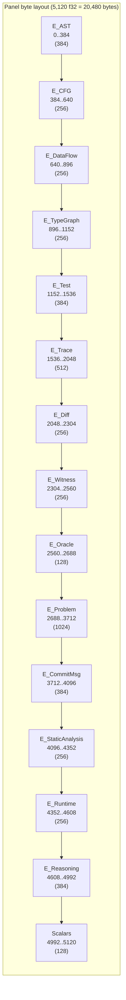
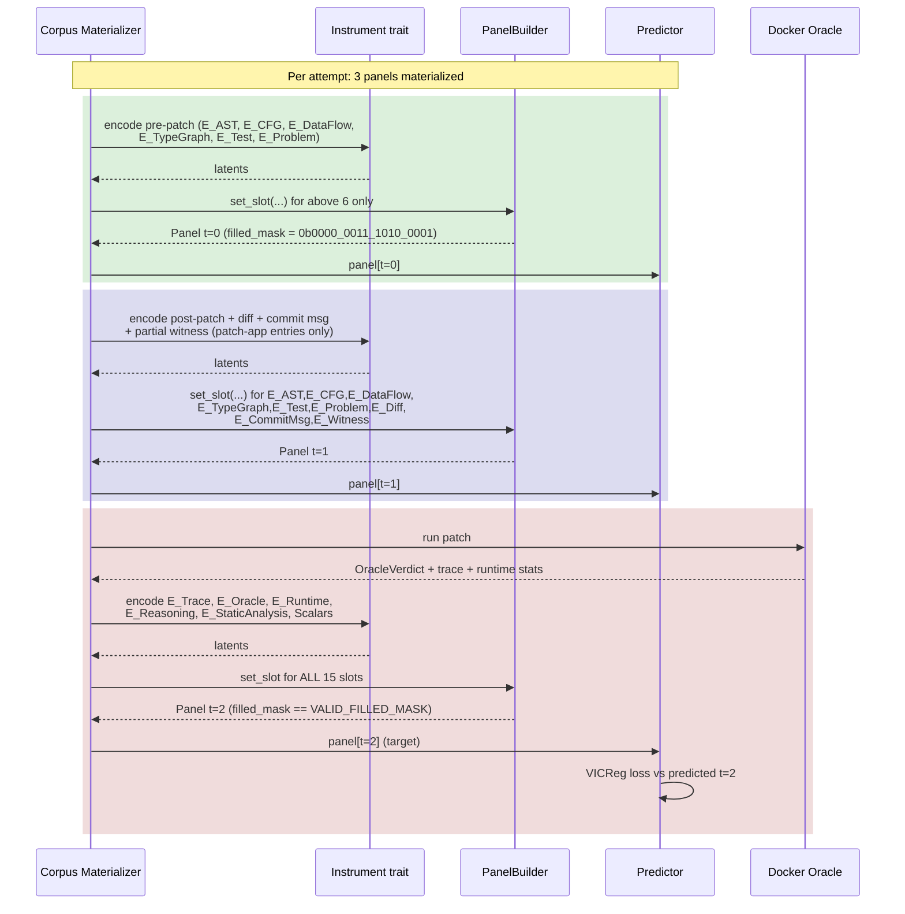
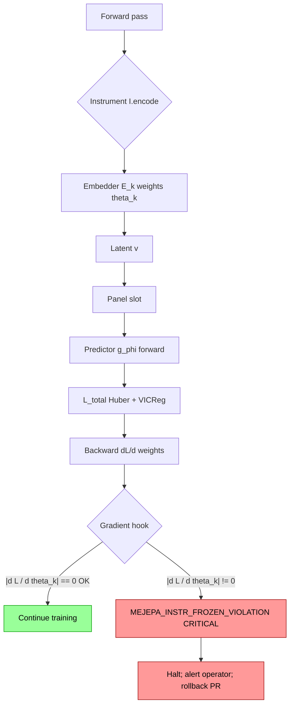

```mermaid
graph TB
    subgraph Inputs ["Per-attempt inputs (durable reality)"]
        SRC[("AST-perfect chunks<br/>(11 languages)")]
        DIAG[("Toolchain diagnostics<br/>Pyright/mypy/rustc/javac/...")]
        TRACE[("Execution trace events<br/>(fn_id, line, val_hash, ts)")]
        WIT[("Witness chain entries<br/>(73-byte SHAKE-256)")]
        ORA[("OracleVerdict<br/>(per-test, exception)")]
        TXT[("Problem / commit text")]
        REA[("Agent CoT transcript<br/>+ recommendation JSONs")]
        RT[("Runtime aggregates<br/>(walltime, RSS, syscalls)")]
        SCL[("Repo-health scalars<br/>(BFS, blame, churn)")]
    end

    subgraph FrozenEmbedders ["Frozen embedder substrate (E1-E21)"]
        E1[E1 e5-large-v2<br/>1024-d]
        E7[E7 Qodo-Embed<br/>1536-d]
        E8[E8 Graph]
        E10[E10 Contextual]
        E11[E11 Kepler<br/>768-d]
        E17[E17 AffectText]
        ETMP[E2/E3/E4 temporal]
    end

    subgraph CodeDomain ["Code-domain instruments (consume AST-perfect chunks)"]
        EAST[E_AST 384-d<br/>Qodo+proj 1536-&gt;384]
        ECFG[E_CFG 256-d<br/>E8+graph-attn]
        EDF[E_DataFlow 256-d<br/>E11+graph-attn]
        ETG[E_TypeGraph 256-d<br/>E11+lattice]
        ETST[E_Test 384-d<br/>E1 on test descs]
        EDIFF[E_Diff 256-d<br/>Qodo+diff-encoder]
    end

    subgraph SignalDomain ["Signal-domain instruments"]
        ETR[E_Trace 512-d<br/>E2/3/4+seq-tx]
        EWIT[E_Witness 256-d<br/>SHIPPED]
        EORA[E_Oracle 128-d<br/>SHIPPED]
        EPRB[E_Problem 1024-d<br/>E1]
        ECMT[E_CommitMsg 384-d<br/>E1]
        ESA[E_StaticAnalysis 256-d<br/>SHIPPED]
        ERT[E_Runtime 256-d]
        ERSN[E_Reasoning 384-d<br/>E17]
        ESCL[Scalars 128-d]
    end

    subgraph Panel ["5,120-d Panel (concatenation)"]
        PB[PanelBuilder]
        P[Panel<br/>data: Vec&lt;f32&gt; len=5120<br/>filled_mask: u16]
    end

    SRC --> EAST
    SRC --> ECFG
    SRC --> EDF
    SRC --> ETG
    SRC --> ETST
    SRC --> EDIFF
    DIAG --> ETG
    DIAG --> ESA
    TRACE --> ETR
    WIT --> EWIT
    ORA --> EORA
    TXT --> EPRB
    TXT --> ECMT
    REA --> ERSN
    RT --> ERT
    SCL --> ESCL

    E7 --> EAST
    E8 --> ECFG
    E11 --> EDF
    E11 --> ETG
    E1 --> ETST
    E7 --> EDIFF
    ETMP --> ETR
    E1 --> EPRB
    E1 --> ECMT
    E17 --> ERSN

    EAST --> PB
    ECFG --> PB
    EDF --> PB
    ETG --> PB
    ETST --> PB
    ETR --> PB
    EDIFF --> PB
    EWIT --> PB
    EORA --> PB
    EPRB --> PB
    ECMT --> PB
    ESA --> PB
    ERT --> PB
    ERSN --> PB
    ESCL --> PB

    PB --> P

    P --> Predictor[("Phase 2 Predictor<br/>panel[t=0,1] -&gt; panel[t=2]")]
    P --> CF[("RocksDB<br/>CF_MEJEPA_PANELS")]
    P --> GTau[("Phase 4b<br/>Gτ guard")]

    classDef shipped fill:#9f6,stroke:#363,color:#000
    classDef pending fill:#fc6,stroke:#a83,color:#000
    classDef frozen fill:#9cf,stroke:#347,color:#000
    classDef ir fill:#fc9,stroke:#a63,color:#000

    class EWIT,EORA,ESA,PB,P shipped
    class EAST,ECFG,EDF,ETG,ETST,ETR,EDIFF,EPRB,ECMT,ERT,ERSN,ESCL pending
    class E1,E7,E8,E10,E11,E17,ETMP frozen
    class P ir
```

# TECH-INSTRUMENTS — ME-JEPA-Code Instruments + 5,120-d Panel (Implementation)

> **📊 2026-05-10 STATUS:** PARTIAL — see ../implementation-plan.md for the full Phase 1 status.

> **Level 3 — Technical Specification.** Implements `SPEC-INSTRUMENTS.md`. Defines HOW the instruments + panel are built. Conflicts with constitution / functional spec resolve to those.

```xml
<technical_spec id="TECH-INSTRUMENTS" version="1.0" implements="SPEC-INSTRUMENTS">

<metadata>
  <title>ME-JEPA-Code Instruments + 5,120-d Panel — Implementation</title>
  <status>partial</status>
  <owner>Phase 1 ME-JEPA implementation team</owner>
  <last_updated>2026-05-10</last_updated>
  <related_specs>
    <spec_ref>SPEC-INSTRUMENTS</spec_ref>
    <spec_ref>SPEC-AST-CHUNKING</spec_ref>
    <spec_ref>SPEC-EMBEDDERS</spec_ref>
    <spec_ref>SPEC-WITNESS</spec_ref>
    <spec_ref>SPEC-CORPUS</spec_ref>
    <spec_ref>TECH-PREDICTOR</spec_ref>
  </related_specs>
</metadata>

<architecture_diagram>



</architecture_diagram>

<panel_layout_diagram>



</panel_layout_diagram>

<time_step_protocol_diagram>



</time_step_protocol_diagram>

<frozen_invariant_diagram>



</frozen_invariant_diagram>

<data_models>

  <model name="InstrumentSlot">
    <field name="variant" type="enum" constraints="serde rename_all snake_case; 15 variants in canonical doc-09 order"/>
    <description>One of 15 panel slots: EAst, ECfg, EDataFlow, ETypeGraph, ETest, ETrace, EDiff, EWitness, EOracle, EProblem, ECommitMsg, EStaticAnalysis, ERuntime, EReasoning, Scalars. Per shipped lib.rs.</description>
  </model>

  <model name="Panel">
    <field name="data" type="Vec&lt;f32&gt;" constraints="len == PANEL_DIM == 5_120; every element finite"/>
    <field name="filled_mask" type="u16" constraints="bits in InstrumentSlot::all() order; (filled_mask &amp; !VALID_FILLED_MASK) == 0; filled_mask != 0"/>
    <description>Joint embedding IR. Constructed only via PanelBuilder or Panel::try_new; never via raw struct literal in user code.</description>
  </model>

  <model name="PanelSerde">
    <field name="data" type="Vec&lt;f32&gt;"/>
    <field name="filled_mask" type="u16"/>
    <description>Internal serde shim. Panel uses `#[serde(try_from = "PanelSerde", into = "PanelSerde")]` so deserialization always re-runs validate_panel_parts, gating all JSON ingress.</description>
  </model>

  <model name="OracleVerdict">
    <field name="per_test_outcomes" type="Vec&lt;PerTestOutcome&gt;" constraints="non-empty for normal runs; can be empty when execution crashed before tests started"/>
    <field name="exception_class" type="Option&lt;ExceptionClass&gt;" constraints="Some when execution crashed; None otherwise"/>
    <field name="total_test_count" type="u32" constraints="bounded to 1_000_000 in encoder"/>
  </model>

  <model name="PerTestOutcome">
    <field name="test_id" type="String"/>
    <field name="outcome" type="TestOutcome"/>
  </model>

  <model name="TestOutcome">
    <field name="variant" type="enum {Pass, Fail, Skip, Error}"/>
  </model>

  <model name="ExceptionClass">
    <field name="variant" type="enum {AssertionError, TypeError, ValueError, ImportError, AttributeError, KeyError, IndexError, NameError, RuntimeError, Other}" constraints="ExceptionClass::all() returns these 10 in canonical order; one-hot at panel dims 6..16 for E_Oracle"/>
  </model>

  <model name="WitnessChainInput">
    <field name="format_version" type="u8" constraints="must == CANONICAL_WITNESS_FORMAT_VERSION (1)"/>
    <field name="chain_bytes" type="Vec&lt;u8&gt;" constraints="len multiple of WITNESS_ENTRY_SIZE (73); ≤ MAX_WITNESS_ENTRIES (65,536) entries"/>
  </model>

  <model name="StaticAnalysisInput">
    <field name="source_text" type="String" constraints="any UTF-8; can be empty (caller's responsibility)"/>
    <field name="diagnostics" type="Vec&lt;Diagnostic&gt;" constraints="≤ MAX_DIAGNOSTICS (100,000)"/>
    <field name="churn_30d" type="Option&lt;u32&gt;"/>
  </model>

  <model name="Diagnostic">
    <field name="tool" type="String" constraints="e.g. mypy, pyright, ruff, clippy, rust-analyzer, javac, dotnet, tsc, gcc, ruby, go"/>
    <field name="severity" type="DiagnosticSeverity" constraints="enum {Error, Warning, Info, Hint}"/>
    <field name="category" type="String"/>
    <field name="line" type="u32"/>
    <field name="column" type="u32"/>
  </model>

  <model name="CodeInstrumentInput">
    <field name="language" type="ChunkerLanguage" constraints="rust|python|javascript|typescript|go|java|c|cpp|csharp|ruby|php"/>
    <field name="chunks" type="Vec&lt;AstPerfectChunk&gt;" constraints="non-empty; each chunk's metadata = (entity_type, parent_chain, line_start, line_end, sha256)"/>
  </model>

  <model name="AstPerfectChunk">
    <field name="entity_type" type="enum {Function, Method, Class, Impl, Module, Trait, Interface, Macro, Enum, Struct, Union, Namespace}" constraints="bounded by syntactic entity per doc 14"/>
    <field name="text" type="String"/>
    <field name="parent_chain" type="Vec&lt;String&gt;"/>
    <field name="line_start" type="u32"/>
    <field name="line_end" type="u32"/>
    <field name="sha256" type="[u8; 32]"/>
  </model>

  <model name="DiffInstrumentInput">
    <field name="before" type="CodeInstrumentInput"/>
    <field name="after" type="CodeInstrumentInput"/>
    <field name="edges" type="Vec&lt;DiffEdge&gt;" constraints="added/removed/modified node events from AST diff"/>
  </model>

  <model name="TraceInput">
    <field name="events" type="Vec&lt;TraceEvent&gt;" constraints="≤ 1_000_000 events; reject larger"/>
  </model>

  <model name="TraceEvent">
    <field name="kind" type="TraceEventKind" constraints="enum {FnEnter, FnExit, LineHit, ValueSnapshot, Exception}"/>
    <field name="fn_id" type="u32"/>
    <field name="line_no" type="u32"/>
    <field name="val_hash" type="[u8; 8]"/>
    <field name="timestamp_ns" type="u64"/>
  </model>

  <model name="RuntimeInput">
    <field name="walltime_ns_p50" type="u64"/>
    <field name="walltime_ns_p99" type="u64"/>
    <field name="peak_rss_bytes" type="u64"/>
    <field name="allocation_count" type="u64"/>
    <field name="syscall_histogram" type="HashMap&lt;String, u64&gt;" constraints="bounded to 256 unique syscall names"/>
    <field name="coverage_delta_lines" type="i64"/>
    <field name="coverage_delta_branches" type="i64"/>
    <field name="filesystem_paths_touched" type="u32"/>
    <field name="network_calls" type="u32"/>
    <field name="exit_codes" type="HashMap&lt;String, i32&gt;" constraints="per-test exit code (0 == normal, signals on the negative range)"/>
    <field name="determinism_flag" type="bool" constraints="true if 3 reruns produced identical outcomes within 30% walltime tolerance"/>
  </model>

  <model name="ScalarInput">
    <field name="bfs_depth_from_touched_files" type="u32"/>
    <field name="blame_age_days_p50" type="f32"/>
    <field name="symbol_churn_30d" type="u32"/>
    <field name="cyclomatic_complexity_delta" type="i32"/>
    <field name="coverage_delta_pct" type="f32"/>
    <field name="repo_commit_cadence_per_week" type="f32"/>
    <field name="repo_ci_green_rate" type="f32" constraints="∈ [0, 1]"/>
    <field name="repo_contributor_count" type="u32"/>
    <field name="docstring_coverage_delta" type="f32"/>
    <field name="loc_delta" type="i32"/>
  </model>

  <model name="ReasoningInput">
    <field name="events" type="Vec&lt;ReasoningEvent&gt;" constraints="≤ 10_000 events; reject larger"/>
  </model>

  <model name="ReasoningEvent">
    <field name="kind" type="enum {ChatMessage, ToolCall, ToolResult, RecommendationJson, ReflexionRecord}"/>
    <field name="role" type="enum {User, Assistant, System, Tool}"/>
    <field name="text" type="String" constraints="encoded opaquely; never echoed back per SEC-MEJEPA-06"/>
    <field name="timestamp_ns" type="u64"/>
  </model>

  <model name="TextInstrumentInput">
    <field name="text" type="String" constraints="UTF-8; max 16 KB per E1 typical context"/>
  </model>

  <model name="PanelJSONExternal">
    <field name="version" type="String" constraints="exactly &quot;1.0.0&quot; for v1 panels"/>
    <field name="code_version" type="String" constraints="git SHA of producing codebase"/>
    <field name="embedder_versions" type="HashMap&lt;String, String&gt;" constraints="map embedder_id (E1..E21) → SHA-256 hex"/>
    <field name="time_step" type="u8" constraints="∈ {0, 1, 2}"/>
    <field name="attempt_id" type="String" constraints="UUID v4"/>
    <field name="slots" type="HashMap&lt;String, Vec&lt;f32&gt;&gt;" constraints="keys = slug per InstrumentSlot::slug(); each vector length matches slot.dim()"/>
    <field name="scalars" type="Vec&lt;f32&gt;" constraints="length 128"/>
    <field name="total_dim" type="usize" constraints="== 5_120"/>
    <field name="sha256" type="String" constraints="hex digest of canonical concat(slot[0]..slot[14], scalars) bytes"/>
  </model>

</data_models>

<api_contracts>

  <!-- The instruments crate is library-only; no MCP / HTTP surface here.
       Phase 7 mejepa_predict_latest etc. ship in a separate spec. -->

  <library_api crate="context-graph-mejepa-instruments">
    <implements>REQ-INSTR-15, REQ-INSTR-17, REQ-INSTR-18, REQ-INSTR-23</implements>

    <const name="PANEL_DIM" type="usize" value="5_120"/>
    <const name="SLOT_COUNT" type="usize" value="15"/>
    <const name="VALID_FILLED_MASK" type="u16" value="(1u16 &lt;&lt; SLOT_COUNT) - 1"/>
    <const name="CANONICAL_WITNESS_FORMAT_VERSION" type="u8" value="1"/>
    <const name="MAX_WITNESS_ENTRIES" type="usize" value="65_536"/>
    <const name="MAX_DIAGNOSTICS" type="usize" value="100_000"/>
    <const name="MAX_TRACE_EVENTS" type="usize" value="1_000_000"/>
    <const name="MAX_REASONING_EVENTS" type="usize" value="10_000"/>

    <pub_type name="InstrumentResult&lt;T&gt;" alias="Result&lt;T, InstrumentError&gt;"/>

    <pub_enum name="InstrumentError">
      <variant name="InvalidInput">field, message, remediation; code() = MEJEPA_INSTRUMENTS_INVALID_INPUT</variant>
      <variant name="NumericalInvariant">field, message, remediation; code() = MEJEPA_INSTRUMENTS_NUMERICAL_INVARIANT</variant>
    </pub_enum>

    <pub_trait name="Instrument">
      <signature>type Input;</signature>
      <signature>fn slot(&amp;self) -&gt; InstrumentSlot;</signature>
      <signature>fn output_dim(&amp;self) -&gt; usize { self.slot().dim() }</signature>
      <signature>fn encode(&amp;self, input: &amp;Self::Input) -&gt; InstrumentResult&lt;Vec&lt;f32&gt;&gt;;</signature>
    </pub_trait>

    <pub_struct name="Panel">
      <signature>fn try_new(data: Vec&lt;f32&gt;, filled_mask: u16) -&gt; InstrumentResult&lt;Self&gt;</signature>
      <signature>fn data(&amp;self) -&gt; &amp;[f32]</signature>
      <signature>fn filled_mask(&amp;self) -&gt; u16</signature>
      <signature>fn slot(&amp;self, slot: InstrumentSlot) -&gt; &amp;[f32]</signature>
      <signature>fn is_filled(&amp;self, slot: InstrumentSlot) -&gt; bool</signature>
    </pub_struct>

    <pub_struct name="PanelBuilder">
      <signature>fn new() -&gt; Self</signature>
      <signature>fn set_slot(&amp;mut self, slot: InstrumentSlot, vector: &amp;[f32]) -&gt; InstrumentResult&lt;()&gt;</signature>
      <signature>fn set_from_instrument&lt;I: Instrument&lt;Input = In&gt;, In&gt;(&amp;mut self, instrument: &amp;I, input: &amp;In) -&gt; InstrumentResult&lt;()&gt;</signature>
      <signature>fn build(self) -&gt; InstrumentResult&lt;Panel&gt;</signature>
      <signature>fn require_slots(&amp;self, required_slots: &amp;[InstrumentSlot]) -&gt; InstrumentResult&lt;()&gt;</signature>
    </pub_struct>
  </library_api>

</api_contracts>

<component_contracts>

  <component name="Panel/PanelBuilder" path="crates/context-graph-mejepa-instruments/src/lib.rs" status="shipped">
    <implements>REQ-INSTR-15, REQ-INSTR-17, REQ-INSTR-23, BR-INSTR-03, BR-INSTR-04, BR-INSTR-06</implements>
    <method name="PanelBuilder::set_slot">
      <signature>fn set_slot(&amp;mut self, slot: InstrumentSlot, vector: &amp;[f32]) -&gt; InstrumentResult&lt;()&gt;</signature>
      <implements>REQ-INSTR-15</implements>
      <behavior>
        1. Lookup slot.extent() → (offset, dim).
        2. If vector.len() != dim → return InstrumentError::invalid("vector", ...).
        3. For each element v: if !v.is_finite() → return InstrumentError::invariant("vector", ...).
        4. Compute slot_bit(slot); if (filled_mask &amp; bit) != 0 → return InvalidInput("slot", "already filled").
        5. data[offset..offset+dim].copy_from_slice(vector).
        6. filled_mask |= bit.
        7. Ok(()).
      </behavior>
      <throws>InstrumentError::InvalidInput, InstrumentError::NumericalInvariant</throws>
    </method>
    <method name="Panel::try_new">
      <signature>fn try_new(data: Vec&lt;f32&gt;, filled_mask: u16) -&gt; InstrumentResult&lt;Self&gt;</signature>
      <implements>REQ-INSTR-15, EC-INSTR-01, EC-INSTR-02</implements>
      <behavior>
        1. Run validate_panel_parts(&amp;data, filled_mask):
           a. data.len() == PANEL_DIM, else InvalidInput.
           b. filled_mask != 0, else InvalidInput.
           c. (filled_mask &amp; !VALID_FILLED_MASK) == 0, else InvalidInput.
           d. every data[i].is_finite(), else NumericalInvariant.
        2. Return Self { data, filled_mask }.
      </behavior>
      <throws>InstrumentError</throws>
    </method>
    <method name="PanelBuilder::set_from_instrument">
      <signature>fn set_from_instrument&lt;I, In&gt;(&amp;mut self, instrument: &amp;I, input: &amp;In) -&gt; InstrumentResult&lt;()&gt; where I: Instrument&lt;Input = In&gt;</signature>
      <behavior>
        1. vector = instrument.encode(input)?
        2. If vector.len() != instrument.output_dim() → NumericalInvariant ("instrument violated declared output_dim").
        3. self.set_slot(instrument.slot(), &amp;vector).
      </behavior>
    </method>
  </component>

  <component name="EOracleInstrument" path="crates/context-graph-mejepa-instruments/src/e_oracle.rs" status="shipped">
    <implements>REQ-INSTR-09, EC-INSTR-03, EC-INSTR-04</implements>
    <method name="encode">
      <signature>fn encode(&amp;self, input: &amp;OracleVerdict) -&gt; InstrumentResult&lt;Vec&lt;f32&gt;&gt;</signature>
      <behavior>
        1. Bound input.total_test_count to 1e6.
        2. Allocate out: Vec&lt;f32&gt; of length 128, zero-filled.
        3. Tally per_test_outcomes by TestOutcome variant; write fractions to dims 0..4.
        4. Write bounded total to dim 4.
        5. Write has_exception flag (0.0 / 1.0) to dim 5.
        6. If exception_class is Some(c), write 1.0 at dim 6 + c.index() (one-hot over 10 classes at dims 6..16).
        7. Dims 16..128 reserved (zero-padding).
        8. Validate finite; return out.
      </behavior>
    </method>
  </component>

  <component name="EWitnessInstrument" path="crates/context-graph-mejepa-instruments/src/e_witness.rs" status="shipped">
    <implements>REQ-INSTR-08, BR-INSTR-05, EC-INSTR-05, EC-INSTR-06, ERR-INSTR-06, ERR-INSTR-07</implements>
    <method name="encode">
      <signature>fn encode(&amp;self, input: &amp;WitnessChainInput) -&gt; InstrumentResult&lt;Vec&lt;f32&gt;&gt;</signature>
      <behavior>
        1. validate_input(input): format_version match; len multiple of WITNESS_ENTRY_SIZE; ≤ MAX_WITNESS_ENTRIES; chain_bytes non-empty.
        2. verify_chain_bytes(&amp;input.chain_bytes) — fail-closed if Stage 0/F invariants break.
        3. Decode every WitnessEntry; aggregate (count, type histogram, monotonic timestamp check, prev-hash chain integrity check).
        4. Project into 256-d per shipped scheme (typed scalar + categorical features).
        5. Validate finite; return.
      </behavior>
    </method>
  </component>

  <component name="EStaticAnalysisInstrument" path="crates/context-graph-mejepa-instruments/src/e_static_analysis.rs" status="shipped">
    <implements>REQ-INSTR-12</implements>
    <method name="encode">
      <signature>fn encode(&amp;self, input: &amp;StaticAnalysisInput) -&gt; InstrumentResult&lt;Vec&lt;f32&gt;&gt;</signature>
      <behavior>
        1. Validate input: ≤ MAX_DIAGNOSTICS.
        2. Compute severity counts; tool histogram (32 hash bins); category histogram (32 hash bins); severity histogram (4 dims).
        3. Encode bounded ratios for line/column normalization.
        4. Append source-shape features (line count, non-whitespace chars, churn_30d).
        5. Validate finite; return 256-d.
      </behavior>
    </method>
  </component>

  <component name="EAstInstrument" path="crates/context-graph-mejepa-instruments/src/e_code.rs" status="pending-neural">
    <implements>REQ-INSTR-01, REQ-INSTR-19, EC-INSTR-09</implements>
    <method name="encode">
      <signature>fn encode(&amp;self, input: &amp;CodeInstrumentInput) -&gt; InstrumentResult&lt;Vec&lt;f32&gt;&gt;</signature>
      <behavior>
        1. Validate input: chunks non-empty; entity_type ∈ supported set; sha256 round-trip checks.
        2. For each chunk, run E7 Qodo forward (1536-d) under torch.no_grad / candle frozen.
        3. Mean-pool chunk vectors weighted by non-whitespace char count.
        4. Apply frozen 1536→384 linear projection (weights pinned in models_config.toml; SHA verified per SEC-MEJEPA-02).
        5. Validate finite; return 384-d.
        6. Frozen invariant: assert no parameter has requires_grad == true; insert gradient hook for Phase 3 verification.
      </behavior>
      <throws>InstrumentError; if E7 unavailable → MEJEPA_INFER_INSTRUMENT_MISSING</throws>
    </method>
    <note>Until neural shipping, the deterministic typed E_AST encoder in e_code.rs is the production target (per Q-INSTR-05).</note>
  </component>

  <component name="ECfgInstrument" path="crates/context-graph-mejepa-instruments/src/e_code.rs" status="pending-neural">
    <implements>REQ-INSTR-02, REQ-INSTR-19</implements>
    <method name="encode">
      <signature>fn encode(&amp;self, input: &amp;CodeInstrumentInput) -&gt; InstrumentResult&lt;Vec&lt;f32&gt;&gt;</signature>
      <behavior>
        1. Validate input.
        2. For each chunk bounded by Function/Method/Impl/Closure entity, extract CFG via tree-sitter (basic blocks + edges per language-specific block-statement maps).
        3. Encode each basic block as text → E8 Graph forward.
        4. Run a 2-layer graph-attention head over (block_embeddings, edges) → 256-d.
        5. Frozen verification.
        6. Return.
      </behavior>
    </method>
  </component>

  <component name="EDataFlowInstrument" path="crates/context-graph-mejepa-instruments/src/e_code.rs" status="pending-neural">
    <implements>REQ-INSTR-03, REQ-INSTR-19</implements>
    <method name="encode">
      <signature>fn encode(&amp;self, input: &amp;CodeInstrumentInput) -&gt; InstrumentResult&lt;Vec&lt;f32&gt;&gt;</signature>
      <behavior>
        1. Extract def-use edges per language (rust-analyzer SSA / Python def-use via tree-sitter / TSC TypeScript flow / etc.).
        2. Encode variables via E11 Kepler.
        3. 2-layer graph-attention head over (variable_embeddings, def_use_edges) → 256-d.
        4. Frozen.
      </behavior>
    </method>
  </component>

  <component name="ETypeGraphInstrument" path="crates/context-graph-mejepa-instruments/src/e_code.rs" status="pending-neural">
    <implements>REQ-INSTR-04, BR-INSTR-02, ERR-INSTR-03, EC-INSTR-07</implements>
    <method name="encode">
      <signature>fn encode(&amp;self, input: &amp;CodeInstrumentInput) -&gt; InstrumentResult&lt;Vec&lt;f32&gt;&gt;</signature>
      <behavior>
        1. Resolve language toolchain: Pyright / mypy (Python); rust-analyzer (Rust); javac (Java); dotnet build (C#); tsc (TS); gcc-syntax (C/C++); ruby -c (Ruby); go vet (Go); php -l (PHP); js (TS aside).
        2. If no toolchain available → MEJEPA_INFER_INSTRUMENT_MISSING.
        3. Run toolchain on the chunk's source file (or compile_commands.json-driven invocation per per-language doc 09 §3.1 rules).
        4. Parse type diagnostics; build a type lattice (type ID → parent type IDs).
        5. Encode lattice nodes via E11 Kepler; graph-attention over edges → 256-d.
        6. Frozen.
      </behavior>
    </method>
  </component>

  <component name="ETestInstrument" path="crates/context-graph-mejepa-instruments/src/e_text.rs" status="shipped-deterministic">
    <implements>REQ-INSTR-05, REQ-INSTR-19</implements>
    <method name="encode">
      <signature>fn encode(&amp;self, input: &amp;TextInstrumentInput) -&gt; InstrumentResult&lt;Vec&lt;f32&gt;&gt;</signature>
      <behavior>
        Today: deterministic typed encoder (shipped). Phase 1 neural: forward through E1 (e5-large-v2, 1024-d) → linear projection 1024→384, frozen weights. Validate finite; return.
      </behavior>
    </method>
  </component>

  <component name="EProblemInstrument" path="crates/context-graph-mejepa-instruments/src/e_text.rs" status="shipped-deterministic">
    <implements>REQ-INSTR-10</implements>
    <method name="encode">
      <signature>fn encode(&amp;self, input: &amp;TextInstrumentInput) -&gt; InstrumentResult&lt;Vec&lt;f32&gt;&gt;</signature>
      <behavior>Today: deterministic. Phase 1 neural: E1 forward → 1024-d (E1's native dim); no projection; frozen.</behavior>
    </method>
  </component>

  <component name="ECommitMsgInstrument" path="crates/context-graph-mejepa-instruments/src/e_text.rs" status="shipped-deterministic">
    <implements>REQ-INSTR-11</implements>
    <method name="encode">
      <signature>fn encode(&amp;self, input: &amp;TextInstrumentInput) -&gt; InstrumentResult&lt;Vec&lt;f32&gt;&gt;</signature>
      <behavior>Today: deterministic. Phase 1 neural: E1 forward → 1024-d → linear projection 1024→384; frozen.</behavior>
    </method>
  </component>

  <component name="ETraceInstrument" path="crates/context-graph-mejepa-instruments/src/e_trace.rs" status="shipped-deterministic">
    <implements>REQ-INSTR-06, EC-INSTR-08</implements>
    <method name="encode">
      <signature>fn encode(&amp;self, input: &amp;TraceInput) -&gt; InstrumentResult&lt;Vec&lt;f32&gt;&gt;</signature>
      <behavior>
        1. Validate ≤ MAX_TRACE_EVENTS (1M).
        2. For each event, encode (kind one-hot, fn_id hashed bin, line_no normalized, val_hash fold, timestamp Δ from sequence head).
        3. Sequence transformer 6-layer / hidden 256 / 8 heads (frozen) over event embeddings; mean-pool → 512-d.
        4. Today's shipped encoder is a deterministic typed encoder; Phase 1 neural ships the transformer.
      </behavior>
    </method>
  </component>

  <component name="EDiffInstrument" path="crates/context-graph-mejepa-instruments/src/e_code.rs" status="pending-neural">
    <implements>REQ-INSTR-07, REQ-INSTR-19</implements>
    <method name="encode">
      <signature>fn encode(&amp;self, input: &amp;DiffInstrumentInput) -&gt; InstrumentResult&lt;Vec&lt;f32&gt;&gt;</signature>
      <behavior>
        1. Encode before / after chunks via E7 Qodo (frozen).
        2. For each diff edge (added/removed/modified node), encode (edge kind one-hot, before/after embedding diff).
        3. Pooling: mean over edge embeddings → 256-d.
        4. Frozen.
      </behavior>
    </method>
  </component>

  <component name="ERuntimeInstrument" path="crates/context-graph-mejepa-instruments/src/e_runtime.rs" status="shipped-deterministic">
    <implements>REQ-INSTR-13, EC-INSTR-13</implements>
    <method name="encode">
      <signature>fn encode(&amp;self, input: &amp;RuntimeInput) -&gt; InstrumentResult&lt;Vec&lt;f32&gt;&gt;</signature>
      <behavior>
        1. Encode walltime / RSS / allocation_count via log1p.
        2. Encode syscall histogram via fixed 64-bin hash (deterministic seed).
        3. Encode coverage Δ + filesystem-paths-touched + network-call count.
        4. Encode determinism_flag, exit_code histogram (signal vs assertion).
        5. Project into 256-d.
        6. Frozen.
      </behavior>
    </method>
  </component>

  <component name="EReasoningInstrument" path="crates/context-graph-mejepa-instruments/src/e_reasoning.rs" status="shipped-deterministic">
    <implements>REQ-INSTR-14, EC-INSTR-14, NFR-INSTR-05</implements>
    <method name="encode">
      <signature>fn encode(&amp;self, input: &amp;ReasoningInput) -&gt; InstrumentResult&lt;Vec&lt;f32&gt;&gt;</signature>
      <behavior>
        1. Validate ≤ MAX_REASONING_EVENTS (10K).
        2. Today: deterministic typed encoder. Phase 1 neural: E17 AffectText forward over each event's text → mean-pool by event kind → 384-d.
        3. SEC-MEJEPA-06: latent is opaque; reverse-decoding test (NFR-INSTR-05) asserts BLEU &lt; 5.
        4. Frozen.
      </behavior>
    </method>
  </component>

  <component name="ScalarsInstrument" path="crates/context-graph-mejepa-instruments/src/e_scalars.rs" status="shipped-deterministic">
    <implements>REQ-INSTR-16</implements>
    <method name="encode">
      <signature>fn encode(&amp;self, input: &amp;ScalarInput) -&gt; InstrumentResult&lt;Vec&lt;f32&gt;&gt;</signature>
      <behavior>
        1. log1p / clamp each numeric field.
        2. Project into 128-d (deterministic feature layout):
           dims 0..16: BFS depth one-hot + fractional;
           dims 16..32: blame-age histogram (16 bins, 0..2 years);
           dims 32..48: symbol-churn histogram;
           dims 48..64: complexity Δ histogram;
           dims 64..80: coverage Δ histogram;
           dims 80..96: repo cadence + CI green-rate + contributor count features;
           dims 96..128: reserved zero-padding for future scalar additions.
        3. Frozen.
      </behavior>
    </method>
  </component>

  <component name="materialize_panel" path="crates/context-graph-mejepa-instruments/src/lib.rs (new helper)" status="proposed">
    <implements>REQ-INSTR-17, BR-INSTR-06, AC-INSTR-02-01, AC-INSTR-02-02</implements>
    <method name="materialize_panel">
      <signature>fn materialize_panel(time_step: TimeStep, ctx: &amp;AttemptContext) -&gt; InstrumentResult&lt;Panel&gt;</signature>
      <behavior>
        match time_step {
          TimeStep::T0 (pre-patch): set_from_instrument for {EAst, ECfg, EDataFlow, ETypeGraph, ETest, EProblem} on ctx.pre_patch_inputs(). Other slots unset (zero-filled by default, filled_mask bit unset).
          TimeStep::T1 (post-patch pre-execution): set_from_instrument for {EAst, ECfg, EDataFlow, ETypeGraph, ETest, EProblem, EDiff, ECommitMsg, EWitness (patch-app entries only)}. Trace, Oracle, Runtime, Reasoning, StaticAnalysis, Scalars unset.
          TimeStep::T2 (post-execution): set_from_instrument for ALL 15 slots; require_slots(&amp;InstrumentSlot::all()).
        }
        builder.build() → Panel with filled_mask reflecting only explicitly-set slots.
      </behavior>
      <throws>InstrumentError; MEJEPA_INFER_INSTRUMENT_MISSING; MEJEPA_INSTRUMENTS_INVALID_INPUT</throws>
    </method>
  </component>

  <component name="FrozenGradientHook" path="crates/context-graph-mejepa-train/src/frozen_hook.rs (Phase 3, deferred)" status="pending">
    <implements>REQ-INSTR-18, ERR-INSTR-05, EC-INSTR-10, NFR-INSTR-06</implements>
    <method name="register_frozen_hooks">
      <signature>fn register_frozen_hooks&lt;I: InstrumentInternal&gt;(instruments: &amp;[I]) -&gt; Result&lt;FrozenGuard, TrainingError&gt;</signature>
      <behavior>
        1. For each instrument's parameter tensor θ_E:
           a. Assert θ_E.requires_grad == false at registration.
           b. Register a backward hook that asserts |∂L/∂θ_E| == 0 across all backward passes.
        2. On violation, raise MEJEPA_INSTR_FROZEN_VIOLATION; halt the training step; surface to operator.
      </behavior>
    </method>
  </component>

</component_contracts>

<panel_serialization_protocol>

The on-disk panel JSON schema (per REQ-INSTR-23) is:

```json
{
  "version": "1.0.0",
  "code_version": "13e45124abcdef...",
  "embedder_versions": {
    "E1": "sha256:...",
    "E7": "sha256:...",
    "E8": "sha256:...",
    "E10": "sha256:...",
    "E11": "sha256:...",
    "E17": "sha256:..."
  },
  "time_step": 2,
  "attempt_id": "f2ebf36c-1234-...",
  "slots": {
    "e_ast": [/* 384 f32 */],
    "e_cfg": [/* 256 f32 */],
    "e_data_flow": [/* 256 f32 */],
    "e_type_graph": [/* 256 f32 */],
    "e_test": [/* 384 f32 */],
    "e_trace": [/* 512 f32 */],
    "e_diff": [/* 256 f32 */],
    "e_witness": [/* 256 f32 */],
    "e_oracle": [/* 128 f32 */],
    "e_problem": [/* 1024 f32 */],
    "e_commit_msg": [/* 384 f32 */],
    "e_static_analysis": [/* 256 f32 */],
    "e_runtime": [/* 256 f32 */],
    "e_reasoning": [/* 384 f32 */]
  },
  "scalars": [/* 128 f32 */],
  "total_dim": 5120,
  "sha256": "<hex digest>"
}
```

**Validation gates** (executed by `Panel::try_new` and the JSON `try_from` shim):
1. `version == "1.0.0"` for v1 panels.
2. `total_dim == 5120`.
3. `slots[slug].len() == InstrumentSlot::from_slug(slug).unwrap().dim()` for every key.
4. `scalars.len() == 128`.
5. Every f32 finite.
6. SHA-256 over canonical concat matches `sha256` field; mismatch → `MEJEPA_INSTRUMENTS_INVALID_INPUT field=panel.sha256`.
7. `embedder_versions[E_k]` matches the pinned digest in `models_config.toml` (per SEC-MEJEPA-02).
8. `code_version` non-empty.

**Storage layout** in `CF_MEJEPA_PANELS`:
- Key: `(attempt_id_uuid_bytes, time_step_u8)` — 17 bytes.
- Value: serialized `Panel` (5,120 × 4 + 2 = 20,482 bytes) OR tier-compressed (8/7/5/3-bit per `context-graph-tier-compression`).
- Provenance metadata (`embedder_versions`, `code_version`, `frozen_at`, `corpus_sha`) in companion CF `CF_MEJEPA_PANEL_META`.

</panel_serialization_protocol>

<implementation_notes>

  <note category="frozen_invariant">
    Per constitution utml_v1_invariants rule 2 + anti_patterns frozen-instrument rule, every
    instrument's underlying embedder weights MUST be loaded with requires_grad = false. In
    candle, this means setting `Var::from_tensor(weights).set_requires_grad(false)` AND wrapping
    every forward call in a no-grad scope at the trait boundary. The Phase 3 training loop
    (FrozenGradientHook) double-checks at runtime by asserting zero gradient flow per
    NFR-INSTR-06.
  </note>

  <note category="determinism">
    Same input + same code_version + same embedder_versions → byte-equal Panel.data() per
    NFR-INSTR-03. Implementation rules:
    - No `rand::thread_rng()` anywhere in instrument code; seed every PRNG from a deterministic
      function of input + code_version.
    - Hash-bin operations (E_StaticAnalysis tool/category histograms) use a fixed seed (e.g.
      DefaultHasher with a documented seed) — do NOT use SipHash with random keys.
    - Floating-point reductions ordered consistently (sum left-to-right, no parallel reduction
      with non-deterministic order).
    - GPU kernels use deterministic algorithms where available (`torch.use_deterministic_algorithms(True)` equivalent in candle); document any non-deterministic ops.
  </note>

  <note category="ast_chunk_consumption">
    Per doc 14 §4 + REQ-INSTR-19, code-domain instruments accept `CodeInstrumentInput { language,
    chunks }` with chunks bounded by syntactic entities. The crate `context-graph-core`
    (ast_chunker.rs) currently ships Rust support; the 10 remaining languages are Phase 1 work
    (per doc 09 §3.1 per-language harness states). Until each language's chunker ships, that
    language's code-domain instruments fail closed with `MEJEPA_CHUNKER_UNSUPPORTED_LANGUAGE`.
  </note>

  <note category="toolchain_dependency">
    `E_TypeGraph` and `E_StaticAnalysis` invoke real toolchains (Pyright, mypy, rust-analyzer,
    javac, dotnet, tsc, gcc, ruby, go, php). Per doc 09 §3.1 (current C / C++ / C# / Java /
    TypeScript / Ruby states), parser-only fallback is forbidden. Tool absence → fail closed
    with `MEJEPA_INFER_INSTRUMENT_MISSING`. Tool invocation should be sandboxed (no network
    side-effects; constitution anti_patterns network rule).
  </note>

  <note category="performance">
    Latency budgets per NFR-INSTR-02:
    - Scalar aggregators (E_Oracle, E_StaticAnalysis, E_Runtime, Scalars) &lt; 1 ms — pure-Rust loops, no FFI, no GPU.
    - E1-derived (E_Test, E_Problem, E_CommitMsg) &lt; 5 ms — assumes E1 forward cached for repeated text.
    - E11/Kepler-derived (E_DataFlow, E_TypeGraph) &lt; 10 ms — Kepler is small (768-d, RoBERTa-base).
    - Code-domain neural (E_AST, E_CFG, E_Diff) &lt; 20 ms cold — Qodo (1.5B params) is the bottleneck.
    Use a file-SHA-keyed cache keyed by (chunk.sha256, embedder_version) to amortize repeated calls (constitution performance_budgets panel_materialization_p50).
  </note>

  <note category="serialization">
    `Panel` uses `#[serde(try_from = "PanelSerde", into = "PanelSerde")]` so deserialization
    always re-runs `validate_panel_parts`. This is the single chokepoint that prevents
    malformed JSON from constructing a Panel via raw deserialize. Per constitution
    failure_taxonomy MEJEPA_INFER_DIM_MISMATCH.
  </note>

  <note category="security">
    Per SEC-MEJEPA-02, embedder weights must be loaded from pinned SHA-256 digests in
    `models_config.toml`. Mismatch → refuse to load. The PanelJSON's `embedder_versions`
    field surfaces the digest at panel-read time so a stale digest triggers REQ-INSTR-23
    rejection at the predictor read boundary.

    Per SEC-MEJEPA-06, `E_Reasoning` MUST encode CoT text as opaque embeddings. Implementation
    rule: never store the raw text in any panel-derived artifact; the only persisted
    representation is the 384-d latent. NFR-INSTR-05 reverse-decode probe asserts BLEU &lt; 5.

    Per SEC-MEJEPA-07, FSV files in `/tmp/contextgraph-mejepa-instruments-fsv/` must be created
    with mode 0o600. Implementation: use `OpenOptions::new().create(true).write(true).mode(0o600)`
    on Unix; on Windows, set ACL equivalent.
  </note>

  <note category="testing">
    Per constitution testing_requirements + REQ-INSTR-20:
    - Unit tests per instrument's encode() (currently 27 tests on shipped E_Oracle / E_Witness /
      E_StaticAnalysis / Panel / PanelBuilder).
    - Integration tests per language for code-domain instruments.
    - FSV harness `examples/phase1_extended_fsv.rs` writes 4 boundary cases × N instruments +
      panel.json; re-reads each before reporting success.
    - Phase 3 frozen-gradient hook test (TC-INSTR-14).
    - Phase 1 DoD linear-probe per instrument (TC-INSTR-15).
    - Per memory/project_phase0_mejepa_mutation_corpus.md: total ME-JEPA-foundation crates tests
      at 251 (post-2026-05-09e SWE-bench oracle bridge); the instruments crate contributes 27 of
      these.
  </note>

  <note category="evolution">
    Adding a new slot (16th instrument) requires:
    1. Constitution version bump.
    2. PANEL_DIM update + InstrumentSlot enum variant + layout() table update.
    3. PanelSerde shim version bump (v2.0 schema).
    4. Migration plan for existing panels in CF_MEJEPA_PANELS (per constitution
       anti_patterns "no backwards-compat shims unless operator explicitly requests" rule —
       wipe + regenerate is the default per memory/feedback_no_backwards_compat.md).
    5. Phase 2 predictor architecture update (input dim 8,192 → larger; output dim 5,120 → larger).
  </note>

  <note category="provenance">
    Per constitution provenance rule, every persisted panel carries `embedder_versions` so a
    weight retrain or model swap forces panel rebuild. Combined with `code_version` (git SHA),
    this gives byte-equal reproducibility at any point in time. Inspirational sources for
    individual instruments cite ruvnet/RuVector clean-room with SHA reference per constitution
    coding_standards provenance rule.
  </note>

  <note category="failure_taxonomy">
    All instrument errors map to constitution failure_taxonomy codes:
    - MEJEPA_INSTRUMENTS_INVALID_INPUT (general input rejection)
    - MEJEPA_INSTRUMENTS_NUMERICAL_INVARIANT (NaN/Inf in vectors or panel data)
    - MEJEPA_INFER_INSTRUMENT_MISSING (E_TypeGraph etc. without toolchain)
    - MEJEPA_INFER_DIM_MISMATCH (panel data length wrong)
    - MEJEPA_CHUNKER_UNSUPPORTED_LANGUAGE (code-domain instrument on unsupported language)
    - MEJEPA_INSTR_FROZEN_VIOLATION (CRITICAL: gradient detected through frozen instrument)
    The 6th is the most consequential: it indicates a structural break in the JEPA's
    target-side collapse-immunity property and MUST halt training.
  </note>

  <note category="shipped_state">
    Per memory/project_phase0_mejepa_mutation_corpus.md (2026-05-09d entry):
    - PanelBuilder + Panel: ✅ shipped (lib.rs)
    - InstrumentSlot enum + layout(): ✅ shipped (lib.rs)
    - EOracleInstrument: ✅ shipped (e_oracle.rs)
    - EWitnessInstrument: ✅ shipped (e_witness.rs)
    - EStaticAnalysisInstrument: ✅ shipped (e_static_analysis.rs)
    - 27 tests pass; FSV at /tmp/contextgraph-mejepa-instruments-fsv/{all_pass,mixed,
      crash_assertion_error,crash_type_error}_{input,encoded}.json + panel.json (46 KB)
    - Deterministic typed encoders for all 14 named slots + Scalars also ship as fallback for
      neural-pending slots, per Q-INSTR-05 open question.

    Pending Phase 1 deliverables:
    - Neural-backed E_AST (E7 Qodo + 1536→384 projection) — REQ-INSTR-01
    - Neural-backed E_CFG (E8 + graph-attention) — REQ-INSTR-02
    - Neural-backed E_DataFlow (E11 + graph-attention) — REQ-INSTR-03
    - Neural-backed E_TypeGraph (E11 + lattice) — REQ-INSTR-04
    - Neural-backed E_Test (E1) — REQ-INSTR-05
    - Neural-backed E_Trace (sequence transformer) — REQ-INSTR-06
    - Neural-backed E_Diff (E7 + diff-encoder) — REQ-INSTR-07
    - Neural-backed E_Problem (E1) — REQ-INSTR-10
    - Neural-backed E_CommitMsg (E1) — REQ-INSTR-11
    - Neural-backed E_Reasoning (E17 AffectText) — REQ-INSTR-14
    - materialize_panel time-step helper — REQ-INSTR-17
    - Phase 3 FrozenGradientHook — REQ-INSTR-18
    - Phase 1 DoD linear-probe binaries — REQ-INSTR-21
  </note>

</implementation_notes>

<test_strategy>

  <strategy category="unit">
    Each instrument: TC-INSTR-{04..14} + 4 boundary cases (all_pass / mixed /
    crash_assertion_error / crash_type_error). Unit tests live alongside source in
    `<unit>_tests` modules per constitution coding_standards file_organization.
  </strategy>

  <strategy category="integration">
    `materialize_panel` per (task_id, mutation_category, time_step) across the
    Phase 0 mutation corpus (4 sample tasks × 8 mutations × 3 time steps = 96 panels).
    Verify byte-equal reproducibility (TC-INSTR-02), all-15-filled at t=2 (TC-INSTR-12),
    structural-only at t=0 (TC-INSTR-11).
  </strategy>

  <strategy category="cross_language">
    Per NFR-INSTR-10, code-domain instruments tested across all 11 languages. Test fixtures:
    one real source file per language passed through ast_chunker → CodeInstrumentInput → encode.
    Language-specific toolchain present + missing scenarios for E_TypeGraph (TC-INSTR-10).
  </strategy>

  <strategy category="frozen_verification">
    Phase 3 training loop registers FrozenGradientHook per NFR-INSTR-06. Test runs 1,000
    forward+backward passes with random panels and asserts zero gradient through every
    instrument's parameter tensor. Any nonzero gradient triggers TC-INSTR-14 failure +
    MEJEPA_INSTR_FROZEN_VIOLATION.
  </strategy>

  <strategy category="determinism">
    NFR-INSTR-03: 100 random inputs encoded twice; SHA-256 of outputs must match in 100/100
    cases. Tested per instrument and end-to-end on full panel.
  </strategy>

  <strategy category="round_trip">
    NFR-INSTR-09 / TC-INSTR-15: per-instrument linear-probe achieves ≥ 70% mutation-category
    top-1 accuracy on a 100-example holdout. Persisted to
    /tmp/contextgraph-mejepa-instruments-fsv/linear_probe_e_x.json with confusion matrix.
  </strategy>

  <strategy category="performance">
    NFR-INSTR-01 / TC-INSTR-16: latency profiling on 100-panel batch; histogram persisted to
    /tmp/contextgraph-mejepa-instruments-fsv/latency_p50_p99.json. Targets: panel
    materialization p50 &lt; 100 ms warm; p99 &lt; 500 ms cold.
  </strategy>

  <strategy category="security">
    NFR-INSTR-04: stat() FSV files; assert mode 0o600.
    NFR-INSTR-05: train reverse-decoder on E_Reasoning latent → text; assert BLEU &lt; 5.
    SEC-MEJEPA-02: load embedder weights with pinned SHA; mismatch test asserts refuse-to-load.
    SEC-MEJEPA-07: FSV files mode 0o600 verified across all evidence files.
  </strategy>

  <strategy category="fsv">
    Per constitution fsv_protocol + REQ-INSTR-20:
    - `examples/phase1_extended_fsv.rs` writes /tmp/contextgraph-mejepa-instruments-fsv/{all_pass,
      mixed,crash_assertion_error,crash_type_error}_{input,encoded}.json + panel.json (46 KB).
    - Re-reads each file before reporting success.
    - Operator inspects evidence; constitution fsv_evidence_paths references this directory.
  </strategy>

</test_strategy>

<acceptance_criteria_traceability>

  | Acceptance criterion | Components | Test cases | Notes |
  |---|---|---|---|
  | AC-INSTR-01-01 | InstrumentSlot::layout, Panel::try_new | TC-INSTR-01, TC-INSTR-12 | layout sums to 5,120 |
  | AC-INSTR-01-02 | All instruments + Panel | TC-INSTR-02, NFR-INSTR-03 strategy | byte-equal determinism |
  | AC-INSTR-02-01 | materialize_panel(t=0) | TC-INSTR-11 | t=0 structural-only |
  | AC-INSTR-02-02 | EOracleInstrument | TC-INSTR-06 | crash_assertion_error boundary |
  | AC-INSTR-02-03 | ETypeGraphInstrument | TC-INSTR-10 | toolchain-missing fail-closed |
  | AC-INSTR-03-01 | All instruments + FrozenGradientHook | TC-INSTR-14 | frozen-gradient assertion |
  | AC-INSTR-03-02 | All instruments | NFR-INSTR-03 strategy | byte-equal across 30 days |
  | AC-INSTR-04-01 | mejepa-shift-subscriber + materialize_panel | NFR-INSTR-01 strategy + Phase 7 spec | p50 &lt; 5 s |
  | AC-INSTR-05-01 | phase1_extended_fsv example | TC-INSTR-13 | 4 boundary cases × N instruments |
  | AC-INSTR-05-02 | Panel JSON round-trip | TC-INSTR-02, REQ-INSTR-23 | dim correctness; metadata gates |
  | AC-INSTR-06-01 | Linear-probe binaries | TC-INSTR-15 | top-1 ≥ 70% |

</acceptance_criteria_traceability>

</technical_spec>
```
