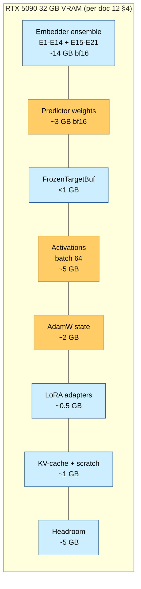
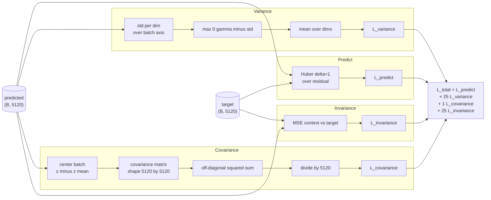

# TECH-PREDICTOR — ME-JEPA-Code Predictor + Frozen Target + VICReg + Oracle Head (Implementation)

> **Level 3 — Technical Specification.** Implements `SPEC-PREDICTOR.md`. Defines HOW the trainable transformer + frozen target adapter + VICReg loss + Oracle head are built. Conflicts with constitution / functional spec resolve to those.

```xml
<technical_spec id="TECH-PREDICTOR" version="1.0" implements="SPEC-PREDICTOR">

<metadata>
  <title>ME-JEPA-Code Predictor + Frozen Target Readback + VICReg Loss + Oracle Head — Implementation</title>
  <status>draft</status>
  <owner>Phase 2 ME-JEPA implementation team</owner>
  <last_updated>2026-05-09</last_updated>
  <related_specs>
    <spec_ref>SPEC-PREDICTOR</spec_ref>
    <spec_ref>SPEC-INSTRUMENTS</spec_ref>
    <spec_ref>TECH-INSTRUMENTS</spec_ref>
    <spec_ref>SPEC-EMBEDDERS</spec_ref>
    <spec_ref>SPEC-CORPUS</spec_ref>
    <spec_ref>TECH-UTML</spec_ref>
    <spec_ref>SPEC-WITNESS</spec_ref>
  </related_specs>
</metadata>

<architecture_diagram>

```mermaid
graph TB
    subgraph TrainableSide ["Trainable side (gradient path)"]
        PT0[("panel[t=0]<br/>shape (B, 5120) bf16")]
        PT1[("panel[t=1]<br/>shape (B, 5120) bf16")]
        CONCAT[Concat axis=-1<br/>shape (B, 10240)]
        PROJ_IN[Linear 10240 to 1024<br/>input projection]
        L1[TransformerLayer 1<br/>MHA 8 heads + GeLU FFN<br/>+ residual + LN]
        L2[TransformerLayer 2]
        L3[TransformerLayer 3]
        L4[TransformerLayer 4]
        L5[TransformerLayer 5]
        L6[TransformerLayer 6]
        PROJ_OUT[Linear 1024 to 5120<br/>output projection]
        PRED[("PredictedPanel<br/>shape (B, 5120) bf16")]
        OH[OracleHead<br/>Linear 5120 to num_tests+1]
        OL[("OracleLogits<br/>shape (B, num_tests+1)")]
    end

    subgraph FrozenSide ["Frozen side (no gradient ever)"]
        PT2[("panel[t=2]<br/>shape (B, 5120) bf16")]
        FTA[FrozenTargetAdapter<br/>holds Box dyn Instrument<br/>parameters returns empty slice]
        TGT[("TargetPanel<br/>shape (B, 5120) bf16")]
    end

    subgraph LossSide ["VICReg loss + diagnostics"]
        LP[L_predict<br/>Huber delta=1]
        LV[L_variance<br/>mean dim max 0 gamma minus std]
        LC[L_covariance<br/>off-diagonal C of z squared / d]
        LI[L_invariance<br/>MSE context vs target]
        LT[L_total = L_predict + 25 LV + 1 LC + 25 LI]
        VFD[Variance-floor diagnostic<br/>fires MEJEPA_PRED_VICREG_DEGENERATE<br/>when more than 50 percent dims below gamma 2x]
        GH[Gradient hook<br/>asserts norm dL/d theta_instrument less than 1e-12<br/>else MEJEPA_PRED_FROZEN_TARGET_GRAD]
    end

    PT0 --> CONCAT
    PT1 --> CONCAT
    CONCAT --> PROJ_IN --> L1 --> L2 --> L3 --> L4 --> L5 --> L6 --> PROJ_OUT --> PRED
    PRED --> OH --> OL
    PRED --> LP
    PRED --> LV
    PRED --> LC
    PRED --> LI
    LP --> LT
    LV --> LT
    LC --> LT
    LI --> LT
    LV --> VFD

    PT2 --> FTA --> TGT
    TGT --> LP
    TGT --> LI
    TGT -.no grad.-> FTA

    LT -.backward.-> PROJ_OUT
    LT -.backward.-> L6
    LT -.backward.-> PROJ_IN
    LT -.X blocked.-> FTA
    GH -.guard.-> FTA

    classDef trainable fill:#fc6,stroke:#a83,color:#000
    classDef frozen fill:#9cf,stroke:#347,color:#000
    classDef loss fill:#fc9,stroke:#a63,color:#000
    classDef tensor fill:#9f6,stroke:#363,color:#000

    class PROJ_IN,L1,L2,L3,L4,L5,L6,PROJ_OUT,OH trainable
    class FTA frozen
    class LP,LV,LC,LI,LT,VFD,GH loss
    class PT0,PT1,PT2,PRED,TGT,OL,CONCAT tensor
```

</architecture_diagram>

<vram_budget_diagram>



| Component | VRAM | Owned by |
|---|---|---|
| Embedder ensemble (21 weights, bf16) | ~14 GB | SPEC-EMBEDDERS |
| **ME-JEPA predictor (6-layer, 1024 hidden, 8 heads, bf16)** | **~3 GB** | **TECH-PREDICTOR** |
| Frozen target-readback buffers | <1 GB | TECH-PREDICTOR |
| Activation memory (batch 64) | ~5 GB | TECH-PREDICTOR |
| Optimizer state (AdamW, bf16) | ~2 GB | SPEC-MEJEPA-TRAIN (Phase 3) |
| LoRA adapters (rank 32, all 21 embedders) | ~0.5 GB | SPEC-EMBEDDERS Phase 5 |
| KV-cache + scratch | ~1 GB | TECH-PREDICTOR |
| **Predictor steady-state target** | **≤ 8 GB** | **REQ-PRED-13** |
| **Total ensemble + predictor + train state** | **~28-29 GB** | (fits in 32 GB RTX 5090) |

</vram_budget_diagram>

<gradient_isolation_diagram>

```mermaid
sequenceDiagram
    participant TL as Training Loop
    participant Pred as MeJepaPredictor
    participant FTA as FrozenTargetAdapter
    participant Inst as Instrument trait
    participant Opt as AdamW
    participant GH as GradientHook
    participant TC as TrainingCert

    Note over TL,TC: One AdamW step

    TL->>Pred: forward(panel_t0, panel_t1)
    Pred-->>TL: PredictedPanel
    TL->>FTA: encode_target(panel_t2)
    FTA->>Inst: dyn Instrument encode
    Note right of Inst: weights have requires_grad=false<br/>tensors held by Box dyn Instrument<br/>no exposed mut Var
    Inst-->>FTA: latent slice
    FTA-->>TL: TargetPanel

    TL->>TL: vicreg_loss(predicted, target, lambdas)
    TL-->>TL: LossOutputs

    TL->>Pred: l_total.backward()
    Pred->>Pred: gradient flows through trainable params

    Pred->>GH: post-backward hook
    GH->>FTA: enumerate instrument tensors
    GH->>GH: assert all grad norms less than 1e-12

    alt Norm OK
        GH-->>Pred: ok
        TL->>Opt: optimizer.step()
        Opt-->>TL: step done
        TL->>TC: write per-step cert with all 4 loss components
    else Norm bad
        GH-->>Pred: MEJEPA_PRED_FROZEN_TARGET_GRAD
        Pred-->>TL: Err(critical)
        TL->>TL: abort step; do NOT call optimizer.step
        TL->>TL: do NOT write cert
        TL->>TL: write blocker memory entry
        TL->>TL: alert operator
    end
```

</gradient_isolation_diagram>

<vicreg_loss_diagram>



</vicreg_loss_diagram>

<data_models>

  <model name="MeJepaPredictor">
    <field name="config" type="PredictorConfig" constraints="immutable after construction"/>
    <field name="input_proj" type="Linear" constraints="in=10240, out=1024, bias=true"/>
    <field name="layers" type="Vec&lt;TransformerLayer&gt;" constraints="len == config.num_layers (default 6)"/>
    <field name="output_proj" type="Linear" constraints="in=1024, out=5120, bias=true"/>
    <field name="oracle_head" type="OracleHead" constraints="in=5120, out=num_tests+1"/>
    <field name="frozen_target_adapter" type="FrozenTargetAdapter" constraints="parameters().is_empty() invariant"/>
    <field name="device" type="candle_core::Device" constraints="must be Cuda(0) for sm_120a; cpu fallback forbidden per CLAUDE.md no-silent-fallback"/>
    <field name="dtype" type="candle_core::DType" constraints="bf16 only on cuda; fp32 only when device=cpu (debug)"/>
    <description>Top-level container. The only trainable component of ME-JEPA-Code. Owns the transformer body + Oracle head. Borrows / holds (does NOT own backprop on) the FrozenTargetAdapter.</description>
  </model>

  <model name="PredictorConfig">
    <field name="num_layers" type="u8" constraints="default 6; range [1, 12]"/>
    <field name="hidden_dim" type="u32" constraints="default 1024; must be % num_heads == 0"/>
    <field name="num_heads" type="u8" constraints="default 8"/>
    <field name="ff_expansion" type="u8" constraints="default 4 (FFN inner dim = 4 * hidden_dim per transformer convention)"/>
    <field name="activation" type="ActivationKind" constraints="GeLU only in Phase 2"/>
    <field name="dropout" type="f32" constraints="default 0.0; >0.0 only at training time"/>
    <field name="layer_norm_eps" type="f32" constraints="default 1e-5"/>
    <field name="gradient_checkpointing" type="bool" constraints="default false; enable for batch≥128 / depth≥9"/>
    <field name="vram_warn_threshold_bytes" type="u64" constraints="default 9 * (1 &lt;&lt; 30) (9 GB) per BR-PRED-04"/>
    <field name="vicreg_variance_floor_consecutive_passes" type="u8" constraints="default 2 per REQ-PRED-08"/>
    <description>Phase 2 configuration. Defaults are doc 09 §2.4 + REQ-PRED-02 fixed.</description>
  </model>

  <model name="TransformerLayer">
    <field name="self_attn" type="MultiHeadSelfAttention" constraints="num_heads = config.num_heads; head_dim = hidden_dim / num_heads"/>
    <field name="ffn" type="FeedForward" constraints="2-layer GeLU MLP, hidden -> 4*hidden -> hidden"/>
    <field name="attn_ln" type="LayerNorm" constraints="pre-attention layer-norm (Pre-LN per modern transformer practice)"/>
    <field name="ffn_ln" type="LayerNorm" constraints="pre-FFN layer-norm"/>
    <description>Standard pre-LN transformer block with residual connections wrapping attention and FFN. No relative-position encoding (the input is two stacked panels, not a token sequence).</description>
  </model>

  <model name="OracleHead">
    <field name="project_to_logits" type="Linear" constraints="Linear&lt;5120, num_tests + 1&gt;; bias=true"/>
    <field name="num_tests" type="usize" constraints="set at construction; corpus-max + per-instance subsetting at inference per EC-PRED-07"/>
    <description>Single-Linear projection per doc 09 §2.5. The +1 slot is a dedicated "exception" probability.</description>
  </model>

  <model name="FrozenTargetAdapter">
    <field name="instruments" type="Vec&lt;Box&lt;dyn Instrument + Send + Sync&gt;&gt;" constraints="loaded from context-graph-mejepa-instruments per SPEC-INSTRUMENTS; trait API forbids `&amp;mut self` weight mutation"/>
    <field name="provenance" type="TargetProvenance" constraints="code_version + embedder_versions for byte-equality verification per REQ-PRED-11"/>
    <description>The frozen target side. Has zero trainable parameters. The trait `Instrument` is defined in `context-graph-mejepa-instruments` such that no `&amp;mut self` weight-mutating method exists; underlying embedder weights are loaded with `requires_grad = false` and detached. NO `&amp;mut self` methods on this struct that touch instrument weights — that's the type-level guarantee that ΔΞ.target_collapse = 0 by construction.</description>
  </model>

  <model name="TargetProvenance">
    <field name="code_version" type="String" constraints="git SHA hex of producing codebase"/>
    <field name="embedder_versions" type="HashMap&lt;String, String&gt;" constraints="map E1..E21 → SHA-256 hex"/>
    <field name="frozen_at" type="DateTime&lt;Utc&gt;" constraints="ISO 8601; recorded once at adapter construction"/>
    <description>Per constitution `<provenance>` rule: every persistent artifact carries provenance; the FrozenTargetAdapter is a long-lived runtime artifact.</description>
  </model>

  <model name="PredictedPanel">
    <field name="data" type="Tensor" constraints="shape (batch, 5120); bf16 on candle-cuda; finite"/>
    <field name="batch_size" type="usize" constraints="≥ 1"/>
  </model>

  <model name="TargetPanel">
    <field name="data" type="Tensor" constraints="shape (batch, 5120); bf16; finite; produced with requires_grad = false"/>
    <field name="provenance_ref" type="String" constraints="reference into the FrozenTargetAdapter's TargetProvenance for cert/audit"/>
  </model>

  <model name="OracleLogits">
    <field name="logits" type="Tensor" constraints="shape (batch, num_tests + 1); finite"/>
    <field name="num_tests" type="usize" constraints="1 ≤ num_tests ≤ 10000"/>
  </model>

  <model name="VicregLambdas">
    <field name="var" type="f32" constraints="default 25.0; immutable absent constitutional amendment"/>
    <field name="cov" type="f32" constraints="default 1.0"/>
    <field name="inv" type="f32" constraints="default 25.0"/>
    <field name="gamma" type="f32" constraints="default 1.0"/>
  </model>

  <model name="LossOutputs">
    <field name="l_predict" type="f32" constraints="finite ≥ 0; public field; consumed by SPEC-UTML compute_delta_p"/>
    <field name="l_variance" type="f32" constraints="finite ≥ 0; ≤ gamma"/>
    <field name="l_covariance" type="f32" constraints="finite ≥ 0"/>
    <field name="l_invariance" type="f32" constraints="finite ≥ 0"/>
    <field name="l_total" type="f32" constraints="l_predict + var * l_variance + cov * l_covariance + inv * l_invariance ± 1e-3"/>
  </model>

  <model name="PredictorError">
    <field name="kind" type="enum {DimMismatch, NanDetected, VramExceeded, FrozenTargetGrad, VicregDegenerate, ConfigInvalid, DeviceUnavailable}"/>
    <field name="code" type="&amp;'static str" constraints="MEJEPA_PRED_DIM_MISMATCH | MEJEPA_PRED_NAN_DETECTED | MEJEPA_PRED_VRAM_EXCEEDED | MEJEPA_PRED_FROZEN_TARGET_GRAD | MEJEPA_PRED_VICREG_DEGENERATE | MEJEPA_PRED_CONFIG_INVALID | MEJEPA_PRED_DEVICE_UNAVAILABLE"/>
    <field name="context" type="HashMap&lt;String, String&gt;" constraints="structured diagnostic context (shapes, dim indices, layer ids, file paths starting with file:)"/>
  </model>

  <model name="LossError">
    <field name="kind" type="enum {NanDetected, DimMismatch, BatchTooSmall, NonFiniteLambda}"/>
    <field name="code" type="&amp;'static str"/>
    <field name="context" type="HashMap&lt;String, String&gt;"/>
  </model>

  <model name="ForwardPassEvidence">
    <field name="panel_dim" type="usize" constraints="== 5120"/>
    <field name="batch_size" type="usize"/>
    <field name="forward_latency_ms_p50" type="f32"/>
    <field name="forward_latency_ms_p99" type="f32"/>
    <field name="output_finite" type="bool" constraints="must be true"/>
    <field name="output_sha256" type="String" constraints="hex digest of bf16 bytes for determinism check"/>
    <field name="vram_resident_bytes" type="u64"/>
    <field name="device" type="String" constraints="Cuda(0) sm_120a"/>
    <field name="code_version" type="String"/>
    <field name="dod_pass" type="bool" constraints="all REQ-PRED thresholds met"/>
    <description>FSV evidence model written to `/tmp/contextgraph-mejepa-predictor-fsv/forward-pass-evidence.json` mode 0o600.</description>
  </model>

  <model name="VicregLossEvidence">
    <field name="batch_size" type="usize"/>
    <field name="lambdas" type="VicregLambdas"/>
    <field name="l_predict" type="f32"/>
    <field name="l_variance" type="f32"/>
    <field name="l_covariance" type="f32"/>
    <field name="l_invariance" type="f32"/>
    <field name="l_total" type="f32"/>
    <field name="components_finite" type="bool" constraints="must be true"/>
    <field name="formula_check" type="bool" constraints="abs(l_total - (l_predict + 25*l_variance + l_covariance + 25*l_invariance)) &lt; 1e-3"/>
    <field name="dod_pass" type="bool"/>
  </model>

</data_models>

<api_contracts>

  <!-- The predictor crate is a library + a `bin/mejepa.rs` entrypoint with `train --dry-run`.
       MCP tool surface (mejepa_predict, mejepa_verify) ships in Phase 7, not here. -->

  <library_api crate="context-graph-mejepa">
    <implements>REQ-PRED-01..REQ-PRED-18</implements>

    <const name="PANEL_DIM" type="usize" value="5_120">
      <description>Inherited from SPEC-INSTRUMENTS via re-export</description>
    </const>
    <const name="CONCAT_INPUT_DIM" type="usize" value="10_240">
      <description>panel_t0_dim + panel_t1_dim per SPEC-PREDICTOR REQ-PRED-01</description>
    </const>
    <const name="DEFAULT_NUM_LAYERS" type="u8" value="6"/>
    <const name="DEFAULT_HIDDEN_DIM" type="u32" value="1_024"/>
    <const name="DEFAULT_NUM_HEADS" type="u8" value="8"/>
    <const name="DEFAULT_LAMBDA_VAR" type="f32" value="25.0"/>
    <const name="DEFAULT_LAMBDA_COV" type="f32" value="1.0"/>
    <const name="DEFAULT_LAMBDA_INV" type="f32" value="25.0"/>
    <const name="DEFAULT_GAMMA" type="f32" value="1.0"/>
    <const name="VRAM_STEADY_STATE_TARGET_BYTES" type="u64" value="8_589_934_592 (8 GB)"/>
    <const name="VRAM_WARN_THRESHOLD_BYTES" type="u64" value="9_663_676_416 (9 GB)"/>
    <const name="GRAD_NORM_NOISE_FLOOR" type="f64" value="1e-12"/>
    <const name="VICREG_DEGENERATE_DIM_FRACTION" type="f32" value="0.5"/>
    <const name="VICREG_DEGENERATE_CONSECUTIVE_PASSES" type="u8" value="2"/>

    <pub_struct name="MeJepaPredictor">
      <field>config: PredictorConfig</field>
      <field>input_proj: Linear (candle_nn::Linear)</field>
      <field>layers: Vec&lt;TransformerLayer&gt;</field>
      <field>output_proj: Linear</field>
      <field>oracle_head: OracleHead</field>
      <field>frozen_target_adapter: FrozenTargetAdapter</field>
      <field>device: candle_core::Device</field>
      <field>dtype: candle_core::DType</field>
      <field>variance_floor_history: VarianceFloorHistory</field>
    </pub_struct>

    <method on="MeJepaPredictor" name="new">
      <signature>pub fn new(config: PredictorConfig, frozen_target_adapter: FrozenTargetAdapter, device: candle_core::Device) -&gt; Result&lt;Self, PredictorError&gt;</signature>
      <implements>REQ-PRED-02, REQ-PRED-09</implements>
      <behavior>
        1. Validate config: num_layers ∈ [1,12], hidden_dim % num_heads == 0, activation == GeLU, dropout ∈ [0, 0.5].
        2. If device is not Cuda(0), refuse with MEJEPA_PRED_DEVICE_UNAVAILABLE (no silent CPU fallback).
        3. Verify sm_120a capability via cudarc; refuse otherwise.
        4. Set dtype = BF16 on cuda.
        5. Construct input_proj Linear(10240, 1024), layers Vec of num_layers TransformerLayer, output_proj Linear(1024, 5120).
        6. Construct OracleHead from corpus-max num_tests.
        7. Move all Vars to device + dtype.
        8. Assert frozen_target_adapter.parameters().is_empty() — runtime invariant per REQ-PRED-09.
        9. Return Self.
      </behavior>
      <throws>PredictorError::ConfigInvalid, ::DeviceUnavailable</throws>
    </method>

    <method on="MeJepaPredictor" name="forward">
      <signature>pub fn forward(&amp;self, panel_t0: &amp;Tensor, panel_t1: &amp;Tensor) -&gt; Result&lt;PredictedPanel, PredictorError&gt;</signature>
      <implements>REQ-PRED-01, REQ-PRED-03, REQ-PRED-04, REQ-PRED-05, REQ-PRED-18</implements>
      <behavior>
        1. Validate input shapes: panel_t0.dims() == [batch, 5120], panel_t1.dims() == [batch, 5120], same batch.
           Else: return Err(MEJEPA_PRED_DIM_MISMATCH) with both observed shapes in context.
        2. Validate finiteness of inputs (sample-based for hot-path; full-tensor in dry-run mode).
           NaN/Inf in input: return Err(MEJEPA_PRED_NAN_DETECTED) with source=input.
        3. Concatenate axis=-1: x = Tensor::cat(&amp;[panel_t0, panel_t1], 1)?  — shape (batch, 10240).
        4. x = self.input_proj.forward(&amp;x)?; — shape (batch, 1024).
        5. For layer in &amp;self.layers: x = layer.forward(&amp;x)?;
        6. predicted = self.output_proj.forward(&amp;x)?; — shape (batch, 5120).
        7. Validate finiteness of predicted; on NaN/Inf: return Err(MEJEPA_PRED_NAN_DETECTED) with layer_id, tensor_name.
        8. Return Ok(PredictedPanel { data: predicted, batch_size: batch }).
      </behavior>
      <throws>PredictorError::DimMismatch, ::NanDetected</throws>
    </method>

    <method on="MeJepaPredictor" name="trainable_parameters">
      <signature>pub fn trainable_parameters(&amp;self) -&gt; Vec&lt;&amp;Var&gt;</signature>
      <implements>REQ-PRED-09</implements>
      <behavior>
        Enumerate Vars from: input_proj, every layer in self.layers, output_proj, oracle_head.project_to_logits.
        DO NOT enumerate from frozen_target_adapter.
        This is the only set of Vars passed to AdamW::new.
      </behavior>
    </method>

    <method on="MeJepaPredictor" name="run_gradient_hook">
      <signature>pub fn run_gradient_hook(&amp;self, grads: &amp;GradStore) -&gt; Result&lt;(), PredictorError&gt;</signature>
      <implements>REQ-PRED-10</implements>
      <behavior>
        1. For each instrument in self.frozen_target_adapter.instruments:
           1a. For each tensor T held by the instrument's underlying embedder weight refs:
               grad_norm = grads.get(T.id()).map(|g| g.l2_norm()).unwrap_or(0.0);
               if grad_norm &gt; GRAD_NORM_NOISE_FLOOR (1e-12):
                   return Err(PredictorError::FrozenTargetGrad with instrument_id + grad_norm + threshold).
        2. Return Ok(()).

        Called by the training loop AFTER l_total.backward() and BEFORE optimizer.step().
        On Err, the training loop skips optimizer.step() AND skips writing the per-step training cert.
      </behavior>
      <throws>PredictorError::FrozenTargetGrad (CRITICAL severity)</throws>
    </method>

    <method on="MeJepaPredictor" name="check_vram_steady_state">
      <signature>pub fn check_vram_steady_state(&amp;self) -&gt; Result&lt;u64, PredictorError&gt;</signature>
      <implements>REQ-PRED-13, REQ-PRED-14</implements>
      <behavior>
        1. Synchronize device, then query cudaMemGetInfo via cudarc.
        2. resident = total - free.
        3. If resident ≥ VRAM_WARN_THRESHOLD_BYTES (9 GB): return Err(VramExceeded).
        4. Return Ok(resident).
      </behavior>
      <throws>PredictorError::VramExceeded</throws>
    </method>

    <method on="MeJepaPredictor" name="record_vicreg_variance_status">
      <signature>pub fn record_vicreg_variance_status(&amp;mut self, low_variance_dim_count: usize, total_dims: usize) -&gt; Result&lt;(), PredictorError&gt;</signature>
      <implements>REQ-PRED-08</implements>
      <behavior>
        Push the boolean `low_variance_dim_count &gt; VICREG_DEGENERATE_DIM_FRACTION * total_dims` to self.variance_floor_history (ring buffer of last VICREG_DEGENERATE_CONSECUTIVE_PASSES entries).
        If history.is_full() AND every entry is true: return Err(VicregDegenerate).
        Else: Ok(()).

        Called by the training loop after each validation pass.
      </behavior>
      <throws>PredictorError::VicregDegenerate</throws>
    </method>

    <pub_struct name="OracleHead">
      <field>project_to_logits: Linear</field>
      <field>num_tests: usize</field>
    </pub_struct>

    <method on="OracleHead" name="new">
      <signature>pub fn new(num_tests: usize, vb: VarBuilder) -&gt; Result&lt;Self, PredictorError&gt;</signature>
      <implements>REQ-PRED-12</implements>
      <behavior>
        Validate num_tests ∈ [1, 10000].
        project_to_logits = candle_nn::linear(5120, num_tests + 1, vb.pp("oracle_head"))?
        Return Self.
      </behavior>
      <throws>PredictorError::ConfigInvalid</throws>
    </method>

    <method on="OracleHead" name="predict_logits">
      <signature>pub fn predict_logits(&amp;self, predicted: &amp;Tensor) -&gt; Result&lt;OracleLogits, PredictorError&gt;</signature>
      <implements>REQ-PRED-12</implements>
      <behavior>
        1. Validate predicted.shape() == [batch, 5120]; else DimMismatch.
        2. logits = self.project_to_logits.forward(predicted)?  — shape (batch, num_tests + 1).
        3. Validate finiteness; else NanDetected.
        4. Return Ok(OracleLogits { logits, num_tests: self.num_tests }).
      </behavior>
    </method>

    <method on="OracleHead" name="predict_probabilities">
      <signature>pub fn predict_probabilities(&amp;self, logits: &amp;OracleLogits) -&gt; Result&lt;Tensor, PredictorError&gt;</signature>
      <implements>REQ-PRED-12</implements>
      <behavior>
        probs = candle_nn::ops::softmax(&amp;logits.logits, /*dim=*/ 1)?;
        Validate row sums to 1.0 ± 1e-5 in dry-run mode; skip in hot path.
        Return Ok(probs).
      </behavior>
    </method>

    <pub_struct name="FrozenTargetAdapter">
      <field>instruments: Vec&lt;Box&lt;dyn Instrument + Send + Sync&gt;&gt;</field>
      <field>provenance: TargetProvenance</field>
    </pub_struct>

    <method on="FrozenTargetAdapter" name="new">
      <signature>pub fn new(instruments: Vec&lt;Box&lt;dyn Instrument + Send + Sync&gt;&gt;, provenance: TargetProvenance) -&gt; Self</signature>
      <implements>REQ-PRED-09, REQ-PRED-11</implements>
      <behavior>
        Construct directly; no `&amp;mut self` methods are exposed that touch instrument weights — that's the type-level guarantee.
      </behavior>
    </method>

    <method on="FrozenTargetAdapter" name="parameters">
      <signature>pub fn parameters(&amp;self) -&gt; &amp;[&amp;Var]</signature>
      <implements>REQ-PRED-09</implements>
      <behavior>
        Returns a static empty slice.
        ```rust
        const EMPTY: &amp;[&amp;Var] = &amp;[];
        EMPTY
        ```
        This is the structural guarantee that AdamW cannot register any frozen-target state for training.
      </behavior>
    </method>

    <method on="FrozenTargetAdapter" name="encode_target">
      <signature>pub fn encode_target(&amp;self, panel_t2: &amp;Panel) -&gt; Result&lt;TargetPanel, PredictorError&gt;</signature>
      <implements>REQ-PRED-11</implements>
      <behavior>
        1. Validate panel_t2.data().len() == PANEL_DIM (5120); else DimMismatch.
        2. Convert panel_t2 to a (1, 5120) Tensor with requires_grad = false on the predictor's device.
        3. Detach the resulting tensor (defense-in-depth — a `.requires_grad_(true)` call later cannot reattach if the tensor is already detached).
        4. Return Ok(TargetPanel { data: tensor, provenance_ref: self.provenance.code_version.clone() }).
      </behavior>
      <throws>PredictorError::DimMismatch</throws>
    </method>

    <pub_fn name="vicreg_loss">
      <signature>pub fn vicreg_loss(predicted: &amp;Tensor, target: &amp;Tensor, lambdas: VicregLambdas) -&gt; Result&lt;LossOutputs, LossError&gt;</signature>
      <implements>REQ-PRED-06, REQ-PRED-07, REQ-PRED-08, REQ-PRED-16</implements>
      <behavior>
        1. Validate predicted.shape() == target.shape() == [batch, 5120]; else DimMismatch.
        2. Validate batch ≥ 2 (covariance term is degenerate at batch=1; warn but compute as 0.0); else BatchTooSmall is logged but execution continues with l_covariance = 0.
        3. Validate lambdas finite; else NonFiniteLambda.

        4. L_predict (Huber δ=1):
           residual = predicted - target
           huber = where(|residual| &lt; 1, 0.5*residual², |residual| - 0.5)
           l_predict = huber.mean() — scalar f32.

        5. L_variance:
           std_per_dim = predicted.std(/*axis=*/0, /*ddof=*/0).sqrt()  — shape (5120,)
           below_floor_count = (std_per_dim &lt; lambdas.gamma).sum().to_scalar::&lt;f32&gt;()
           l_variance = max(0, lambdas.gamma - std_per_dim).mean().to_scalar::&lt;f32&gt;()

        6. L_covariance:
           centered = predicted - predicted.mean(axis=0, keepdim=true)
           cov = (centered.transpose() @ centered) / (batch - 1)  — shape (5120, 5120)
           off_diag = cov.masked_fill(eye_mask(5120), 0)
           l_covariance = off_diag.pow(2).sum().to_scalar::&lt;f32&gt;() / 5120.0

        7. L_invariance:
           l_invariance = (predicted - target).pow(2).mean().to_scalar::&lt;f32&gt;()

        8. l_total = l_predict + lambdas.var * l_variance + lambdas.cov * l_covariance + lambdas.inv * l_invariance.

        9. Validate every component finite; else NanDetected.

        10. Return Ok(LossOutputs { l_predict, l_variance, l_covariance, l_invariance, l_total }).
      </behavior>
      <throws>LossError::DimMismatch, ::NanDetected, ::NonFiniteLambda</throws>
    </pub_fn>

    <pub_fn name="huber_loss_delta_one">
      <signature>fn huber_loss_delta_one(residual: &amp;Tensor) -&gt; Result&lt;Tensor, LossError&gt;</signature>
      <implements>REQ-PRED-06</implements>
      <behavior>
        abs = residual.abs()?
        quadratic = (0.5 * residual.sqr()?)?
        linear = (abs - 0.5)?
        Tensor::where(abs.lt(1.0)?, quadratic, linear).mean()
      </behavior>
    </pub_fn>

  </library_api>

  <bin_entrypoint name="mejepa" path="crates/context-graph-mejepa/src/bin/mejepa.rs">
    <implements>REQ-PRED-15</implements>
    <subcommand name="train">
      <flag name="--dry-run" type="bool"/>
      <flag name="--batches" type="usize" default="1"/>
      <flag name="--batch-size" type="usize" default="64"/>
      <flag name="--corpus" type="PathBuf" required="false (synthetic when dry-run)"/>
      <flag name="--output" type="PathBuf"/>
      <behavior>
        When --dry-run:
        1. Allocate synthetic panels (or pull first 64 corpus examples if --corpus given).
        2. Construct MeJepaPredictor with default config + FrozenTargetAdapter loaded from context-graph-mejepa-instruments.
        3. Run forward + vicreg_loss for `batches` iterations; do NOT call backward / optimizer.step in dry-run.
        4. Measure forward latency p50/p99 over warm calls.
        5. Query VRAM steady-state via check_vram_steady_state.
        6. Write ForwardPassEvidence to /tmp/contextgraph-mejepa-predictor-fsv/forward-pass-evidence.json (mode 0o600).
        7. Write VicregLossEvidence to /tmp/contextgraph-mejepa-predictor-fsv/vicreg-loss-evidence.json (mode 0o600).
        8. Re-read both JSON files; assert thresholds (latency &lt; 50 ms, vram &lt; 8 GB, l_total finite).
        9. Print structured stdout containing: forward_latency_ms_p50, forward_latency_ms_p99, vram_resident_bytes, l_predict, l_variance, l_covariance, l_invariance, l_total, dod_pass.
        10. Exit 0 on dod_pass; exit 2 with first failing metric otherwise.
      </behavior>
    </subcommand>
  </bin_entrypoint>

</api_contracts>

<component_contracts>

  <component name="MeJepaPredictor" path="crates/context-graph-mejepa/src/predictor/mod.rs">
    <method name="forward">
      <signature>pub fn forward(&amp;self, panel_t0: &amp;Tensor, panel_t1: &amp;Tensor) -&gt; Result&lt;PredictedPanel, PredictorError&gt;</signature>
      <implements>REQ-PRED-01, REQ-PRED-03, REQ-PRED-04, REQ-PRED-18</implements>
      <behavior>
        Validates dims (5120 each), validates finiteness, concats to (batch, 10240), runs input_proj → 6 transformer layers → output_proj. Returns PredictedPanel of shape (batch, 5120). Fails closed on dim mismatch or NaN/Inf.
      </behavior>
      <throws>PredictorError::DimMismatch, ::NanDetected</throws>
    </method>
    <method name="trainable_parameters">
      <signature>pub fn trainable_parameters(&amp;self) -&gt; Vec&lt;&amp;Var&gt;</signature>
      <implements>REQ-PRED-09</implements>
      <behavior>Returns input_proj + 6 layers + output_proj + oracle_head Vars. NEVER returns FrozenTargetAdapter state.</behavior>
    </method>
    <method name="run_gradient_hook">
      <signature>pub fn run_gradient_hook(&amp;self, grads: &amp;GradStore) -&gt; Result&lt;(), PredictorError&gt;</signature>
      <implements>REQ-PRED-10</implements>
      <behavior>Iterates instrument tensors, asserts grad_norm &lt; 1e-12; raises FrozenTargetGrad on violation.</behavior>
      <throws>PredictorError::FrozenTargetGrad (CRITICAL)</throws>
    </method>
  </component>

  <component name="FrozenTargetAdapter" path="crates/context-graph-mejepa/src/frozen_target/mod.rs">
    <method name="parameters">
      <signature>pub fn parameters(&amp;self) -&gt; &amp;[&amp;Var]</signature>
      <implements>REQ-PRED-09</implements>
      <behavior>Always returns the static empty slice. This is the type-level guarantee of zero trainable parameters.</behavior>
    </method>
    <method name="encode_target">
      <signature>pub fn encode_target(&amp;self, panel_t2: &amp;Panel) -&gt; Result&lt;TargetPanel, PredictorError&gt;</signature>
      <implements>REQ-PRED-11</implements>
      <behavior>Validates panel dim, converts to detached tensor with requires_grad = false, returns TargetPanel.</behavior>
    </method>
    <invariant>
      <statement>The struct exposes ZERO `&amp;mut self` methods that touch instrument weights. Adding such a method is a CRITICAL spec violation per the constitution `<utml_v1_invariants>` rule 2.</statement>
    </invariant>
  </component>

  <component name="OracleHead" path="crates/context-graph-mejepa/src/oracle_head/mod.rs">
    <method name="predict_logits">
      <signature>pub fn predict_logits(&amp;self, predicted: &amp;Tensor) -&gt; Result&lt;OracleLogits, PredictorError&gt;</signature>
      <implements>REQ-PRED-12</implements>
      <behavior>Single Linear(5120, num_tests + 1) projection. The +1 slot is "exception" probability per doc 09 §2.5.</behavior>
    </method>
    <method name="predict_probabilities">
      <signature>pub fn predict_probabilities(&amp;self, logits: &amp;OracleLogits) -&gt; Result&lt;Tensor, PredictorError&gt;</signature>
      <implements>REQ-PRED-12</implements>
      <behavior>Softmax over axis 1; returns probabilities ∈ [0,1] with row sums == 1.</behavior>
    </method>
  </component>

  <component name="VicregLoss" path="crates/context-graph-mejepa/src/loss/vicreg.rs">
    <method name="vicreg_loss">
      <signature>pub fn vicreg_loss(predicted: &amp;Tensor, target: &amp;Tensor, lambdas: VicregLambdas) -&gt; Result&lt;LossOutputs, LossError&gt;</signature>
      <implements>REQ-PRED-06, REQ-PRED-07, REQ-PRED-16</implements>
      <behavior>
        Computes the four-term decomposition (l_predict, l_variance, l_covariance, l_invariance) and sums into l_total per the doc 09 §2.4 formula. Validates finiteness of every component before returning.
      </behavior>
      <throws>LossError::DimMismatch, ::NanDetected, ::BatchTooSmall (warn-only), ::NonFiniteLambda</throws>
    </method>
  </component>

  <component name="VarianceFloorHistory" path="crates/context-graph-mejepa/src/loss/variance_floor.rs">
    <method name="record_pass">
      <signature>pub fn record_pass(&amp;mut self, low_variance_dim_count: usize, total_dims: usize) -&gt; Result&lt;(), PredictorError&gt;</signature>
      <implements>REQ-PRED-08</implements>
      <behavior>Ring buffer of last 2 passes; if both passes have low_variance_dim_count &gt; 0.5 * total_dims, raise VicregDegenerate.</behavior>
    </method>
  </component>

  <component name="MejepaTrainBin" path="crates/context-graph-mejepa/src/bin/mejepa.rs">
    <method name="run_dry_run">
      <signature>fn run_dry_run(args: &amp;TrainArgs) -&gt; Result&lt;(), MejepaCliError&gt;</signature>
      <implements>REQ-PRED-15</implements>
      <behavior>
        Runs the full Phase 2 DoD verification: forward + vicreg + VRAM check, writes FSV evidence, re-reads it, asserts thresholds, exits 0 or 2.
      </behavior>
    </method>
  </component>

  <component name="PredictorFsvHarness" path="crates/context-graph-mejepa/examples/predictor_fsv.rs">
    <method name="main">
      <signature>fn main() -&gt; Result&lt;(), Box&lt;dyn std::error::Error&gt;&gt;</signature>
      <implements>REQ-PRED-15 (FSV protocol)</implements>
      <behavior>
        Dedicated FSV binary independent of the `bin/mejepa.rs` train subcommand. Same outputs (forward-pass-evidence.json, vicreg-loss-evidence.json) but with extended adversarial cases:
        - Inject NaN to verify MEJEPA_PRED_NAN_DETECTED.
        - Run gradient-hook with synthetic violation to verify MEJEPA_PRED_FROZEN_TARGET_GRAD.
        - Force a 9 GB allocation to verify MEJEPA_PRED_VRAM_EXCEEDED.
        - Run two eval-mode forwards to verify byte-equal determinism.
        Each case writes its own boundary evidence file under /tmp/contextgraph-mejepa-predictor-fsv/.
      </behavior>
    </method>
  </component>

</component_contracts>

<implementation_notes>

  <note category="frozen-target-architecture">
    The `FrozenTargetAdapter` is owned by `MeJepaPredictor` (composition, not inheritance) but the underlying instruments are loaded from `context-graph-mejepa-instruments`. The adapter is constructed via `FrozenTargetAdapter::new(instruments, provenance)`. The instruments themselves are `Box&lt;dyn Instrument + Send + Sync&gt;` — the trait API in `context-graph-mejepa-instruments::Instrument` MUST NOT expose any `&mut` weight-mutating method, and the embedder weights it carries MUST be loaded with `.detach()` and `requires_grad = false`. Phase 1 trait audit must verify this; the gradient-hook (REQ-PRED-10) is the runtime safety net.
  </note>

  <note category="determinism">
    REQ-PRED-05 byte-equal forward determinism on candle-cuda requires three properties: (a) deterministic CUDA kernel selection (cublas / cudnn deterministic algos), (b) eval-mode dropout = 0, (c) no in-flight reductions with non-deterministic order. Set `CUBLAS_WORKSPACE_CONFIG=:4096:8` at process startup. Avoid `Tensor::sum_all` over very large tensors that could trigger non-deterministic reduction tree paths — prefer chunked sums.
  </note>

  <note category="vram">
    VRAM polling uses `cudarc::driver::result::mem_get_info()`. Poll BETWEEN training steps, not in the hot path. Cache the result and refresh every 10 steps; the steady-state assertion runs on the cached reading. For the Phase 2 dry-run (REQ-PRED-15), poll at the end after device synchronization to capture the steady-state value, not the peak.
  </note>

  <note category="vicreg-formula">
    The VICReg formula has subtle dimensional semantics. `L_variance` operates over the *batch* axis (compute std per output dim across the batch); collapsing this to per-dim mean is correct. `L_covariance` computes the (panel_dim × panel_dim) covariance matrix and penalizes off-diagonals; with panel_dim=5120, this is a 5120×5120 = 26M-entry tensor — memory bound. Use `predicted.transpose(0,1).matmul(predicted)` and subtract the per-dim mean outer product, then mask the diagonal in-place. Avoid materializing the dense matrix twice.
  </note>

  <note category="lambda-defaults">
    The defaults λ_var=25, λ_cov=1, λ_inv=25, γ=1 are doc 09 §2.4 fixed and constitution-locked per BR-PRED-06. Changing them requires a constitution amendment with operator approval. The PredictorConfig accepts non-default lambdas only when an explicit `__phase2_dryrun_unlock = true` flag is set — used by FSV adversarial harnesses to verify response surface, never in production training.
  </note>

  <note category="oracle-head-sizing">
    EC-PRED-07 surfaces num_tests sizing. Recommendation: size `num_tests` at construction to `corpus.max_test_count_across_all_tasks()` (≈1,247 for SWE-bench Lite based on empirical analysis). At inference time, `OracleHead::predict_probabilities()` returns the full softmax; downstream consumers (Phase 4 conformal calibration) subset to the per-task tests. Total Oracle head parameters = 5120 * 1248 ≈ 6.4M params * 2 bytes (bf16) ≈ 13 MB — negligible.
  </note>

  <note category="architecture-headroom">
    REQ-PRED-17 + EC-PRED-10 cover the 12-layer / batch-128 extension path. The PredictorConfig field `gradient_checkpointing` toggles candle's `Function::checkpoint()` wrapper around each TransformerLayer. With checkpointing, activation memory drops ~3x (recompute on backward) at the cost of ~30% latency increase. When extending to 12 layers, the operator MUST set `gradient_checkpointing = true` AND opt into E15-E21 lazy-load via `embedder_lazy_load = ["e15", "e16", "e17", "e18", "e19", "e20", "e21"]` to satisfy the doc 12 §4 budget.
  </note>

  <note category="error-handling">
    Per CLAUDE.md §11.9 + constitution `<error_handling>` "fail-closed at boundaries": every fallible operation returns `Result&lt;_, PredictorError&gt;` with structured `.code()` tag. Errors include source-of-truth file paths starting with `file:` per constitution `<file_organization>` rule. Error messages are operator-readable; internal context (shapes, sample indices) is in the `context: HashMap` for debugging.
  </note>

  <note category="cross-spec-utml">
    REQ-PRED-16 mandates `LossOutputs::l_predict` is a public field. The SPEC-UTML technical spec's `compute_delta_p` function reads it via `loss_outputs.l_predict` per training step. Changing this field's visibility or name is a spec-level breaking change requiring SPEC-UTML to be amended in the same PR.
  </note>

  <note category="phase2-dod-binary">
    The Phase 2 DoD-checking binary (`cargo run --release -p context-graph-mejepa -- train --dry-run --batches 1 --batch-size 64`) is in `bin/mejepa.rs`, NOT `examples/`. The FSV harness `examples/predictor_fsv.rs` is separate and runs a wider adversarial battery. Both write to `/tmp/contextgraph-mejepa-predictor-fsv/` mode 0o600 per SEC-MEJEPA-07.
  </note>

  <note category="provenance">
    Per constitution `<provenance>` rule: "Every clean-room reimplementation cites its inspirational source." The transformer body is inspired by candle's reference implementation at `candle/candle-transformers/src/models/llama.rs` HEAD pinned in Cargo.toml. The VICReg loss is a clean-room reimplementation of Bardes et al. 2022 — no code copied; cite the paper. The Oracle head is original to ME-JEPA per doc 09 §2.5.
  </note>

  <note category="phase-dependency">
    Phase 2 (this spec) depends on Phase 1 (SPEC-INSTRUMENTS) shipping at minimum the deterministic skeletons of all 15 instrument slots. Currently shipped: E_Oracle (128-d), E_Witness (256-d), E_StaticAnalysis (256-d), Panel struct, PanelBuilder. Pending: 12 of 15 slots. The Phase 2 dry-run binary (REQ-PRED-15) MAY use synthetic random panels as inputs while waiting on Phase 1 — but production training (Phase 3) requires Phase 1 fully shipped.
  </note>

  <note category="security-mcp-namespace">
    Per constitution `<mcp_tool_namespace_lock>`: the predictor crate exposes NO MCP tools in Phase 2. Phase 7 will add `mcp__cgreality__mejepa_predict` and `mejepa_verify` in a separate spec. The retired `mcp__cgreality__reality_run_attempt` namespace MUST NOT be reused; this crate adds nothing to MCP surface in Phase 2.
  </note>

  <note category="testing-fsv">
    Per constitution `<testing_requirements>` `fsv_evidence_paths`: this crate's evidence lives at `/tmp/contextgraph-mejepa-predictor-fsv/{forward-pass-evidence.json, vicreg-loss-evidence.json}`. The FSV protocol (constitution `<fsv_protocol>`): write evidence → re-read → assert before reporting success. This is enforced by both the `bin/mejepa.rs train --dry-run` and `examples/predictor_fsv.rs` paths.
  </note>

  <note category="rust-version-pin">
    Per constitution `<tech_stack>`: Rust 1.84+, candle v0.9.x, edition 2021. The crate's Cargo.toml MUST pin these versions exactly. Workspace-level dependencies are resolved through the parent Cargo.toml; this crate adds no new top-level external deps beyond candle-core / candle-nn / candle-transformers / cudarc / serde / serde_json / sha2 (already in workspace).
  </note>

  <note category="weight-blob-storage">
    Trained predictor weights persist to `CF_MEJEPA_WEIGHT_BLOBS` keyed by `theta_sha = SHA-256(serialize_state_dict())`. This is a Phase 3 (training-loop) responsibility, not Phase 2, but the predictor's `save_state_dict` / `load_state_dict` API MUST be available in this spec for Phase 3 to consume. Use safetensors format (binary, not JSON) for weight serialization — fast, self-describing, candle-native.
  </note>

</implementation_notes>

</technical_spec>
```
