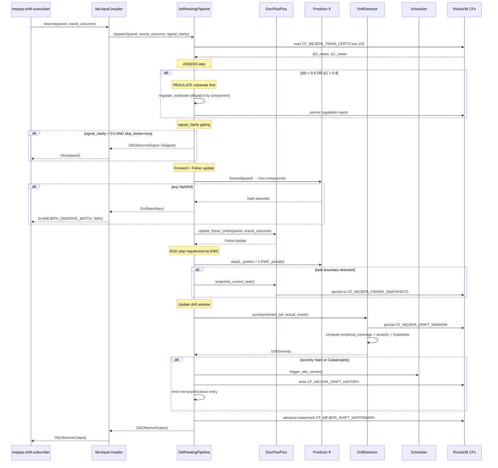
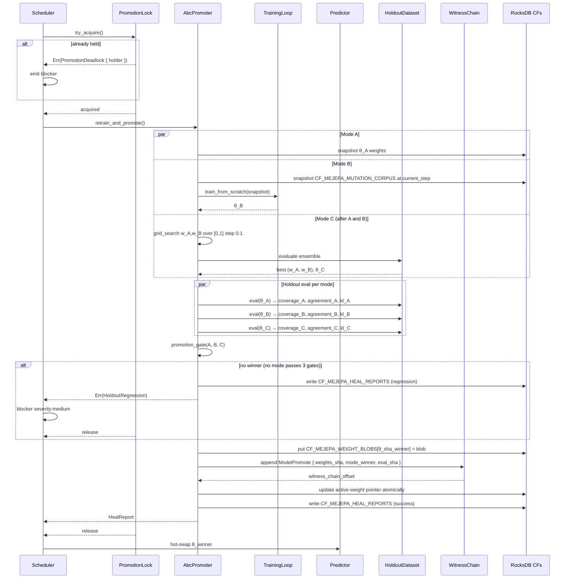
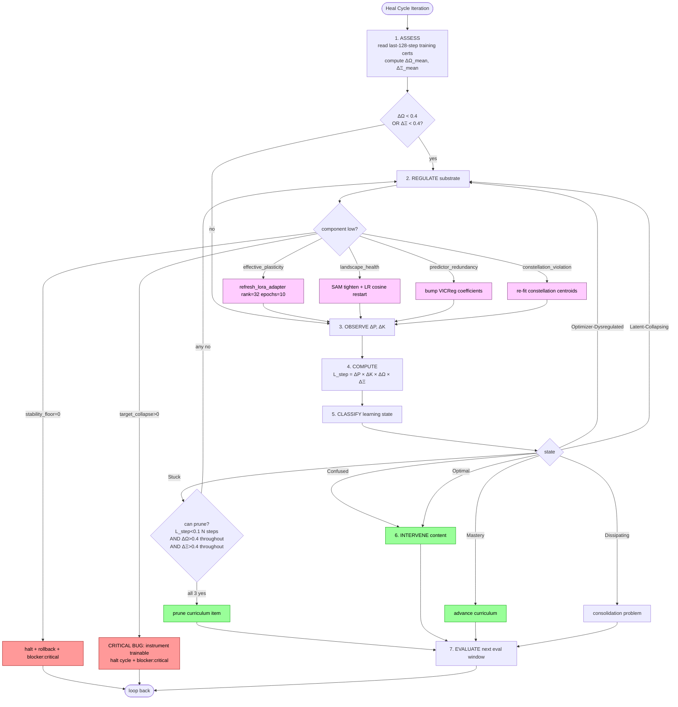
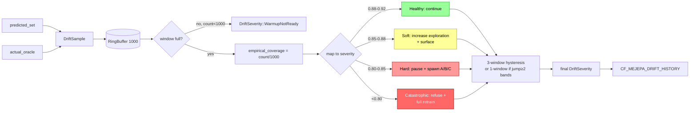

# TECH-SELF-HEALING — ME-JEPA-Code Self-Healing Operations (Implementation)

> **📊 2026-05-10 STATUS:** SHIPPED — see ../implementation-plan.md for the full Phase 5 status.

> **Level 3 — Technical Specification.** Implements `SPEC-SELF-HEALING.md`. Defines HOW the self-healing domain (Phase 5) is built. Conflicts with constitution / functional spec resolve to those per `<spec_authority_order>`.

```xml
<technical_spec id="TECH-SELF-HEALING" version="1.0" implements="SPEC-SELF-HEALING">

<metadata>
  <title>ME-JEPA-Code Self-Healing — Online observe() with EWC++, Drift Detection, A/B/C Promotion, Periodic Full Retrain, Continuous Calibration, Witness-Chain Integrity, LoRA Refresh, Distillation-Based Online Update — Implementation</title>
  <status>shipped</status>
  <owner>Phase 5 ME-JEPA implementation team</owner>
  <last_updated>2026-05-10</last_updated>
  <related_specs>
    <spec_ref>SPEC-SELF-HEALING</spec_ref>
    <spec_ref>SPEC-INFERENCE</spec_ref>
    <spec_ref>TECH-INFERENCE</spec_ref>
    <spec_ref>SPEC-PREDICTOR</spec_ref>
    <spec_ref>TECH-PREDICTOR</spec_ref>
    <spec_ref>SPEC-TRAINING</spec_ref>
    <spec_ref>TECH-TRAINING</spec_ref>
    <spec_ref>SPEC-EMBEDDERS</spec_ref>
    <spec_ref>TECH-EMBEDDERS</spec_ref>
    <spec_ref>SPEC-CORPUS</spec_ref>
    <spec_ref>TECH-CORPUS</spec_ref>
    <spec_ref>SPEC-WITNESS</spec_ref>
    <spec_ref>SPEC-TCT</spec_ref>
    <spec_ref>SPEC-UTML</spec_ref>
    <spec_ref>SPEC-SHIFT-SUBSCRIBER</spec_ref>
    <spec_ref>SPEC-HYGIENE</spec_ref>
  </related_specs>
</metadata>

<architecture_diagram>

```mermaid
graph TB
    subgraph Inputs ["Inputs"]
        SS[("mejepa-shift-subscriber<br/>(SPEC-SHIFT-SUBSCRIBER)<br/>panel, oracle_outcome,<br/>signal_clarity")]
        Op[("Operator<br/>mcp__cgreality__mejepa_*")]
        Sched[("Self-Healing Scheduler<br/>tokio interval tasks")]
    end

    subgraph ObserveLayer ["observe() body (UTML §IX cycle)"]
        Assess[ASSESS ΔΩ, ΔΞ]
        Reg{REGULATE if<br/>ΔΩ&lt;0.4 OR ΔΞ&lt;0.4}
        Lora[refresh_lora_adapter<br/>SPEC-EMBEDDERS]
        Sam[SAM tighten + LR cosine restart]
        Halt[halt + rollback]
        Vic[bump VICReg coefficients]
        Tct[re-fit constellation<br/>SPEC-TCT]
        Obs[OBSERVE ΔP, ΔK]
        Comp[COMPUTE L_step]
        Classify[CLASSIFY learning state]
        Inter[INTERVENE substrate-first then content]
        Eval[EVALUATE]
        Ewc[EwcPlusPlus<br/>update_fisher_online +<br/>SGD step + boundary detect]
        Distill[Distillation loop<br/>InfoNCE + EMA τ=0.996<br/>SPEC-EMBEDDERS]
    end

    subgraph DriftLayer ["DriftDetector"]
        RB[("RingBuffer&lt;DriftSample, 1000&gt;")]
        Cov[empirical_coverage]
        Sev[severity table → DriftSeverity]
        Hyst[3-window hysteresis]
    end

    subgraph PromoteLayer ["AbcPromoter"]
        ModeA[Mode A: current θ_A]
        ModeB[Mode B: train_from_scratch]
        ModeC[Mode C: ensemble grid-search]
        HoldEval[holdout evaluation<br/>coverage + agreement + OOD KL]
        PG{Promotion Gate<br/>3 conditions all pass?}
        WriteBlob[("CF_MEJEPA_WEIGHT_BLOBS<br/>θ_sha → blob")]
        WriteEntry[ModelPromote witness entry]
        ActivePtr[active-weight pointer<br/>updated atomically]
    end

    subgraph CalibLayer ["Continuous Calibration"]
        SW[("calibration sliding window<br/>last 1,000 examples")]
        Quant[(N+1)*(1−α)/N quantile]
        Sigma[σ² tune]
        WriteCalib[("CF_MEJEPA_CALIBRATION_HISTORY")]
    end

    subgraph IntegrityLayer ["Witness-Chain Integrity"]
        Replay[chain.len() % 73 == 0<br/>+ prev_hash chain]
        Restore[restore from last verified checkpoint]
    end

    subgraph Storage ["RocksDB Column Families"]
        FS[("CF_MEJEPA_FISHER_SNAPSHOTS")]
        DH[("CF_MEJEPA_DRIFT_HISTORY")]
        DW[("CF_MEJEPA_DRIFT_WINDOW")]
        HR[("CF_MEJEPA_HEAL_REPORTS")]
        WB[("CF_MEJEPA_WEIGHT_BLOBS")]
        CC[("CF_MEJEPA_CALIBRATION_HISTORY")]
        TC[("CF_MEJEPA_TRAIN_CERTS<br/>last-128-step window")]
        WC[("witness chain on disk<br/>SHAKE-256 73-byte entries")]
    end

    subgraph SMAP ["SMAP Surfaces"]
        Journal[("memory/journal/")]
        Blockers[("memory/blockers/")]
        Reports[("memory/reports/")]
    end

    subgraph MCP ["MCP tools"]
        HS[("mejepa_heal_status")]
        RB2[("mejepa_rollback_to")]
        HD[("mejepa-heal-drill CLI")]
    end

    SS --> Assess
    Sched --> Assess
    Sched --> SW
    Sched --> Replay
    Sched --> ModeA
    Op --> RB2
    Op --> HD

    TC --> Assess
    Assess --> Reg
    Reg -->|effective_plasticity&lt;0.4| Lora
    Reg -->|landscape_health bad| Sam
    Reg -->|stability_floor=0| Halt
    Reg -->|predictor_redundancy| Vic
    Reg -->|constellation_violation| Tct
    Reg -->|all OK| Obs
    Lora --> Obs
    Sam --> Obs
    Vic --> Obs
    Tct --> Obs
    Halt --> Blockers
    Obs --> Comp
    Comp --> Classify
    Classify --> Inter
    Inter --> Ewc
    Ewc --> FS
    Inter --> Distill
    Inter --> Eval

    Ewc --> RB
    RB --> Cov --> Sev --> Hyst --> DH
    Hyst -->|Hard/Catastrophic| ModeA
    Hyst -->|Hard/Catastrophic| ModeB
    Hyst -->|Hard/Catastrophic| ModeC
    ModeA --> HoldEval
    ModeB --> HoldEval
    ModeC --> HoldEval
    HoldEval --> PG
    PG -->|winner| WriteBlob --> WB
    PG -->|winner| WriteEntry --> WC
    WriteEntry --> ActivePtr
    PG -->|none| Blockers
    WriteEntry --> HR

    SW --> Quant --> WriteCalib --> CC
    SW --> Sigma --> WriteCalib

    WC --> Replay
    Replay -->|broken| Restore --> Blockers
    Replay -->|ok| Journal

    Hyst --> Journal
    PG --> Reports
    Lora --> Journal

    HS --> Sched
    RB2 --> WB
    HD --> Sched

    classDef shipped fill:#9f6,stroke:#363,color:#000
    classDef pending fill:#fc6,stroke:#a83,color:#000
    classDef cycle fill:#fcf,stroke:#737,color:#000
    classDef store fill:#9cf,stroke:#347,color:#000

    class Lora,Distill,Tct shipped
    class Ewc,RB,Cov,Sev,Hyst,ModeA,ModeB,ModeC,HoldEval,PG,Quant,Sigma,Replay,Restore pending
    class Assess,Reg,Obs,Comp,Classify,Inter,Eval cycle
    class FS,DH,DW,HR,WB,CC,TC,WC store
```

</architecture_diagram>

<observe_sequence_diagram>



</observe_sequence_diagram>

<abc_promotion_diagram>



</abc_promotion_diagram>

<utml_cycle_diagram>



</utml_cycle_diagram>

<drift_severity_diagram>



</drift_severity_diagram>

<data_models>

  <model name="SelfHealingPipeline">
    <field name="ewc" type="EwcPlusPlus" constraints="online Fisher accumulator + λ ramp + boundary detector"/>
    <field name="drift_detector" type="DriftDetector" constraints="rolling 1000-window + severity mapping + hysteresis"/>
    <field name="abc_promoter" type="AbcPromoter" constraints="single-promotion lock; one in flight at a time"/>
    <field name="calibration_writer" type="CalibrationWriter" constraints="sliding window + persist to CF_MEJEPA_CALIBRATION_HISTORY"/>
    <field name="integrity_checker" type="ChainIntegrityChecker" constraints="reuses crates/context-graph-witness end-to-end replay"/>
    <field name="lora_refresher" type="LoraRefresher" constraints="reuses crates/context-graph-embeddings lora.rs"/>
    <field name="distiller" type="OnlineDistiller" constraints="reuses crates/context-graph-embeddings distillation.rs"/>
    <field name="predictor" type="Arc&lt;RwLock&lt;Predictor&gt;&gt;" constraints="exclusive write lock during observe(); shared read elsewhere"/>
    <field name="storage" type="Arc&lt;RocksDbStore&gt;" constraints="reads/writes CF_MEJEPA_* CFs"/>
    <field name="witness_chain" type="Arc&lt;WitnessChainAppender&gt;" constraints="exclusive append lock"/>
    <field name="config" type="MeJepaHealConfig" constraints="see SPEC-SELF-HEALING data_requirements"/>
    <field name="status" type="Arc&lt;Mutex&lt;HealStatus&gt;&gt;" constraints="snapshot for mejepa_heal_status MCP tool"/>
    <field name="promotion_lock" type="Arc&lt;Mutex&lt;PromotionLockState&gt;&gt;" constraints="held during entire A/B/C promotion; deadlock-detection"/>
    <description>Top-level orchestrator owned by MeJepaCompiler. observe() body delegates here.</description>
  </model>

  <model name="EwcPlusPlus">
    <field name="fisher_matrix" type="FisherMatrix" constraints="online running estimate; full-rank after 10 boundaries"/>
    <field name="lambda" type="f32" constraints="∈ [initial_lambda, max_lambda]; ramp policy clamped"/>
    <field name="task_snapshots" type="Vec&lt;TaskSnapshot&gt;" constraints="bounded; cap 1 base + ≤4 deltas per embedder; SVD merge on overflow"/>
    <field name="boundary_detector" type="BoundaryDetectorState" constraints="sona-style automatic; loss-curvature shift threshold"/>
    <field name="initial_lambda" type="f32" constraints="default 2000"/>
    <field name="max_lambda" type="f32" constraints="default 15000"/>
    <description>EWC++ core. Inspired by ruvnet/ruvector or sona/src/ewc.rs (clean-room reimplementation per CLAUDE.md §11). Reference HEAD ef5274c2.</description>
  </model>

  <model name="FisherMatrix">
    <field name="diagonal" type="Vec&lt;f32&gt;" constraints="length == predictor_param_count; finite; non-negative"/>
    <field name="rank" type="usize" constraints="computed on demand; full-rank required after 10 boundaries"/>
    <field name="step_count" type="u64" constraints="number of online updates accumulated"/>
    <description>Diagonal-only Fisher matrix (full Fisher is O(N²); diagonal scales). For N=large the diagonal approximation matches sona's choice.</description>
  </model>

  <model name="TaskSnapshot">
    <field name="theta_star" type="Vec&lt;f32&gt;" constraints="frozen weights at boundary; canonical f32 layout"/>
    <field name="fisher_diag_at_boundary" type="Vec&lt;f32&gt;" constraints="snapshot of FisherMatrix.diagonal at boundary"/>
    <field name="boundary_step" type="u64" constraints="observation count when snapshot taken"/>
    <field name="corpus_sha" type="[u8; 32]" constraints="provenance"/>
    <field name="frozen_at" type="i64" constraints="Unix timestamp seconds"/>
  </model>

  <model name="BoundaryDetectorState">
    <field name="loss_running_mean" type="f32" constraints="EMA τ=0.99"/>
    <field name="loss_running_var" type="f32" constraints="EMA τ=0.99"/>
    <field name="curvature_estimator" type="HessianTraceEstimator" constraints="Hutchinson-style; updated every 32 steps"/>
    <field name="boundary_threshold" type="f32" constraints="default 3.0 (z-score on curvature shift); configurable"/>
  </model>

  <model name="DriftDetector">
    <field name="window" type="RingBuffer&lt;DriftSample, 1000&gt;" constraints="persistent via CF_MEJEPA_DRIFT_WINDOW"/>
    <field name="stated_coverage" type="f32" constraints="default 0.90 (1 − α); ∈ (0, 1)"/>
    <field name="severity_thresholds" type="SeverityTable" constraints="defaults: Healthy [0.88, 0.92], Soft [0.85, 0.88), Hard [0.80, 0.85), Catastrophic &lt; 0.80"/>
    <field name="hysteresis_windows" type="usize" constraints="default 3; smaller jumps require N consecutive windows"/>
    <field name="last_severity" type="Option&lt;DriftSeverity&gt;" constraints="for hysteresis"/>
    <field name="severity_history" type="Vec&lt;(u64, DriftSeverity)&gt;" constraints="bounded; persisted to CF_MEJEPA_DRIFT_HISTORY"/>
  </model>

  <model name="DriftSample">
    <field name="predicted_set" type="Vec&lt;OracleOutcome&gt;" constraints="from RealityPrediction.confidence.outcome_set"/>
    <field name="actual_oracle" type="OracleOutcome" constraints="from CF_MEJEPA_ORACLE_VERDICTS"/>
    <field name="witness_chain_offset" type="u64" constraints="pin to chain entry"/>
    <field name="ood_score" type="f32" constraints="for OOD distribution KL during promotion gate"/>
    <field name="signal_clarity" type="f32" constraints="∈ [0, 1]"/>
  </model>

  <model name="SeverityTable">
    <field name="healthy_min" type="f32" constraints="default 0.88"/>
    <field name="healthy_max" type="f32" constraints="default 0.92"/>
    <field name="soft_min" type="f32" constraints="default 0.85"/>
    <field name="hard_min" type="f32" constraints="default 0.80"/>
  </model>

  <model name="AbcPromoter">
    <field name="mode_a" type="ModelHandle" constraints="snapshot of θ_A taken at promotion start"/>
    <field name="mode_b" type="ModelHandle" constraints="θ_B from train_from_scratch"/>
    <field name="mode_c" type="EnsembleHandle" constraints="(w_A, w_B, θ_A, θ_B) ensemble; w_A + w_B = 1"/>
    <field name="holdout" type="HoldoutDataset" constraints="10% per SPEC-CORPUS; stratified by language; immutable per promotion"/>
    <field name="grid_search_step" type="f32" constraints="default 0.1; w_A ∈ {0.0, 0.1, ..., 1.0}"/>
    <field name="weight_blobs" type="Arc&lt;RocksDbStore&gt;" constraints="writes CF_MEJEPA_WEIGHT_BLOBS"/>
    <field name="witness_chain" type="Arc&lt;WitnessChainAppender&gt;"/>
  </model>

  <model name="ModelHandle">
    <field name="theta_sha" type="[u8; 32]" constraints="SHA-256 of canonical weights serialization"/>
    <field name="weights_blob_key" type="Vec&lt;u8&gt;" constraints="key into CF_MEJEPA_WEIGHT_BLOBS"/>
    <field name="trained_corpus_sha" type="[u8; 32]"/>
    <field name="trained_at_step" type="u64"/>
  </model>

  <model name="EnsembleHandle">
    <field name="w_a" type="f32" constraints="∈ [0, 1]"/>
    <field name="w_b" type="f32" constraints="∈ [0, 1]; w_a + w_b == 1"/>
    <field name="theta_a_sha" type="[u8; 32]"/>
    <field name="theta_b_sha" type="[u8; 32]"/>
  </model>

  <model name="HoldoutEval">
    <field name="coverage" type="f32" constraints="empirical conformal coverage on holdout"/>
    <field name="oracle_agreement" type="f32" constraints="fraction of (predicted_pass, actual_pass) matches"/>
    <field name="ood_distribution_kl" type="f32" constraints="KL divergence of OOD score distribution vs Mode A baseline"/>
    <field name="num_samples" type="usize"/>
    <field name="evaluation_summary_sha" type="[u8; 32]" constraints="SHA-256 of canonical JSON summary"/>
  </model>

  <model name="PromotionGate">
    <field name="stated_coverage_min" type="f32" constraints="default 0.90"/>
    <field name="oracle_agreement_floor" type="f32" constraints="A's score; computed at promotion start"/>
    <field name="ood_kl_ceiling" type="f32" constraints="A's KL; computed at promotion start"/>
    <field name="full_retrain_floor" type="f32" constraints="default 0.02 (Phase 5.4 floor)"/>
  </model>

  <model name="HealReport">
    <field name="mode_winner" type="enum" constraints="A | B | C | A_unchanged_no_floor_clearance | A_unchanged_no_winner"/>
    <field name="mode_a_score" type="HoldoutEval"/>
    <field name="mode_b_score" type="HoldoutEval"/>
    <field name="mode_c_score" type="HoldoutEval"/>
    <field name="mode_c_weights" type="(f32, f32)"/>
    <field name="weights_sha_winner" type="[u8; 32]"/>
    <field name="evaluation_summary_sha" type="[u8; 32]"/>
    <field name="witness_chain_offset" type="u64"/>
    <field name="promotion_latency_seconds" type="u64"/>
    <field name="status_change" type="String" constraints="retraining → active"/>
    <field name="trigger_reason" type="enum" constraints="DriftHard | DriftCatastrophic | PeriodicFullRetrain | OperatorTriggered"/>
  </model>

  <model name="HealError">
    <field name="variant" type="enum" constraints="BatchNan{component:String, witness_chain_offset:u64} | DriftDetected{severity:DriftSeverity, empirical_coverage:f32} | IntegrityViolation{kind:IntegrityViolationKind} | HoldoutRegression{mode_a_score:HoldoutEval, mode_b_score:HoldoutEval, mode_c_score:HoldoutEval} | QuotaExceeded{used_gb:f32, quota_gb:f32} | FisherRankDeficient{rank:usize, dim:usize} | LoraRefreshFail{embedder_id:EmbedderId, cause:String} | PromotionDeadlock{holder:String} | ConformalInsufficientSamples{observed:usize, required:usize} | CriticalBug{kind:CriticalBugKind} | RollbackTargetGone{theta_sha:[u8;32], gced_at:i64} | FeatureDisabled"/>
    <field name="code_method" type="fn" constraints=".code() returns SCREAMING_SNAKE per constitution failure_taxonomy"/>
  </model>

  <model name="IntegrityViolationKind">
    <field name="variant" type="enum" constraints="WrongSize{actual:u64, expected_modulo:u64} | BrokenAt{offset:usize, expected_prev_hash:[u8;32], actual_prev_hash:[u8;32]}"/>
  </model>

  <model name="CriticalBugKind">
    <field name="variant" type="enum" constraints="TargetCollapseNonZero{value:f32, contributing_instruments:Vec&lt;InstrumentSlot&gt;} | StabilityFloorZero{value:f32, last_good_step:u64}"/>
  </model>

  <model name="LoraRefresher">
    <field name="lora_handle" type="Arc&lt;LoraTrainer&gt;" constraints="from crates/context-graph-embeddings/src/training/lora.rs"/>
    <field name="rank" type="usize" constraints="default 32"/>
    <field name="epochs" type="u32" constraints="default 10"/>
    <field name="alpha" type="f32" constraints="default 16.0"/>
    <field name="dropout" type="f32" constraints="default 0.1"/>
  </model>

  <model name="OnlineDistiller">
    <field name="distill_handle" type="Arc&lt;DistillationTrainer&gt;" constraints="from crates/context-graph-embeddings/src/training/distillation.rs"/>
    <field name="ema_tau" type="f32" constraints="default 0.996"/>
    <field name="quality_gate" type="bool" constraints="default true; signal_clarity-based filtering"/>
    <field name="signal_clarity_threshold" type="f32" constraints="default 0.5"/>
  </model>

  <model name="ChainIntegrityChecker">
    <field name="chain_path" type="PathBuf" constraints="from active runtime root"/>
    <field name="last_verified_offset" type="u64" constraints="for fast incremental verify"/>
    <field name="rollback_target" type="Option&lt;[u8; 32]&gt;" constraints="last good promotion's weights_sha"/>
  </model>

  <model name="CalibrationWriter">
    <field name="sliding_window" type="VecDeque&lt;CalibrationExample&gt;" constraints="capped at 1000"/>
    <field name="alpha" type="f32" constraints="default 0.10"/>
    <field name="last_record" type="Option&lt;CalibrationRecord&gt;" constraints="fallback during insufficient samples"/>
  </model>

  <model name="PromotionLockState">
    <field name="held_by" type="Option&lt;String&gt;" constraints="thread_id or PID"/>
    <field name="acquired_at" type="i64" constraints="Unix seconds"/>
    <field name="trigger_reason" type="enum" constraints="DriftHard | DriftCatastrophic | PeriodicFullRetrain | OperatorTriggered"/>
  </model>

  <model name="HealStatus">
    <field name="drift_severity" type="DriftSeverity"/>
    <field name="last_promotion_at" type="i64"/>
    <field name="last_calibration_at" type="i64"/>
    <field name="last_integrity_check_at" type="i64"/>
    <field name="observation_counter" type="u64"/>
    <field name="ewc_lambda" type="f32"/>
    <field name="fisher_rank" type="usize"/>
    <field name="active_weights_sha" type="[u8; 32]"/>
    <field name="active_calibration_version" type="String"/>
    <field name="active_constellation_version" type="String"/>
    <field name="status_change" type="enum" constraints="active | retraining | degraded | paused"/>
  </model>

</data_models>

<rocksdb_column_families>

  <cf name="CF_MEJEPA_FISHER_SNAPSHOTS">
    <key_format>u64 boundary_step (big-endian)</key_format>
    <value_format>bincode TaskSnapshot</value_format>
    <retention>bounded by per-embedder cap (1 base + ≤4 deltas); SVD merge older snapshots into base</retention>
  </cf>

  <cf name="CF_MEJEPA_DRIFT_WINDOW">
    <key_format>u64 ring_buffer_offset (big-endian)</key_format>
    <value_format>bincode DriftSample</value_format>
    <retention>capped at 1000 entries; oldest evicted on insert at full capacity</retention>
  </cf>

  <cf name="CF_MEJEPA_DRIFT_HISTORY">
    <key_format>i64 timestamp_seconds (big-endian)</key_format>
    <value_format>bincode { severity, empirical_coverage, window_start_offset, window_end_offset }</value_format>
    <retention>last 90 days; older pruned by Phase 6 hygiene</retention>
  </cf>

  <cf name="CF_MEJEPA_HEAL_REPORTS">
    <key_format>i64 timestamp_seconds (big-endian)</key_format>
    <value_format>bincode HealReport</value_format>
    <retention>last 365 days; tagged releases retained indefinitely</retention>
  </cf>

  <cf name="CF_MEJEPA_WEIGHT_BLOBS">
    <key_format>[u8; 32] theta_sha</key_format>
    <value_format>weight blob (canonical f32 little-endian; deduplicated by SHA)</value_format>
    <retention>active + last promotion-cycle weights retained; older GC'd by Phase 6 hygiene per SPEC-HYGIENE</retention>
  </cf>

  <cf name="CF_MEJEPA_ACTIVE_POINTERS">
    <key_format>String key (e.g., "active_weights", "active_calibration", "active_constellation")</key_format>
    <value_format>bincode { theta_sha or version, frozen_at }</value_format>
    <retention>single-row-per-key; updated atomically on promotion</retention>
  </cf>

  <cf name="CF_MEJEPA_CALIBRATION_HISTORY">
    <key_format>i64 frozen_at_seconds (big-endian)</key_format>
    <value_format>bincode CalibrationRecord (per TECH-INFERENCE)</value_format>
    <retention>last 30 records (SPEC-HYGIENE §6.1 calibration_snapshots budget)</retention>
  </cf>

  <cf name="CF_MEJEPA_SHIFT_WATERMARK">
    <key_format>String session_id</key_format>
    <value_format>u64 last_processed_offset</value_format>
    <retention>per-session; advanced atomically AFTER each successful observe()</retention>
  </cf>

</rocksdb_column_families>

<api_contracts>

  <endpoint path="mcp__cgreality__mejepa_heal_status" method="MCP_TOOL">
    <implements>REQ-HEAL-17</implements>
    <request_body>
      (no parameters)
    </request_body>
    <responses>
      success: HealStatus JSON
      error: { error_code: "MEJEPA_HEAL_*", message: string, payload: {...} }
    </responses>
    <schema_constraints>
      additionalProperties: false on all object schemas
    </schema_constraints>
  </endpoint>

  <endpoint path="mcp__cgreality__mejepa_rollback_to" method="MCP_TOOL">
    <implements>REQ-HEAL-18</implements>
    <request_body>
      target_witness_chain_offset: u64 (required)
    </request_body>
    <responses>
      success: { rolled_back_to: theta_sha_hex, new_witness_chain_offset: u64 }
      error: { error_code: "MEJEPA_HEAL_ROLLBACK_TARGET_GONE" | ... }
    </responses>
  </endpoint>

  <cli path="cargo run --release -p context-graph-mejepa -- heal-drill" method="CLI">
    <implements>REQ-HEAL-15</implements>
    <request_body>
      --inject-drift: enum { soft, hard, catastrophic } (required)
      --output-fsv: path (default /tmp/contextgraph-mejepa-self-healing-fsv/)
      --max-observations: u64 (default 5000)
    </request_body>
    <responses>
      stdout JSON: { drift_detected: severity, observations_to_detect: u64, retrain_triggered: bool, mode_winner: char, promotion_latency_seconds: u64 }
      exit: 0 on all metrics within bounds; non-zero otherwise
    </responses>
  </cli>

</api_contracts>

<component_contracts>

  <component name="SelfHealingPipeline" path="crates/context-graph-mejepa/src/heal/pipeline.rs">

    <method name="new">
      <signature>pub fn new(predictor: Arc&lt;RwLock&lt;Predictor&gt;&gt;, storage: Arc&lt;RocksDbStore&gt;, witness_chain: Arc&lt;WitnessChainAppender&gt;, lora_handle: Arc&lt;LoraTrainer&gt;, distill_handle: Arc&lt;DistillationTrainer&gt;, config: MeJepaHealConfig) -&gt; Result&lt;Self, HealError&gt;</signature>
      <implements>REQ-HEAL-01</implements>
      <behavior>
        1. Load latest EwcPlusPlus state from CF_MEJEPA_FISHER_SNAPSHOTS (if any).
        2. Load DriftDetector state from CF_MEJEPA_DRIFT_WINDOW + CF_MEJEPA_DRIFT_HISTORY.
        3. Load latest CalibrationRecord from CF_MEJEPA_CALIBRATION_HISTORY (fallback if &lt; 1000 samples).
        4. Verify witness_chain integrity at startup; abort if broken (set status=paused).
        5. Initialize HealStatus.
      </behavior>
      <throws>HealError::IntegrityViolation, ConformalInsufficientSamples (warning), FisherRankDeficient</throws>
    </method>

    <method name="observe">
      <signature>pub fn observe(&amp;mut self, panel: &amp;Panel, oracle_outcome: &amp;OracleOutcome, signal_clarity: f32) -&gt; Result&lt;ObserveOutput, HealError&gt;</signature>
      <implements>REQ-HEAL-01, REQ-HEAL-10, REQ-HEAL-13</implements>
      <behavior>
        1. **ASSESS**: read last `config.train_cert_window_steps` (default 128) certs from CF_MEJEPA_TRAIN_CERTS; compute `delta_omega_mean`, `delta_xi_mean`. If empty, use bootstrap defaults (0.5 / 0.5) and set degraded_status=true.
        2. **REGULATE if ΔΩ &lt; 0.4 OR ΔΞ &lt; 0.4**: dispatch to `regulate_substrate(component_breakdown)`:
           - effective_plasticity &lt; 0.4 → `lora_refresher.refresh(embedder_id_with_highest_dK_contribution, fresh_corpus_slice, rank=32, epochs=10)`
           - landscape_health bad → `predictor.sam_tighten()` + `optimizer.lr_cosine_anneal_restart()`
           - stability_floor → 0 → `halt_and_rollback()` + return CriticalBug { StabilityFloorZero }
           - predictor_redundancy high → `vicreg_bump_coefficients()`
           - constellation_violation_rate high → call `constellation.refit_centroids(fresh_walk_data)` (cross-cutting SPEC-TCT)
           - target_collapse &gt; 0 (a bug) → return CriticalBug { TargetCollapseNonZero }
           Multiple components: serialize per EC-HEAL-11 priority.
        3. **signal_clarity gating** per BR-HEAL-05:
           - if `signal_clarity &lt; config.signal_clarity_threshold AND config.skip_below_signal_clarity == true`: return Ok(ObserveOutput::Skipped { signal_clarity }).
           - else: continue with weight = signal_clarity multiplicatively.
        4. **Forward + NaN check**: predictor.forward(panel) → loss components; if any NaN/Inf return Err(BatchNan).
        5. **Fisher update**: `ewc.update_fisher_online(panel, oracle_outcome)`.
        6. **SGD step**: `predictor.step(L_predict + lambda * EWC_penalty * signal_clarity_multiplier)` where EWC_penalty = `Σ_old_tasks F_i * (θ_i − θ_i*)²`. Atomic via `write_text_checked` for the weights snapshot.
        7. **Boundary detect**: `if ewc.detect_task_boundary() then ewc.snapshot_current_task() and persist to CF_MEJEPA_FISHER_SNAPSHOTS`.
        8. **Drift window update**: build DriftSample; `drift_detector.push(sample)`; persist to CF_MEJEPA_DRIFT_WINDOW.
        9. **OBSERVE/COMPUTE/CLASSIFY**: compute ΔP, ΔK; L_step; classify into 7 states.
        10. **INTERVENE**: per state. Route Optimizer-Dysregulated / Latent-Collapsing back to REGULATE step (do not advance to content tweaks).
        11. **Drift severity check**: `drift_detector.detect_drift()` → DriftSeverity. If Hard/Catastrophic AND no promotion in flight: spawn `abc_promoter.retrain_and_promote()` in background; return Err(DriftDetected { severity, empirical_coverage }) so caller pauses.
        12. **Distillation update** (REQ-HEAL-09): if signal_clarity ≥ threshold, call `distiller.consume(panel, oracle_outcome)` for embedder consolidation.
        13. **Watermark advance**: storage.put(CF_MEJEPA_SHIFT_WATERMARK, session_id, witness_chain_offset_after_step).
        14. **EVALUATE** placeholder: queue for next-eval-window evaluation.
        15. Return Ok(ObserveOutput { theta_sha_after, l_step, delta_p, delta_k, delta_omega, delta_xi, fisher_rank, status_change }).
      </behavior>
      <throws>BatchNan, DriftDetected, IntegrityViolation, FisherRankDeficient, LoraRefreshFail, CriticalBug</throws>
      <atomicity>SGD step + Fisher snapshot write + watermark advance must complete or none of them apply (per NFR-HEAL-05). Implementation: stage writes, fsync, then atomic-rename on watermark; on crash mid-step the watermark stays at prior offset and the shift is re-processed exactly once (cross-cutting with SPEC-SHIFT-SUBSCRIBER).</atomicity>
      <latency_budget>p50 &lt; 5 s; p99 &lt; 30 s per NFR-HEAL-01.</latency_budget>
    </method>

    <method name="regulate_substrate">
      <signature>fn regulate_substrate(&amp;mut self, component_breakdown: &amp;ComponentBreakdown) -&gt; Result&lt;RegulationReport, HealError&gt;</signature>
      <implements>REQ-HEAL-08, REQ-HEAL-10, EC-HEAL-11</implements>
      <behavior>
        Priority order per EC-HEAL-11: stability_floor → effective_plasticity → constellation_violation → predictor_redundancy → landscape_health. Execute serially; emit a regulation report; persist to CF_MEJEPA_HEAL_REPORTS.
      </behavior>
      <throws>CriticalBug { StabilityFloorZero | TargetCollapseNonZero }, LoraRefreshFail</throws>
    </method>

    <method name="full_retrain_if_due">
      <signature>fn full_retrain_if_due(&amp;mut self) -&gt; Result&lt;Option&lt;HealReport&gt;, HealError&gt;</signature>
      <implements>REQ-HEAL-05</implements>
      <behavior>
        1. Read `observation_counter` from HealStatus.
        2. If `counter % full_retrain_period == 0 AND counter &gt; 0`: snapshot corpus immutably; train_from_scratch(snapshot); evaluate_on_holdout; promote iff winner_score &gt; current_score + 0.02.
        3. Persist HealReport to CF_MEJEPA_HEAL_REPORTS.
        4. Return Some(HealReport) if promotion happened; None otherwise.
      </behavior>
      <throws>BatchNan, HoldoutRegression, QuotaExceeded, PromotionDeadlock</throws>
    </method>

    <method name="continuous_calibration_if_due">
      <signature>fn continuous_calibration_if_due(&amp;mut self) -&gt; Result&lt;Option&lt;CalibrationRecord&gt;, HealError&gt;</signature>
      <implements>REQ-HEAL-06</implements>
      <behavior>
        1. If `counter % continuous_calibration_period == 0 AND counter &gt; 0`:
           a. Pull last 1,000 calibration examples from sliding window.
           b. If &lt; 1,000: return Err(ConformalInsufficientSamples) and fall back to last-known.
           c. Compute new τ via `(⌈(N+1)·(1−α)⌉/N)`-quantile of non-conformity scores.
           d. Compute new σ² so calibration examples score &lt; 0.30 (binary search).
           e. Persist new CalibrationRecord to CF_MEJEPA_CALIBRATION_HISTORY with `frozen_at`, `corpus_sha`, `embedder_versions`.
           f. Update CF_MEJEPA_ACTIVE_POINTERS["active_calibration"] atomically.
           g. Return Some(record).
      </behavior>
      <throws>ConformalInsufficientSamples</throws>
    </method>

    <method name="integrity_check_if_due">
      <signature>fn integrity_check_if_due(&amp;mut self, force: bool) -&gt; Result&lt;ChainIntegrityReport, HealError&gt;</signature>
      <implements>REQ-HEAL-07</implements>
      <behavior>
        1. If `force OR counter % integrity_check_period == 0`:
           a. Reuse `crates/context-graph-witness::verify_chain_integrity` (shipped).
           b. On Ok: persist report, update HealStatus.last_integrity_check_at.
           c. On Err: return Err(IntegrityViolation); halt inference (status_change=paused); restore from last verified checkpoint (rollback_target = last good ModelPromote's weights_sha); surface blocker severity:critical.
      </behavior>
      <throws>IntegrityViolation</throws>
    </method>

  </component>

  <component name="EwcPlusPlus" path="crates/context-graph-mejepa/src/heal/ewc.rs">

    <method name="update_fisher_online">
      <signature>pub fn update_fisher_online(&amp;mut self, panel: &amp;Panel, oracle_outcome: &amp;OracleOutcome) -&gt; Result&lt;FisherUpdate, HealError&gt;</signature>
      <implements>REQ-HEAL-02</implements>
      <behavior>
        1. Compute per-example gradient g over predictor parameters.
        2. Update diagonal Fisher: `fisher_matrix.diagonal[i] = (1 − ema_decay) * fisher_matrix.diagonal[i] + ema_decay * g[i]^2` (online running estimate; ema_decay default 0.01).
        3. Increment step_count.
        4. Recompute rank if step_count % 1000 == 0; if rank-deficient AFTER any boundary, return Err(FisherRankDeficient).
        5. Return FisherUpdate { delta_norm, current_rank }.
      </behavior>
      <throws>FisherRankDeficient</throws>
    </method>

    <method name="detect_task_boundary">
      <signature>pub fn detect_task_boundary(&amp;mut self) -&gt; bool</signature>
      <implements>REQ-HEAL-02, Q-HEAL-01 (resolution: loss-curvature shift)</implements>
      <behavior>
        1. Compute current Hessian-trace estimate (Hutchinson's method, 16 random vectors).
        2. Compute z-score against running mean / variance.
        3. If |z| &gt; boundary_threshold (default 3.0) for 2 consecutive checks: return true.
        4. Reset boundary_detector running mean / variance after positive detection.
      </behavior>
    </method>

    <method name="snapshot_current_task">
      <signature>pub fn snapshot_current_task(&amp;mut self) -&gt; Result&lt;TaskSnapshot, HealError&gt;</signature>
      <implements>REQ-HEAL-02</implements>
      <behavior>
        1. Snapshot current θ as theta_star.
        2. Snapshot current fisher_matrix.diagonal as fisher_diag_at_boundary.
        3. Persist TaskSnapshot to CF_MEJEPA_FISHER_SNAPSHOTS.
        4. If task_snapshots.len() &gt; cap: SVD-merge oldest into base.
      </behavior>
      <throws>HealError::FisherRankDeficient (if SVD merge fails)</throws>
    </method>

    <method name="current_lambda">
      <signature>pub fn current_lambda(&amp;self) -&gt; f32</signature>
      <implements>REQ-HEAL-02</implements>
      <behavior>
        Return current λ. Adaptive ramp: λ scales with `min(max_lambda, initial_lambda * (1 + log(1 + task_count)))`. Always clamped to [initial_lambda, max_lambda].
      </behavior>
    </method>

    <method name="ewc_penalty">
      <signature>pub fn ewc_penalty(&amp;self, theta: &amp;Tensor) -&gt; Tensor</signature>
      <implements>REQ-HEAL-01</implements>
      <behavior>
        Compute `Σ_old_tasks Σ_i F_i * (theta_i − task.theta_star_i)^2` summed over all retained snapshots. Returns scalar tensor for backprop.
      </behavior>
    </method>

  </component>

  <component name="DriftDetector" path="crates/context-graph-mejepa/src/heal/drift.rs">

    <method name="push">
      <signature>pub fn push(&amp;mut self, sample: DriftSample)</signature>
      <implements>REQ-HEAL-03</implements>
      <behavior>
        1. Append sample to ring buffer; evict oldest at capacity 1000.
        2. Persist to CF_MEJEPA_DRIFT_WINDOW.
      </behavior>
    </method>

    <method name="detect_drift">
      <signature>pub fn detect_drift(&amp;mut self) -&gt; DriftSeverity</signature>
      <implements>REQ-HEAL-03, EC-HEAL-04</implements>
      <behavior>
        1. If window.len() &lt; 1000: return DriftSeverity::WarmupNotReady.
        2. Compute `empirical_coverage = count(s.actual_oracle ∈ s.predicted_set) / 1000`.
        3. Map to raw severity per severity_thresholds.
        4. Apply hysteresis: if last_severity is None or new severity is ≥2 bands away, accept immediately; else require `hysteresis_windows` consecutive same-severity windows.
        5. On transition: persist (timestamp, severity, empirical_coverage, window_start_offset, window_end_offset) to CF_MEJEPA_DRIFT_HISTORY; emit memory/journal/ entry.
        6. Return final DriftSeverity.
      </behavior>
    </method>

  </component>

  <component name="AbcPromoter" path="crates/context-graph-mejepa/src/heal/promote.rs">

    <method name="retrain_and_promote">
      <signature>pub fn retrain_and_promote(&amp;mut self, trigger_reason: TriggerReason) -&gt; Result&lt;HealReport, HealError&gt;</signature>
      <implements>REQ-HEAL-04, REQ-HEAL-12</implements>
      <behavior>
        1. Acquire `promotion_lock`; if already held return Err(PromotionDeadlock { holder }).
        2. Snapshot Mode A (current θ_A) — already in CF_MEJEPA_WEIGHT_BLOBS.
        3. Spawn Mode B: snapshot CF_MEJEPA_MUTATION_CORPUS at current_step; `train_from_scratch(snapshot)` via Phase 3 training loop; persist θ_B blob.
        4. Spawn Mode C: grid-search w_A ∈ {0.0, 0.1, ..., 1.0} on holdout; pick (w_A, w_B) maximizing oracle_agreement; persist θ_C provenance (w_A, w_B, theta_a_sha, theta_b_sha).
        5. Evaluate all three on holdout (parallel): coverage, oracle_agreement, ood_distribution_kl.
        6. Run promotion_gate: a mode is promotable iff coverage ≥ stated_coverage AND oracle_agreement ≥ A's score AND ood_kl ≤ A's kl. If multiple pass, highest oracle_agreement wins.
        7. If no winner: persist HealReport with mode_winner=A_unchanged_no_winner; return Err(HoldoutRegression).
        8. Quota check: read RocksDB usage; if &gt; 90 % of quota_gb return Err(QuotaExceeded).
        9. Persist winner blob to CF_MEJEPA_WEIGHT_BLOBS keyed by theta_sha (deduplicated).
        10. Compute evaluation_summary_sha = sha256(holdout_eval_canonical_json).
        11. Append ModelPromote witness entry: (timestamp, op_type=ModelPromote, weights_sha_winner, mode_winner, evaluation_summary_sha). Sign with ed25519 per SEC-MEJEPA-03.
        12. Update CF_MEJEPA_ACTIVE_POINTERS["active_weights"] atomically.
        13. Persist HealReport to CF_MEJEPA_HEAL_REPORTS.
        14. Hot-swap predictor θ via Arc&lt;RwLock&lt;Predictor&gt;&gt; write lock.
        15. Old weights retained for one promotion-cycle (Phase 6 GCs them).
        16. Release promotion_lock.
      </behavior>
      <throws>PromotionDeadlock, BatchNan (during Mode B train), HoldoutRegression, QuotaExceeded</throws>
      <crash_recovery>If crash between step 11 (witness entry) and step 12 (active-pointer): on restart, recovery routine reads latest ModelPromote, verifies weights_sha is in CF_MEJEPA_WEIGHT_BLOBS, activates per EC-HEAL-13.</crash_recovery>
    </method>

    <method name="rollback_to">
      <signature>pub fn rollback_to(&amp;mut self, target_witness_chain_offset: u64) -&gt; Result&lt;HealReport, HealError&gt;</signature>
      <implements>REQ-HEAL-18</implements>
      <behavior>
        1. Acquire promotion_lock.
        2. Read entry at target_witness_chain_offset; assert op_type == ModelPromote (else error).
        3. Read weights_sha from entry payload.
        4. Look up weights_sha in CF_MEJEPA_WEIGHT_BLOBS; if missing return Err(RollbackTargetGone).
        5. Append ModelRollback witness entry: (timestamp, op_type=ModelRollback, weights_sha, source_offset=target_witness_chain_offset).
        6. Update CF_MEJEPA_ACTIVE_POINTERS["active_weights"].
        7. Hot-swap predictor.
        8. Release lock.
      </behavior>
      <throws>RollbackTargetGone, IntegrityViolation</throws>
    </method>

  </component>

  <component name="LoraRefresher" path="crates/context-graph-mejepa/src/heal/lora_refresh.rs">

    <method name="refresh">
      <signature>pub fn refresh(&amp;mut self, embedder_id: EmbedderId, fresh_corpus_slice: &amp;CorpusSlice) -&gt; Result&lt;LoraRefreshReport, HealError&gt;</signature>
      <implements>REQ-HEAL-08</implements>
      <behavior>
        1. Capture `pre_base_sha = sha256(base_embedder.weights)`; `pre_lora_sha = sha256(lora_adapter.weights)`.
        2. Capture pre_plasticity = ΔΩ.effective_plasticity from current train cert window.
        3. Reuse `crates/context-graph-embeddings::training::lora::fine_tune` with:
           - frozen base
           - rank=32, alpha=16.0, dropout=0.1, epochs=10, lr=1e-4
           - corpus = fresh_corpus_slice
        4. Capture `post_base_sha = sha256(base_embedder.weights)`. Assert == pre_base_sha (frozen invariant per BR-HEAL-06); else return Err(LoraRefreshFail { embedder_id, cause: "base mutated" }).
        5. Capture post_lora_sha; assert != pre_lora_sha.
        6. Run a mini-eval to recompute ΔΩ.effective_plasticity; if not &gt; 0.4 return Err(LoraRefreshFail { embedder_id, cause: "plasticity not restored" }).
        7. Persist LoraRefreshReport to CF_MEJEPA_HEAL_REPORTS.
      </behavior>
      <throws>LoraRefreshFail (NaN, OOM, plasticity not restored, base mutated)</throws>
    </method>

  </component>

  <component name="OnlineDistiller" path="crates/context-graph-mejepa/src/heal/distill.rs">

    <method name="consume">
      <signature>pub fn consume(&amp;mut self, panel: &amp;Panel, oracle_outcome: &amp;OracleOutcome) -&gt; Result&lt;DistillStep, HealError&gt;</signature>
      <implements>REQ-HEAL-09, BR-HEAL-05</implements>
      <behavior>
        1. Compute signal_clarity from oracle_outcome (or read from observation metadata).
        2. If `quality_gate AND signal_clarity &lt; signal_clarity_threshold`: return Ok(DistillStep::Skipped).
        3. For each active embedder:
           a. teacher_score = oracle.score(panel) (from oracle_outcome).
           b. student_score = embedder.score(panel).
           c. loss = info_nce_loss(student_score, teacher_score, temperature=0.07).
           d. student.backward(loss).
           e. EMA update: `w_student ← τ * w_student + (1 − τ) * w_student_after_grad` where τ=0.996.
        4. Persist DistillStep.
      </behavior>
      <throws>BatchNan</throws>
    </method>

  </component>

  <component name="ChainIntegrityChecker" path="crates/context-graph-mejepa/src/heal/integrity.rs">

    <method name="verify">
      <signature>pub fn verify(&amp;mut self) -&gt; Result&lt;ChainIntegrityReport, HealError&gt;</signature>
      <implements>REQ-HEAL-07</implements>
      <behavior>
        1. Read durable chain bytes via shipped `crates/context-graph-witness::read_witness_chain`.
        2. Assert `chain.len() % 73 == 0`; else return Err(IntegrityViolation { kind: WrongSize }).
        3. Iterate entries; compute `prev_hash = shake256_256(prev_entry_bytes)`; assert `entry.prev_hash == prev_hash`.
        4. On legacy first-entry mismatch (EC-HEAL-08): try `witness_chain_legacy::reconcile` first; if confirmed legacy, repair via shipped `witness_chain_repair` and continue verification.
        5. On break: emit memory/blockers/ severity:critical; halt inference (status_change=paused); set rollback_target = last good ModelPromote's weights_sha; return Err(IntegrityViolation { kind: BrokenAt(i) }).
        6. On success: persist ChainIntegrityReport (entry_count, replay_duration_ms) to memory/journal/.
      </behavior>
      <throws>IntegrityViolation</throws>
    </method>

  </component>

  <component name="HealDrillCli" path="crates/context-graph-mejepa/src/bin/mejepa-heal-drill.rs">

    <method name="main">
      <signature>fn main() -&gt; Result&lt;(), HealError&gt;</signature>
      <implements>REQ-HEAL-15</implements>
      <behavior>
        1. Parse args: --inject-drift {soft|hard|catastrophic}, --output-fsv, --max-observations.
        2. Load synthetic corpus + mock-oracle that deterministically produces the requested coverage (e.g., 0.70 for hard).
        3. Run observe() in a loop with the synthetic stream until DriftSeverity matches the injected band OR max_observations hit.
        4. On detection: emit drift-drill-evidence.json with observations_to_detect, severity history.
        5. The detection triggers A/B/C (per spec); wait for HealReport; emit abc-promotion-evidence.json.
        6. Force ΔΩ.effective_plasticity drop to trigger LoRA refresh; emit lora-refresh-evidence.json.
        7. Force a chain corruption (write garbage bytes at known offset of a TEST chain — never the production chain); emit witness-integrity-evidence.json.
        8. Force 10 task boundaries; assert Fisher full-rank; emit ewc-fisher-evidence.json.
        9. Set FSV file modes to 0o600 per SEC-MEJEPA-07.
        10. Print stdout JSON summary.
      </behavior>
      <throws>Any HealError variant; logged with full context.</throws>
    </component_note>
    </method>

  </component>

</component_contracts>

<implementation_notes>

  <note category="security">
    Witness-chain promotion entries signed with operator-controlled ed25519 private key per SEC-MEJEPA-03. Private key never leaves operator hardware. Verifier holds public key only.
  </note>

  <note category="security">
    FSV evidence under /tmp/contextgraph-mejepa-self-healing-fsv/ created with `OpenOptions::new().mode(0o600)` per SEC-MEJEPA-07.
  </note>

  <note category="performance">
    Diagonal Fisher (not full Fisher) for memory budget: full Fisher is O(N²) for N predictor parameters, infeasible at predictor scale. Diagonal Fisher is O(N) and matches sona's choice. Trade-off accepted per Q-HEAL-01 resolution.
  </note>

  <note category="performance">
    Mode B retrain is the long pole of the &lt; 60 min promotion budget. Implementation: warm-start Mode B from Mode A's optimizer state on the same machine; reuse the Phase 3 training loop's bf16 AdamW + LoRA + InfoNCE + multitask machinery (already shipped).
  </note>

  <note category="performance">
    Mode C grid-search (11 ensemble weight points) runs in parallel via tokio spawn_blocking; per-weight evaluation reuses cached holdout panel encodings.
  </note>

  <note category="reliability">
    Atomic durability via shipped `crates/context-graph-witness::witness_chain_io::write_text_checked` per doc 09 §10 item 20. Stage all writes to a temp file, fsync, atomic-rename to final. Watermark advance is the COMMIT point — observe() is exactly-once relative to watermark.
  </note>

  <note category="reliability">
    Promotion-lock crash recovery (EC-HEAL-13): on restart, scan witness chain for latest ModelPromote entry; verify weights_sha is in CF_MEJEPA_WEIGHT_BLOBS; activate. If active-pointer disagrees with latest ModelPromote, the active-pointer wins (the ModelPromote without active-pointer update is treated as a half-applied promotion to be retried).
  </note>

  <note category="integration">
    LoRA refresh REUSES `crates/context-graph-embeddings/src/training/lora.rs` (shipped). Do NOT reinvent. The refresh API is `LoraTrainer::fine_tune(embedder_id, corpus_slice, hyperparams)`.
  </note>

  <note category="integration">
    Distillation REUSES `crates/context-graph-embeddings/src/training/distillation.rs` (shipped). Do NOT reinvent. EMA τ=0.996 per doc 12 §8 mandate.
  </note>

  <note category="integration">
    Witness chain REUSES `crates/context-graph-witness` (shipped). Specifically `verify_chain_integrity`, `read_witness_chain`, `write_text_checked`, `witness_chain_legacy::reconcile`, `witness_chain_repair`. Do NOT reinvent.
  </note>

  <note category="integration">
    Cross-cutting with SPEC-SHIFT-SUBSCRIBER: this spec owns observe() body; shift-subscriber owns the watermark management + shift-log tail loop. Watermark is in CF_MEJEPA_SHIFT_WATERMARK; observe() advances it AFTER successful step. On error, watermark stays put → subscriber retries → exactly-once semantics.
  </note>

  <note category="integration">
    Cross-cutting with SPEC-INFERENCE: when DriftDetector reports Hard/Catastrophic, MeJepaCompiler reads `status_change` and stamps it on every RealityPrediction during the heal cycle. After successful promotion, `status_change` reverts to "active".
  </note>

  <note category="integration">
    Cross-cutting with SPEC-TCT: when ΔΞ.constellation_violation_rate triggers REGULATE branch, this spec calls SPEC-TCT's `refit_centroids(fresh_walk_data)` over FFI; SPEC-TCT owns the algorithm. Open question Q-HEAL-04 about operator approval semantics.
  </note>

  <note category="integration">
    Cross-cutting with SPEC-HYGIENE (Phase 6): old promotion-cycle weights are GC'd by Phase 6 nightly hygiene. The retention contract: active + 1 prior promotion-cycle. Phase 6 reads CF_MEJEPA_HEAL_REPORTS to determine the boundary.
  </note>

  <note category="testability">
    The mejepa-heal-drill CLI is the canonical end-to-end FSV harness. It must be re-runnable on a clean machine with a fresh DB; the synthetic drift injection is deterministic (seeded). FSV evidence files under /tmp/contextgraph-mejepa-self-healing-fsv/ are mode 0o600 per SEC-MEJEPA-07.
  </note>

  <note category="testability">
    Per CLAUDE.md §11.9 + constitution `<anti_patterns>` rule on DataIntegrity: tests use real predictor + real corpus + real chain. The "synthetic" in heal-drill refers to deterministic mock-oracle injection at the verification boundary, not mock model components.
  </note>

  <note category="determinism">
    Given (corpus_snapshot_sha, code_version, frozen_seeds), full retrain produces byte-equal weights_sha (NFR-HEAL-08). Implementation: seed all RNGs (CUDA + tokio + tokenizers) from a single `frozen_seed` derived from corpus_snapshot_sha.
  </note>

  <note category="provenance">
    Every persistent artifact (TaskSnapshot, CalibrationRecord, HealReport, weight blob) carries provenance metadata: corpus_sha, embedder_versions, frozen_at, code_version per constitution `<provenance>` rule. Inspired by sona/src/ewc.rs at HEAD ef5274c2 (clean-room reimplementation per CLAUDE.md §11).
  </note>

  <note category="failure_logging">
    Every HealError variant logs context BEFORE returning. Format (per `tracing::error!`):
    ```
    error_code = "MEJEPA_OBSERVE_BATCH_NAN"
    component = "predictor.transformer.layer_3.attn.q_proj"
    panel_sha = "0x..."
    oracle_outcome_digest = "0x..."
    predictor_checkpoint_sha = "0x..."
    lambda_ewc = 4500.0
    fisher_rank = 5120
    witness_chain_offset = 102_456_789
    ```
    No silent fallback. No `unwrap_or(0.5)` on confidence intervals (constitution `<anti_patterns>`).
  </note>

  <note category="vram_budget">
    Constitution `<performance_budgets>` vram_steady_state ≤ 29 GB. During heal cycle: predictor (~8 GB) + 21 embedders (~17 GB) + LoRA refresh adapter (small) + Mode B training activations (~3 GB peak). Mode B retrain serializes with LoRA refresh when budget tight per NFR-HEAL-09.
  </note>

  <note category="upstream_reference">
    EwcPlusPlus inspired by `ruvnet/ruvector crates/sona/src/ewc.rs at HEAD ef5274c2` per memory/decisions/agent-141-coordinator--upstream-reference-only-clean-room.md. Reimplemented clean-room. Distillation and LoRA refresh reuse already-shipped clean-room implementations in context-graph-embeddings.
  </note>

</implementation_notes>

<test_plan_implementation>

  <test_case_impl id="TC-HEAL-01-impl">
    <test_id>TC-HEAL-01</test_id>
    <implementation>
      Unit test in crates/context-graph-mejepa/src/heal/pipeline.rs. Loads a Phase 0 mutation corpus example via context-graph-mejepa-corpus; constructs a real Panel + OracleOutcome; invokes pipeline.observe(); asserts ObserveOutput finite + non-zero theta_sha delta.
    </implementation>
  </test_case_impl>

  <test_case_impl id="TC-HEAL-04-impl">
    <test_id>TC-HEAL-04</test_id>
    <implementation>
      Integration test in crates/context-graph-mejepa/tests/heal/drift_detection.rs. Constructs a deterministic mock-oracle (seeded RNG) that mismatches predicted_set 30 % of the time. Runs 1,000 observe() calls. Asserts DriftSeverity::Hard reported; window_start_offset and window_end_offset non-zero.
    </implementation>
  </test_case_impl>

  <test_case_impl id="TC-HEAL-05-impl">
    <test_id>TC-HEAL-05</test_id>
    <implementation>
      End-to-end harness: mejepa-heal-drill CLI (REQ-HEAL-15). Runs against real Phase 0 corpus + Phase 2 predictor + Phase 3 training loop. Emits all 5 FSV evidence files. Asserted via FSV harness binary at examples/heal_drill_fsv.rs.
    </implementation>
  </test_case_impl>

  <test_case_impl id="TC-HEAL-08-impl">
    <test_id>TC-HEAL-08</test_id>
    <implementation>
      Integration test in crates/context-graph-mejepa/tests/heal/integrity.rs. Constructs a 100,000-entry TEST chain (NEVER the production chain). Corrupts byte at offset 5_000 * 73 + 30. Invokes integrity_check_if_due(force=true). Asserts Err(IntegrityViolation { kind: BrokenAt(5_000) }).
    </implementation>
  </test_case_impl>

  <test_case_impl id="TC-HEAL-09-impl">
    <test_id>TC-HEAL-09</test_id>
    <implementation>
      Integration test reuses crates/context-graph-embeddings::training::lora test fixtures. Forces ΔΩ.effective_plasticity = 0.30 by injecting low-quality observations. Calls regulate_substrate. Asserts pre_base_sha == post_base_sha; lora_adapter_sha changed; post_plasticity &gt; 0.4.
    </implementation>
  </test_case_impl>

  <test_case_impl id="TC-HEAL-14-impl">
    <test_id>TC-HEAL-14</test_id>
    <implementation>
      Crash-injection test using `nix::sys::signal::kill(pid, SIGKILL)` after ModelPromote witness entry written but before active-pointer update. On restart, asserts recovery routine reads latest ModelPromote, activates weights_sha, writes recovery journal entry.
    </implementation>
  </test_case_impl>

</test_plan_implementation>

<crate_layout>

```
crates/context-graph-mejepa/
  src/
    heal/
      mod.rs                  # public API: SelfHealingPipeline
      pipeline.rs             # observe() body + UTML cycle dispatch
      ewc.rs                  # EwcPlusPlus + FisherMatrix + BoundaryDetector
      drift.rs                # DriftDetector + RingBuffer + SeverityTable + hysteresis
      promote.rs              # AbcPromoter + PromotionGate + rollback
      lora_refresh.rs         # LoraRefresher (delegates to context-graph-embeddings)
      distill.rs              # OnlineDistiller (delegates to context-graph-embeddings)
      integrity.rs            # ChainIntegrityChecker (delegates to context-graph-witness)
      calibration.rs          # CalibrationWriter (sliding window)
      schedule.rs             # tokio interval tasks for periodic full retrain / continuous calibration / integrity check
      status.rs               # HealStatus snapshot + mejepa_heal_status MCP tool wiring
      errors.rs               # HealError variants + .code() impls
    bin/
      mejepa-heal-drill.rs    # canonical FSV harness
  tests/
    heal/
      observe.rs              # TC-HEAL-01..02
      ewc.rs                  # TC-HEAL-03
      drift_detection.rs      # TC-HEAL-04
      promotion.rs            # TC-HEAL-05, TC-HEAL-13
      full_retrain.rs         # TC-HEAL-06
      continuous_calibration.rs # TC-HEAL-07
      integrity.rs            # TC-HEAL-08
      lora_refresh.rs         # TC-HEAL-09
      distill.rs              # TC-HEAL-10
      utml_cycle.rs           # TC-HEAL-11..12
      crash_recovery.rs       # TC-HEAL-14
      mcp_status.rs           # TC-HEAL-15
      rollback.rs             # TC-HEAL-16
  examples/
    heal_drill_fsv.rs         # /tmp/contextgraph-mejepa-self-healing-fsv/ producer
```

Files ≤ 500 lines per constitution `<file_organization>` rule. Files exceeding the cap are split via the file-length-manager agent (e.g., `pipeline.rs` may split into `pipeline_assess.rs`, `pipeline_regulate.rs`, `pipeline_observe.rs`).

</crate_layout>

</technical_spec>
```
