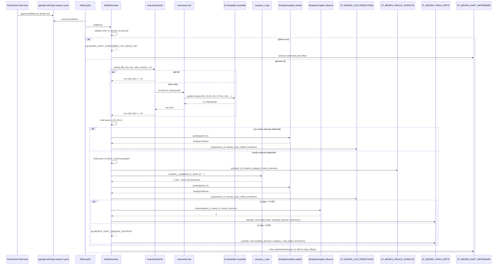
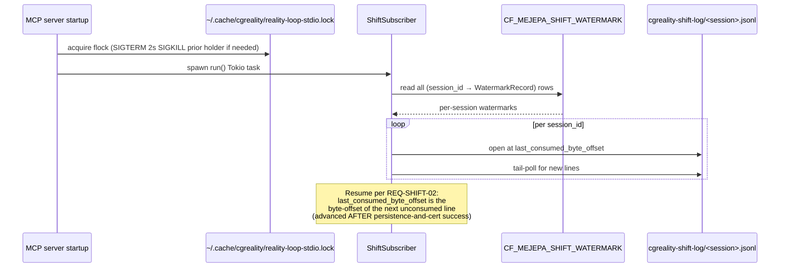
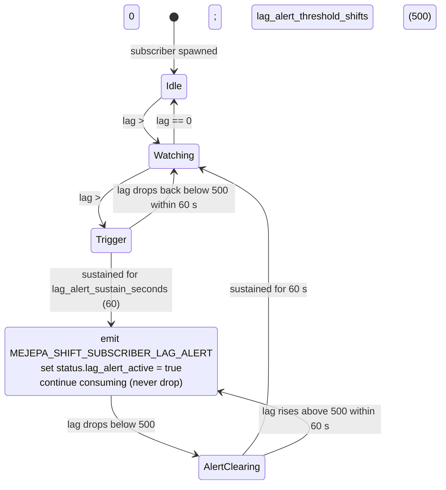

# TECH-SHIFT-SUBSCRIBER — ME-JEPA-Code Real-Time Reality-Shift → Online Observe Pipeline (Implementation)

> **📊 2026-05-10 STATUS:** PARTIAL — see ../implementation-plan.md for the full Phase 7 status.

> **Level 3 — Technical Specification.** Implements `SPEC-SHIFT-SUBSCRIBER.md`. Defines HOW the shift-subscriber domain (Phase 7) is built. Conflicts with constitution / functional spec resolve to those.

```xml
<technical_spec id="TECH-SHIFT-SUBSCRIBER" version="1.0" implements="SPEC-SHIFT-SUBSCRIBER">

<metadata>
  <title>ME-JEPA-Code Shift-Log Subscriber + Phase 7 MCP Tool Surface — Implementation</title>
  <status>draft</status>
  <owner>Phase 7 ME-JEPA implementation team</owner>
  <last_updated>2026-05-09</last_updated>
  <related_specs>
    <spec_ref>SPEC-SHIFT-SUBSCRIBER</spec_ref>
    <spec_ref>SPEC-INSTRUMENTS</spec_ref>
    <spec_ref>TECH-INSTRUMENTS</spec_ref>
    <spec_ref>SPEC-AST-CHUNKING</spec_ref>
    <spec_ref>TECH-AST-CHUNKING</spec_ref>
    <spec_ref>SPEC-EMBEDDERS</spec_ref>
    <spec_ref>TECH-EMBEDDERS</spec_ref>
    <spec_ref>SPEC-PREDICTOR</spec_ref>
    <spec_ref>TECH-PREDICTOR</spec_ref>
    <spec_ref>SPEC-INFERENCE</spec_ref>
    <spec_ref>TECH-INFERENCE</spec_ref>
    <spec_ref>SPEC-SELF-HEALING</spec_ref>
    <spec_ref>SPEC-TRAINING</spec_ref>
    <spec_ref>TECH-TRAINING</spec_ref>
    <spec_ref>SPEC-WITNESS</spec_ref>
    <spec_ref>SPEC-UTML</spec_ref>
    <spec_ref>SPEC-HYGIENE</spec_ref>
    <spec_ref>SPEC-CORPUS</spec_ref>
    <spec_ref>SPEC-TCT</spec_ref>
  </related_specs>
</metadata>

<architecture_diagram>

```mermaid
graph TB
    subgraph Producer ["Shift-log producer (read-only authority)"]
        Hook[("PostToolUse Edit hook<br/>scripts/cc/hook_post_tool_use_edit.sh")]
        Jsonl[("/tmp/contextgraph-rust-reality-loop/<br/>cgreality-shift-log/<br/>&lt;session_id&gt;.jsonl")]
        WChain[("witness chain<br/>SHAKE-256 73-byte segments")]
        Hook -->|append| Jsonl
        Hook -->|append| WChain
    end

    subgraph SubCrate ["context-graph-mejepa-shift-subscriber crate"]
        Tail[("ShiftLogTail<br/>tokio::fs::File +<br/>BufReader, line-buffered")]
        Parser[("serde_json::from_str<br/>-> ShiftEntry")]
        Sup[("Supervisor<br/>tokio::task::JoinSet<br/>1 task, max_concurrent_shifts=1")]
        Proc[("ShiftSubscriber::process_shift")]
        ICache[("InstrumentCache<br/>RwLock&lt;LruCache&lt;<br/>SlotKey, Arc&lt;Vec&lt;f32&gt;&gt;&gt;&gt;<br/>cap=4_096; budget=4 GB")]
        PB1[("PanelBuilder t=1<br/>15 slots × 5,120-d")]
        PB2[("PanelBuilder t=2<br/>+ E_Oracle populated")]
        WMW[("WatermarkWriter<br/>per-session row in<br/>CF_MEJEPA_SHIFT_WATERMARK")]
        Metrics[("Metrics<br/>atomic counters:<br/>lag, hit_rate, errors")]
    end

    subgraph MeJepa ["context-graph-mejepa crate (cross-cutting)"]
        Pred[("MeJepaCompiler::predict<br/>(SPEC-INFERENCE)")]
        Verify[("MeJepaCompiler::verify<br/>(SPEC-INFERENCE)")]
        Obs[("MeJepaCompiler::observe<br/>(SPEC-SELF-HEALING)")]
        UTML[("compute_l_step<br/>(SPEC-UTML)")]
    end

    subgraph CFs ["RocksDB column families"]
        WCF[("CF_MEJEPA_SHIFT_WATERMARK")]
        LP[("CF_MEJEPA_LIVE_PREDICTIONS<br/>(session_id,offset)→Pred")]
        OV[("CF_MEJEPA_ORACLE_VERDICTS<br/>(task_id,mut_cat)→Outcome")]
        TC[("CF_MEJEPA_TRAIN_CERTS<br/>step→Cert")]
        Panels[("CF_MEJEPA_PANELS")]
    end

    subgraph MCP ["MCP tool surface (mcp__cgreality__mejepa_*)"]
        T1[mejepa_predict_latest]
        T2[mejepa_observe_shift]
        T3[mejepa_subscriber_status]
        T4[mejepa_capture_audit]
        T5[mejepa_verify]
    end

    subgraph Retired ["Retired surfaces (CCREALITY_ENGINE_RETIRED)"]
        R1[reality_run_attempt]
        R2[reality_alter_*]
    end

    Jsonl --> Tail
    Tail --> Parser --> Sup --> Proc
    Proc --> ICache
    Proc --> PB1
    Proc --> PB2
    PB1 --> Pred
    PB2 --> UTML
    UTML -->|L_step >= 0.05| Obs
    UTML -.L_step < 0.05 dropped.-> TC
    Pred --> LP
    PB2 --> OV
    Obs --> TC
    Obs --> Panels
    Proc --> WMW --> WCF
    Proc --> Metrics
    WChain --> PB1
    WChain --> PB2

    T1 --> LP
    T2 --> Proc
    T3 --> Metrics
    T3 --> WCF
    T4 --> LP
    T4 --> OV
    T4 --> TC
    T4 --> Panels
    T5 --> Verify
    Verify --> Pred

    R1 -.fail-closed.-> EngineRetired[CCREALITY_ENGINE_RETIRED]
    R2 -.fail-closed.-> EngineRetired

    classDef shipped fill:#9f6,stroke:#363,color:#000
    classDef pending fill:#fc6,stroke:#a83,color:#000
    classDef retired fill:#f99,stroke:#900,color:#000
    classDef cf fill:#9cf,stroke:#347,color:#000

    class Hook,Jsonl,WChain shipped
    class Tail,Parser,Sup,Proc,ICache,PB1,PB2,WMW,Metrics,T1,T2,T3,T4,T5 pending
    class R1,R2,EngineRetired retired
    class WCF,LP,OV,TC,Panels cf
```

</architecture_diagram>

<process_shift_sequence_diagram>



</process_shift_sequence_diagram>

<restart_recovery_diagram>



</restart_recovery_diagram>

<lag_alert_state_machine>



</lag_alert_state_machine>

<data_models>

  <model name="ShiftSubscriber">
    <field name="tail" type="ShiftLogTail" constraints="owns the per-session BufReader pool"/>
    <field name="instrument_cache" type="Arc&lt;InstrumentCache&gt;" constraints="LruCache(SlotKey -&gt; Arc&lt;Vec&lt;f32&gt;&gt;); cap=4_096; RAM budget 4 GB"/>
    <field name="watermark_writer" type="WatermarkWriter" constraints="per-session rows in CF_MEJEPA_SHIFT_WATERMARK"/>
    <field name="mejepa_handle" type="Arc&lt;MeJepaCompiler&gt;" constraints="cross-cutting with SPEC-INFERENCE/SPEC-PREDICTOR; predict()/verify() &amp;self, observe() &amp;mut self gated through dedicated mutex"/>
    <field name="utml_factor_engine" type="Arc&lt;UtmlFactorEngine&gt;" constraints="cross-cutting with SPEC-UTML; computes L_step + ΔP/ΔK/ΔΩ/ΔΞ"/>
    <field name="train_cert_writer" type="Arc&lt;TrainCertWriter&gt;" constraints="cross-cutting with SPEC-TRAINING; one cert per shift"/>
    <field name="oracle_writer" type="Arc&lt;OracleVerdictWriter&gt;" constraints="cross-cutting with SPEC-CORPUS; corpus_entry_added increment"/>
    <field name="storage" type="Arc&lt;RocksDbStore&gt;" constraints="opens CF_MEJEPA_SHIFT_WATERMARK, CF_MEJEPA_LIVE_PREDICTIONS, CF_MEJEPA_ORACLE_VERDICTS, CF_MEJEPA_TRAIN_CERTS, CF_MEJEPA_PANELS"/>
    <field name="witness_chain" type="Arc&lt;WitnessChainReader&gt;" constraints="replay-only; SHAKE-256 73-byte segments"/>
    <field name="metrics" type="Arc&lt;SubscriberMetrics&gt;" constraints="atomic counters: lag, hit_rate, error_rate, dropped_l_step_count, rss_high_water"/>
    <field name="config" type="MeJepaShiftSubscriberConfig" constraints="validated at construction; out-of-bound knobs fail-closed"/>
    <field name="supervisor" type="JoinSetSupervisor" constraints="captures panics; sets task_alive_since=None on death"/>
    <description>Top-level subscriber actor. Single Tokio task. All Arc-wrapped components shared with MCP tool handlers. Per REQ-SHIFT-01.</description>
  </model>

  <model name="MeJepaShiftSubscriberConfig">
    <field name="lag_alert_threshold_shifts" type="usize" constraints="default 500; range [100, 5_000]"/>
    <field name="lag_alert_sustain_seconds" type="u64" constraints="default 60; range [10, 300]"/>
    <field name="instrument_cache_capacity" type="usize" constraints="default 4_096; range [256, 16_384]"/>
    <field name="instrument_cache_ram_budget_bytes" type="u64" constraints="default 4 * 1024^3; range [256 * 1024^2, 8 * 1024^3]"/>
    <field name="l_step_observe_threshold" type="f32" constraints="default 0.05; range [0.01, 0.20]; cannot be set below 0.01 (would re-introduce uninformative-tuple training)"/>
    <field name="tail_poll_interval_ms" type="u64" constraints="default 100; range [10, 5_000]"/>
    <field name="max_concurrent_shifts" type="usize" constraints="default 1; range [1, 4]; locked at 1 in v1.0 per Q-SHIFT-04"/>
    <field name="rss_budget_bytes" type="u64" constraints="default 512 * 1024^2; range [128 * 1024^2, 2 * 1024^3]"/>
    <field name="audit_chunk_size_bytes" type="usize" constraints="default 1 * 1024^2; range [128 * 1024, 4 * 1024^2]"/>
    <field name="watermark_flush_every_n_shifts" type="usize" constraints="default 1 (flush every shift; no batching); range [1, 16]"/>
  </model>

  <model name="ShiftEntry">
    <field name="shift_id" type="ShiftId" constraints="ULID; matches existing producer schema"/>
    <field name="timestamp_unix_ns" type="u128"/>
    <field name="tool_name" type="String"/>
    <field name="tool_use_id" type="Option&lt;String&gt;"/>
    <field name="session_id" type="SessionId"/>
    <field name="subject" type="serde_json::Value"/>
    <field name="before" type="ShiftSide" constraints="parsed from raw `before: Value` per ShiftSide::try_from(Value)"/>
    <field name="after" type="ShiftSide"/>
    <field name="delta_summary" type="serde_json::Value"/>
    <field name="verification" type="serde_json::Value"/>
    <field name="harness_transition_path" type="Option&lt;PathBuf&gt;"/>
    <field name="byte_offset" type="u64" constraints="byte offset in JSONL where this entry started; populated by tail reader"/>
  </model>

  <model name="ShiftSide">
    <field name="path" type="PathBuf" constraints="canonicalized; no traversal"/>
    <field name="sha" type="[u8; 32]" constraints="SHA-256"/>
    <field name="line_count" type="u32"/>
    <field name="size_bytes" type="u64"/>
  </model>

  <model name="ShiftId">
    <field name="raw" type="String" constraints="bounded 23 chars; ASCII; format `01J<20 uppercase hex>`"/>
    <field name="cmp_method" type="fn" constraints="lexicographic Ord per ULID monotonicity"/>
  </model>

  <model name="SessionId">
    <field name="raw" type="String" constraints="bounded 64 chars; UTF-8; canonicalized at construction"/>
  </model>

  <model name="ShiftOutcome">
    <field name="shift_id" type="ShiftId"/>
    <field name="path" type="enum" constraints="PredictOnly | PredictAndObserve { l_step: f32 } | Skipped { reason: SkipReason }"/>
    <field name="panel_t1_sha" type="[u8; 32]"/>
    <field name="panel_t2_sha" type="Option&lt;[u8; 32]&gt;"/>
    <field name="prediction_persisted_at" type="i64"/>
    <field name="l_step" type="Option&lt;f32&gt;"/>
    <field name="observe_invoked" type="bool"/>
    <field name="cache_hits" type="usize"/>
    <field name="cache_misses" type="usize"/>
    <field name="latency_ms" type="u64"/>
    <field name="missing_slots" type="Vec&lt;InstrumentSlot&gt;"/>
  </model>

  <model name="SkipReason">
    <field name="variant" type="enum" constraints="LogParseFail { byte_offset: u64, parse_error: String } | InstrumentMissing { slots: Vec&lt;InstrumentSlot&gt; } | WitnessIntegrityViolation { offset: u64 } | LStepNan | RetiredSurfaceCalled"/>
  </model>

  <model name="WatermarkWriter">
    <field name="rocksdb" type="Arc&lt;DB&gt;"/>
    <field name="cf" type="ColumnFamilyHandle" constraints="CF_MEJEPA_SHIFT_WATERMARK"/>
    <field name="write_options" type="rocksdb::WriteOptions" constraints="sync=true on every write to ensure durability before watermark advance acknowledgment"/>
  </model>

  <model name="WatermarkRecord">
    <field name="session_id" type="SessionId"/>
    <field name="last_consumed_shift_id" type="ShiftId"/>
    <field name="last_consumed_byte_offset" type="u64"/>
    <field name="last_advanced_at_unix_seconds" type="i64"/>
    <field name="provenance_corpus_sha" type="[u8; 32]"/>
    <field name="provenance_code_version" type="String"/>
    <field name="serialization_method" type="fn" constraints="JSON via serde; key = `wm:<session_id>` UTF-8 bytes"/>
  </model>

  <model name="ShiftLogTail">
    <field name="root_dir" type="PathBuf" constraints="default `/tmp/contextgraph-rust-reality-loop/cgreality-shift-log/`; configurable for tests"/>
    <field name="readers" type="HashMap&lt;SessionId, BufReader&lt;tokio::fs::File&gt;&gt;" constraints="one reader per active session"/>
    <field name="poll_interval" type="Duration"/>
    <field name="rotation_detector" type="RotationDetector" constraints="watches file inode + size monotonicity"/>
  </model>

  <model name="InstrumentCache">
    <field name="lru" type="RwLock&lt;LruCache&lt;SlotKey, Arc&lt;Vec&lt;f32&gt;&gt;&gt;&gt;"/>
    <field name="capacity" type="AtomicUsize" constraints="hot-resizable within bounds"/>
    <field name="ram_budget_bytes" type="u64"/>
    <field name="ram_used_bytes" type="AtomicU64" constraints="updated on each insert/evict"/>
    <field name="hits" type="AtomicU64"/>
    <field name="misses" type="AtomicU64"/>
  </model>

  <model name="SlotKey">
    <field name="file_sha" type="[u8; 32]"/>
    <field name="slot_id" type="InstrumentSlot" constraints="enum from SPEC-INSTRUMENTS, 15 variants"/>
    <field name="code_version" type="String" constraints="`git describe --always --dirty`; captured at startup"/>
  </model>

  <model name="SubscriberMetrics">
    <field name="lag_total" type="AtomicU64"/>
    <field name="lag_per_session" type="DashMap&lt;SessionId, AtomicU64&gt;"/>
    <field name="lag_alert_state" type="LagAlertState" constraints="atomic state machine: Idle | Watching | Trigger { since: Instant } | AlertActive | AlertClearing { since: Instant }"/>
    <field name="error_rate_window" type="RwLock&lt;CircularBuffer&lt;ErrorEvent, 1000&gt;&gt;"/>
    <field name="dropped_l_step_count" type="AtomicU64"/>
    <field name="rss_high_water" type="AtomicU64"/>
    <field name="task_alive_since" type="RwLock&lt;Option&lt;i64&gt;&gt;"/>
    <field name="last_panic" type="RwLock&lt;Option&lt;PanicInfo&gt;&gt;"/>
  </model>

  <model name="SubscriberError">
    <field name="variant" type="enum" constraints="LagAlert { lag: u64, sustain_seconds: u64 } | LogParseFail { session_id: SessionId, byte_offset: u64, line_preview: String, parse_error: String } | InstrumentCacheOverflow { requested_bytes: u64, current_bytes: u64, capacity_bytes: u64 } | WatermarkBackwards { persisted: ShiftId, observed: ShiftId, session_id: SessionId } | ObserveBatchNan { shift_id: ShiftId, factors: UtmlFactorBundle } | ObserveIntegrityViolation { shift_id: ShiftId, witness_chain_offset: u64, expected_hash: [u8; 32], observed_hash: [u8; 32] } | EngineRetired { tool_name: String } | RocksDbWriteFailed { cf: String, key: Vec&lt;u8&gt;, retry: u8 } | ConfigOutOfBounds { knob: String, value: String }"/>
    <field name="code_method" type="fn" constraints=".code() returns SCREAMING_SNAKE per `<failure_taxonomy>`: MEJEPA_SHIFT_SUBSCRIBER_LAG_ALERT, MEJEPA_SHIFT_SUBSCRIBER_LOG_PARSE_FAIL, MEJEPA_SHIFT_SUBSCRIBER_INSTRUMENT_CACHE_OVERFLOW, MEJEPA_SHIFT_SUBSCRIBER_WATERMARK_BACKWARDS, MEJEPA_OBSERVE_BATCH_NAN, MEJEPA_OBSERVE_INTEGRITY_VIOLATION, CCREALITY_ENGINE_RETIRED"/>
  </model>

  <model name="UtmlFactorBundle">
    <field name="delta_p" type="f32" constraints="finite; clamped [0,1]"/>
    <field name="delta_k" type="f32" constraints="finite; clamped [0,1]"/>
    <field name="delta_omega" type="f32" constraints="finite; clamped [0,1]"/>
    <field name="delta_xi" type="f32" constraints="finite; clamped [0,1]"/>
    <field name="l_step" type="f32" constraints="product; finite"/>
    <description>Owned by SPEC-UTML; carried verbatim through this domain.</description>
  </model>

  <model name="CaptureAuditBundle">
    <field name="attempt_id" type="String"/>
    <field name="attempt_found" type="bool"/>
    <field name="panels" type="HashMap&lt;TimeStep, PanelSnapshot&gt;"/>
    <field name="missing_slots" type="Vec&lt;InstrumentSlot&gt;"/>
    <field name="aux_head_predictions" type="HashMap&lt;AuxHeadId, AuxHeadPrediction&gt;"/>
    <field name="reality_prediction" type="Option&lt;RealityPrediction&gt;"/>
    <field name="verify_verdict" type="Option&lt;VerifyVerdict&gt;"/>
    <field name="oracle_outcome" type="Option&lt;OracleOutcome&gt;"/>
    <field name="l_step" type="Option&lt;f32&gt;"/>
    <field name="utml_factors" type="Option&lt;UtmlFactorBundle&gt;"/>
    <field name="counterfactual_perturbations" type="Vec&lt;CounterfactualResult&gt;" constraints="cross-cutting with SPEC-PREDICTOR"/>
    <field name="bracketing_witness_offsets" type="(u64, u64)"/>
    <field name="cache_hit_flags" type="HashMap&lt;InstrumentSlot, bool&gt;"/>
    <field name="panel_shas" type="HashMap&lt;TimeStep, [u8; 32]&gt;"/>
    <field name="embedder_versions" type="HashMap&lt;EmbedderId, String&gt;"/>
    <field name="nearest_neighbors" type="Vec&lt;String&gt;" constraints="when attempt_found=false; 5 nearest by witness_chain_offset"/>
  </model>

  <model name="LiveSubscriberStatus">
    <field name="last_watermark_per_session" type="HashMap&lt;SessionId, ShiftId&gt;"/>
    <field name="lag" type="u64"/>
    <field name="lag_alert_active" type="bool"/>
    <field name="error_rate_per_1000" type="f32" constraints="finite; [0,1]"/>
    <field name="instrument_cache_hit_rate" type="f32" constraints="finite; [0,1]"/>
    <field name="instrument_cache_capacity" type="usize"/>
    <field name="instrument_cache_entries" type="usize"/>
    <field name="rss_bytes" type="u64"/>
    <field name="task_alive_since" type="Option&lt;i64&gt;"/>
    <field name="dropped_l_step_below_threshold_count" type="u64"/>
    <field name="last_panic" type="Option&lt;PanicInfo&gt;"/>
  </model>

  <model name="PanicInfo">
    <field name="message" type="String"/>
    <field name="backtrace" type="String"/>
    <field name="captured_at_unix_seconds" type="i64"/>
    <field name="last_in_flight_shift" type="Option&lt;ShiftId&gt;"/>
  </model>

</data_models>

<api_contracts>

  <endpoint path="mcp__cgreality__mejepa_predict_latest" method="MCP_TOOL">
    <implements>REQ-SHIFT-07, REQ-SHIFT-05</implements>
    <request_body>
      session_id: string (required)
      limit: u32 (optional, default 1, max 100)
    </request_body>
    <responses>
      success: { predictions: [{ session_id, witness_chain_offset, last_consumed_shift_id, prediction: RealityPrediction, persisted_at_unix_seconds }], session_known: bool }
      error: { error_code: "MEJEPA_SHIFT_SUBSCRIBER_*", message: string, payload: {...} }
    </responses>
    <schema_constraints>
      additionalProperties: false on all object schemas
      session_id length ≤ 64 chars
      limit clamped to 100
    </schema_constraints>
    <handler_path>crates/context-graph-mcp/src/handlers/tools/mejepa/predict_latest.rs</handler_path>
  </endpoint>

  <endpoint path="mcp__cgreality__mejepa_observe_shift" method="MCP_TOOL">
    <implements>REQ-SHIFT-07, REQ-SHIFT-11</implements>
    <request_body>
      shift_id: string (required, ULID format)
    </request_body>
    <responses>
      success: { shift_found: bool, replay_outcome: ShiftOutcome | null }
      error: { error_code: "MEJEPA_SHIFT_SUBSCRIBER_*", ... }
    </responses>
    <schema_constraints>
      additionalProperties: false
      shift_id matches `^01J[0-9A-F]{20}$`
    </schema_constraints>
    <handler_path>crates/context-graph-mcp/src/handlers/tools/mejepa/observe_shift.rs</handler_path>
  </endpoint>

  <endpoint path="mcp__cgreality__mejepa_subscriber_status" method="MCP_TOOL">
    <implements>REQ-SHIFT-07, REQ-SHIFT-12</implements>
    <request_body>
      (no parameters)
    </request_body>
    <responses>
      success: LiveSubscriberStatus
    </responses>
    <schema_constraints>
      additionalProperties: false (rejects unknown extras)
    </schema_constraints>
    <handler_path>crates/context-graph-mcp/src/handlers/tools/mejepa/subscriber_status.rs</handler_path>
  </endpoint>

  <endpoint path="mcp__cgreality__mejepa_capture_audit" method="MCP_TOOL">
    <implements>REQ-SHIFT-07, REQ-SHIFT-10</implements>
    <request_body>
      attempt_id: string (required)
      page: u32 (optional, default 0; for chunked responses on bundles &gt; audit_chunk_size_bytes)
    </request_body>
    <responses>
      success: { bundle: CaptureAuditBundle, total_pages: u32, current_page: u32 }
      error: { error_code: "...", ... }
    </responses>
    <schema_constraints>
      additionalProperties: false
      attempt_id length ≤ 128 chars; UTF-8 sanitized
    </schema_constraints>
    <handler_path>crates/context-graph-mcp/src/handlers/tools/mejepa/capture_audit.rs</handler_path>
  </endpoint>

  <endpoint path="mcp__cgreality__mejepa_verify" method="MCP_TOOL">
    <implements>REQ-SHIFT-07, SPEC-INFERENCE REQ-INFER-16 (cross-cutting)</implements>
    <request_body>
      patch: PatchBundle (required; per SPEC-INFERENCE schema)
      context: TaskContext (required)
      include_provenance: bool (optional, default false)
    </request_body>
    <responses>
      success: VerifyVerdict + Option&lt;ProvenanceBundle&gt; + { last_consumed_shift_id, subscriber_lag_at_call_time }
      error: { error_code: "MEJEPA_INFER_*" or "MEJEPA_SHIFT_SUBSCRIBER_*", ... }
    </responses>
    <schema_constraints>
      additionalProperties: false
      path canonicalization at boundary (rejects `../`, control chars per SEC-MEJEPA-01)
      problem_statement length ≤ 64 KiB
    </schema_constraints>
    <handler_path>crates/context-graph-mcp/src/handlers/tools/mejepa/verify.rs (this domain wires the MCP shim; the seven-gate body is owned by TECH-INFERENCE)</handler_path>
  </endpoint>

  <endpoint path="mcp__cgreality__reality_run_attempt" method="MCP_TOOL">
    <implements>REQ-SHIFT-13 (fail-closed retired surface)</implements>
    <request_body>
      (any payload)
    </request_body>
    <responses>
      error: { error_code: "CCREALITY_ENGINE_RETIRED", message: "tool retired in 2026-05-09 ME-JEPA pivot; use mcp__cgreality__mejepa_*" }
    </responses>
    <handler_path>crates/context-graph-mcp/src/handlers/tools/reality_loop/retired.rs (existing fail-closed shim; this spec adds NO new behaviour)</handler_path>
  </endpoint>

  <cli path="cargo run --release -p context-graph-mejepa -- verify" method="CLI">
    <implements>REQ-SHIFT-15 (Phase 7 DoD)</implements>
    <request_body>
      --task: SWE-bench task id (required, e.g. astropy__astropy-12907)
      --patch: path to candidate patch (required)
      --output-fsv: path (default /tmp/contextgraph-mejepa-shift-subscriber-fsv/)
    </request_body>
    <responses>
      stdout JSON: { panel_materialization_ms, me_jepa_verify_verdict, me_jepa_predicts_match_oracle, corpus_entry_added, total_corpus_size }
      exit: 0 on all metrics within bounds; non-zero with structured error otherwise
    </responses>
  </cli>

</api_contracts>

<component_contracts>

  <component name="ShiftSubscriber" path="crates/context-graph-mejepa-shift-subscriber/src/lib.rs">

    <method name="new">
      <signature>pub fn new(tail: ShiftLogTail, instrument_cache: Arc&lt;InstrumentCache&gt;, watermark_writer: WatermarkWriter, mejepa_handle: Arc&lt;MeJepaCompiler&gt;, utml_factor_engine: Arc&lt;UtmlFactorEngine&gt;, train_cert_writer: Arc&lt;TrainCertWriter&gt;, oracle_writer: Arc&lt;OracleVerdictWriter&gt;, storage: Arc&lt;RocksDbStore&gt;, witness_chain: Arc&lt;WitnessChainReader&gt;, metrics: Arc&lt;SubscriberMetrics&gt;, config: MeJepaShiftSubscriberConfig) -&gt; Result&lt;Self, SubscriberError&gt;</signature>
      <implements>REQ-SHIFT-01, REQ-SHIFT-17</implements>
      <behavior>
        1. Validate config knobs against bounds; on out-of-bound, return `SubscriberError::ConfigOutOfBounds` per REQ-SHIFT-17
        2. Verify all required CFs exist on `storage` (CF_MEJEPA_SHIFT_WATERMARK, CF_MEJEPA_LIVE_PREDICTIONS, CF_MEJEPA_ORACLE_VERDICTS, CF_MEJEPA_TRAIN_CERTS, CF_MEJEPA_PANELS); fail-closed if any missing
        3. Hydrate `metrics.task_alive_since` to None (will be populated when run() starts)
        4. Capture `code_version` via `git describe --always --dirty` for SlotKey + provenance
        5. Construct InstrumentCache with capacity from config; budget recorded
      </behavior>
      <throws>SubscriberError::ConfigOutOfBounds, SubscriberError::RocksDbWriteFailed (CF missing surfaced as such)</throws>
    </method>

    <method name="run">
      <signature>pub async fn run(mut self) -&gt; Result&lt;(), SubscriberError&gt;</signature>
      <implements>REQ-SHIFT-01, REQ-SHIFT-02, REQ-SHIFT-03</implements>
      <behavior>
        1. Set `metrics.task_alive_since = Some(now())`
        2. Hydrate per-session resume points from CF_MEJEPA_SHIFT_WATERMARK; for each session open the JSONL at `last_consumed_byte_offset`
        3. Enter the main loop:
           a. Poll all session readers for new lines (deadline `tail_poll_interval_ms`)
           b. For each parsed `ShiftEntry`, await `self.process_shift(entry).await`
           c. After process_shift returns Ok or skip, advance the watermark via `self.watermark_writer.write_watermark(record)?`
           d. Update `metrics.lag_*` by recomputing per-session lag
           e. Run `self.evaluate_lag_alert_state()` (state machine in lag_alert_state_machine diagram)
           f. On `tokio::select!` shutdown signal, drain in-flight, set `task_alive_since = None`, return Ok
        4. On panic inside spawn_blocking instrument forward, supervisor catches it, populates `last_panic`, then `respawn_or_die` is decided by retry count per EC-SHIFT-10
      </behavior>
      <throws>SubscriberError</throws>
    </method>

    <method name="process_shift">
      <signature>pub async fn process_shift(&amp;mut self, shift: ShiftEntry) -&gt; Result&lt;ShiftOutcome, SubscriberError&gt;</signature>
      <implements>REQ-SHIFT-04, REQ-SHIFT-05, REQ-SHIFT-06, REQ-SHIFT-09</implements>
      <behavior>
        1. Start `Instant::now()` for latency measurement
        2. Validate watermark monotonicity: read prior watermark for session; reject `MEJEPA_SHIFT_SUBSCRIBER_WATERMARK_BACKWARDS` if shift_id &lt;= prior
        3. Build `panel_t1` via 15 calls to `self.materialize_slot(shift.after.sha, slot, &amp;shift).await?`
           - each call hits InstrumentCache; on miss, dispatches to Instrument trait via `tokio::task::spawn_blocking` for AST + embedder forward
           - missing-instrument errors → record in `missing_slots` per BR-SHIFT-06; do NOT zero-pad
        4. Branch on whether the shift carries an oracle outcome (resolved by parsing `shift.subject` for a `validation.json` delta):
           a. NO oracle outcome → call `self.mejepa_handle.predict(&amp;panel_t1)?`; persist to CF_MEJEPA_LIVE_PREDICTIONS keyed by `(session_id, witness_chain_offset)`
           b. YES oracle outcome →
              i. Parse OracleOutcome from `validation.json` artifact
              ii. Build `panel_t2` via materialize_slot for E_Oracle slot specifically (cross-cutting with SPEC-INSTRUMENTS)
              iii. Persist OracleOutcome to CF_MEJEPA_ORACLE_VERDICTS keyed by `(task_id, mutation_category)` (corpus_entry_added increments via SPEC-CORPUS writer)
              iv. Compute `utml = self.utml_factor_engine.compute_l_step(&amp;panel_t1, &amp;panel_t2, &amp;oracle_outcome)?`
              v. Persist prediction (via mejepa_handle.predict) to CF_MEJEPA_LIVE_PREDICTIONS — REGARDLESS of L_step gate per BR-SHIFT-04
              vi. If `utml.l_step >= config.l_step_observe_threshold` → call `self.mejepa_handle.observe(&amp;panel_t1, &amp;panel_t2, &amp;oracle_outcome)?`; write per-step training cert with `sampling_decision: observed`
              vii. Else → emit `MEJEPA_SHIFT_OBSERVE_DROPPED` (debug log; informational); write per-step training cert with `sampling_decision: dropped_l_step_below_threshold`; increment `metrics.dropped_l_step_count`
        5. Construct ShiftOutcome with cache hit/miss counts + missing_slots + latency_ms
        6. Caller (`run()`) advances watermark only after process_shift returns Ok; on Err, watermark stays put per BR-SHIFT-02 (retry on next poll)
      </behavior>
      <throws>SubscriberError::WatermarkBackwards, SubscriberError::ObserveBatchNan (NaN in L_step), SubscriberError::ObserveIntegrityViolation (witness replay broken), SubscriberError::RocksDbWriteFailed</throws>
    </method>

    <method name="materialize_slot">
      <signature>async fn materialize_slot(&amp;self, file_sha: [u8; 32], slot: InstrumentSlot, shift: &amp;ShiftEntry) -&gt; Result&lt;Arc&lt;Vec&lt;f32&gt;&gt;, SubscriberError&gt;</signature>
      <implements>REQ-SHIFT-04, REQ-SHIFT-08</implements>
      <behavior>
        1. Construct SlotKey { file_sha, slot, code_version: self.code_version.clone() }
        2. Cache hit → bump `metrics.hits`; return `Arc<Vec<f32>>`
        3. Cache miss → bump `metrics.misses`; read source bytes from `shift.after.path`; verify on-disk SHA matches `file_sha` (else surface `MEJEPA_INFER_SOURCE_SHA_DRIFT` per cross-cutting with SPEC-INFERENCE)
        4. Dispatch to the slot's Instrument::encode via `tokio::task::spawn_blocking` (AST parsing is CPU-bound and would block the runtime)
        5. On instrument missing (e.g., pyright not on PATH for E_TypeGraph) → return `MEJEPA_INFER_INSTRUMENT_MISSING` per BR-SHIFT-06; caller records in `missing_slots` and continues
        6. On success, insert into cache; if RAM budget exceeded, LRU evict; if eviction cannot free enough → `MEJEPA_SHIFT_SUBSCRIBER_INSTRUMENT_CACHE_OVERFLOW` per ERR-SHIFT-03
      </behavior>
      <throws>SubscriberError::InstrumentCacheOverflow, MeJepaInferError::InstrumentMissing (wrapped), MeJepaInferError::SourceShaDrift (wrapped)</throws>
    </method>

    <method name="evaluate_lag_alert_state">
      <signature>fn evaluate_lag_alert_state(&amp;mut self)</signature>
      <implements>REQ-SHIFT-03</implements>
      <behavior>State machine per lag_alert_state_machine diagram. Atomic transitions; never blocks the main loop; emits `MEJEPA_SHIFT_SUBSCRIBER_LAG_ALERT` exactly once per Idle→AlertActive transition (no log spam).</behavior>
    </method>

  </component>

  <component name="WatermarkWriter" path="crates/context-graph-mejepa-shift-subscriber/src/watermark.rs">

    <method name="new">
      <signature>pub fn new(rocksdb: Arc&lt;DB&gt;, cf: ColumnFamilyHandle) -&gt; Self</signature>
      <implements>REQ-SHIFT-02</implements>
    </method>

    <method name="write_watermark">
      <signature>pub fn write_watermark(&amp;self, record: WatermarkRecord) -&gt; Result&lt;(), WatermarkError&gt;</signature>
      <implements>REQ-SHIFT-02</implements>
      <behavior>
        1. Validate monotonicity: read existing record at `key = b"wm:{session_id}"`; if persisted shift_id &gt; record.shift_id, return `WatermarkError::Backwards`
        2. Serialize WatermarkRecord to JSON
        3. Put with `WriteOptions { sync: true }` so the write is durable before this returns
        4. Return Ok
      </behavior>
      <throws>WatermarkError::Backwards, WatermarkError::RocksDb</throws>
    </method>

    <method name="read_watermark">
      <signature>pub fn read_watermark(&amp;self, session_id: &amp;SessionId) -&gt; Result&lt;Option&lt;WatermarkRecord&gt;, WatermarkError&gt;</signature>
      <implements>REQ-SHIFT-02</implements>
      <behavior>Point read on `b"wm:{session_id}"`; deserialize JSON. None if missing (fresh session).</behavior>
    </method>

    <method name="read_all_watermarks">
      <signature>pub fn read_all_watermarks(&amp;self) -&gt; Result&lt;Vec&lt;WatermarkRecord&gt;, WatermarkError&gt;</signature>
      <implements>REQ-SHIFT-02 (run() startup hydration)</implements>
      <behavior>Iterate CF with prefix `b"wm:"`; deserialize each value.</behavior>
    </method>

  </component>

  <component name="ShiftLogTail" path="crates/context-graph-mejepa-shift-subscriber/src/tail.rs">

    <method name="new">
      <signature>pub fn new(root_dir: PathBuf, poll_interval: Duration) -&gt; Self</signature>
      <implements>REQ-SHIFT-01</implements>
    </method>

    <method name="open_or_create_reader">
      <signature>pub async fn open_or_create_reader(&amp;mut self, session_id: &amp;SessionId, start_byte_offset: u64) -&gt; Result&lt;(), SubscriberError&gt;</signature>
      <implements>REQ-SHIFT-02</implements>
      <behavior>
        1. Resolve path `{root_dir}/{session_id}.jsonl`
        2. Open with `tokio::fs::OpenOptions::new().read(true).open(&amp;path).await?`
        3. Seek to `start_byte_offset`
        4. Wrap in `BufReader`; insert into `self.readers`
        5. Capture inode for rotation detection (EC-SHIFT-01)
      </behavior>
    </method>

    <method name="poll_next_line">
      <signature>pub async fn poll_next_line(&amp;mut self, session_id: &amp;SessionId) -&gt; Result&lt;Option&lt;(String, u64)&gt;, SubscriberError&gt;</signature>
      <implements>REQ-SHIFT-01, EC-SHIFT-01, EC-SHIFT-02</implements>
      <behavior>
        1. `read_line` on the reader with timeout `poll_interval`
        2. Empty result → check rotation (inode/size compare); on rotation, reopen at offset 0 and retry once
        3. Half-written line (no `\n`) → return None; caller retries on next poll
        4. Returns `Some((line, byte_offset_of_start))` so caller can record `byte_offset` in WatermarkRecord
      </behavior>
    </method>

    <method name="poll_all">
      <signature>pub async fn poll_all(&amp;mut self) -&gt; Vec&lt;(SessionId, ShiftEntry)&gt;</signature>
      <implements>REQ-SHIFT-01</implements>
      <behavior>Round-robin poll across active sessions; parse via `serde_json::from_str`; on parse failure record `SubscriberError::LogParseFail` (caller advances watermark past offset per AC-SHIFT-01-04).</behavior>
    </method>

    <method name="discover_sessions">
      <signature>pub async fn discover_sessions(&amp;self) -&gt; Result&lt;Vec&lt;SessionId&gt;, SubscriberError&gt;</signature>
      <implements>REQ-SHIFT-01</implements>
      <behavior>Read directory; filter `*.jsonl`; canonicalize paths; reject filenames with control characters per SEC-MEJEPA-01.</behavior>
    </method>

  </component>

  <component name="InstrumentCache" path="crates/context-graph-mejepa-shift-subscriber/src/cache.rs">

    <method name="new">
      <signature>pub fn new(capacity: usize, ram_budget_bytes: u64) -&gt; Self</signature>
      <implements>REQ-SHIFT-08, NFR-SHIFT-08</implements>
    </method>

    <method name="get_or_insert_with">
      <signature>pub fn get_or_insert_with&lt;F&gt;(&amp;self, key: SlotKey, compute: F) -&gt; Result&lt;Arc&lt;Vec&lt;f32&gt;&gt;, SubscriberError&gt; where F: FnOnce() -&gt; Result&lt;Vec&lt;f32&gt;, SubscriberError&gt;</signature>
      <implements>REQ-SHIFT-04, REQ-SHIFT-08</implements>
      <behavior>
        1. Read lock; check LRU; on hit, bump hits, return Arc::clone
        2. Drop read lock; compute() outside the lock to avoid blocking other readers
        3. Take write lock; recheck (someone else may have inserted); insert if still missing
        4. If new size exceeds ram_budget_bytes, pop LRU until under budget; if cannot satisfy → `MEJEPA_SHIFT_SUBSCRIBER_INSTRUMENT_CACHE_OVERFLOW`
      </behavior>
    </method>

    <method name="hit_rate">
      <signature>pub fn hit_rate(&amp;self) -&gt; f32</signature>
      <implements>REQ-SHIFT-12</implements>
    </method>

    <method name="entries">
      <signature>pub fn entries(&amp;self) -&gt; usize</signature>
    </method>

    <method name="resize">
      <signature>pub fn resize(&amp;self, new_capacity: usize) -&gt; Result&lt;(), SubscriberError&gt;</signature>
      <behavior>Hot-resize within bounds [256, 16_384]; SPEC-HYGIENE may invoke this.</behavior>
    </method>

  </component>

  <component name="MejepaPredictLatestHandler" path="crates/context-graph-mcp/src/handlers/tools/mejepa/predict_latest.rs">

    <method name="handle">
      <signature>pub async fn handle(&amp;self, args: Value) -&gt; Result&lt;Value, McpError&gt;</signature>
      <implements>REQ-SHIFT-07</implements>
      <behavior>
        1. Parse args via `MejepaPredictLatestArgs::try_from(args)`; reject extras (`additionalProperties: false`)
        2. RocksDB prefix scan on CF_MEJEPA_LIVE_PREDICTIONS with prefix `b"sess:{session_id}:"`
        3. Take last `limit` rows (witness_chain_offset DESC)
        4. If empty → respond `{ predictions: [], session_known: false }` (NEVER an error per EC-SHIFT-11)
        5. Deserialize each row's RealityPrediction; package response
      </behavior>
    </method>

  </component>

  <component name="MejepaObserveShiftHandler" path="crates/context-graph-mcp/src/handlers/tools/mejepa/observe_shift.rs">

    <method name="handle">
      <signature>pub async fn handle(&amp;self, args: Value) -&gt; Result&lt;Value, McpError&gt;</signature>
      <implements>REQ-SHIFT-07, REQ-SHIFT-11</implements>
      <behavior>
        1. Parse args; validate `shift_id` regex `^01J[0-9A-F]{20}$`
        2. Locate the shift via SubscriberIndex (in-memory shift_id → (session_id, byte_offset) map maintained as the subscriber consumes)
        3. If found → invoke `subscriber.process_shift(replayed_entry)` with `replay: true` flag; the watermark writer SHALL refuse to advance backward (REQ-SHIFT-11) so we use a `ReplayWatermarkPolicy::DoNotAdvance` variant
        4. The per-step training cert writer accepts `replay: true` and emits an audit cert
        5. Return `{ shift_found: true, replay_outcome: ShiftOutcome { ... } }`
        6. Not found → `{ shift_found: false, replay_outcome: null }` (NEVER errors per AC-SHIFT-06-02)
      </behavior>
    </method>

  </component>

  <component name="MejepaSubscriberStatusHandler" path="crates/context-graph-mcp/src/handlers/tools/mejepa/subscriber_status.rs">

    <method name="handle">
      <signature>pub async fn handle(&amp;self, args: Value) -&gt; Result&lt;Value, McpError&gt;</signature>
      <implements>REQ-SHIFT-07, REQ-SHIFT-12</implements>
      <behavior>
        1. Reject any args (additionalProperties: false; expected empty object)
        2. Snapshot atomics: lag_total, lag_alert_state, hits/misses → hit_rate, dropped_l_step_count, rss (via `procfs::process::Process::myself()?.statm()?.resident * page_size`), task_alive_since, last_panic
        3. Read CF_MEJEPA_SHIFT_WATERMARK to get per-session watermarks
        4. Package as `LiveSubscriberStatus`
      </behavior>
    </method>

  </component>

  <component name="MejepaCaptureAuditHandler" path="crates/context-graph-mcp/src/handlers/tools/mejepa/capture_audit.rs">

    <method name="handle">
      <signature>pub async fn handle(&amp;self, args: Value) -&gt; Result&lt;Value, McpError&gt;</signature>
      <implements>REQ-SHIFT-07, REQ-SHIFT-10</implements>
      <behavior>
        1. Parse `attempt_id` and optional `page`
        2. Lookup CF_MEJEPA_PANELS by `(attempt_id, time_step)` for t=0/1/2; CF_MEJEPA_LIVE_PREDICTIONS by `(session_id derived from attempt, witness_chain_offset)`; CF_MEJEPA_ORACLE_VERDICTS; CF_MEJEPA_TRAIN_CERTS for L_step + factor decomposition
        3. If no rows found → query nearest 5 by witness_chain_offset distance via secondary index; respond `attempt_found: false, nearest_neighbors: [...]`
        4. If found → assemble CaptureAuditBundle with EVERY field; missing slots surfaced explicitly (AC-SHIFT-05-03)
        5. If serialized JSON &gt; `audit_chunk_size_bytes`, paginate by panel slot; respond `total_pages` + `current_page` + slice
        6. Sort all keys deterministically; canonicalize floats via `ryu` for byte-stable diffs across replays
      </behavior>
    </method>

  </component>

  <component name="MejepaVerifyHandler" path="crates/context-graph-mcp/src/handlers/tools/mejepa/verify.rs">

    <method name="handle">
      <signature>pub async fn handle(&amp;self, args: Value) -&gt; Result&lt;Value, McpError&gt;</signature>
      <implements>REQ-SHIFT-07; cross-cutting with TECH-INFERENCE REQ-INFER-16</implements>
      <behavior>
        1. Parse PatchBundle + TaskContext + include_provenance per TECH-INFERENCE
        2. Path canonicalize at boundary per SEC-MEJEPA-01
        3. Dispatch to `self.mejepa_compiler.verify(&amp;patch, &amp;context)` (TECH-INFERENCE-owned body)
        4. Snapshot subscriber state: `last_consumed_shift_id` (from metrics), `subscriber_lag_at_call_time`
        5. Wrap response: `{ verdict: VerifyVerdict, provenance: Option<ProvenanceBundle>, subscriber_state: { last_consumed_shift_id, subscriber_lag } }`
      </behavior>
    </method>

  </component>

  <component name="RetiredSurfaceHandler" path="crates/context-graph-mcp/src/handlers/tools/reality_loop/retired.rs">

    <method name="reality_run_attempt">
      <signature>pub async fn reality_run_attempt(args: Value) -&gt; Result&lt;Value, McpError&gt;</signature>
      <implements>REQ-SHIFT-13</implements>
      <behavior>Return `McpError { code: "CCREALITY_ENGINE_RETIRED", message: "tool retired in 2026-05-09 ME-JEPA pivot; use mcp__cgreality__mejepa_*", payload: { attempted_tool: "reality_run_attempt" } }`. Do NOT spawn `target/release/reality-loop`. Do NOT alias to any new tool.</behavior>
    </method>

    <method name="reality_alter_*">
      <signature>(family of fail-closed shims for retired alter_* tools)</signature>
      <implements>REQ-SHIFT-13</implements>
      <behavior>Same fail-closed pattern.</behavior>
    </method>

  </component>

</component_contracts>

<rocksdb_schema>

  <column_family name="CF_MEJEPA_SHIFT_WATERMARK">
    <key_format>UTF-8 `wm:{session_id}`</key_format>
    <value_format>JSON-serialized `WatermarkRecord`</value_format>
    <write_options>sync=true on every advance (REQ-SHIFT-02)</write_options>
    <retention>Per SPEC-HYGIENE; recommend retain-all in v1.0 (Q-SHIFT-05); ~64 bytes per session × 100k sessions = 6.4 MB</retention>
    <provenance>Record carries `provenance_corpus_sha`, `provenance_code_version`</provenance>
  </column_family>

  <column_family name="CF_MEJEPA_LIVE_PREDICTIONS">
    <key_format>10-byte `(session_id_hash[6] || witness_chain_offset_be[8])` for prefix-scan; secondary index on `(attempt_id)` via SubscriberIndex</key_format>
    <value_format>JSON `RealityPrediction` per TECH-INFERENCE</value_format>
    <retention>Phase 6 hygiene tier-compresses past 30 days; rolling 1,000-attempt window must stay hot</retention>
  </column_family>

  <column_family name="CF_MEJEPA_ORACLE_VERDICTS">
    <key_format>UTF-8 `(task_id || ':' || mutation_category)`</key_format>
    <value_format>JSON `OracleOutcome` per SPEC-CORPUS</value_format>
    <retention>Gold tier; never tier-compressed</retention>
  </column_family>

  <column_family name="CF_MEJEPA_TRAIN_CERTS">
    <key_format>step number big-endian u64</key_format>
    <value_format>per SPEC-TRAINING; this domain WRITES one cert per shift via `train_cert_writer.write(cert)`; cert carries `replay: bool`, `sampling_decision: enum`</value_format>
    <retention>Per SPEC-HYGIENE</retention>
  </column_family>

  <column_family name="CF_MEJEPA_PANELS">
    <key_format>per SPEC-INSTRUMENTS</key_format>
    <value_format>tier-compressed panel; this domain READS for `mejepa_capture_audit`</value_format>
    <retention>Per SPEC-HYGIENE</retention>
  </column_family>

  <secondary_index name="SubscriberIndex">
    <description>In-memory `DashMap<ShiftId, (SessionId, ByteOffset, Option<AttemptId>)>` populated as the subscriber consumes; reconstructed on startup via tail-and-skim of the JSONL files plus cross-references in CF_MEJEPA_LIVE_PREDICTIONS. Used by `mejepa_observe_shift` (locate by ShiftId) and `mejepa_capture_audit` (locate by AttemptId).</description>
    <persistence>Not persisted to disk; rebuilt on startup. Bounded by RAM budget.</persistence>
  </secondary_index>

</rocksdb_schema>

<implementation_notes>

  <note category="concurrency">Subscriber is one Tokio task. AST parsing + embedder forward dispatched via `tokio::task::spawn_blocking` because they are CPU-bound and would block the runtime. `max_concurrent_shifts=1` (REQ-SHIFT-17) preserves observe() ordering for EWC++ correctness per Q-SHIFT-04.</note>

  <note category="durability">`WriteOptions { sync: true }` on every watermark write. Per-shift latency budget (5 s p50) easily absorbs the fsync cost (typical ~2 ms on NVMe). NEVER batch watermark writes — a batched watermark would advance past shifts whose persistence is still in flight, violating REQ-SHIFT-02.</note>

  <note category="ordering">Persistence-before-watermark is the structural correctness invariant. The order in `process_shift` is: panel materialize → predict() → CF_MEJEPA_LIVE_PREDICTIONS write → (if oracle) CF_MEJEPA_ORACLE_VERDICTS write → (if oracle) UTML compute → (if observe path) observe() → CF_MEJEPA_TRAIN_CERTS write → ONLY THEN return Ok so caller advances watermark. SIGKILL between any two steps is recoverable: the in-flight shift is re-processed exactly once on respawn (REQ-SHIFT-11 idempotent overwrite).</note>

  <note category="idempotency">`process_shift` is idempotent on `(session_id, witness_chain_offset)`: writes to CF_MEJEPA_LIVE_PREDICTIONS and CF_MEJEPA_ORACLE_VERDICTS overwrite atomically. `mejepa_observe_shift` exploits this for replay (REQ-SHIFT-11). EWC++ Fisher information accumulation in observe() is NOT idempotent across replays; the `replay: true` flag in the per-step cert documents this for audit.</note>

  <note category="performance">Per doc 12 §7 the inner work is ~80 ms when warmed: 50 ms parallel embedder inference (14 embedders, batch 1, RTX 5090, each &lt;5 ms), &lt;10 ms panel materialize, &lt;10 ms ME-JEPA forward, &lt;5 ms VICReg + L_step computation, &lt;5 ms RocksDB persistence. The 5 s p50 budget is therefore loose; the cold-cache p99 (30 s) absorbs full AST + tree-sitter + embedder forward on previously unseen file SHAs.</note>

  <note category="parallelism">Within process_shift, the 15 slot materializations CAN run in parallel via `futures::stream::iter(slots).buffer_unordered(N).try_collect()` since they are independent — but per REQ-SHIFT-17 `max_concurrent_shifts=1` keeps the OUTER loop serialized. Inner-shift slot parallelism is allowed and recommended.</note>

  <note category="error_propagation">Every failure returns a structured `SubscriberError` whose `.code()` returns SCREAMING_SNAKE per `<failure_taxonomy>`. The error carries enough context (shift_id, session_id, byte_offset, paths, SHAs) to debug without the source line. Per `<error_handling>` "every failure logs context (input shapes, file paths, SHAs) before returning". Use `tracing::error!` with structured fields; do NOT format into prose.</note>

  <note category="security">Path canonicalization at every MCP tool boundary per SEC-MEJEPA-01. JSONL paths from `subject` field are validated against the repo root before being read. Symlinks pointing outside repo root rejected. Never trust the producer's path field unconditionally — even though the producer is part of the same trusted code base, defense-in-depth.</note>

  <note category="testing">FSV harness at `crates/context-graph-mejepa-shift-subscriber/examples/shift_subscriber_fsv.rs` writes evidence to `/tmp/contextgraph-mejepa-shift-subscriber-fsv/` (mode 0o600 per SEC-MEJEPA-07). The FSV creates a synthetic JSONL fixture, spawns the subscriber, asserts watermark + persistence + latency invariants, re-reads each evidence file, and runs assert! before reporting success per `<fsv_protocol>`.</note>

  <note category="provenance">Every persisted record carries `provenance_corpus_sha`, `provenance_code_version`, `embedder_versions`, `frozen_at` per `<provenance>`. The `code_version` is captured ONCE at subscriber construction (no per-shift git invocation cost) and embedded into every SlotKey so cache invalidates automatically on redeploy.</note>

  <note category="metrics">All metrics are atomic counters (`AtomicU64`, `AtomicUsize`) updated lock-free. The `lag_alert_state` is an `AtomicU8` representing the state machine variant; transitions use `compare_exchange_weak` to avoid lost updates. The 1,000-shift error_rate window uses `parking_lot::RwLock<CircularBuffer>` for predictable latency.</note>

  <note category="mcp_integration">Tool registration lives in `crates/context-graph-mcp/src/tools/definitions/mejepa.rs` (new file) and is wired into the existing `definitions/` module index. The `additionalProperties: false` lesson from audit-9 is enforced via `serde(deny_unknown_fields)` on every args struct AND in the JSON-Schema served from `tools/list`.</note>

  <note category="retired_surfaces">The retired `mcp__cgreality__reality_run_attempt` and family live at `crates/context-graph-mcp/src/handlers/tools/reality_loop/retired.rs`. Per REQ-SHIFT-13 these MUST remain fail-closed. This spec adds NO new behaviour to retired shims — the new `mcp__cgreality__mejepa_*` tools are entirely separate handlers under `handlers/tools/mejepa/`.</note>

  <note category="cross_cutting_inference">`mejepa_verify` MCP shim lives in this crate's handler tree, but the seven-gate body (OOD, conformal, Granger, witness, SHA, Gτ, etc.) is owned by TECH-INFERENCE. The shim is ~50 lines: parse args, dispatch to `MeJepaCompiler::verify`, attach subscriber state, serialize. Any change to the gate ladder belongs in TECH-INFERENCE; this spec does not duplicate the logic.</note>

  <note category="cross_cutting_self_healing">Similarly, `observe()` body is owned by SPEC-SELF-HEALING. This spec wires the call site (the `if utml.l_step >= threshold` branch in `process_shift`). Any change to the gradient computation, EWC++ regularization, or A/B/C retraining policy belongs in SPEC-SELF-HEALING.</note>

  <note category="cross_cutting_training">Per-step training cert is written by this domain via `train_cert_writer.write(cert)` (cross-cutting with SPEC-TRAINING). The cert format is owned by SPEC-TRAINING; this spec only constructs the cert with the runtime fields (replay flag, sampling_decision, L_step factor decomposition).</note>

  <note category="cross_cutting_hygiene">The instrument cache LRU eviction policy is owned by SPEC-HYGIENE. This spec implements the cache mechanism (LRU + RAM budget); SPEC-HYGIENE may invoke `cache.resize(new_capacity)` to react to pressure observations from elsewhere in the system.</note>

  <note category="cross_cutting_corpus">Each oracle-attached shift increments `corpus_entry_added` via the SPEC-CORPUS-owned writer (`oracle_writer.append(verdict)`). This domain only calls the writer; the corpus retention policy + CF schema are SPEC-CORPUS's responsibility.</note>

  <note category="phase7_dod">The `cargo run --release -p context-graph-mejepa -- verify --task ... --patch ...` CLI lives in `crates/context-graph-mejepa/src/bin/verify_cli.rs` (NEW) and exercises this domain end-to-end. It synthesizes a shift entry from the patch, drives `process_shift` directly (bypassing the JSONL tail for deterministic test), measures `panel_materialization_ms`, then queries the oracle and asserts agreement on a 5% sample. FSV evidence captures the full round-trip.</note>

  <note category="restart_safety_proof">The restart-safety property (NFR-SHIFT-06 at-least-once delivery) is structurally enforced by: (1) watermark advance happens AFTER process_shift returns Ok; (2) process_shift returns Ok ONLY after CF persistence has fsynced; (3) CF writes are idempotent on `(session_id, witness_chain_offset)` keys. Therefore: a SIGKILL between any two steps either leaves the watermark un-advanced (the shift will be re-processed and the CF write will overwrite atomically) or leaves it advanced past a fully-persisted shift (no replay needed). The combination is provably exactly-once-on-CF, at-least-once-on-observe (EWC++ tolerates duplicate observe calls due to Fisher accumulation).</note>

  <note category="dependency_clean_room">Per `<provenance>` rule, every clean-room reimplementation cites its inspirational source. The shift-tail logic is inspired by `tail -f` semantics (POSIX), not by any specific upstream crate. The InstrumentCache is inspired by `lru::LruCache` (we use the public crate but the wrapping logic is ours). No vendoring of `ruvnet/agentdb` or `ruvnet/ruvector` per locked decision.</note>

</implementation_notes>

```
