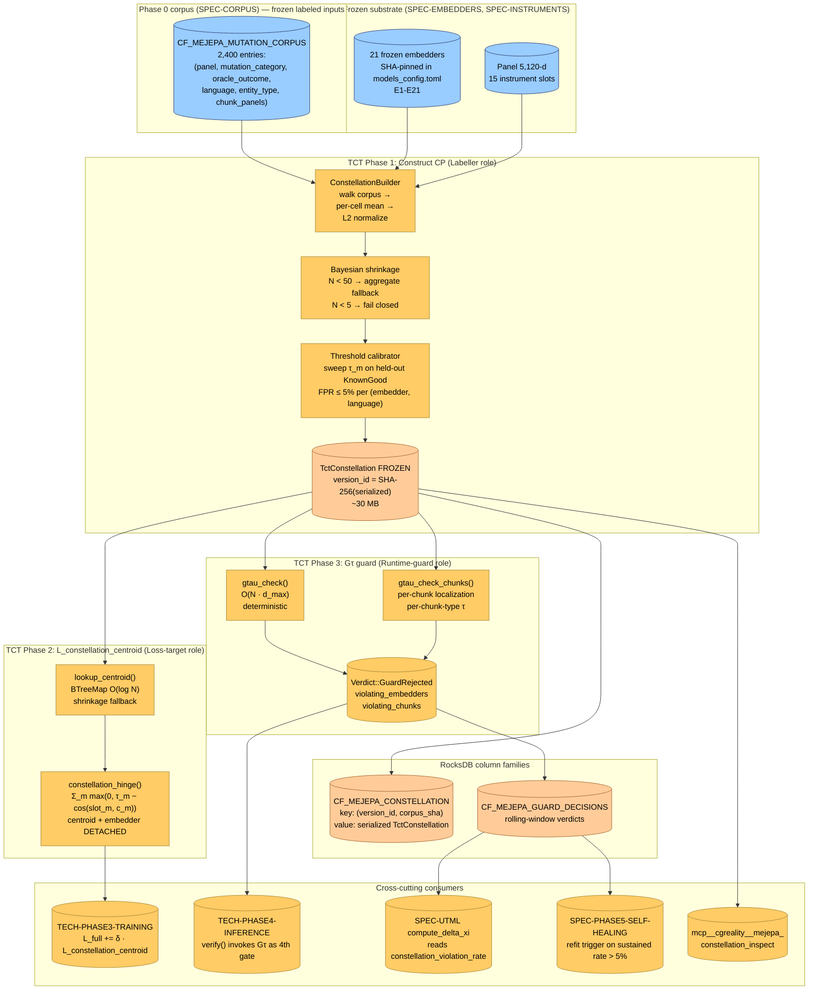
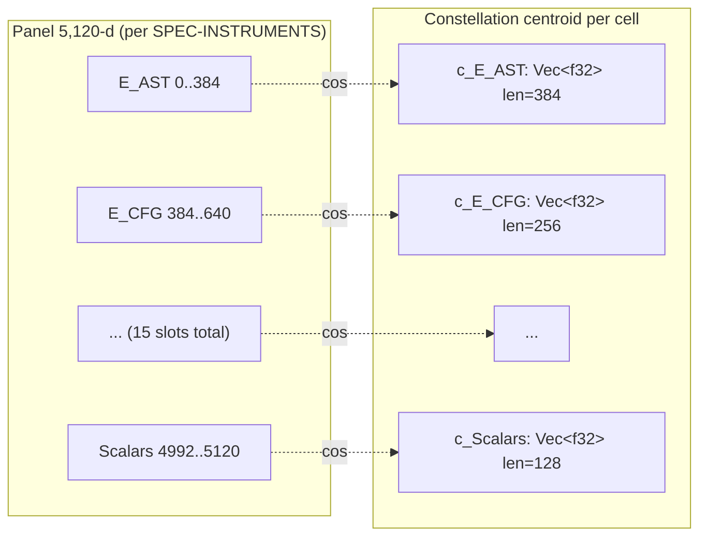

# TECH-TCT — Teleological Constellation Training + Gτ Guard (Implementation)

> **Level 3 — Technical Specification.** Implements `SPEC-TCT.md`. Defines HOW the constellation construction + Gτ guard + L_constellation_centroid lookup primitive are built. Conflicts with the constitution / functional spec resolve to those. Cross-cutting boundaries: this spec defines the constellation data + Gτ test + centroid-lookup primitive; the L_constellation_centroid loss-surface integration lives in TECH-PHASE3-TRAINING; the verify() Gτ call site lives in TECH-PHASE4-INFERENCE.

```xml
<technical_spec id="TECH-TCT" version="1.0" implements="SPEC-TCT">

<metadata>
  <title>Teleological Constellation Training + Gτ Guard — Implementation</title>
  <status>draft</status>
  <owner>Phase 4b ME-JEPA implementation team</owner>
  <last_updated>2026-05-09</last_updated>
  <related_specs>
    <spec_ref>SPEC-TCT</spec_ref>
    <spec_ref>SPEC-CORPUS</spec_ref>
    <spec_ref>SPEC-AST-CHUNKING</spec_ref>
    <spec_ref>SPEC-EMBEDDERS</spec_ref>
    <spec_ref>SPEC-INSTRUMENTS</spec_ref>
    <spec_ref>SPEC-UTML</spec_ref>
    <spec_ref>TECH-PHASE3-TRAINING</spec_ref>
    <spec_ref>TECH-PHASE4-INFERENCE</spec_ref>
  </related_specs>
  <provenance>
    Inspired by Royse, C. (April 2026). *Teleological Constellation Training: Multi-Modal
    Embedding Decomposition as Meaning Compression for Identity-Locked Generation and a
    Third Path Around the Data Wall.* ResearchGate DOI 10.13140/RG.2.2.24370.57288.
    Implementation is clean-room per constitution &lt;coding_standards.provenance&gt; rule.
  </provenance>
</metadata>

<architecture_diagram>



</architecture_diagram>

<three_role_diagram>

```mermaid
sequenceDiagram
    participant Corpus as Phase 0 corpus
    participant Builder as ConstellationBuilder
    participant CP as TctConstellation
    participant Train as TECH-PHASE3-TRAINING
    participant Infer as TECH-PHASE4-INFERENCE (verify())
    participant Verifier as External Verifier

    Note over Corpus,Verifier: Same 21 frozen embedders serve all THREE roles<br/>without parameter update (per doc 13 §3.4)

    rect rgb(220, 240, 220)
    Note over Corpus,CP: ROLE 1: Labeller (TCT Phase 1)
    Corpus->>Builder: (panel, mutation_category, oracle_outcome,<br/>language, entity_type, chunk_panels)
    Builder->>Builder: per-cell mean → L2 normalize
    Builder->>Builder: Bayesian shrinkage on N &lt; 50
    Builder->>Builder: τ_m calibration: FPR ≤ 5% on held-out KnownGood
    Builder->>CP: FROZEN: version_id + corpus_provenance
    CP->>CP: persist to CF_MEJEPA_CONSTELLATION
    end

    rect rgb(220, 220, 240)
    Note over Train,CP: ROLE 2: Loss target (TCT Phase 2)
    Train->>CP: lookup_centroid(predicted_class, language, entity_type, embedder_id)
    CP-->>Train: c_m (with shrinkage fallback record)
    Train->>Train: hinge = Σ_m max(0, τ_m − cos(g_φ(panel)_m, c_m))
    Train->>Train: backward — gradient ONLY through predictor;<br/>centroid + embedder DETACHED
    Train->>Train: persist per-embedder hinge to training cert
    end

    rect rgb(240, 220, 220)
    Note over Infer,Verifier: ROLE 3: Runtime guard (TCT Phase 3)
    Infer->>CP: gtau_check(predicted_panel, predicted_class, language, entity_type)
    CP-->>Infer: gtau_satisfied + violations
    alt Gτ rejects
        Infer->>Infer: Verdict::GuardRejected with violating_chunks
        Infer->>CFGUARD: persist verdict
    end
    Verifier->>CP: load with corpus_provenance check
    Verifier->>Verifier: re-run Gτ on persisted panel<br/>(deterministic O(N·d_max))
    Verifier->>Verifier: assert byte-equal to persisted verdict
    end
```

</three_role_diagram>

<panel_layout_referenced_diagram>



</panel_layout_referenced_diagram>

<data_models>

  <model name="TctConstellation">
    <field name="per_category_centroids" type="BTreeMap&lt;MutationCategory, BTreeMap&lt;EmbedderId, Vec&lt;f32&gt;&gt;&gt;" constraints="every Vec&lt;f32&gt; L2-normalized within f32 ULP; finite; len matches embedder dim"/>
    <field name="per_language_centroids" type="BTreeMap&lt;(Language, MutationCategory), BTreeMap&lt;EmbedderId, Vec&lt;f32&gt;&gt;&gt;" constraints="L2-normalized; finite"/>
    <field name="outcome_centroids" type="BTreeMap&lt;OracleOutcome, BTreeMap&lt;EmbedderId, Vec&lt;f32&gt;&gt;&gt;" constraints="L2-normalized; finite; 4 × 21 = 84 cells"/>
    <field name="per_chunk_type_centroids" type="BTreeMap&lt;(MutationCategory, EntityType, Language, EmbedderId), Vec&lt;f32&gt;&gt;" constraints="L2-normalized; cells with N &lt; 50 collapsed via shrinkage; cells with N &lt; 5 fail closed"/>
    <field name="thresholds" type="BTreeMap&lt;EmbedderId, f32&gt;" constraints="21 keys; ∈ [-1, 1]"/>
    <field name="per_chunk_type_thresholds" type="BTreeMap&lt;(EntityType, EmbedderId), f32&gt;" constraints="tighter than panel-level when present"/>
    <field name="corpus_provenance" type="CorpusProvenance"/>
    <field name="frozen_at" type="SystemTime" constraints="UTC; cannot be in future"/>
    <field name="version_id" type="[u8; 32]" constraints="SHA-256 of deterministic-serialization of all preceding fields"/>
    <description>Frozen constellation data type. Constructed once, persisted as immutable artifact to CF_MEJEPA_CONSTELLATION, loaded entirely into RAM at process start. Reload only on explicit operator action or Phase 5 refit.</description>
  </model>

  <model name="CorpusProvenance">
    <field name="corpus_sha" type="[u8; 32]" constraints="SHA-256 of source corpus snapshot"/>
    <field name="embedder_versions" type="BTreeMap&lt;EmbedderId, [u8; 32]&gt;" constraints="21 keys; per-embedder weight SHA-256"/>
    <field name="frozen_at" type="SystemTime"/>
    <field name="code_version" type="String" constraints="40-hex git commit hash of context-graph-mejepa-tct"/>
  </model>

  <model name="MutationCategory">
    <field name="variant" type="enum {KnownGood, SubtleFlip, OffByOne, SwapVariable, DeleteTestCall, WrongFile, OverEngineer, CompileError}" constraints="serde rename_all snake_case; 8 variants per SPEC-CORPUS"/>
  </model>

  <model name="OracleOutcome">
    <field name="variant" type="enum {Pass, Fail, OutOfDistribution, Abstain}" constraints="4 variants"/>
  </model>

  <model name="Language">
    <field name="variant" type="enum {Rust, Python, Javascript, Typescript, Go, Java, C, Cpp, CSharp, Ruby, Php}" constraints="11 variants per SPEC-AST-CHUNKING"/>
  </model>

  <model name="EntityType">
    <field name="variant" type="enum {Function, Method, Class, Struct, Impl, Module, Trait, Interface, Macro, Enum, Union, Namespace, TopLevelStmt}" constraints="13 variants per constitution &lt;tct_invariants&gt; cell math"/>
  </model>

  <model name="EmbedderId">
    <field name="variant" type="enum {E1..E21}" constraints="21 variants per SPEC-EMBEDDERS"/>
  </model>

  <model name="ChunkId">
    <field name="file_sha" type="[u8; 32]" constraints="SHA-256 of post-edit file"/>
    <field name="language" type="Language"/>
    <field name="entity_type" type="EntityType"/>
    <field name="line_start" type="u32" constraints="≥ 1; 1-indexed"/>
    <field name="line_end" type="u32" constraints="≥ line_start"/>
    <field name="parent_chain_hash" type="[u8; 16]" constraints="BLAKE3-128 hash of parent_chain"/>
    <description>Per-chunk localization for chunk-level Gτ rejection. Maps to a specific function/method/class/impl-block in source-of-truth chunks per SPEC-AST-CHUNKING.</description>
  </model>

  <model name="GtauViolation">
    <field name="embedder" type="EmbedderId"/>
    <field name="observed_cos" type="f32" constraints="∈ [-1, 1]; finite"/>
    <field name="threshold" type="f32" constraints="∈ [-1, 1]; finite"/>
    <field name="violating_chunk" type="Option&lt;ChunkId&gt;" constraints="Some when chunk-level Gτ ran; None when only panel-level Gτ ran"/>
  </model>

  <model name="GtauOutput">
    <field name="gtau_satisfied" type="bool"/>
    <field name="violations" type="Vec&lt;GtauViolation&gt;" constraints="empty when gtau_satisfied; non-empty when not"/>
    <field name="centroid_origin" type="BTreeMap&lt;EmbedderId, ShrinkageOrigin&gt;" constraints="records which aggregate level the centroid came from for each embedder"/>
    <field name="elapsed_ms" type="f32" constraints="for FSV / latency profiling"/>
  </model>

  <model name="ShrinkageOrigin">
    <field name="variant" type="enum {OwnCell, LanguageAggregate, EntityAggregate, CategoryAggregate}"/>
    <description>Records which level of the shrinkage hierarchy supplied the centroid; populated for FSV evidence.</description>
  </model>

  <model name="ChunkGtauOutput">
    <field name="per_chunk_results" type="Vec&lt;(ChunkId, GtauOutput)&gt;" constraints="one entry per input chunk"/>
    <field name="violating_chunks" type="Vec&lt;ChunkId&gt;" constraints="every chunk where gtau_satisfied = false for at least one embedder"/>
    <field name="aggregate_satisfied" type="bool" constraints="true iff every per-chunk gtau_satisfied is true"/>
  </model>

  <model name="ConstellationHingeOutput">
    <field name="per_embedder_hinges" type="BTreeMap&lt;EmbedderId, f32&gt;" constraints="21 keys; each ≥ 0.0; finite"/>
    <field name="total_hinge" type="f32" constraints="sum of per_embedder_hinges; ≥ 0.0"/>
    <field name="centroid_origin" type="BTreeMap&lt;EmbedderId, ShrinkageOrigin&gt;"/>
  </model>

  <model name="VerdictGuardRejected">
    <field name="violating_embedders" type="Vec&lt;GtauViolation&gt;" constraints="non-empty"/>
    <field name="predictor_predicted" type="PredictorOutput" constraints="captures predictor's verdict before Gτ ran"/>
    <field name="violating_chunks" type="Vec&lt;ChunkId&gt;" constraints="possibly empty when only panel-level Gτ ran"/>
    <field name="constellation_version_id" type="[u8; 32]" constraints="for replay against the exact constellation"/>
  </model>

  <model name="PredictorOutput">
    <field name="predicted_class" type="MutationCategory"/>
    <field name="per_test_probabilities" type="Vec&lt;f32&gt;" constraints="∈ [0, 1] each"/>
    <field name="confidence_interval" type="(f32, f32)" constraints="lo ≤ hi; both ∈ [0, 1]"/>
    <field name="latent_density" type="f32" constraints="OOD score"/>
    <description>Owned by SPEC-PHASE2-PREDICTOR; included in GuardRejected for full diagnosability.</description>
  </model>

  <model name="RollingWindow">
    <field name="window_size_calls" type="u32" constraints="default 1000; configurable via MEJEPA_TCT_RATE_WINDOW_SIZE"/>
    <field name="window_hours" type="u32" constraints="default 24; configurable via MEJEPA_TCT_RATE_WINDOW_HOURS"/>
    <description>The smaller of the two bounds (calls or hours) controls the effective window.</description>
  </model>

</data_models>

<api_contracts>

  <!-- Note: this domain is library-only. The MCP-tool surface is a single read-only inspector. -->

  <endpoint path="mcp__cgreality__mejepa_constellation_inspect" method="MCP_TOOL">
    <implements>REQ-TCT-15</implements>
    <request_body>
      version_id: Option&lt;String&gt; (hex; default = currently-loaded version_id)
    </request_body>
    <responses>
      OK: {
        version_id: String (hex),
        corpus_provenance: { corpus_sha, embedder_versions: {EmbedderId: hex_sha}, frozen_at: ISO 8601, code_version: hex },
        frozen_at: ISO 8601,
        cell_counts: { panel_level_cells: u32, per_chunk_type_cells: u32, shrunken_cells: u32 },
        sample_support_histogram: { N_lt_5: u32, N_5_to_50: u32, N_50_plus: u32 },
        thresholds: { EmbedderId: f32 },
        per_chunk_type_threshold_summary: { EntityType: { mean_threshold: f32, n_cells: u32 } }
      }
      ERROR: { code: "MEJEPA_TCT_PROVENANCE_MISMATCH" | "MEJEPA_INFER_GTAU_STALE_CONSTELLATION" | ..., message: String }
    </responses>
  </endpoint>

</api_contracts>

<component_contracts>

  <component name="TctConstellation" path="crates/context-graph-mejepa-tct/src/constellation.rs">

    <method name="version_id">
      <signature>pub fn version_id(&amp;self) -&gt; [u8; 32]</signature>
      <implements>REQ-TCT-01, REQ-TCT-05</implements>
      <behavior>
        Returns the SHA-256 of the deterministic serialization of all centroid maps + thresholds + corpus_provenance.
        Computed once at construction; cached.
      </behavior>
    </method>

    <method name="lookup_centroid">
      <signature>pub fn lookup_centroid(&amp;self, mutation: MutationCategory, language: Language, entity_type: EntityType, embedder: EmbedderId) -&gt; Option&lt;(&amp;[f32], ShrinkageOrigin)&gt;</signature>
      <implements>REQ-TCT-06</implements>
      <behavior>
        1. Try `per_chunk_type_centroids[(mutation, entity_type, language, embedder)]` — return (slice, ShrinkageOrigin::OwnCell) if present.
        2. Try `per_language_centroids[(language, mutation)][embedder]` — return (slice, ShrinkageOrigin::LanguageAggregate) if present.
        3. Try entity-aggregate: search per_chunk_type_centroids for matching (mutation, entity_type, *, embedder); average if multiple — return (slice, ShrinkageOrigin::EntityAggregate) if present.
        4. Try `per_category_centroids[mutation][embedder]` — return (slice, ShrinkageOrigin::CategoryAggregate) if present.
        5. Otherwise return None.
        Lookup is read-only on the BTreeMap; zero-copy slice borrowing.
      </behavior>
      <throws>None — returns None on absence.</throws>
    </method>

    <method name="threshold">
      <signature>pub fn threshold(&amp;self, embedder: EmbedderId, entity_type: Option&lt;EntityType&gt;) -&gt; f32</signature>
      <implements>REQ-TCT-04, REQ-TCT-08</implements>
      <behavior>
        1. If entity_type is Some, try `per_chunk_type_thresholds[(entity_type, embedder)]` — return if present.
        2. Otherwise return `thresholds[embedder]` (panel-level fallback).
      </behavior>
    </method>

    <method name="check_provenance">
      <signature>pub fn check_provenance(&amp;self, runtime_embedder_versions: &amp;BTreeMap&lt;EmbedderId, [u8; 32]&gt;) -&gt; Result&lt;(), TctError&gt;</signature>
      <implements>REQ-TCT-12</implements>
      <behavior>
        For each EmbedderId in self.corpus_provenance.embedder_versions:
          if runtime_embedder_versions[id] != self.corpus_provenance.embedder_versions[id]:
            return Err(TctError::ProvenanceMismatch { embedder, expected, observed }).
        Otherwise Ok(()).
      </behavior>
      <throws>MEJEPA_TCT_PROVENANCE_MISMATCH</throws>
    </method>

    <method name="check_freshness">
      <signature>pub fn check_freshness(&amp;self, max_age: Duration, allow_stale: bool) -&gt; Result&lt;(), TctError&gt;</signature>
      <implements>REQ-TCT-11</implements>
      <behavior>
        let age = SystemTime::now().duration_since(self.frozen_at)?;
        if age &gt; max_age &amp;&amp; !allow_stale:
          return Err(TctError::StaleConstellation { frozen_at, age_days, max_age_days }).
        Otherwise Ok(()) (logging an audit entry to ./memory/journal/ when allow_stale is true).
      </behavior>
      <throws>MEJEPA_INFER_GTAU_STALE_CONSTELLATION</throws>
    </method>

  </component>

  <component name="ConstellationBuilder" path="crates/context-graph-mejepa-tct/src/builder.rs">

    <method name="new">
      <signature>pub fn new(corpus_sha: [u8; 32], embedder_versions: BTreeMap&lt;EmbedderId, [u8; 32]&gt;, code_version: String) -&gt; Self</signature>
      <implements>REQ-TCT-02</implements>
      <behavior>Initialize empty per-cell sample buckets; record provenance inputs for use at finalize().</behavior>
    </method>

    <method name="ingest_corpus_entry">
      <signature>pub fn ingest_corpus_entry(&amp;mut self, panel: &amp;Panel, mutation: MutationCategory, oracle_outcome: OracleOutcome, language: Language, entity_type: EntityType, chunk_panels: &amp;[(ChunkId, Panel)]) -&gt; Result&lt;(), TctError&gt;</signature>
      <implements>REQ-TCT-02</implements>
      <behavior>
        For each embedder slot in panel:
          accumulate into bucket per_category_centroids[mutation][embedder] (sum + count)
          accumulate into bucket per_language_centroids[(language, mutation)][embedder]
          accumulate into bucket outcome_centroids[oracle_outcome][embedder]
        For each chunk in chunk_panels:
          accumulate into bucket per_chunk_type_centroids[(mutation, chunk.entity_type, chunk.language, embedder)]
        Validate every accumulated value is finite; reject NaN/Inf entries with a structured error.
      </behavior>
      <throws>MEJEPA_INFER_DIM_MISMATCH (when panel slot dim mismatches embedder dim)</throws>
    </method>

    <method name="finalize">
      <signature>pub fn finalize(self, validation_slice: &amp;HeldOutValidation) -&gt; Result&lt;TctConstellation, TctError&gt;</signature>
      <implements>REQ-TCT-02, REQ-TCT-03, REQ-TCT-04</implements>
      <behavior>
        1. Compute mean per cell: bucket.sum / bucket.count
        2. L2-normalize each centroid: c / ||c|| (return error if ||c|| &lt; 1e-12)
        3. Apply Bayesian shrinkage to per_chunk_type_centroids:
             For each cell with N &lt; 50:
               Try language-aggregate (per_language_centroids[(language, mutation)][embedder]):
                 if its support N ≥ 50, replace cell with that centroid; record ShrinkageOrigin::LanguageAggregate
               Else try entity-aggregate; record ShrinkageOrigin::EntityAggregate
               Else try category-aggregate; record ShrinkageOrigin::CategoryAggregate
               Else if N &lt; 5: return Err(InsufficientSamples { cell, N })
        4. Calibrate thresholds via threshold_calibrator on validation_slice (REQ-TCT-04 detail below)
        5. Compute version_id = SHA-256(serialize(constellation))
        6. Return TctConstellation
      </behavior>
      <throws>MEJEPA_TCT_INSUFFICIENT_SAMPLES, MEJEPA_TCT_THRESHOLD_CALIBRATION_FAIL</throws>
    </method>

  </component>

  <component name="ThresholdCalibrator" path="crates/context-graph-mejepa-tct/src/calibrator.rs">

    <method name="calibrate">
      <signature>pub fn calibrate(centroids: &amp;Centroids, validation: &amp;HeldOutValidation, target_fpr: f32) -&gt; Result&lt;Thresholds, TctError&gt;</signature>
      <implements>REQ-TCT-04</implements>
      <behavior>
        For each (embedder, language) cell with ≥ 30 held-out KnownGood samples:
          Compute observed cosines for all held-out samples against the (KnownGood, language, embedder) centroid.
          Sort cosines ascending.
          τ_m candidate = the value at the 5th percentile (i.e., FPR exactly 5%).
          Verify empirical FPR on the slice ≤ target_fpr; if not, fail.
        For (embedder, language) cells with &lt; 30 samples:
          Skip strict enforcement; emit warning; use conservative panel-level threshold.
        For (entity_type, embedder) cells with ≥ 50 samples:
          Compute sharper per_chunk_type_thresholds analogously.
        Returns Thresholds { panel_level: BTreeMap, per_chunk_type: BTreeMap } or fails.
      </behavior>
      <throws>MEJEPA_TCT_THRESHOLD_CALIBRATION_FAIL</throws>
    </method>

    <implementation_note>
      Threshold sweep uses 100 candidates between min and max observed cosine on the held-out slice;
      pick the smallest τ_m yielding empirical FPR ≤ 0.05. Determinism: same input slice + same code_version
      produces byte-equal thresholds.
    </implementation_note>

  </component>

  <component name="GtauChecker" path="crates/context-graph-mejepa-tct/src/gtau.rs">

    <method name="gtau_check">
      <signature>pub fn gtau_check(predicted_panel: &amp;Panel, predicted_class: MutationCategory, language: Language, entity_type: EntityType, constellation: &amp;TctConstellation) -&gt; Result&lt;GtauOutput, TctError&gt;</signature>
      <implements>REQ-TCT-08</implements>
      <behavior>
        1. Verify predicted_panel.is_finite() across all 5,120 dims. If any NaN/Inf: return MEJEPA_INFER_DIM_MISMATCH.
        2. For each EmbedderId m in EmbedderId::all() (21 iterations):
             a. let slot_m = predicted_panel.slot_for(m) (zero-copy borrow)
             b. let (centroid, origin) = constellation.lookup_centroid(predicted_class, language, entity_type, m).ok_or(NoCentroid)?
             c. let cos_m = cosine_similarity(slot_m, centroid)
             d. let τ_m = constellation.threshold(m, Some(entity_type))
             e. if cos_m &lt; τ_m: push GtauViolation { embedder: m, observed_cos: cos_m, threshold: τ_m, violating_chunk: None }
             f. record origin in centroid_origin map
        3. let gtau_satisfied = violations.is_empty()
        4. Record elapsed_ms for FSV / profiling
        5. Return GtauOutput { gtau_satisfied, violations, centroid_origin, elapsed_ms }
      </behavior>
      <throws>MEJEPA_INFER_DIM_MISMATCH (NaN/Inf in panel)</throws>
    </method>

    <method name="gtau_check_chunks">
      <signature>pub fn gtau_check_chunks(chunk_panels: &amp;[(ChunkId, Panel)], predicted_class: MutationCategory, constellation: &amp;TctConstellation) -&gt; Result&lt;ChunkGtauOutput, TctError&gt;</signature>
      <implements>REQ-TCT-09</implements>
      <behavior>
        1. let mut per_chunk_results = Vec::with_capacity(chunk_panels.len())
        2. let mut violating_chunks = Vec::new()
        3. for (chunk_id, panel) in chunk_panels:
             let result = gtau_check(panel, predicted_class, chunk_id.language, chunk_id.entity_type, constellation)?
             // Patch each violation with the chunk_id for localization:
             let mut violations = result.violations.clone()
             for v in &amp;mut violations:
               v.violating_chunk = Some(chunk_id.clone())
             let result = GtauOutput { violations, ..result }
             if !result.gtau_satisfied: violating_chunks.push(chunk_id.clone())
             per_chunk_results.push((chunk_id.clone(), result))
        4. let aggregate_satisfied = violating_chunks.is_empty()
        5. Return ChunkGtauOutput { per_chunk_results, violating_chunks, aggregate_satisfied }
      </behavior>
      <throws>Same as gtau_check (per chunk).</throws>
    </method>

    <method name="cosine_similarity">
      <signature>fn cosine_similarity(a: &amp;[f32], b: &amp;[f32]) -&gt; f32</signature>
      <implements>REQ-TCT-08</implements>
      <behavior>
        Assert a.len() == b.len(); compute dot(a, b) / (||a|| · ||b||); if either norm &lt; 1e-12, return 0.0.
        SIMD-accelerated when length is multiple of 8 (f32x8). Determinism: pairwise summation in fixed order.
      </behavior>
    </method>

  </component>

  <component name="ConstellationHingeOp" path="crates/context-graph-mejepa-tct/src/hinge.rs">

    <method name="constellation_hinge">
      <signature>pub fn constellation_hinge(predicted_panel: &amp;Panel, predicted_class: MutationCategory, language: Language, entity_type: EntityType, constellation: &amp;TctConstellation) -&gt; Result&lt;ConstellationHingeOutput, TctError&gt;</signature>
      <implements>REQ-TCT-07</implements>
      <behavior>
        1. let mut per_embedder_hinges = BTreeMap::new()
        2. let mut centroid_origin = BTreeMap::new()
        3. for embedder m in EmbedderId::all():
             let slot_m = predicted_panel.slot_for(m)
             let (centroid, origin) = constellation.lookup_centroid(predicted_class, language, entity_type, m).ok_or(NoCentroid)?
             let cos_m = cosine_similarity(slot_m, centroid)
             let τ_m = constellation.threshold(m, Some(entity_type))
             let hinge_m = (τ_m - cos_m).max(0.0)
             per_embedder_hinges.insert(m, hinge_m)
             centroid_origin.insert(m, origin)
        4. let total_hinge = per_embedder_hinges.values().sum()
        5. Return ConstellationHingeOutput { per_embedder_hinges, total_hinge, centroid_origin }
      </behavior>
      <throws>None on the happy path; NoCentroid if shrinkage fallback exhausted.</throws>
    </method>

    <method name="constellation_hinge_op (candle)">
      <signature>pub fn constellation_hinge_op(predicted_panel: &amp;Tensor, predicted_class: MutationCategory, language: Language, entity_type: EntityType, constellation: &amp;TctConstellation) -&gt; Result&lt;Tensor, TctError&gt;</signature>
      <implements>REQ-TCT-07</implements>
      <behavior>
        Differentiable variant of constellation_hinge for use inside Phase 3 training loop:
          1. Slice each embedder slot from predicted_panel as a Tensor view (preserves autograd graph).
          2. Load centroid as a DETACHED Tensor (no requires_grad) — explicit `centroid_tensor.detach()`.
          3. Compute cos via Tensor::matmul / Tensor::norm; subtract τ_m; ReLU.
          4. Sum over 21 embedders.
          Returns a scalar Tensor (∈ [0, ∞)) suitable for backprop into predictor only.
        CRITICAL: centroid + threshold tensors MUST be created with requires_grad = false. A gradient hook
        on each centroid asserts |grad| == 0 in debug builds. In release builds, a sample-based check at
        end of epoch verifies via probe. Any nonzero gradient triggers MEJEPA_INSTR_FROZEN_VIOLATION
        per constitution &lt;tct_invariants&gt; rule 1.
      </behavior>
      <throws>MEJEPA_INSTR_FROZEN_VIOLATION if any centroid gradient is detected nonzero.</throws>
    </method>

  </component>

  <component name="ConstellationStore" path="crates/context-graph-mejepa-tct/src/store.rs">

    <method name="persist">
      <signature>pub fn persist(&amp;self, db: &amp;rocksdb::DB, constellation: &amp;TctConstellation) -&gt; Result&lt;[u8; 32], TctError&gt;</signature>
      <implements>REQ-TCT-05</implements>
      <behavior>
        1. let serialized = bincode2::serialize(constellation, bincode2::config::standard().with_fixed_int_encoding().with_little_endian())?
        2. let version_id = sha256(serialized)
        3. let key = [version_id.as_slice(), constellation.corpus_provenance.corpus_sha.as_slice()].concat()  // 64-byte composite
        4. db.put_cf(&amp;CF_MEJEPA_CONSTELLATION, key, serialized)?
        5. Return version_id
      </behavior>
      <throws>RocksDB I/O errors propagated as TctError::IoError.</throws>
    </method>

    <method name="load">
      <signature>pub fn load(&amp;self, db: &amp;rocksdb::DB, version_id: [u8; 32], runtime_embedder_versions: &amp;BTreeMap&lt;EmbedderId, [u8; 32]&gt;, max_age: Duration, allow_stale: bool) -&gt; Result&lt;TctConstellation, TctError&gt;</signature>
      <implements>REQ-TCT-05, REQ-TCT-11, REQ-TCT-12</implements>
      <behavior>
        1. Iterate keys in CF_MEJEPA_CONSTELLATION with prefix = version_id; expect exactly one match.
        2. let serialized = db.get_cf(&amp;CF_MEJEPA_CONSTELLATION, &amp;key)?
        3. let constellation: TctConstellation = bincode2::deserialize(&amp;serialized)?
        4. constellation.check_provenance(runtime_embedder_versions)?
        5. constellation.check_freshness(max_age, allow_stale)?
        6. Verify constellation.version_id() == version_id (paranoid integrity check)
        7. Return constellation
      </behavior>
      <throws>MEJEPA_TCT_PROVENANCE_MISMATCH, MEJEPA_INFER_GTAU_STALE_CONSTELLATION, integrity errors.</throws>
    </method>

  </component>

  <component name="ViolationRateAggregator" path="crates/context-graph-mejepa-tct/src/rate.rs">

    <method name="constellation_violation_rate">
      <signature>pub fn constellation_violation_rate(db: &amp;rocksdb::DB, window: RollingWindow, now: SystemTime) -&gt; Result&lt;Option&lt;f32&gt;, TctError&gt;</signature>
      <implements>REQ-TCT-13</implements>
      <behavior>
        1. Read up to window.window_size_calls most-recent verdicts from CF_MEJEPA_GUARD_DECISIONS (using a reverse iterator on a timestamp prefix).
        2. Filter to those within window.window_hours of now.
        3. let total = filtered.len()
        4. if total &lt; 30: return Ok(None)  // insufficient samples
        5. let rejected = filtered.filter(|v| matches!(v, Verdict::GuardRejected(_))).count()
        6. Return Ok(Some(rejected as f32 / total as f32))
      </behavior>
      <throws>RocksDB I/O errors.</throws>
    </method>

  </component>

  <component name="McpInspectTool" path="crates/context-graph-mejepa-tct/src/mcp.rs">

    <method name="mejepa_constellation_inspect">
      <signature>pub fn mejepa_constellation_inspect(version_id: Option&lt;[u8; 32]&gt;, db: &amp;rocksdb::DB, runtime_embedder_versions: &amp;BTreeMap&lt;EmbedderId, [u8; 32]&gt;) -&gt; Result&lt;ConstellationInspectOutput, TctError&gt;</signature>
      <implements>REQ-TCT-15</implements>
      <behavior>
        1. Load constellation (via ConstellationStore::load) using version_id (or current default).
        2. Compute summary statistics:
             - cell_counts: total panel-level + total per-chunk-type + count of shrunken cells
             - sample_support_histogram: bucketize sample counts {N&lt;5, 5≤N&lt;50, N≥50}
             - threshold table: panel-level + per-chunk-type summary (mean, count per EntityType)
        3. Return JSON-serializable summary; never include raw centroid byte arrays.
      </behavior>
      <throws>Same as ConstellationStore::load.</throws>
    </method>

  </component>

</component_contracts>

<error_taxonomy>

  <error_code id="MEJEPA_INFER_CONSTELLATION_VIOLATION" http_code="400">
    Gτ rejected the predicted panel; one or more embedders below threshold. Persisted with violating_embedders + violating_chunks (per constitution &lt;failure_taxonomy&gt;).
  </error_code>

  <error_code id="MEJEPA_INFER_GTAU_STALE_CONSTELLATION" http_code="500">
    Constellation older than max_age (default 90 days); refuse without operator override. Per constitution &lt;failure_taxonomy&gt;.
  </error_code>

  <error_code id="MEJEPA_TCT_INSUFFICIENT_SAMPLES" http_code="500">
    Cell has &lt; 5 supporting examples even after Bayesian shrinkage. Construction fails closed.
  </error_code>

  <error_code id="MEJEPA_TCT_THRESHOLD_CALIBRATION_FAIL" http_code="500">
    Empirical Gτ FPR exceeds 5% target on held-out KnownGood validation slice for one or more (embedder, language) cells with sufficient samples.
  </error_code>

  <error_code id="MEJEPA_TCT_PROVENANCE_MISMATCH" http_code="500">
    Constellation embedder version SHA-256 does not match runtime-loaded embedder weight digest. Refuse to use; rebuild required.
  </error_code>

  <error_code id="MEJEPA_INSTR_FROZEN_VIOLATION" http_code="500">
    A nonzero gradient was detected through a frozen embedder weight or a centroid during L_constellation_centroid backward. CRITICAL bug per constitution &lt;tct_invariants&gt; rule 1 + &lt;anti_patterns&gt; "No learnable target encoder".
  </error_code>

  <error_code id="MEJEPA_INFER_DIM_MISMATCH" http_code="400">
    Predicted panel contains NaN/Inf or wrong dimensionality. Fail closed; do NOT silently substitute zeros.
  </error_code>

</error_taxonomy>

<implementation_notes>

  <note category="determinism">
    All cosine computations use pairwise summation in a fixed order to ensure byte-equal output across re-runs.
    SIMD acceleration (f32x8) is applied only when slot length is a multiple of 8; falls back to scalar otherwise.
    BTreeMap iteration order is canonical (Rust default) — both at construction and at lookup.
  </note>

  <note category="serialization">
    `bincode2::config::standard().with_fixed_int_encoding().with_little_endian()` is the canonical serialization
    config — fixed-width int encoding ensures byte-equal output across platforms; little-endian matches the
    target hardware (RTX 5090 host = x86_64). serde_json is used ONLY for FSV evidence files (human-readable).
  </note>

  <note category="storage">
    CF_MEJEPA_CONSTELLATION uses 64-byte composite key (version_id || corpus_sha). RocksDB tier policy:
    primary copy in level 0 (frequent reads); after 30 days, may cold-tier to level 1 if not accessed.
    Per constitution &lt;performance_budgets&gt; rocksdb_disk_total_quota — constellation accounts for ~30 MB
    out of the 115 GB total budget.
  </note>

  <note category="security">
    FSV evidence files at /tmp/contextgraph-mejepa-tct-fsv/ created with mode 0o600 per SEC-MEJEPA-07.
    Constellation provenance enforcement (REQ-TCT-12) is the load-time integrity check that prevents
    silent drift when an embedder is updated without rebuilding the constellation.
    Audit-logged operator override for stale constellation: writes to ./memory/journal/ + witness chain.
  </note>

  <note category="performance">
    Gτ test latency target &lt; 10 ms p50 with all 21 embedders cached. Bottleneck is 21 × cosine on dim 384-1536.
    SIMD f32x8 cosine on a 1536-d slot completes in ~2-5 µs; 21 embedders × ~3 µs = ~60 µs raw compute, leaving
    headroom for shrinkage lookup + violation aggregation.
    Constellation in-RAM footprint after Bayesian shrinkage: ~30 MB (24,024 cells × ~1 KB avg centroid + thresholds).
  </note>

  <note category="frozenness">
    Per constitution &lt;tct_invariants&gt; rule 1: the same 21 frozen embedders serve all three roles without
    parameter update. The constellation_hinge_op() in candle MUST create centroid + threshold tensors with
    requires_grad = false. Debug builds install a gradient hook asserting |grad| == 0 every backward pass;
    release builds run a sample-based probe at end of epoch. Any nonzero gradient is MEJEPA_INSTR_FROZEN_VIOLATION
    — CRITICAL bug.
  </note>

  <note category="cross_cutting">
    L_constellation_centroid loss surface integration lives in TECH-PHASE3-TRAINING:
      L_full = α · L_panel + β · L_pairwise + γ · L_action + δ · L_constellation_centroid + ...
    where δ is a hyperparameter tuned per UTML §IX coaching cycle (default 0.1; bumped to 0.3 if
    constellation_violation_rate sustains &gt; 5% per UTML's "Latent-Collapsing" intervention).
    This crate exposes only the lookup + hinge primitive; training-loop wiring is the consumer's job.
  </note>

  <note category="cross_cutting">
    Verify() Gτ call site lives in TECH-PHASE4-INFERENCE:
      let gtau_output = gtau_check(predicted_panel, predicted_class, language, entity_type, &amp;constellation)?;
      if !gtau_output.gtau_satisfied {
        return Ok(Verdict::GuardRejected { violating_embedders, predictor_predicted, violating_chunks, constellation_version_id });
      }
    Gτ is the fourth gate (alongside conformal interval, OOD score, L_step health). The Verdict enum
    structure is defined in SPEC-PHASE4-INFERENCE; this crate defines only the GuardRejected variant
    payload + the gtau_check function.
  </note>

  <note category="cross_cutting">
    constellation_violation_rate is consumed by SPEC-UTML's compute_delta_xi as the third predictor-side
    defense diagnostic per doc 11 §5.3. The Phase 5 self-healing controller reads the rate over a 2-hour
    rolling window and triggers refit when sustained &gt; 5% — UTML §IX "Latent-Collapsing" intervention.
    Constellation refit produces a new immutable version_id; the previous one is preserved for rollback if
    refit regresses on holdout (per constitution &lt;failure_taxonomy&gt; MEJEPA_RETRAIN_HOLDOUT_REGRESSION).
  </note>

  <note category="universal_agent_verifier">
    Per doc 13 §4.1 + §4.2, the same Gτ machinery is invoked when verifying any agent's output —
    Claude Code, GPT-5, Gemini, Cursor, Aider, Dependabot, ME-JEPA itself. The agent's identity is
    irrelevant; what matters is that the output can be encoded by the 21 frozen embedders and compared
    to constellations computed from real working code. The Verdict::GuardRejected with violating_chunks
    is the structured reject the agent (or operator) reads; per doc 14 §8.1, the agent can target only
    those chunks on its next attempt.
  </note>

  <note category="provenance">
    Constellation provenance (corpus_sha + per-embedder weight SHA-256 + frozen_at + code_version git SHA)
    is the substrate for per-output verifiability per Royse 2026c §5.1's frozen-centroid provenance claim.
    Any third party with the persisted constellation + the frozen embedders can re-run Gτ and reproduce
    gtau_satisfied + per-violation cosines to within f32 ULP.
  </note>

  <note category="testing">
    Test corpus uses real synthesized panel data spanning all 8 mutation categories × all 11 languages ×
    all 13 entity types where feasible. FSV harness writes to /tmp/contextgraph-mejepa-tct-fsv/ and
    re-reads + asserts before reporting success per constitution &lt;coding_standards.fsv_protocol&gt;.
    No mock embedders or mock oracle outputs in tests per CLAUDE.md §11.9 + constitution
    &lt;anti_patterns&gt; "No mock embedders".
  </note>

  <note category="dependencies_status">
    Phase 0 corpus completion (SPEC-CORPUS) is the prerequisite. Per memory/MEMORY.md:
      - 8 mutation operators: shipped (mejepa-corpus crate)
      - SWE-bench oracle bridge: shipped (one-instance Docker FSV verified)
      - Full 300×8 corpus generation: pending
      - 21 embedders: pending (Phase 1 in progress)
      - 5,120-d Panel: 3 of 15 slots shipped (E_Oracle, E_Witness, E_StaticAnalysis)
    TCT-CONSTELLATION cannot ship Phase 1 (Builder + finalize + calibration) until ≥ 2,000 corpus entries
    + ≥ 18 of 21 embedders + ≥ 12 of 15 panel slots are in tree. Phase 2 (lookup + hinge) and Phase 3
    (Gτ + chunk-level Gτ + GuardRejected variant) can ship incrementally as the substrate matures.
  </note>

</implementation_notes>

<file_structure>

```
crates/context-graph-mejepa-tct/
├── Cargo.toml
├── src/
│   ├── lib.rs                          # public API surface
│   ├── constellation.rs                # TctConstellation type + methods (REQ-TCT-01, 06, 11, 12)
│   ├── builder.rs                      # ConstellationBuilder (REQ-TCT-02, 03)
│   ├── calibrator.rs                   # ThresholdCalibrator (REQ-TCT-04)
│   ├── shrinkage.rs                    # Bayesian shrinkage policy (REQ-TCT-03)
│   ├── gtau.rs                         # GtauChecker + cosine_similarity (REQ-TCT-08, 09)
│   ├── hinge.rs                        # ConstellationHingeOp (REQ-TCT-07)
│   ├── store.rs                        # RocksDB persistence (REQ-TCT-05)
│   ├── rate.rs                         # ViolationRateAggregator (REQ-TCT-13)
│   ├── verdict.rs                      # VerdictGuardRejected variant + ChunkId + GtauViolation (REQ-TCT-10)
│   ├── mcp.rs                          # mejepa_constellation_inspect MCP tool (REQ-TCT-15)
│   ├── error.rs                        # TctError enum + .code() impl
│   └── types.rs                        # Language / EntityType / EmbedderId / MutationCategory / OracleOutcome aliases
├── examples/
│   └── tct_fsv.rs                      # FSV harness binary writing /tmp/contextgraph-mejepa-tct-fsv/* (REQ-TCT-14)
└── tests/
    ├── builder_integration.rs           # corpus → constellation round-trip
    ├── calibration_integration.rs       # FPR ≤ 5% verification
    ├── gtau_unit.rs                     # accept/reject/boundary
    ├── chunk_gtau_integration.rs        # per-chunk localization
    ├── hinge_unit.rs                    # boundary + frozen-gradient
    ├── store_integration.rs             # RocksDB round-trip
    ├── stale_integration.rs             # MEJEPA_INFER_GTAU_STALE_CONSTELLATION
    ├── provenance_integration.rs        # MEJEPA_TCT_PROVENANCE_MISMATCH
    ├── rate_integration.rs              # rolling window
    └── external_replay_integration.rs   # third-party reproducibility ≥ 99.9%
```

</file_structure>

<test_strategy>

  <unit_tests>
    Per-component coverage of the API contracts above. Notable:
    - constellation_hinge boundary case (cos == τ_m yields exact 0.0): FP-safe via direct subtraction + max(0, .)
    - cosine_similarity zero-norm case: returns 0.0 instead of NaN
    - shrinkage hierarchy ordering: each level explicitly tested for the expected ShrinkageOrigin tag
    - lookup_centroid absence: Option::None when shrinkage exhausted
  </unit_tests>

  <integration_tests>
    - Builder + finalize round-trip with synthesized 500-entry corpus: deterministic byte-equal SHA-256 across two builds
    - Threshold calibration on synthesized validation slice: FPR ≤ 0.05 per cell with ≥ 30 samples
    - RocksDB persist + load round-trip: byte-equal serialization + provenance check + freshness check
    - Gτ on synthesized accept and reject panels: deterministic and reproducible
    - Chunk-level Gτ on a 3-chunk patch where chunk_2 fails: violating_chunks contains exactly chunk_2
    - constellation_violation_rate over a synthesized verdict stream of 100 entries with 10 GuardRejected: rate = 0.10
  </integration_tests>

  <e2e_tests>
    - FSV harness end-to-end: writes 4 evidence files; re-reads + asserts; mode 0o600
    - External-verifier replay: cold-start third-party rebuild reproduces gtau_satisfied + per-violation cosines within f32 ULP
    - MCP tool mejepa_constellation_inspect: JSON output matches contract; no raw centroids
  </e2e_tests>

  <fsv_assertion_protocol>
    Per constitution &lt;coding_standards.fsv_protocol&gt;:
      For each FSV evidence file at /tmp/contextgraph-mejepa-tct-fsv/{constellation-evidence.json, gtau-evidence.json, threshold-calibration-evidence.json, chunk-level-rejection-evidence.json}:
        1. Compute structure in-memory.
        2. serde_json::to_string_pretty + write with mode 0o600.
        3. Re-read from disk.
        4. Deserialize; assert bytes_equal_to_in_memory_pretty_print (canonical key order).
        5. Run domain-specific assertion (e.g., for gtau-evidence.json: re-run Gτ on the persisted panel and verify byte-equal verdict).
      Harness exits non-zero on any assertion failure.
  </fsv_assertion_protocol>

  <performance_tests>
    - Gτ latency profiling: 1,000 calls on warm-cached embedders; assert p50 &lt; 10 ms (per NFR-TCT-01)
    - Constellation in-RAM footprint: load synthesized full-scale (24,024 cells post-shrinkage); assert &lt; 35 MB (per NFR-TCT-03)
    - Construction wall-clock: 500 corpus entries; assert &lt; 30 s on RTX 5090 host
  </performance_tests>

</test_strategy>

<implementation_phases>

  <phase id="P1" name="Constellation type + Builder + RocksDB CF" effort="~3 days" depends="Phase 0 corpus ≥ 2,000 entries; ≥ 18 embedders; ≥ 12 panel slots">
    Deliverables:
    - TctConstellation type + serialization (REQ-TCT-01)
    - ConstellationBuilder with sample-bucket accumulation (REQ-TCT-02)
    - Bayesian shrinkage policy (REQ-TCT-03)
    - CF_MEJEPA_CONSTELLATION RocksDB integration (REQ-TCT-05)
    - Determinism FSV: two builds yield byte-equal SHA-256
  </phase>

  <phase id="P2" name="Threshold calibration + provenance + freshness checks" effort="~2 days" depends="P1; held-out validation slice ≥ 30 KnownGood per language">
    Deliverables:
    - ThresholdCalibrator with FPR ≤ 5% target (REQ-TCT-04)
    - check_provenance + check_freshness on TctConstellation (REQ-TCT-11, REQ-TCT-12)
    - threshold-calibration-evidence.json FSV
  </phase>

  <phase id="P3" name="Gτ check + chunk-level Gτ + GuardRejected variant" effort="~3 days" depends="P1; SPEC-AST-CHUNKING ChunkId stable">
    Deliverables:
    - gtau_check + gtau_check_chunks (REQ-TCT-08, REQ-TCT-09)
    - Verdict::GuardRejected variant in CF_MEJEPA_GUARD_DECISIONS (REQ-TCT-10)
    - gtau-evidence.json + chunk-level-rejection-evidence.json FSV
    - External-verifier replay test (NFR-TCT-05)
  </phase>

  <phase id="P4" name="L_constellation_centroid lookup + hinge primitive" effort="~2 days" depends="P1; candle Tensor backend stable">
    Deliverables:
    - lookup_centroid with shrinkage fallback (REQ-TCT-06)
    - constellation_hinge + constellation_hinge_op (REQ-TCT-07)
    - Frozen-gradient FSV asserting |grad| on centroid + embedder == 0
  </phase>

  <phase id="P5" name="Rolling-window rate + MCP tool" effort="~1 day" depends="P3 + CF_MEJEPA_GUARD_DECISIONS populated">
    Deliverables:
    - constellation_violation_rate (REQ-TCT-13)
    - mejepa_constellation_inspect MCP tool (REQ-TCT-15)
  </phase>

  <total_effort>~11 days for full TCT-CONSTELLATION implementation; aligns with sitrep estimate of ~5 days for panel-level + ~4 days for chunk-level + ~2 days for cross-cutting integration. Slots into Phases 0/3/4/5 of doc 09; does not extend the critical path.</total_effort>

</implementation_phases>

</technical_spec>
```
