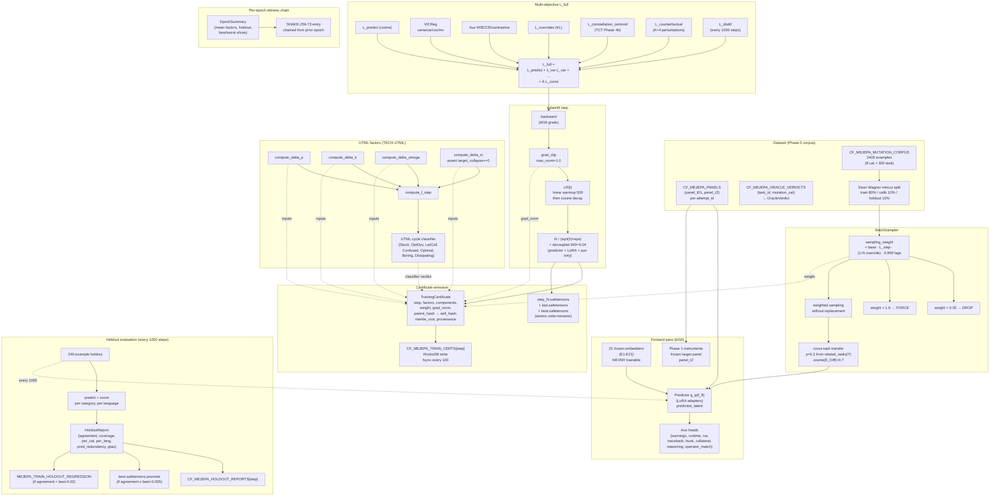

# Technical Specification — Phase 3 Training Loop Implementation

> **Level 3 (technical, *how* to build).** Implements `SPEC-TRAINING.md`. Subordinate to `specs/constitution.md` and `SPEC-UTML` / `TECH-UTML`. When this spec conflicts with the constitution or with `SPEC-TRAINING.md`, the higher-level document wins per `<spec_authority_order>`.

```xml
<technical_spec id="TECH-TRAINING" version="1.0" implements="SPEC-TRAINING">

<metadata>
  <title>Phase 3 Training Loop Implementation: Trainer + AdamW + Multi-Objective Loss + BatchSampler + Certificates + Holdout Evaluation</title>
  <status>draft</status>
  <owner>ME-JEPA Training Team / Phase 3</owner>
  <created_date>2026-05-09</created_date>
  <last_updated>2026-05-09</last_updated>
  <implements_specs>
    <spec_ref>SPEC-TRAINING</spec_ref>
  </implements_specs>
  <dependent_technical_specs>
    <spec_ref>TECH-UTML (compute_delta_*, L_step, sampling_weight, cert primitives)</spec_ref>
    <spec_ref>TECH-CORPUS (corpus loader + Stoer-Wagner split)</spec_ref>
    <spec_ref>TECH-INSTRUMENTS (Panel + frozen target readback)</spec_ref>
    <spec_ref>TECH-EMBEDDERS (21 frozen embedder loaders)</spec_ref>
  </dependent_technical_specs>
</metadata>

<architecture_diagram>



</architecture_diagram>

<crate_layout>

The Phase 3 training implementation lives in a single new crate, composing the already-shipped training infrastructure from `context-graph-embeddings`:

```
crates/
  context-graph-mejepa-train/                              (NEW; Phase 3)
    Cargo.toml
    src/
      bin/
        mejepa-train.rs                                    # entrypoint binary; CLI parsing; dispatches to Trainer
      lib.rs                                               # crate root; re-exports
      config.rs                                            # TrainingConfig + LossCoefficients (TOML loader)
      trainer.rs                                           # Trainer struct + train_one_epoch + main loop  (<500 LOC)
      sampler.rs                                           # BatchSampler + cross_task_transfer  (<500 LOC)
      loss/
        mod.rs                                             # multi-objective L_full assembler
        predict.rs                                         # L_predict (cosine error)
        vicreg.rs                                          # L_variance + L_covariance + L_invariance (reuses embeddings/training/loss.rs primitives)
        aux.rs                                             # L_warnings + L_runtime + L_memory + L_traceback + L_hunk + L_collateral + L_reasoning + L_overrides
        counterfactual.rs                                  # L_counterfactual + perturbation generator
        constellation.rs                                   # δ·L_constellation_centroid (calls into context-graph-mejepa-tct)
      cert/
        mod.rs                                             # TrainingCertificate struct + serialization
        emit.rs                                            # cert RocksDB write to CF_MEJEPA_TRAIN_CERTS; fsync every 100
        chain.rs                                           # parent_hash → self_hash; merkle_root; verify_chain replay
      eval/
        mod.rs                                             # HoldoutReport struct
        holdout.rs                                         # HoldoutEvaluator::evaluate_holdout
        slicing.rs                                         # per_mutation_category_accuracy, per_language_accuracy, generic_only_warning detector
        regression.rs                                      # promote_best / regression detector
      checkpoint.rs                                        # atomic write+rename; --resume validation
      epoch_witness.rs                                     # EpochSummary + 73-byte SHAKE-256 chain
      distillation.rs                                      # aux-head distillation cycle (reuses embeddings/training/distillation.rs)
      lora_wiring.rs                                       # attaches embeddings/training/lora.rs adapters to predictor + aux heads + trainable embedders
      error.rs                                             # TrainerError variants + .code() SCREAMING_SNAKE
    examples/
      train_smoke_fsv.rs                                   # 100-step smoke FSV
      train_cert_chain_fsv.rs                              # 100,000-step chain replay FSV
      train_holdout_eval_fsv.rs                            # synthetic 240-example holdout eval FSV
      train_l_step_evidence_fsv.rs                         # UTML L_step + sampling_weight evidence FSV

  context-graph-mejepa-train/  (DEPENDS ON, EXISTS)
    crates/context-graph-embeddings/src/training/
      trainer.rs                                           # base trainer abstractions (REUSED)
      optimizer.rs                                         # AdamW + warmup + cosine + clipping (REUSED)
      loss.rs                                              # InfoNCE + directional + soft-label primitives (REUSED for VICReg cosine + contrastive)
      evaluation.rs                                        # MRR + AUC + F1 metrics (REUSED for HoldoutReport metric impls)
      pipeline.rs                                          # multi-stage pipeline (REFERENCE for orchestration patterns)
      distillation.rs                                      # online distillation with quality_gate (REUSED)
      lora.rs                                              # LoRAAdapter (REUSED)
      multitask.rs                                         # multitask heads (REUSED for aux head infra)

  context-graph-mejepa/                                    (Phase 2 dep)
    src/predictor.rs                                       # MeJepaPredictor: forward(panel_t01) → predicted_latent
    src/target.rs                                          # FrozenTarget: readback(panel_t2) → target_latent

  context-graph-mejepa-instruments/                        (Phase 1 dep, partially shipped)
    src/                                                   # Panel + Instrument trait

  context-graph-mejepa-corpus/                             (Phase 0 dep, partially shipped)
    src/split.rs                                           # SplitMode::InstanceAtomic / RepoAtomic

  context-graph-mincut/                                    (shipped)
    src/                                                   # Stoer-Wagner mincut

  context-graph-witness/                                   (shipped + extended for UTML certs)
    src/                                                   # SHAKE-256-73 + ed25519 + Merkle helpers

  context-graph-mejepa-train/                              (NEW; consumes via TECH-UTML lib)
    crates/context-graph-mejepa-train/src/learning_signal/ # see TECH-UTML.md (compute_delta_*, l_step, sampling_weight, classifier)
```

All files &lt; 500 lines per constitution &lt;coding_standards&gt;. The `context-graph-mejepa-train` crate is intentionally thin: most logic delegates to either the shipped `context-graph-embeddings/src/training/` primitives (AdamW, LoRA, distillation, loss math) or the UTML library (TECH-UTML's `learning_signal/` module). Net-new code is the wiring (Trainer state machine, sampler, cert emission, holdout slicing, checkpoint orchestration).

</crate_layout>

<data_models>

<model name="Trainer">
  <field name="config" type="TrainingConfig" constraints="non_null"/>
  <field name="predictor" type="MeJepaPredictor" constraints="non_null; from context-graph-mejepa"/>
  <field name="target" type="FrozenTarget" constraints="non_null; from context-graph-mejepa; ZERO trainable params"/>
  <field name="aux_heads" type="AuxHeadEnsemble" constraints="non_null; warnings + runtime + rss + traceback + hunk + collateral + reasoning + operator_match"/>
  <field name="optimizer" type="AdamW" constraints="non_null; reuses context-graph-embeddings/src/training/optimizer.rs::AdamW"/>
  <field name="sampler" type="BatchSampler" constraints="non_null"/>
  <field name="cert_writer" type="TrainCertWriter" constraints="non_null; writes CF_MEJEPA_TRAIN_CERTS"/>
  <field name="checkpointer" type="Checkpointer" constraints="non_null; atomic write+rename"/>
  <field name="holdout_evaluator" type="HoldoutEvaluator" constraints="non_null"/>
  <field name="epoch_witness" type="EpochWitnessChain" constraints="non_null"/>
  <field name="distiller" type="AuxHeadDistiller" constraints="non_null; reuses embeddings/training/distillation.rs"/>
  <field name="lora_state" type="LoraState" constraints="non_null when config.full_finetune=false"/>
  <field name="learning_signal" type="LearningSignalComputer" constraints="non_null; from TECH-UTML"/>
  <field name="utml_classifier" type="UtmlCycleClassifier" constraints="non_null; from TECH-UTML"/>
  <field name="rocksdb" type="Arc&lt;rocksdb::DB&gt;" constraints="non_null; CF handles"/>
  <field name="step" type="u64" constraints="monotonic; primary cert key"/>
  <field name="best_holdout_agreement" type="f32" constraints="[0, 1]; tracks best-so-far for promotion"/>
  <field name="grad_norm_running_mean" type="f32" constraints="EMA over recent steps; for grad-explode detection"/>
  <field name="device" type="candle_core::Device" constraints="Cuda(0) on RTX 5090; sm_120a"/>
  <field name="dtype" type="candle_core::DType" constraints="BF16 for forward/backward; F32 for master weights"/>
</model>

<model name="BatchSampler">
  <field name="config" type="TrainingConfig" constraints="non_null"/>
  <field name="weights" type="Vec&lt;f32&gt;" constraints="length == n_examples; non-negative"/>
  <field name="overrides" type="Vec&lt;bool&gt;" constraints="length == n_examples"/>
  <field name="ages_days" type="Vec&lt;f32&gt;" constraints="length == n_examples; non-negative"/>
  <field name="l_steps" type="Vec&lt;f32&gt;" constraints="length == n_examples; in [0, 1]"/>
  <field name="task_ids" type="Vec&lt;TaskId&gt;" constraints="length == n_examples"/>
  <field name="patch_similarity_graph" type="PatchSimilarityGraph" constraints="non_null; from doc 09 §3.5.3"/>
  <field name="rng" type="SplitMix64" constraints="non_null; deterministic seed from config.random_seed"/>
  <field name="force_indices" type="Vec&lt;usize&gt;" constraints="indices where weight &gt; 1.0"/>
  <field name="drop_indices" type="Vec&lt;usize&gt;" constraints="indices where weight &lt; 0.05"/>
  <field name="regular_indices" type="Vec&lt;usize&gt;" constraints="indices where 0.05 ≤ weight ≤ 1.0"/>
</model>

<model name="TrainCertWriter">
  <field name="rocksdb" type="Arc&lt;rocksdb::DB&gt;" constraints="non_null"/>
  <field name="cf_train_certs" type="rocksdb::ColumnFamily" constraints="CF_MEJEPA_TRAIN_CERTS handle"/>
  <field name="last_self_hash" type="String" constraints="64-hex sha256; chain link"/>
  <field name="cert_count_since_fsync" type="u64" constraints="incremented per cert; triggers fsync at 100"/>
  <field name="code_version" type="String" constraints="40-hex git sha"/>
  <field name="corpus_sha" type="String" constraints="64-hex sha256 of corpus manifest"/>
  <field name="embedder_versions" type="HashMap&lt;String, String&gt;" constraints="21 keys (E1-E21); SHA-256 weight digests"/>
  <field name="frozen_at" type="String" constraints="ISO 8601 UTC; embedder freeze timestamp"/>
</model>

<model name="HoldoutEvaluator">
  <field name="holdout_dataset" type="HoldoutDataset" constraints="non_null; 240 examples per Stoer-Wagner mincut"/>
  <field name="calibration_dataset" type="CalibrationDataset" constraints="non_null; 240 examples"/>
  <field name="constellation" type="Option&lt;ConstellationGuard&gt;" constraints="None when Phase 4b not yet shipped"/>
  <field name="rocksdb" type="Arc&lt;rocksdb::DB&gt;" constraints="non_null; for HoldoutReport persistence"/>
  <field name="cf_holdout_reports" type="rocksdb::ColumnFamily" constraints="CF_MEJEPA_HOLDOUT_REPORTS"/>
</model>

<model name="EpochWitnessChain">
  <field name="rocksdb" type="Arc&lt;rocksdb::DB&gt;" constraints="non_null"/>
  <field name="cf_epoch_witness" type="rocksdb::ColumnFamily" constraints="CF_MEJEPA_EPOCH_WITNESS"/>
  <field name="last_epoch_hash" type="[u8; 32]" constraints="32-byte zero for genesis (epoch 0); else prior epoch's self_hash"/>
  <field name="ed25519_signing_key" type="ed25519_dalek::SigningKey" constraints="from operator keyring per SEC-MEJEPA-03"/>
</model>

<model name="EpochReport">
  <field name="epoch" type="u32" constraints="non-negative"/>
  <field name="summary" type="EpochSummary" constraints="non_null"/>
  <field name="witness_entry" type="EpochWitnessEntry" constraints="non_null; 73 bytes"/>
  <field name="phase3_dod_passed_at_this_epoch" type="Option&lt;bool&gt;" constraints="Some(true|false) on final epoch"/>
</model>

<model name="HoldoutReport">
  <field name="step" type="u64" constraints="primary key"/>
  <field name="prediction_oracle_agreement" type="f32" constraints="[0, 1]"/>
  <field name="conformal_coverage_calibration" type="f32" constraints="[0, 1]"/>
  <field name="per_mutation_category_accuracy" type="HashMap&lt;MutationCategory, f32&gt;" constraints="8 keys"/>
  <field name="per_language_accuracy" type="HashMap&lt;Lang, f32&gt;" constraints="11 keys"/>
  <field name="predictor_redundancy_pairwise_mi" type="f32" constraints="[0, 1]"/>
  <field name="gtau_pass_rate" type="f32" constraints="[0, 1]; 1.0 fallback when constellation None"/>
  <field name="generic_only_warning" type="Option&lt;String&gt;" constraints="populated when gap &gt; 0.10"/>
  <field name="phase3_dod_passed" type="Option&lt;bool&gt;" constraints="Some on final-step report only"/>
  <field name="timestamp_iso8601" type="String" constraints="ISO 8601 UTC"/>
</model>

<model name="EpochSummary">
  <field name="epoch" type="u32" constraints="non-negative"/>
  <field name="mean_l_step" type="f32" constraints="[0, 1]"/>
  <field name="mean_delta_p" type="f32" constraints="[0, 1]"/>
  <field name="mean_delta_k" type="f32" constraints="[0, 1]"/>
  <field name="mean_delta_omega" type="f32" constraints="[0, 1]"/>
  <field name="mean_delta_xi" type="f32" constraints="[0, 1]"/>
  <field name="holdout_agreement" type="f32" constraints="[0, 1]"/>
  <field name="best_category" type="MutationCategory" constraints="one of 8"/>
  <field name="worst_category" type="MutationCategory" constraints="one of 8"/>
  <field name="best_language" type="Lang" constraints="one of 11"/>
  <field name="worst_language" type="Lang" constraints="one of 11"/>
  <field name="total_steps_this_epoch" type="u64" constraints="non-negative"/>
  <field name="skipped_steps_this_epoch" type="u64" constraints="≤ total_steps_this_epoch"/>
</model>

<model name="EpochWitnessEntry">
  <field name="bytes" type="[u8; 73]" constraints="exactly 73 bytes per SHAKE-256-73 format"/>
  <field name="parent_witness_hash" type="[u8; 32]" constraints="prior epoch's self_hash"/>
  <field name="self_hash" type="[u8; 32]" constraints="SHAKE-256(canonical_json(EpochSummary)) truncated to 32 bytes"/>
  <field name="ed25519_signature" type="[u8; 64]" constraints="ed25519_dalek signature over (parent_hash || self_hash || epoch)"/>
  <field name="layout" type="String" constraints="bytes[0..32]=parent_hash; bytes[32..64]=self_hash; bytes[64..72]=epoch_u64_be; bytes[72..73]=version_byte"/>
</model>

<model name="TrainingCertificate">
  <field name="step" type="u64" constraints="primary_key, monotonic, big-endian-encoded"/>
  <field name="loss" type="f32" constraints="finite; equals L_full"/>
  <field name="loss_components" type="HashMap&lt;String, f32&gt;" constraints="13+ keys: predict/var/cov/inv/warn/runtime/rss/trace/hunk/collateral/reasoning/overrides/counterfactual/constellation"/>
  <field name="delta_p" type="f32" constraints="[0, 1]"/>
  <field name="delta_k" type="f32" constraints="[0, 1]"/>
  <field name="delta_omega" type="f32" constraints="[0, 1]"/>
  <field name="delta_xi" type="f32" constraints="[0, 1]"/>
  <field name="L_step" type="f32" constraints="[0, 1]; equals product"/>
  <field name="delta_p_components" type="DeltaPComponents" constraints="from TECH-UTML"/>
  <field name="delta_k_components" type="DeltaKComponents" constraints="from TECH-UTML"/>
  <field name="delta_omega_components" type="DeltaOmegaComponents" constraints="from TECH-UTML"/>
  <field name="delta_xi_components" type="DeltaXiComponents" constraints="target_collapse MUST == 0.0"/>
  <field name="sampling_weight" type="f32" constraints="non-negative"/>
  <field name="grad_norm" type="f32" constraints="non-negative; pre-clip value"/>
  <field name="grad_norm_running_mean" type="f32" constraints="non-negative; for explode-detection"/>
  <field name="drift_coverage" type="f32" constraints="[0, 1]; conformal coverage on rolling calibration window"/>
  <field name="parent_witness_hash" type="String" constraints="64-hex sha256"/>
  <field name="self_hash" type="String" constraints="64-hex sha256; deterministic from sorted-key JSON"/>
  <field name="merkle_root" type="String" constraints="64-hex sha256 over component sub-trees"/>
  <field name="code_version" type="String" constraints="40-hex git sha"/>
  <field name="corpus_sha" type="String" constraints="64-hex sha256"/>
  <field name="embedder_versions" type="HashMap&lt;String, String&gt;" constraints="21 keys"/>
  <field name="frozen_at" type="String" constraints="ISO 8601 UTC"/>
  <field name="timestamp_iso8601" type="String" constraints="ISO 8601 UTC"/>
  <field name="skip_reason" type="Option&lt;SkipReason&gt;" constraints="None when L_step &gt; 0"/>
  <field name="training_mode" type="String" constraints="'lora_rank_32' | 'full_finetune'"/>
  <field name="distillation_cycle_id" type="Option&lt;u64&gt;" constraints="Some when distillation cycle ran this step"/>
  <field name="distillation_loss_mean" type="Option&lt;f32&gt;" constraints="Some when distillation cycle ran"/>
  <field name="distillation_skipped_count" type="Option&lt;u64&gt;" constraints="Some when distillation cycle ran"/>
  <field name="counterfactual_smoothness" type="Option&lt;f32&gt;" constraints="Some when counterfactual cycle ran"/>
  <field name="counterfactual_smoothness_anomaly" type="bool" constraints="default false"/>
  <field name="cross_task_transfer_indices" type="Vec&lt;usize&gt;" constraints="batch slot indices drawn cross-task"/>
  <field name="cross_task_transfer_fallback_count" type="u64" constraints="non-negative"/>
  <field name="holdout_promotion" type="bool" constraints="true when this step's holdout promoted best.safetensors"/>
  <field name="generic_only_warning" type="Option&lt;String&gt;" constraints="populated when per-slice gap &gt; 0.10"/>
  <field name="phase3_dod_passed" type="Option&lt;bool&gt;" constraints="Some on final-step cert"/>
</model>

<model name="TrainerError">
  <field name="code" type="TrainerErrorCode (enum)" constraints="non_null"/>
  <field name="message" type="String" constraints="non_null"/>
  <field name="step" type="Option&lt;u64&gt;" constraints="optional"/>
  <field name="context" type="serde_json::Value" constraints="optional; full diagnostic context"/>
</model>

<model name="TrainerErrorCode">
  <field name="MejepaTrainLossNan" type="enum_variant" constraints="MEJEPA_TRAIN_LOSS_NAN"/>
  <field name="MejepaTrainGradExplode" type="enum_variant" constraints="MEJEPA_TRAIN_GRAD_EXPLODE"/>
  <field name="MejepaTrainVramOom" type="enum_variant" constraints="MEJEPA_TRAIN_VRAM_OOM"/>
  <field name="MejepaTrainCheckpointCorrupt" type="enum_variant" constraints="MEJEPA_TRAIN_CHECKPOINT_CORRUPT"/>
  <field name="MejepaTrainCertChainBroken" type="enum_variant" constraints="MEJEPA_TRAIN_CERT_CHAIN_BROKEN"/>
  <field name="MejepaTrainHoldoutRegression" type="enum_variant" constraints="MEJEPA_TRAIN_HOLDOUT_REGRESSION"/>
  <field name="MejepaInstrumentGradientLeak" type="enum_variant" constraints="MEJEPA_INSTRUMENT_GRADIENT_LEAK (CRITICAL — target_collapse &gt; 0)"/>
  <field name="MejepaTrainDodFailed" type="enum_variant" constraints="MEJEPA_TRAIN_DOD_FAILED (final agreement &lt; 0.75)"/>
  <field name="MejepaTrainConfigInvalid" type="enum_variant" constraints="MEJEPA_TRAIN_CONFIG_INVALID"/>
  <field name="MejepaTrainEmbedderDigestMismatch" type="enum_variant" constraints="MEJEPA_TRAIN_EMBEDDER_DIGEST_MISMATCH (per SEC-MEJEPA-02)"/>
</model>

<model name="SkipReason">
  <field name="PerfectPrediction" type="enum_variant" constraints="ΔP=0"/>
  <field name="CatastrophicForgetting" type="enum_variant" constraints="ΔK=0; cos_align&lt;0"/>
  <field name="NanInf" type="enum_variant" constraints="MEJEPA_OBSERVE_BATCH_NAN"/>
  <field name="GoodhartCatastrophe" type="enum_variant" constraints="ΔΩ.stability_floor=0 due to proxy decoupled"/>
  <field name="SnrBelowFloor" type="enum_variant" constraints="UTML_SNR_BELOW_FLOOR"/>
  <field name="GradExplode" type="enum_variant" constraints="‖g‖ &gt; 100× running mean"/>
  <field name="VramOom" type="enum_variant" constraints="recoverable OOM mid-step"/>
  <field name="OperatorAbort" type="enum_variant" constraints="explicit operator halt mid-step"/>
</model>

<model name="MutationCategory">
  <field name="KnownGood" type="enum_variant"/>
  <field name="SubtleFlip" type="enum_variant"/>
  <field name="OffByOne" type="enum_variant"/>
  <field name="SwapVariable" type="enum_variant"/>
  <field name="DeleteTestCall" type="enum_variant"/>
  <field name="WrongFile" type="enum_variant"/>
  <field name="OverEngineer" type="enum_variant"/>
  <field name="CompileError" type="enum_variant"/>
</model>

<model name="Lang">
  <field name="Rust" type="enum_variant"/>
  <field name="Python" type="enum_variant"/>
  <field name="JavaScript" type="enum_variant"/>
  <field name="TypeScript" type="enum_variant"/>
  <field name="Go" type="enum_variant"/>
  <field name="Java" type="enum_variant"/>
  <field name="C" type="enum_variant"/>
  <field name="Cpp" type="enum_variant"/>
  <field name="CSharp" type="enum_variant"/>
  <field name="Ruby" type="enum_variant"/>
  <field name="Php" type="enum_variant"/>
</model>

<rocksdb_column_families>
  <cf name="CF_MEJEPA_TRAIN_CERTS">
    <key>step (u64 big-endian for ordered iteration)</key>
    <value>JSON-serialized TrainingCertificate (sorted keys; deterministic)</value>
    <retention>retained per Phase 6 hygiene tier policy; cold tier after 90 days</retention>
    <invariant>cert[N].parent_witness_hash == sha256(cert[N-1].self_hash || cert[N-1].body_canonical_json)</invariant>
  </cf>
  <cf name="CF_MEJEPA_HOLDOUT_REPORTS">
    <key>step (u64 big-endian)</key>
    <value>JSON-serialized HoldoutReport (sorted keys)</value>
    <retention>retained 365 days</retention>
    <invariant>step in CF_MEJEPA_HOLDOUT_REPORTS implies step % holdout_eval_interval_steps == 0 (or final step)</invariant>
  </cf>
  <cf name="CF_MEJEPA_WEIGHT_BLOBS">
    <key>theta_sha (sha256 hex of weight blob)</key>
    <value>safetensors blob (deduplicated by content)</value>
    <retention>kept as long as any cert references the theta_sha</retention>
    <invariant>writes are content-addressed; never overwrite</invariant>
  </cf>
  <cf name="CF_MEJEPA_EPOCH_WITNESS">
    <key>epoch (u32 big-endian)</key>
    <value>EpochWitnessEntry (73 bytes raw)</value>
    <retention>retained permanently (audit trail)</retention>
    <invariant>entry[E].parent_witness_hash == sha256(entry[E-1].self_hash || entry[E-1].body); E=0 has zero parent</invariant>
  </cf>
</rocksdb_column_families>

</data_models>

<api_contracts>

<endpoint path="cargo run --release -p context-graph-mejepa-train -- train" method="CLI">
  <implements>REQ-TRAIN-01..12</implements>
  <request_body>
    --corpus PATH (required): Phase 0 corpus directory (CF_MEJEPA_MUTATION_CORPUS handle implicit)
    --output PATH (required): checkpoint output directory ./data/mejepa-checkpoints
    --epochs U32 (default 10)
    --batch-size USIZE (default 64)
    --lr F64 (default 5e-4)
    --weight-decay F64 (default 0.04)
    --warmup-steps U32 (default 500)
    --max-grad-norm F32 (default 1.0)
    --no-mixed-precision (flag; default false → mixed precision enabled)
    --full-finetune (flag; default false → LoRA mode)
    --lora-rank USIZE (default 32)
    --lora-alpha USIZE (default 16)
    --lora-dropout F32 (default 0.05)
    --checkpoint-interval-steps U64 (default 2000)
    --holdout-eval-interval-steps U64 (default 1000)
    --counterfactual-interval-steps U64 (default 5)
    --counterfactual-warmup-steps U64 (default 1000)
    --distillation-interval-steps U64 (default 1000)
    --cross-task-transfer-probability F32 (default 0.3)
    --cross-task-cosine-threshold F32 (default 0.7)
    --random-seed U64 (required)
    --resume PATH (optional; resume from last.safetensors)
    --config PATH (optional; TOML config; CLI flags override TOML)
  </request_body>
  <responses>
    0: success; ./data/mejepa-checkpoints/best.safetensors written; cert chain valid; phase3_dod_passed=true
    1: phase3 DoD failed (final agreement &lt; 0.75); MEJEPA_TRAIN_DOD_FAILED on stderr
    2: training halted mid-run (NaN escalation, grad explode, OOM, chain broken, 3-regression escalation, instrument gradient leak); structured error on stderr
    3: config invalid (MEJEPA_TRAIN_CONFIG_INVALID) or embedder digest mismatch (MEJEPA_TRAIN_EMBEDDER_DIGEST_MISMATCH); refuses to start
  </responses>
</endpoint>

<endpoint path="cargo run --release -p context-graph-mejepa-train -- verify-chain" method="CLI">
  <implements>REQ-TRAIN-03 (chain replay)</implements>
  <request_body>
    --rocksdb PATH (required): RocksDB instance with CF_MEJEPA_TRAIN_CERTS
    --from-step U64 (optional; default 0)
    --to-step U64 (optional; default last)
  </request_body>
  <responses>
    0: chain integrity verified across [from, to]; replay summary printed
    1: chain broken; MEJEPA_TRAIN_CERT_CHAIN_BROKEN with offending step
  </responses>
</endpoint>

<endpoint path="cargo run --release -p context-graph-mejepa-train -- eval-holdout" method="CLI">
  <implements>REQ-TRAIN-05 (standalone holdout eval)</implements>
  <request_body>
    --weights PATH (required): ./data/mejepa-checkpoints/best.safetensors
    --holdout PATH (required): holdout dataset directory
    --constellation PATH (optional): TCT constellation centroids if available
    --alpha F32 (default 0.10): conformal threshold
  </request_body>
  <responses>
    0: HoldoutReport printed to stdout (JSON); persisted to CF_MEJEPA_HOLDOUT_REPORTS
    1: weights load failed (MEJEPA_TRAIN_CHECKPOINT_CORRUPT)
  </responses>
</endpoint>

</api_contracts>

<component_contracts>

<component name="Trainer" path="crates/context-graph-mejepa-train/src/trainer.rs">

  <method name="new">
    <signature>
pub fn new(
    config: TrainingConfig,
    rocksdb: Arc&lt;rocksdb::DB&gt;,
    device: candle_core::Device,
) -&gt; Result&lt;Self, TrainerError&gt;
    </signature>
    <implements>REQ-TRAIN-01, REQ-TRAIN-11</implements>
    <behavior>
1. Validate config (ranges per data_requirements). Fail MEJEPA_TRAIN_CONFIG_INVALID otherwise.
2. Load 21 embedders via context-graph-embeddings::load_all() with SHA-256 digest verification per SEC-MEJEPA-02; fail MEJEPA_TRAIN_EMBEDDER_DIGEST_MISMATCH on mismatch.
3. Load Phase 2 predictor (MeJepaPredictor) and Phase 1 frozen target panel infrastructure.
4. Construct AuxHeadEnsemble.
5. If config.full_finetune=false: attach LoRA adapters (rank/alpha/dropout from config) to predictor + aux heads + trainable embedders (E2/E3/E4/E5/E15-E21) via lora_wiring::attach_loras; base instruments + frozen embedders remain non-trainable.
6. Construct AdamW: reuse context-graph-embeddings::training::optimizer::AdamW::new with AdamWConfig{lr_projection: config.lr, lr_lora: config.lr/10, lr_markers: config.lr, beta1=0.9, beta2=0.999, epsilon=1e-8, weight_decay=config.weight_decay, max_grad_norm=config.max_grad_norm, total_steps=config.epochs * (n_examples/batch_size), warmup_fraction=warmup_steps/total_steps}. Attach all trainable params with appropriate ParamGroup.
7. Construct BatchSampler::new(config, train_split, patch_similarity_graph, rng_seed=config.random_seed).
8. Construct TrainCertWriter::new(rocksdb, code_version=git rev-parse HEAD, corpus_sha=hash of corpus manifest, embedder_versions=21-key map, frozen_at=ISO 8601 now).
9. Construct Checkpointer, HoldoutEvaluator, EpochWitnessChain, AuxHeadDistiller.
10. Construct LearningSignalComputer + UtmlCycleClassifier from context-graph-mejepa-train::learning_signal (TECH-UTML).
11. Initialize step=0; best_holdout_agreement=0.0; grad_norm_running_mean=0.0.
12. Return Ok(Self).
    </behavior>
    <throws>TrainerError{code=MejepaTrainConfigInvalid | MejepaTrainEmbedderDigestMismatch | MejepaTrainCheckpointCorrupt}</throws>
  </method>

  <method name="train_one_epoch">
    <signature>
pub fn train_one_epoch(
    &amp;mut self,
    dataset: &amp;TrainingDataset,
    epoch: u32,
) -&gt; Result&lt;EpochReport, TrainerError&gt;
    </signature>
    <implements>REQ-TRAIN-01, REQ-TRAIN-02, REQ-TRAIN-03, REQ-TRAIN-04, REQ-TRAIN-06, REQ-TRAIN-07, REQ-TRAIN-08, REQ-TRAIN-09, REQ-TRAIN-12</implements>
    <behavior>
1. Recompute sampler.weights from current dataset.l_steps + overrides + ages (called weekly per UTML §6 in periodic-retrain mode; once per epoch in fresh-train mode).
2. Partition into {force_indices, drop_indices, regular_indices}. Surface warning to UT-02 if force_indices.len() &gt; batch_size/2 OR all weights &lt; 0.05.
3. Compute n_batches = ceil((force_indices.len() + regular_indices.len()) / batch_size).
4. For batch_idx in 0..n_batches:
   a. Compose batch via sampler.next_batch(batch_idx): start with all force_indices; fill remaining (batch_size − force_count) slots:
      - For each remaining slot: with p=config.cross_task_transfer_probability, pick one regular index whose task_id has cosine(E_Diff) &gt; 0.7 with current_task; with p=1−p, weighted-sample-without-replacement from regular_indices.
      - Track cross_task_transfer_indices and cross_task_transfer_fallback_count (when related_tasks empty).
   b. Load batch panels (panel_t01, panel_t2) from CF_MEJEPA_PANELS via dataset.load_batch.
   c. Forward pass (bf16 autocast):
      - predicted_latent = predictor.forward(panel_t01).
      - target_latent = frozen_target.readback(panel_t2).  [NEVER trainable per &lt;anti_patterns&gt;]
      - aux_outputs = aux_heads.forward(predictor.hidden_state).
   d. Compute loss components per loss::compose_l_full(predicted_latent, target_latent, aux_outputs, batch_metadata, config.loss_coefficients):
      - L_predict = mse(predicted_latent, target_latent.detach())
      - L_var, L_cov, L_inv = vicreg::compute(predicted_latent_only).
      - L_warn..L_overrides = aux::compute_each(aux_outputs, batch_metadata).
      - L_constellation = constellation::compute(predicted_latent, current_task) if Phase 4b ready else 0.0.
      - L_full = sum(weighted).
   e. If step % config.counterfactual_interval_steps == 0 AND step &gt; config.counterfactual_warmup_steps:
      - L_counterfactual = counterfactual::compute(panel_t01, K=4, eps={0.01,0.05,0.1,0.2}, predictor, frozen_target, seed=step·K).
      - L_full += config.loss_coefficients.alpha_counterfactual * L_counterfactual.
   f. Validate L_full.is_finite(). On NaN/Inf:
      - Emit MEJEPA_TRAIN_LOSS_NAN with diagnostic context.
      - cert.skip_reason = NanInf; rollback model state to start of step (no parameter motion); increment nan_count_in_window.
      - If nan_count_in_window &gt;= 3 within 100 steps → emit MEJEPA_TRAIN_GRAD_EXPLODE; halt.
      - emit_cert_skip(NanInf); continue to next batch.
   g. Backward pass: L_full.backward() on fp32 master weights via candle's autograd; gradients in bf16 cast to fp32 before optimizer step.
   h. Compute grad_norm before clipping; update grad_norm_running_mean (EMA, decay 0.99).
   i. If grad_norm &gt; 100 * grad_norm_running_mean: emit MEJEPA_TRAIN_GRAD_EXPLODE; clip aggressively to running_mean instead of max_norm=1.0; persist anomaly to cert; if recurring 3× in 100 steps → halt.
   j. Otherwise: clip g ← g · min(1.0, max_grad_norm / grad_norm).
   k. Compute UTML factors via learning_signal.compute_all(predicted_latent, target_latent, grad, ema_grad, fisher, ece, embedder_coherence, plasticity, landscape, stability, agent_state, target_collapse=0.0, redundancy, violation):
      - Returns (delta_p, delta_k, delta_omega, delta_xi, components, sub-components).
      - target_collapse asserted == 0.0 inside compute_delta_xi per TECH-UTML; raises MejepaInstrumentGradientLeak if violated.
   l. Compute L_step = compute_l_step(delta_p, delta_k, delta_omega, delta_xi); fail-closed on factor out of [0, 1].
   m. AdamW step: optimizer.step(grads, current_lr_per_group); lr_per_group from cosine schedule.
   n. Compute sampling_weight = compute_sampling_weight(L_step, override_flag, age_in_days, decay=0.995).
   o. emit_cert(step, loss=L_full, loss_components, delta_p, delta_k, delta_omega, delta_xi, L_step, sub-components, sampling_weight, grad_norm_pre_clip, drift_coverage, parent_hash, ...); persist to CF_MEJEPA_TRAIN_CERTS[step]; fsync every 100.
   p. If step % config.distillation_interval_steps == 0: distiller.run_cycle(); update cert.distillation_*.
   q. If step % config.holdout_eval_interval_steps == 0: holdout_evaluator.evaluate(predictor, aux_heads, current_step) → HoldoutReport; check promote/regress; emit MEJEPA_TRAIN_HOLDOUT_REGRESSION if applicable; promote best.safetensors if applicable.
   r. If step % config.checkpoint_interval_steps == 0: checkpointer.write(predictor, lora_state, aux_heads, optimizer.state(), sampler.rng_state(), step).
   s. step += 1.
5. Compute EpochSummary aggregating all certs of this epoch.
6. epoch_witness.append(EpochSummary) → 73-byte SHAKE-256 entry chained from prior epoch.
7. Return Ok(EpochReport{epoch, summary, witness_entry, phase3_dod_passed_at_this_epoch=if epoch == config.epochs - 1 { Some(holdout_agreement &gt;= config.phase3_dod_min_agreement) } else { None }}).
    </behavior>
    <throws>TrainerError{code=MejepaTrainLossNan | MejepaTrainGradExplode | MejepaTrainVramOom | MejepaTrainCheckpointCorrupt | MejepaTrainCertChainBroken | MejepaTrainHoldoutRegression | MejepaInstrumentGradientLeak}</throws>
  </method>

  <method name="evaluate_holdout">
    <signature>
pub fn evaluate_holdout(
    &amp;self,
    holdout: &amp;HoldoutDataset,
) -&gt; Result&lt;HoldoutReport, TrainerError&gt;
    </signature>
    <implements>REQ-TRAIN-05</implements>
    <behavior>
1. Iterate all 240 holdout examples; for each:
   a. predicted_latent = predictor.forward(panel_t01) (no_grad).
   b. predicted_oracle_pass = aux_heads.oracle_head(predicted_latent).softmax().argmax().
   c. actual_oracle_pass = oracle_verdict_for(task_id, mutation_category).pass_to_pass_resolved.
   d. Track agreement, per-category bucket, per-language bucket.
2. Compute predictor_redundancy_pairwise_mi over holdout panel slot statistics.
3. Compute conformal_coverage on calibration split: empirical fraction of (predicted_set, actual) pairs where actual ∈ predicted_set at α=0.10.
4. If self.constellation.is_some(): compute gtau_pass_rate = fraction of holdout panels passing Gτ guard. Else: 1.0.
5. Compute generic_only_warning: if max(per_category) - min(per_category) &gt; 0.10 OR max(per_language) - min(per_language) &gt; 0.10, populate with offending slices.
6. Construct HoldoutReport with all 9 fields + step + timestamp_iso8601.
7. Persist to CF_MEJEPA_HOLDOUT_REPORTS[step].
8. Return Ok(report).
    </behavior>
    <throws>TrainerError</throws>
  </method>

  <method name="run_full_training">
    <signature>
pub fn run_full_training(&amp;mut self, dataset: &amp;TrainingDataset) -&gt; Result&lt;TrainingResult, TrainerError&gt;
    </signature>
    <implements>REQ-TRAIN-01..12 (orchestration)</implements>
    <behavior>
1. For epoch in 0..config.epochs:
   a. epoch_report = self.train_one_epoch(dataset, epoch)?
   b. Log epoch_report.summary to stdout + memory/journal/.
   c. If epoch is final and epoch_report.phase3_dod_passed_at_this_epoch == Some(false): emit MEJEPA_TRAIN_DOD_FAILED; surface to UT-02; return Err.
2. Verify final cert chain integrity via cert::chain::verify_chain(rocksdb, 0..final_step). On break: MEJEPA_TRAIN_CERT_CHAIN_BROKEN.
3. Compute TrainingResult{final_holdout_agreement, total_walltime_seconds, total_steps, total_certs, best_safetensors_path}.
4. Emit FSV evidence to /tmp/contextgraph-mejepa-train-fsv/ with mode 0o600 per SEC-MEJEPA-07.
5. Return Ok(TrainingResult).
    </behavior>
    <throws>TrainerError</throws>
  </method>

</component>

<component name="BatchSampler" path="crates/context-graph-mejepa-train/src/sampler.rs">

  <method name="new">
    <signature>
pub fn new(
    config: &amp;TrainingConfig,
    train_split: &amp;TrainingDataset,
    patch_similarity_graph: PatchSimilarityGraph,
    rng_seed: u64,
) -&gt; Self
    </signature>
    <implements>REQ-TRAIN-04, REQ-TRAIN-07</implements>
    <behavior>
1. Initialize weights/overrides/ages_days/l_steps/task_ids vectors of length n_examples.
2. Initial weights = sampling_weight(L_step=initial 0.5 neutral, override_flag, age_in_days=0, decay=0.995) for all examples; refined every epoch.
3. Initialize SplitMix64 PRNG with rng_seed for deterministic batch composition.
4. Partition into force/regular/drop on first weight refresh.
    </behavior>
    <throws>none</throws>
  </method>

  <method name="recompute_weights">
    <signature>
pub fn recompute_weights(&amp;mut self, l_steps: &amp;[f32], current_iso_date: &amp;str) -&gt; Result&lt;(), TrainerError&gt;
    </signature>
    <implements>REQ-TRAIN-04 (weekly recompute per UTML §6)</implements>
    <behavior>
1. Validate l_steps.len() == self.weights.len(); fail otherwise.
2. For i in 0..n: ages_days[i] = days_between(examples[i].created_at, current_iso_date).
3. For i in 0..n: weights[i] = compute_sampling_weight(l_steps[i], overrides[i], ages_days[i], 0.995). Reuses TECH-UTML.
4. Re-partition into force_indices (weight &gt; 1.0), drop_indices (weight &lt; 0.05), regular_indices (else).
5. If force_indices.len() &gt; batch_size/2: log warning. If regular_indices.is_empty() AND force_indices.is_empty(): epoch is vacuous; surface warning.
6. Return Ok(()).
    </behavior>
    <throws>TrainerError</throws>
  </method>

  <method name="next_batch">
    <signature>
pub fn next_batch(&amp;mut self, batch_idx: u64, current_task: TaskId) -&gt; Result&lt;Batch, TrainerError&gt;
    </signature>
    <implements>REQ-TRAIN-04, REQ-TRAIN-07</implements>
    <behavior>
1. Reseed PRNG to (config.random_seed, batch_idx) for reproducibility per batch.
2. Initialize batch_indices = self.force_indices.clone() (force-include; truncate if &gt; batch_size).
3. While batch_indices.len() &lt; config.batch_size:
   a. With p = config.cross_task_transfer_probability:
      - related = patch_similarity_graph.related_tasks(current_task, threshold=config.cross_task_cosine_threshold).
      - If related.is_empty(): cross_task_fallback_count += 1; fall through to regular sampling.
      - Else: pick a regular_index whose task_id ∈ related uniformly at random; track in cross_task_transfer_indices.
   b. Else (or fallback): weighted_sample_without_replacement from regular_indices proportional to self.weights[regular_indices].
   c. Push selected index to batch_indices.
4. Construct Batch{indices: batch_indices, cross_task_indices, cross_task_fallback_count}.
5. Return Ok(batch).
    </behavior>
    <throws>TrainerError</throws>
  </method>

</component>

<component name="TrainCertWriter" path="crates/context-graph-mejepa-train/src/cert/emit.rs">

  <method name="emit">
    <signature>
pub fn emit(&amp;mut self, cert: TrainingCertificate) -&gt; Result&lt;(), TrainerError&gt;
    </signature>
    <implements>REQ-TRAIN-03, BR-TRAIN-03</implements>
    <behavior>
1. Validate cert.delta_xi_components.target_collapse == 0.0 (defense-in-depth; UTML enforces it primarily). If not, raise MejepaInstrumentGradientLeak.
2. Set cert.parent_witness_hash = self.last_self_hash.
3. Compute body_canonical_json = serde_json::to_string with sorted keys + cert.parent_witness_hash + all fields except cert.self_hash + cert.merkle_root.
4. Compute cert.merkle_root = merkle::compute_root(&[delta_p_components_json, delta_k_components_json, delta_omega_components_json, delta_xi_components_json, loss_components_json]).
5. Compute cert.self_hash = sha256_hex(body_canonical_json || cert.merkle_root).
6. final_json = serde_json::to_string canonical(cert) with sorted keys.
7. key_bytes = cert.step.to_be_bytes().
8. self.rocksdb.put_cf(self.cf_train_certs, key_bytes, final_json.as_bytes())?
9. self.last_self_hash = cert.self_hash.
10. self.cert_count_since_fsync += 1; if &gt;= 100: rocksdb.flush_cf(cf_train_certs); cert_count_since_fsync = 0.
11. Return Ok(()).
    </behavior>
    <throws>TrainerError{code=MejepaInstrumentGradientLeak (delegated)}</throws>
  </method>

  <method name="emit_cert_skip">
    <signature>
pub fn emit_cert_skip(&amp;mut self, step: u64, reason: SkipReason, partial_cert: PartialCertContext) -&gt; Result&lt;(), TrainerError&gt;
    </signature>
    <implements>REQ-TRAIN-03, BR-TRAIN-03</implements>
    <behavior>
1. Construct cert with skip_reason=Some(reason), sampling_weight=0.0, L_step=0.0, factors zeros where unknown.
2. Preserve known fields (grad_norm if computed pre-skip, partial loss components).
3. Call self.emit(cert) (chain link still emitted to preserve auditability).
4. Return Ok(()).
    </behavior>
    <throws>TrainerError</throws>
  </method>

  <method name="verify_chain">
    <signature>
pub fn verify_chain(&amp;self, from_step: u64, to_step: u64) -&gt; Result&lt;u64, TrainerError&gt;
    </signature>
    <implements>REQ-TRAIN-03, NFR-TRAIN-02</implements>
    <behavior>
1. expected_parent = if from_step == 0 then "00...00" (32-byte zero hex) else cert[from_step-1].self_hash.
2. For step in from_step..=to_step:
   a. cert_bytes = rocksdb.get_cf(cf_train_certs, step.to_be_bytes())?.ok_or(MejepaTrainCertChainBroken{step, reason="cert_missing"}).
   b. cert: TrainingCertificate = serde_json::from_slice(&amp;cert_bytes)?
   c. recomputed_self = sha256_hex(canonical_body(&amp;cert)).
   d. If cert.self_hash != recomputed_self: return Err(MejepaTrainCertChainBroken{step, expected=recomputed_self, actual=cert.self_hash}).
   e. If cert.parent_witness_hash != expected_parent: return Err(MejepaTrainCertChainBroken{step, expected=expected_parent, actual=cert.parent_witness_hash}).
   f. expected_parent = cert.self_hash.
3. Return Ok(to_step - from_step + 1).
    </behavior>
    <throws>TrainerError{code=MejepaTrainCertChainBroken}</throws>
  </method>

</component>

<component name="HoldoutEvaluator" path="crates/context-graph-mejepa-train/src/eval/holdout.rs">

  <method name="evaluate">
    <signature>
pub fn evaluate(
    &amp;mut self,
    predictor: &amp;MeJepaPredictor,
    aux_heads: &amp;AuxHeadEnsemble,
    step: u64,
    constellation: Option&lt;&amp;ConstellationGuard&gt;,
) -&gt; Result&lt;HoldoutReport, TrainerError&gt;
    </signature>
    <implements>REQ-TRAIN-05</implements>
    <behavior>
1. Initialize counters: total_correct=0; per_cat_counts={cat: (correct, total)}; per_lang_counts={lang: (correct, total)}; gtau_pass_count=0; gtau_total=0.
2. For example in self.holdout_dataset.iter():
   a. With candle no_grad: predicted_latent = predictor.forward(example.panel_t01).
   b. predicted_oracle_pass = aux_heads.oracle_head(predicted_latent).softmax().argmax().to_bool().
   c. actual_oracle_pass = example.oracle_verdict.pass_to_pass_resolved.
   d. is_correct = (predicted_oracle_pass == actual_oracle_pass).
   e. total_correct += is_correct as u64.
   f. per_cat_counts.entry(example.category).update((is_correct, 1)).
   g. per_lang_counts.entry(example.language).update((is_correct, 1)).
   h. If constellation.is_some(): gtau_total += 1; gtau_pass_count += constellation.unwrap().passes(predicted_latent, example.category, example.language) as u64.
3. agreement = total_correct as f32 / self.holdout_dataset.len() as f32.
4. Compute conformal_coverage on calibration split (separate iteration with α=0.10).
5. Compute predictor_redundancy_pairwise_mi via mutual_information::compute_pairwise(predicted_latents) helper.
6. gtau_pass_rate = if gtau_total &gt; 0 then gtau_pass_count as f32 / gtau_total as f32 else 1.0.
7. per_category_acc = HashMap::from(per_cat_counts.map(|(c, (correct, total))| (c, correct as f32 / total as f32))).
8. per_language_acc = same for languages.
9. Compute generic_only_warning:
   - cat_gap = per_category_acc.values().max() - per_category_acc.values().min().
   - lang_gap = per_language_acc.values().max() - per_language_acc.values().min().
   - If cat_gap &gt; 0.10 OR lang_gap &gt; 0.10: Some(format!("per_category_gap={:.2} per_language_gap={:.2}", cat_gap, lang_gap)).
   - Else: None.
10. Construct HoldoutReport with all fields populated; phase3_dod_passed = None (set by orchestrator on final report).
11. Persist via rocksdb.put_cf(cf_holdout_reports, step.to_be_bytes(), serde_json::to_string(&amp;report)).
12. Return Ok(report).
    </behavior>
    <throws>TrainerError</throws>
  </method>

  <method name="check_promote_or_regress">
    <signature>
pub fn check_promote_or_regress(
    &amp;self,
    report: &amp;HoldoutReport,
    best_so_far: &amp;mut f32,
    promotion_threshold: f32,
    regression_threshold: f32,
    consecutive_regression_count: &amp;mut u32,
) -&gt; Result&lt;PromoteRegressDecision, TrainerError&gt;
    </signature>
    <implements>REQ-TRAIN-05, BR-TRAIN-05</implements>
    <behavior>
1. delta = report.prediction_oracle_agreement − *best_so_far.
2. If delta &gt;= promotion_threshold:
   - *best_so_far = report.prediction_oracle_agreement.
   - *consecutive_regression_count = 0.
   - Return Ok(PromoteRegressDecision::Promote).
3. If delta &lt;= -regression_threshold:
   - *consecutive_regression_count += 1.
   - If *consecutive_regression_count &gt;= 3:
     - Return Err(MejepaTrainHoldoutRegression{step: report.step, current: report.prediction_oracle_agreement, prior_best: *best_so_far, delta, slice_breakdowns: ..., consecutive: *consecutive_regression_count, escalated: true}).
   - Else:
     - Surface warning (non-halt); Return Ok(PromoteRegressDecision::RegressWarn{delta}).
4. Else:
   - *consecutive_regression_count = 0.
   - Return Ok(PromoteRegressDecision::NoChange).
    </behavior>
    <throws>TrainerError{code=MejepaTrainHoldoutRegression}</throws>
  </method>

</component>

<component name="Checkpointer" path="crates/context-graph-mejepa-train/src/checkpoint.rs">

  <method name="write_step_checkpoint">
    <signature>
pub fn write_step_checkpoint(
    &amp;self,
    output_dir: &amp;Path,
    step: u64,
    predictor: &amp;MeJepaPredictor,
    lora_state: Option&lt;&amp;LoraState&gt;,
    aux_heads: &amp;AuxHeadEnsemble,
    optimizer_state: &amp;AdamWState,
    sampler_rng_state: u64,
) -&gt; Result&lt;String, TrainerError&gt;
    </signature>
    <implements>REQ-TRAIN-10</implements>
    <behavior>
1. step_path = output_dir.join(format!("step_{}.safetensors", step)).
2. tmp_path = output_dir.join(format!("step_{}.safetensors.tmp", step)).
3. Build SafeTensors blob with named tensors:
   - predictor weights (or LoRA delta only if lora_state.is_some()).
   - aux_heads weights.
   - optimizer.m, optimizer.v, optimizer.step, optimizer.lr_schedule_state.
   - sampler_rng_state as u64 in metadata.
   - code_version + corpus_sha + frozen_at in metadata.
4. Compute theta_sha = sha256_hex(blob).
5. Persist blob to CF_MEJEPA_WEIGHT_BLOBS[theta_sha] (deduplicated; skip write if already present).
6. Write blob to tmp_path; fsync.
7. Atomic rename tmp_path → step_path (POSIX rename(2) atomic guarantee).
8. Update last.safetensors symlink/copy: rename last.safetensors → last.safetensors.prev (if exists); copy step_path → last.safetensors atomically.
9. Return Ok(theta_sha).
    </behavior>
    <throws>TrainerError</throws>
  </method>

  <method name="promote_best">
    <signature>
pub fn promote_best(&amp;self, output_dir: &amp;Path, source_step: u64) -&gt; Result&lt;(), TrainerError&gt;
    </signature>
    <implements>REQ-TRAIN-05, REQ-TRAIN-10</implements>
    <behavior>
1. source_path = output_dir.join(format!("step_{}.safetensors", source_step)).
2. tmp_best = output_dir.join("best.safetensors.tmp").
3. Copy source_path → tmp_best.
4. Atomic rename tmp_best → output_dir.join("best.safetensors").
5. Return Ok(()).
    </behavior>
    <throws>TrainerError</throws>
  </method>

  <method name="resume_from">
    <signature>
pub fn resume_from(
    &amp;self,
    checkpoint_path: &amp;Path,
    rocksdb: &amp;rocksdb::DB,
) -&gt; Result&lt;ResumedState, TrainerError&gt;
    </signature>
    <implements>REQ-TRAIN-10, AC-TRAIN-10-02</implements>
    <behavior>
1. Load SafeTensors from checkpoint_path. On dtype mismatch / missing keys: return Err(MejepaTrainCheckpointCorrupt).
2. Extract step from metadata; verify cert chain ends at this step:
   - last_cert_step = max key in CF_MEJEPA_TRAIN_CERTS.
   - If checkpoint.step != last_cert_step: return Err(MejepaTrainCheckpointCorrupt{checkpoint_step, last_cert_step}).
3. Verify cert chain integrity via TrainCertWriter::verify_chain(0, last_cert_step). On break: return Err(MejepaTrainCertChainBroken).
4. Reconstruct ResumedState{predictor_weights, lora_state, aux_heads_weights, optimizer_state, sampler_rng_state, step}.
5. Return Ok(ResumedState).
    </behavior>
    <throws>TrainerError{code=MejepaTrainCheckpointCorrupt | MejepaTrainCertChainBroken}</throws>
  </method>

</component>

<component name="EpochWitnessChain" path="crates/context-graph-mejepa-train/src/epoch_witness.rs">

  <method name="append">
    <signature>
pub fn append(&amp;mut self, summary: EpochSummary) -&gt; Result&lt;EpochWitnessEntry, TrainerError&gt;
    </signature>
    <implements>REQ-TRAIN-09, BR-TRAIN-09, NFR-TRAIN-07</implements>
    <behavior>
1. canonical = serde_json::to_string canonical(summary) with sorted keys.
2. self_hash = shake256_truncated(canonical, 32 bytes).
3. signature_payload = self.last_epoch_hash || self_hash || summary.epoch.to_be_bytes() (32+32+8=72 bytes).
4. ed25519_signature = self.ed25519_signing_key.sign(&amp;signature_payload).to_bytes() (64 bytes).
5. entry_bytes = build 73-byte payload: bytes[0..32]=self.last_epoch_hash; bytes[32..64]=self_hash; bytes[64..72]=summary.epoch.to_be_bytes(); bytes[72..73]=version_byte=0x01.
   (Note: ed25519_signature 64 bytes stored in CF_MEJEPA_EPOCH_WITNESS metadata adjacent to entry_bytes per cf value layout.)
6. self.rocksdb.put_cf(self.cf_epoch_witness, summary.epoch.to_be_bytes(), serialize(EpochWitnessEntry{bytes: entry_bytes, parent_witness_hash: self.last_epoch_hash, self_hash, ed25519_signature, layout: "v1"}).
7. self.last_epoch_hash = self_hash.
8. Return Ok(entry).
    </behavior>
    <throws>TrainerError</throws>
  </method>

  <method name="verify_chain">
    <signature>
pub fn verify_chain(&amp;self, from_epoch: u32, to_epoch: u32, verifying_key: &amp;ed25519_dalek::VerifyingKey) -&gt; Result&lt;u32, TrainerError&gt;
    </signature>
    <implements>REQ-TRAIN-09, NFR-TRAIN-02</implements>
    <behavior>
1. expected_parent = if from_epoch == 0 then [0u8; 32] else cf_epoch_witness[from_epoch - 1].self_hash.
2. For e in from_epoch..=to_epoch:
   a. entry = rocksdb.get_cf(cf_epoch_witness, e.to_be_bytes())?.
   b. Verify entry.bytes[0..32] == expected_parent. Else: MejepaTrainCertChainBroken.
   c. Verify ed25519 signature over (parent_hash || self_hash || epoch.to_be_bytes()) against verifying_key. Else: MejepaTrainCertChainBroken.
   d. expected_parent = entry.bytes[32..64].
3. Return Ok(to_epoch - from_epoch + 1).
    </behavior>
    <throws>TrainerError{code=MejepaTrainCertChainBroken}</throws>
  </method>

</component>

<component name="AuxHeadDistiller" path="crates/context-graph-mejepa-train/src/distillation.rs">

  <method name="run_cycle">
    <signature>
pub fn run_cycle(
    &amp;mut self,
    predictor: &amp;mut MeJepaPredictor,
    aux_heads: &amp;mut AuxHeadEnsemble,
    dataset: &amp;TrainingDataset,
    cycle_id: u64,
    n_batches: usize,
    quality_gate: bool,
) -&gt; Result&lt;DistillationCycleReport, TrainerError&gt;
    </signature>
    <implements>REQ-TRAIN-08, BR-TRAIN-08</implements>
    <behavior>
1. Snapshot aux_heads weights as frozen teachers (deep clone).
2. Set aux_heads.requires_grad = false (frozen during cycle).
3. distill_loss_sum = 0.0; skipped_count = 0.
4. For batch_idx in 0..n_batches:
   a. batch = sampler.next_batch(...).
   b. predictor.hidden = predictor.forward_to_hidden(batch.panel_t01).
   c. teacher_logits = frozen_aux_heads.forward(predictor.hidden) (no_grad).
   d. If quality_gate: teacher_confidence = softmax(teacher_logits).max(); if &lt; threshold: skipped_count += 1; continue.
   e. student_logits = aux_heads.forward(predictor.hidden) (with_grad on predictor.hidden ONLY; aux_heads frozen).
   f. L_distill_batch = sum over heads of KL(softmax(teacher_logits) || softmax(student_logits)).
   g. L_distill_batch.backward() — gradients flow ONLY into predictor weights.
   h. Use distillation-specific small LR (e.g., self.config.lr / 5). Optimizer applies.
   i. distill_loss_sum += L_distill_batch.detach().to_f32().
5. aux_heads.requires_grad = true (re-enable; original aux head training resumes next non-distillation step).
6. Return Ok(DistillationCycleReport{cycle_id, mean_loss: distill_loss_sum / n_batches as f32, skipped_count}).
    </behavior>
    <throws>TrainerError</throws>
    <implementation_note>Reuses crates/context-graph-embeddings/src/training/distillation.rs::DistillationLoop with quality_gate=true and the EMA-style gating already shipped per doc 12 §6.</implementation_note>
  </method>

</component>

<component name="LossComposer" path="crates/context-graph-mejepa-train/src/loss/mod.rs">

  <method name="compose_l_full">
    <signature>
pub fn compose_l_full(
    predicted_latent: &amp;Tensor,
    target_latent: &amp;Tensor,
    aux_outputs: &amp;AuxOutputs,
    batch_metadata: &amp;BatchMetadata,
    coefficients: &amp;LossCoefficients,
    constellation: Option&lt;&amp;ConstellationGuard&gt;,
) -&gt; Result&lt;(Tensor, HashMap&lt;String, f32&gt;), TrainerError&gt;
    </signature>
    <implements>REQ-TRAIN-02, BR-TRAIN-02</implements>
    <behavior>
1. l_predict = predict::compute(predicted_latent, target_latent.detach()).  // detach: NO gradient through frozen target
2. (l_var, l_cov, l_inv) = vicreg::compute(predicted_latent).  // NEVER on target side
3. l_warn = aux::warnings_mse(aux_outputs.warnings, batch_metadata.actual_warnings).
4. l_runtime = aux::runtime_mse(aux_outputs.log_runtime, batch_metadata.actual_log_runtime).
5. l_rss = aux::memory_mse(aux_outputs.peak_rss, batch_metadata.actual_peak_rss).
6. l_trace = aux::traceback_contrastive(aux_outputs.traceback_features, batch_metadata.actual_traceback_clusters).
7. l_hunk = aux::hunk_attribution_ce(aux_outputs.per_hunk_logits, batch_metadata.actual_per_hunk_verdicts).
8. l_adjacent = aux::collateral_binary_ce(aux_outputs.adjacent_test_logits, batch_metadata.actual_adjacent_test_outcomes).
9. l_reasoning = aux::reasoning_contrastive(aux_outputs.reasoning_features, batch_metadata.actual_cot_clusters).
10. l_overrides = aux::operator_match_kl(aux_outputs.full_verdict, batch_metadata.operator_gold) summed only over override examples (zero contribution otherwise).
11. l_const = if constellation.is_some() { constellation.unwrap().centroid_loss(predicted_latent, batch_metadata.task_categories, batch_metadata.task_languages) } else { Tensor::zeros() }.
12. l_full = l_predict
        + coefficients.lambda_var * l_var + coefficients.lambda_cov * l_cov + coefficients.lambda_inv * l_inv
        + coefficients.alpha_warn * l_warn + coefficients.alpha_runtime * l_runtime + coefficients.alpha_rss * l_rss
        + coefficients.alpha_trace * l_trace + coefficients.alpha_hunk * l_hunk + coefficients.alpha_adjacent * l_adjacent
        + coefficients.alpha_reasoning * l_reasoning + coefficients.alpha_overrides * l_overrides
        + coefficients.delta * l_const.
13. components_map = {"predict": l_predict.to_f32(), "var": l_var.to_f32(), ..., "constellation": l_const.to_f32()}.
14. Validate l_full.is_finite(); fail MejepaTrainLossNan otherwise.
15. Return Ok((l_full, components_map)).
    </behavior>
    <throws>TrainerError{code=MejepaTrainLossNan}</throws>
    <implementation_note>vicreg::compute reuses crates/context-graph-embeddings/src/training/loss.rs vicreg primitives where they match Bardes 2022; aux::* reuse the contrastive + cross-entropy impls in the same module.</implementation_note>
  </method>

</component>

<component name="CounterfactualGenerator" path="crates/context-graph-mejepa-train/src/loss/counterfactual.rs">

  <method name="compute">
    <signature>
pub fn compute(
    panel_t01: &amp;Tensor,
    k: usize,
    epsilons: &amp;[f32],
    predictor: &amp;MeJepaPredictor,
    target: &amp;FrozenTarget,
    seed: u64,
) -&gt; Result&lt;(Tensor, f32), TrainerError&gt;  // (loss, smoothness)
    </signature>
    <implements>REQ-TRAIN-06, BR-TRAIN-06</implements>
    <behavior>
1. Validate k == epsilons.len(); validate k == 4 per doc 09 §3.7.3 invariant.
2. Initialize PRNG with seed.
3. losses = vec![]; smoothness_sum = 0.0; original_pred = predictor.forward(panel_t01).detach().
4. For (i, eps) in epsilons.iter().enumerate():
   a. v = sample_unit_vector(panel_t01.dim_last(), seed=seed.wrapping_add(i as u64 * 1000)).
   b. perturbed = panel_t01 + eps * v.
   c. perturbed_pred = predictor.forward(perturbed).
   d. perturbed_target = target.readback(perturbed).detach().
   e. losses.push(mse(perturbed_pred, perturbed_target)).
   f. smoothness_sum += (1.0 - cosine(perturbed_pred, original_pred)) / eps.
5. l_counterfactual = mean(losses).
6. local_smoothness = smoothness_sum / k as f32.
7. Return Ok((l_counterfactual, local_smoothness)).
    </behavior>
    <throws>TrainerError</throws>
  </method>

</component>

<component name="LoraWiring" path="crates/context-graph-mejepa-train/src/lora_wiring.rs">

  <method name="attach_loras">
    <signature>
pub fn attach_loras(
    predictor: &amp;mut MeJepaPredictor,
    aux_heads: &amp;mut AuxHeadEnsemble,
    embedders: &amp;mut Embedders,
    rank: usize,
    alpha: usize,
    dropout: f32,
) -&gt; Result&lt;LoraState, TrainerError&gt;
    </signature>
    <implements>REQ-TRAIN-11, BR-TRAIN-11</implements>
    <behavior>
1. lora_adapters = HashMap::new().
2. For each q/k/v projection in predictor.attention_layers:
   a. adapter = embeddings::training::lora::LoRAAdapter::new(in_dim, out_dim, rank, alpha, dropout).
   b. lora_adapters.insert(("predictor", layer_id, "qkv"), adapter).
   c. Wrap projection: forward(x) = base_projection(x) + adapter.forward(x).
3. For each aux head: same pattern over its q/k/v.
4. For each TRAINABLE embedder ∈ {E2, E3, E4, E5, E15, E16, E17, E18, E19, E20, E21}: same pattern. (E1, E6, E7, E8, E9, E10, E11, E12, E13, E14 are inference-only frozen.)
5. Set base weights of predictor + aux + trainable embedders to requires_grad=false.
6. lora_adapters values + LayerNorm + biases + aux_head output projections set to requires_grad=true.
7. Return Ok(LoraState{adapters: lora_adapters, base_weights_sha: sha256_of_base_weights}).
    </behavior>
    <throws>TrainerError</throws>
    <implementation_note>Reuses crates/context-graph-embeddings/src/training/lora.rs::LoRAAdapter (rank=32, alpha=16, dropout=0.05 defaults); per doc 12 §6 this is the UTML §V.1 effective_plasticity intervention surface.</implementation_note>
  </method>

</component>

</component_contracts>

<error_handling>

<rule>Every fallible operation returns Result&lt;T, TrainerError&gt; per constitution &lt;coding_standards&gt;.</rule>
<rule>TrainerError carries SCREAMING_SNAKE .code() tag matching constitution &lt;failure_taxonomy&gt;.</rule>
<rule>Source-of-truth file paths in error context start with `file:` (or `git:` for SHAs) per &lt;file_organization&gt;.</rule>
<rule>NaN/Inf detection before any optimizer step write; rollback on failure with no parameter motion.</rule>
<rule>Cert chain integrity checked every 1,000 steps in addition to on-demand replay; mid-run break halts immediately to prevent further chain-off-broken-link writes.</rule>
<rule>Holdout regression: 1st emit warning + cert.regression_warning; 3rd consecutive escalates to halt + critical blocker.</rule>
<rule>VRAM OOM is HALT (no partial state); recommend operator action (smaller batch_size or gradient checkpointing).</rule>
<rule>target_collapse &gt; 0 is CRITICAL; halt training immediately; require operator inspection of Instrument trait impls for accidental requires_grad=true.</rule>

</error_handling>

<implementation_notes>

<note category="reuse">REUSE crates/context-graph-embeddings/src/training/optimizer.rs::AdamW directly. Pre-shipped warmup + cosine + clipping + decoupled WD per-parameter-group are exactly what Phase 3 requires. New code limited to wiring the param groups (predictor projection vs LoRA vs aux head markers) and total_steps computation.</note>

<note category="reuse">REUSE crates/context-graph-embeddings/src/training/loss.rs primitives where they match: VICReg variance/covariance/invariance, InfoNCE for L_traceback / L_reasoning contrastive terms, soft-label CE for L_hunk / L_collateral. Composite L_full assembly in loss/mod.rs is net-new but trivial.</note>

<note category="reuse">REUSE crates/context-graph-embeddings/src/training/distillation.rs::DistillationLoop with quality_gate=true. Aux-head distillation cycle delegates entirely; only the cycle scheduling (every 1,000 steps) + frozen-teacher snapshot logic is net-new.</note>

<note category="reuse">REUSE crates/context-graph-embeddings/src/training/lora.rs::LoRAAdapter with rank=32 default per doc 12 §6 risk #5 cap. Wiring layer (lora_wiring.rs) is net-new but thin (~200 LOC).</note>

<note category="reuse">REUSE crates/context-graph-embeddings/src/training/evaluation.rs metric primitives (MRR, AUC, F1) as inputs to HoldoutReport; agreement is fraction-correct so trivial.</note>

<note category="reuse">REUSE context-graph-mincut::stoer_wagner for any re-splitting need; the train/calibration/holdout split is already produced by Phase 0 (context-graph-mejepa-corpus::split.rs SplitMode::InstanceAtomic shipped 2026-05-09e per memory).</note>

<note category="reuse">REUSE context-graph-witness::shake256_73 + ed25519 + Merkle helpers for per-step cert chain + per-epoch witness chain. Both already shipped.</note>

<note category="reuse">REUSE context-graph-mejepa-train::learning_signal::* (TECH-UTML library) for compute_delta_p / _k / _omega / _xi / l_step / sampling_weight / classifier. This crate is the consumer.</note>

<note category="security">Per SEC-MEJEPA-02: load embedder weights via models_config.toml; refuse if SHA-256 digest mismatches. Trainer init fails MEJEPA_TRAIN_EMBEDDER_DIGEST_MISMATCH.</note>

<note category="security">Per SEC-MEJEPA-03: ed25519 signing key from operator keyring (e.g., file:~/.cache/cgreality/keys/mejepa-train-ed25519.pem mode 0o600); private key never leaves operator hardware. Each per-epoch witness entry signed.</note>

<note category="security">Per SEC-MEJEPA-07: FSV evidence files in /tmp/contextgraph-mejepa-train-fsv/ created with mode 0o600. Use std::os::unix::fs::PermissionsExt explicitly on every fs::write.</note>

<note category="performance">Per NFR-TRAIN-01 + constitution &lt;performance_budgets&gt;: per-step training latency p50 &lt; 50ms target = predictor forward (~30ms candle/cuda bf16) + 4 deltas (~5ms; cached components) + AdamW step (~5ms) + cert serialize+write (~5ms; write is async-batched) + sampler next_batch (~2ms). Total ~47ms p50 budget.</note>

<note category="performance">Per NFR-TRAIN-04 + doc 12 §4: VRAM budget 29 GB on RTX 5090 = 21 frozen embedders ~14 GB (bf16) + predictor + aux heads ~3 GB + LoRA adapters ~0.5 GB + activations ~6 GB + KV-cache ~3 GB + AdamW state (m, v, fp32 master weights) ~2 GB. Tight; lazy-load E15-E21 if budget tightens (per doc 12 §4 risk #2).</note>

<note category="performance">Atomic checkpoint write: write to *.tmp on same filesystem; fsync; rename. POSIX rename(2) is atomic same-fs. NEVER cross-fs rename (would copy). Verify ./data/mejepa-checkpoints is on the same fs as /tmp/checkpoint-staging if used.</note>

<note category="performance">RocksDB writes batched: cert write per step, but flush_cf only every 100 certs. fsync is the durability bound; cert chain itself is verifiable post-recovery from disk-resident certs.</note>

<note category="determinism">Per constitution &lt;coding_standards&gt; "No random initialization in instrument outputs" + reality_loop_contract: same seed + same code_version + same corpus_sha + same embedder_versions produces byte-equal cert chain. Achieved by: (a) deterministic SplitMix64 PRNG per BatchSampler, (b) seeded counterfactual perturbations from (step, ε_idx), (c) sorted-key JSON canonicalization of certs, (d) timestamp_iso8601 EXCLUDED from canonical_body hash.</note>

<note category="generic_only">Per constitution &lt;anti_patterns&gt; "Generic-Only" + reality_loop_contract §11.4: no per-task overfit. Implementation enforces: (a) HoldoutReport.per_mutation_category_accuracy + per_language_accuracy expose any GENERIC-ONLY violation; (b) generic_only_warning surfaces gaps &gt; 0.10; (c) cross-task transfer (REQ-TRAIN-07) structurally upweights related-task gradient signal; (d) loss coefficients are global, never per-task.</note>

<note category="utml_invariant">Per constitution &lt;utml_v1_invariants&gt; rule 2: ΔΞ.target_collapse = 0 by construction. Defense-in-depth: TECH-UTML enforces in compute_delta_xi; TECH-TRAINING re-asserts in TrainCertWriter::emit before persistence; auditor (UT-05) replay invariant-scans the full chain. Triple defense; any single observation of nonzero is CRITICAL halt.</note>

<note category="utml_invariant">Per constitution &lt;utml_v1_invariants&gt; rule 3 (coaching order): training trains the loss but the UTML cycle classifier verdict feeds Phase 5 self-healing scheduler. Training itself does NOT auto-prune curriculum; only Phase 5 controller may, and ONLY when Stuck classification (all three signals: L_step low + ΔΩ &gt; 0.4 + ΔΞ &gt; 0.4) fires.</note>

<note category="anti_pattern">Per constitution &lt;anti_patterns&gt; "no learnable target encoder": Phase 1 instruments + Phase 2 frozen target panel readback NEVER trainable, regardless of --full-finetune flag. lora_wiring::attach_loras explicitly excludes them. Code path that pushes gradients through a frozen Instrument trait impl is a CRITICAL bug; CI guard scans for any requires_grad=true on Instrument-trait types.</note>

<note category="integration">Phase 3 hands off to Phase 4 (inference) via best.safetensors + corpus_sha + embedder_versions metadata. Phase 4 verifies all three before loading. Phase 4 also reads conformal_coverage_calibration from final HoldoutReport to set conformal threshold.</note>

<note category="integration">Phase 3 emits to Phase 5 (self-healing) via UTML cycle classifier verdicts in cert.utml_state + holdout regression alerts via MEJEPA_TRAIN_HOLDOUT_REGRESSION. Phase 5 owns intervention scheduling; Phase 3 only emits diagnostics.</note>

<note category="integration">Phase 3 prepares for Phase 7 (mejepa-shift-subscriber) by ensuring best.safetensors + LoRA adapters loadable for online observe(). Subscriber's online observe path reuses the same AdamW + LoRA infrastructure but with EWC++ regularization atop (Phase 5 dependency).</note>

<note category="testing">FSV protocol per constitution &lt;fsv_protocol&gt;: every shipped primitive ships with example binary writing evidence to /tmp/contextgraph-mejepa-train-fsv/ and re-reading + asserting. Phase 3 ships 4 FSVs: train_smoke_fsv (100-step), train_cert_chain_fsv (100k chain replay), train_holdout_eval_fsv (synthetic 240-example), train_l_step_evidence_fsv (sampling_weight histogram).</note>

<note category="testing">Per constitution &lt;testing_requirements&gt; coverage_minimum 80%; 90% for safety-critical paths. Phase 3 safety-critical paths = cert emission + chain verification + checkpoint write/resume + holdout regression detection. Target: 95% line + branch coverage on these.</note>

<note category="config">TrainingConfig loadable from TOML; CLI flags override TOML; TOML fields documented in config.rs with serde defaults matching this spec's defaults.</note>

<note category="config">Per memory/decisions and operator directive: training runs locally on operator hardware; no cost caps; no remote network calls. All weights local; all RocksDB local; no HTTP from training crate.</note>

<note category="resume">Resume scenarios:
1. Clean kill at checkpoint boundary → resume produces identical step N+1 (verifiable with deterministic seed).
2. Kill mid-step → resume from prior checkpoint loses up to (checkpoint_interval_steps - 1) steps; cert chain may have partial step missing → cert chain replay halts at the partial step → operator must recover (drop partial cert from CF or roll back to (N-K) checkpoint).
3. Kill during holdout eval → on resume, holdout report incomplete; trainer detects and re-runs.</note>

<note category="provenance">Per constitution &lt;provenance&gt; rule "Every clean-room reimplementation cites its inspirational source": SHAKE-256-73 chain inspired by ruvnet/RuVector witness format; LoRA inspired by Hu et al. 2021 microsoft/LoRA; AdamW inspired by Loshchilov &amp; Hutter 2019 + PyTorch reference impl. All clean-room.</note>

</implementation_notes>

</technical_spec>
```
