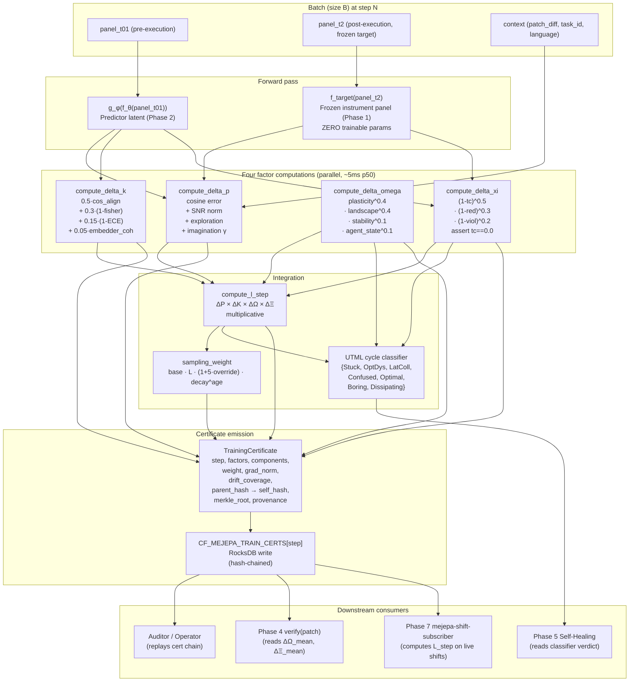

# Technical Specification — UTML v1.0 Four-Factor Learning Formula Implementation

> **📊 2026-05-10 STATUS:** PARTIAL — see ../implementation-plan.md for the full Phase 3 status.

> **Level 3 (technical, *how* to build).** Implements `SPEC-UTML.md`. Subordinate to `specs/constitution.md`. When this spec conflicts with the constitution or with `SPEC-UTML.md`, the higher-level document wins per `<spec_authority_order>`.

```xml
<technical_spec id="TECH-UTML" version="1.0" implements="SPEC-UTML">

<metadata>
  <title>UTML v1.0 Implementation: compute_delta_p / _k / _omega / _xi, L_step, sampling, certificates, classifier</title>
  <status>partial</status>
  <owner>ME-JEPA Training Team / Phase 3 (cross-cutting)</owner>
  <created_date>2026-05-09</created_date>
  <last_updated>2026-05-10</last_updated>
  <implements_specs>
    <spec_ref>SPEC-UTML</spec_ref>
  </implements_specs>
</metadata>

<architecture_diagram>



</architecture_diagram>

<crate_layout>

The UTML implementation lives across two crates:

```
crates/
  context-graph-mejepa-train/                     (NEW; Phase 3)
    src/
      learning_signal/
        mod.rs                                    # public API surface; re-exports
        delta_p.rs                                # compute_delta_p + per-chunk aggregation
        delta_k.rs                                # compute_delta_k + EMA grad + Fisher + ECE
        delta_omega.rs                            # compute_delta_omega + plasticity + landscape + stability
        delta_xi.rs                               # compute_delta_xi + target_collapse assert
        l_step.rs                                 # compute_l_step (multiplication + clamp)
        sampling_weight.rs                        # sampling_weight + drop / force-include logic
        consolidation.rs                          # M(t) discrete integral + Dissipating detector
        state_transfer.rs                         # T(train, deploy) divergence
        classifier.rs                             # 7-state UTML cycle classifier
        embedder_coherence.rs                     # cross-embedder Jaccard NN-set agreement (uses E1-E14)
        agent_state.rs                            # E17 transcript-window probe
        snr.rs                                    # gradient SNR (Liu 2020)
        landscape.rs                              # Hessian top-eigenvalue via power iteration; inverted_U
        plasticity.rs                             # ReLU dormancy + grad-cov rank + GSNR
      cert/
        mod.rs                                    # TrainingCertificate struct
        emit.rs                                   # cert serialization + RocksDB write to CF_MEJEPA_TRAIN_CERTS
        verify.rs                                 # cert chain replay + integrity check
        merkle.rs                                 # Merkle root over component sub-trees
      sampler.rs                                  # BatchSampler consuming sampling_weight
      error.rs                                    # UtmlError variants + .code() SCREAMING_SNAKE
      lib.rs                                      # crate root
    examples/
      utml_l_step_fsv.rs                          # FSV: 100 synthetic examples, write evidence to /tmp/contextgraph-mejepa-train-fsv/
      utml_classifier_fsv.rs                      # FSV: 5 synthetic regimes
      utml_cert_chain_fsv.rs                      # FSV: 100,000-step chain replay

  context-graph-witness/                          (EXISTS; extension)
    src/cert.rs                                   # extend with UTML cert linking helpers (parent_witness_hash → self_hash)
```

All files <500 lines per constitution &lt;coding_standards&gt;. Each `compute_delta_*` lives in its own file with co-located unit tests in `#[cfg(test)] mod tests`.

</crate_layout>

<data_models>

<model name="UtmlError">
  <field name="code" type="UtmlErrorCode (enum)" constraints="non_null"/>
  <field name="message" type="String" constraints="non_null, structured"/>
  <field name="step" type="Option&lt;u64&gt;" constraints="optional"/>
  <field name="context" type="serde_json::Value" constraints="optional, captures factor inputs / shapes / SHAs"/>
</model>

<model name="UtmlErrorCode">
  <field name="UtmlFactorOutOfRange" type="enum_variant" constraints="SCREAMING_SNAKE: UTML_FACTOR_OUT_OF_RANGE"/>
  <field name="UtmlSnrBelowFloor" type="enum_variant" constraints="UTML_SNR_BELOW_FLOOR"/>
  <field name="UtmlCatastrophicForgetting" type="enum_variant" constraints="UTML_CATASTROPHIC_FORGETTING"/>
  <field name="UtmlClassifierAmbiguous" type="enum_variant" constraints="UTML_CLASSIFIER_AMBIGUOUS"/>
  <field name="MejepaInstrumentGradientLeak" type="enum_variant" constraints="MEJEPA_INSTRUMENT_GRADIENT_LEAK (CRITICAL — target_collapse > 0)"/>
  <field name="MejepaObserveBatchNan" type="enum_variant" constraints="MEJEPA_OBSERVE_BATCH_NAN (NaN/Inf)"/>
  <field name="MejepaObserveDriftDetected" type="enum_variant" constraints="MEJEPA_OBSERVE_DRIFT_DETECTED"/>
  <field name="MejepaObserveIntegrityViolation" type="enum_variant" constraints="MEJEPA_OBSERVE_INTEGRITY_VIOLATION (chain broken)"/>
</model>

<model name="DeltaPComponents">
  <field name="delta_p_real" type="f32" constraints="[0, 1]"/>
  <field name="delta_p_imagined" type="Option&lt;f32&gt;" constraints="[0, 1] when Some"/>
  <field name="snr" type="f32" constraints="above floor"/>
  <field name="exploration_bonus" type="f32" constraints="∈ {0.0, 0.5}"/>
  <field name="gamma" type="f32" constraints="[0.6, 0.8]; default 0.7"/>
  <field name="aggregator" type="DeltaPAggregator (enum)" constraints="Mean | Max | TopKMean{k} | EntityWeighted"/>
  <field name="per_chunk_values" type="Vec&lt;f32&gt;" constraints="for per-chunk diagnostics"/>
</model>

<model name="DeltaKComponents">
  <field name="cos_align" type="f32" constraints="[-1, 1]"/>
  <field name="fisher_violation" type="f32" constraints="[0, 1]"/>
  <field name="ece" type="f32" constraints="[0, 1]"/>
  <field name="embedder_coherence" type="f32" constraints="[0, 1]; defaults to 0.5 for first 1000 corpus entries"/>
  <field name="embedder_coherence_source" type="String" constraints="one of: 'computed' | 'bootstrap_neutral_n_lt_1000'"/>
</model>

<model name="DeltaOmegaComponents">
  <field name="effective_plasticity" type="f32" constraints="[0, 1]"/>
  <field name="landscape_health" type="f32" constraints="[0, 1]"/>
  <field name="stability_floor" type="f32" constraints="∈ {1.0, 0.4, 0.1, 0.0}"/>
  <field name="agent_state_score" type="f32" constraints="[0, 1]; defaults to 0.7 (NOT 1.0) when E17 unavailable"/>
  <field name="agent_state_source" type="String" constraints="one of: 'e17_transcript' | 'default_neutral_no_transcript'"/>
</model>

<model name="DeltaXiComponents">
  <field name="target_collapse" type="f32" constraints="MUST == 0.0 for ME-JEPA; assert_eq! enforced"/>
  <field name="predictor_redundancy" type="f32" constraints="[0, 1]"/>
  <field name="constellation_violation_rate" type="f32" constraints="[0, 1]"/>
</model>

<model name="LearningSignal">
  <field name="step" type="u64" constraints="primary key"/>
  <field name="delta_p" type="f32" constraints="[0, 1]"/>
  <field name="delta_k" type="f32" constraints="[0, 1]"/>
  <field name="delta_omega" type="f32" constraints="[0, 1]"/>
  <field name="delta_xi" type="f32" constraints="[0, 1]"/>
  <field name="l_step" type="f32" constraints="[0, 1]; equals product to f32 precision"/>
  <field name="delta_p_components" type="DeltaPComponents" constraints="non_null"/>
  <field name="delta_k_components" type="DeltaKComponents" constraints="non_null"/>
  <field name="delta_omega_components" type="DeltaOmegaComponents" constraints="non_null"/>
  <field name="delta_xi_components" type="DeltaXiComponents" constraints="non_null"/>
</model>

<model name="TrainingCertificate">
  <field name="step" type="u64" constraints="primary_key, monotonic"/>
  <field name="loss" type="f32" constraints="finite"/>
  <field name="signal" type="LearningSignal" constraints="non_null"/>
  <field name="sampling_weight" type="f32" constraints="non_negative"/>
  <field name="grad_norm" type="f32" constraints="non_negative, finite"/>
  <field name="drift_coverage" type="f32" constraints="[0, 1]"/>
  <field name="skip_reason" type="Option&lt;SkipReason&gt;" constraints="None when L_step > 0"/>
  <field name="parent_witness_hash" type="String (64-hex sha256)" constraints="non_null, chain link"/>
  <field name="self_hash" type="String (64-hex sha256)" constraints="non_null, deterministic from sorted-key JSON"/>
  <field name="merkle_root" type="String (64-hex sha256)" constraints="non_null"/>
  <field name="code_version" type="String (40-hex git sha)" constraints="non_null, provenance"/>
  <field name="corpus_sha" type="String (64-hex)" constraints="non_null, provenance"/>
  <field name="embedder_versions" type="HashMap&lt;String, String&gt;" constraints="21 keys (E1-E21); each value SHA-256 weight digest"/>
  <field name="frozen_at" type="String (ISO 8601 UTC)" constraints="non_null"/>
  <field name="timestamp_iso8601" type="String (ISO 8601 UTC)" constraints="non_null"/>
</model>

<model name="SkipReason">
  <field name="PerfectPrediction" type="enum_variant" constraints=""/>
  <field name="CatastrophicForgetting" type="enum_variant" constraints=""/>
  <field name="NanInf" type="enum_variant" constraints=""/>
  <field name="GoodhartCatastrophe" type="enum_variant" constraints=""/>
  <field name="SnrBelowFloor" type="enum_variant" constraints=""/>
  <field name="OperatorAbort" type="enum_variant" constraints=""/>
</model>

<model name="UtmlState">
  <field name="Stuck" type="enum_variant" constraints="L_step < 0.1 for N steps; ΔΩ > 0.4; ΔΞ > 0.4"/>
  <field name="OptimizerDysregulated" type="enum_variant" constraints="L_step < 0.1; ΔΩ < 0.4"/>
  <field name="LatentCollapsing" type="enum_variant" constraints="L_step < 0.1; ΔΞ < 0.4"/>
  <field name="Confused" type="enum_variant" constraints="L_step < 0.3 (no above)"/>
  <field name="Optimal" type="enum_variant" constraints="0.3 ≤ L_step < 0.7"/>
  <field name="Boring" type="enum_variant" constraints="L_step ≥ 0.7"/>
  <field name="Dissipating" type="enum_variant" constraints="mean(L_step) > 0.3 AND ΔM/mean(L_step) < 0.2"/>
</model>

<model name="ClassifierVerdict">
  <field name="state" type="UtmlState" constraints="non_null"/>
  <field name="recommended_intervention" type="Intervention (enum)" constraints="CurriculumPrune | RegulateOmega | RegulateXi | AdvanceCurriculum | None | StateRegulate"/>
  <field name="diagnostic_payload" type="serde_json::Value" constraints="which sub-component triggered"/>
  <field name="confidence" type="f32" constraints="[0, 1]"/>
}
</model>

<model name="DeltaPAggregator">
  <field name="Mean" type="enum_variant" constraints="default for stability"/>
  <field name="Max" type="enum_variant" constraints="when Gτ flagged a violating chunk"/>
  <field name="TopKMean" type="enum_variant" constraints="payload: { k: usize }"/>
  <field name="EntityWeighted" type="enum_variant" constraints="weight by entity importance per doc 14"/>
</model>

<rocksdb_column_families>
  <cf name="CF_MEJEPA_TRAIN_CERTS">
    <key>step (u64, big-endian for ordered iteration)</key>
    <value>JSON-serialized TrainingCertificate (sorted keys for determinism)</value>
    <retention>retained per Phase 6 hygiene tier policy; cold tier after 90 days</retention>
    <invariant>cert[N].parent_witness_hash == sha256(cert[N-1].self_hash || cert[N-1].body)</invariant>
  </cf>
</rocksdb_column_families>

</data_models>

<component_contracts>

<component name="DeltaP" path="crates/context-graph-mejepa-train/src/learning_signal/delta_p.rs">

  <method name="compute_delta_p">
    <signature>
pub fn compute_delta_p(
    predicted: &amp;Tensor,
    target: &amp;Tensor,
    snr: f32,
    exploration_bonus: f32,
    gamma: f32,
    imagined: Option&lt;&amp;Tensor&gt;,
) -&gt; Result&lt;f32, UtmlError&gt;
    </signature>
    <implements>REQ-UTML-02</implements>
    <behavior>
1. Validate predicted.dims() == target.dims(); fail UTML_FACTOR_OUT_OF_RANGE on mismatch.
2. Validate finite(predicted) AND finite(target); fail MEJEPA_OBSERVE_BATCH_NAN on NaN/Inf.
3. Validate snr &gt;= configured snr_floor (default 0.05); fail UTML_SNR_BELOW_FLOOR otherwise.
4. Validate gamma in [0.6, 0.8]; fail UTML_FACTOR_OUT_OF_RANGE otherwise.
5. Validate exploration_bonus in {0.0, 0.5}; fail otherwise.
6. Compute cos_pt = cosine_similarity(predicted, target) batch-mean.
7. delta_p_real = clamp(1.0 − cos_pt, 0.0, 1.0).
8. If imagined.is_some(): cos_it = cosine(imagined, target); delta_p_imagined = clamp(1.0 − cos_it, 0.0, 1.0); else 0.0.
9. base = max(delta_p_real, gamma * delta_p_imagined).
10. raw = base + 0.5 * exploration_bonus.
11. delta_p = clamp(raw / snr, 0.0, 1.0).
12. Return Ok(delta_p).
    </behavior>
    <throws>UtmlError{code=UtmlFactorOutOfRange | MejepaObserveBatchNan | UtmlSnrBelowFloor}</throws>
  </method>

  <method name="compute_delta_p_aggregate">
    <signature>
pub fn compute_delta_p_aggregate(
    per_chunk: &amp;[f32],
    aggregator: DeltaPAggregator,
    entity_weights: Option&lt;&amp;[f32]&gt;,
) -&gt; Result&lt;f32, UtmlError&gt;
    </signature>
    <implements>REQ-UTML-02 (per-chunk doc 14 integration)</implements>
    <behavior>
1. Validate per_chunk non-empty AND all in [0, 1]; fail UTML_FACTOR_OUT_OF_RANGE otherwise.
2. Match aggregator:
   - Mean: per_chunk.iter().sum() / N.
   - Max: per_chunk.iter().copied().fold(0.0, f32::max).
   - TopKMean{k}: sort desc, take first k, mean.
   - EntityWeighted: validate entity_weights.len() == per_chunk.len(); compute Σ(w_i · v_i) / Σ(w_i).
3. Clamp result to [0, 1].
4. Return Ok(aggregate).
    </behavior>
    <throws>UtmlError</throws>
  </method>

</component>

<component name="DeltaK" path="crates/context-graph-mejepa-train/src/learning_signal/delta_k.rs">

  <method name="compute_delta_k">
    <signature>
pub fn compute_delta_k(
    grad: &amp;Tensor,
    ema_grad: &amp;Tensor,
    fisher: &amp;FisherMatrix,
    ece: f32,
    embedder_coherence: f32,
) -&gt; Result&lt;f32, UtmlError&gt;
    </signature>
    <implements>REQ-UTML-03</implements>
    <behavior>
1. Validate ece in [0, 1] AND embedder_coherence in [0, 1]; fail UTML_FACTOR_OUT_OF_RANGE otherwise.
2. Validate finite(grad) AND finite(ema_grad); fail MEJEPA_OBSERVE_BATCH_NAN otherwise.
3. cos_align = cosine_similarity(grad.flatten(), ema_grad.flatten()). Range [-1, 1]; NOT clamped (used directly).
4. If cos_align &lt; configured catastrophic_forgetting_threshold (default 0.0): emit UTML_CATASTROPHIC_FORGETTING; surface to UT-02; return Ok(0.0) signaling step abort.
5. fisher_violation = fisher.compute_violation(grad). Diagonal-Fisher EWC++: Σ_i F_ii * (Δθ_i)^2 / per_param_budget.
6. Validate fisher_violation in [0, 1] (clamp if necessary; the EWC++ budget normalizes it).
7. cos_align_normalized = (cos_align + 1.0) / 2.0  // map [-1,1] → [0,1] for the weighted sum.
8. delta_k_raw = 0.5 * cos_align_normalized
              + 0.3 * (1.0 - fisher_violation)
              + 0.15 * (1.0 - ece)
              + 0.05 * embedder_coherence;
9. delta_k = clamp(delta_k_raw, 0.0, 1.0).
10. Return Ok(delta_k).
    </behavior>
    <throws>UtmlError</throws>
  </method>

  <method name="update_grad_ema">
    <signature>
pub fn update_grad_ema(
    ema_grad: &amp;mut Tensor,
    new_grad: &amp;Tensor,
    decay: f32,  // default 0.99
) -&gt; Result&lt;(), UtmlError&gt;
    </signature>
    <implements>REQ-UTML-03</implements>
    <behavior>
1. Validate decay in (0, 1); fail UTML_FACTOR_OUT_OF_RANGE otherwise.
2. Validate finite(new_grad); fail MEJEPA_OBSERVE_BATCH_NAN otherwise.
3. ema_grad = decay * ema_grad + (1 - decay) * new_grad. (in-place op).
4. Return Ok(()).
    </behavior>
    <throws>UtmlError</throws>
  </method>

</component>

<component name="DeltaOmega" path="crates/context-graph-mejepa-train/src/learning_signal/delta_omega.rs">

  <method name="compute_delta_omega">
    <signature>
pub fn compute_delta_omega(
    plasticity: f32,
    landscape: f32,
    stability: f32,
    agent_state: f32,
) -&gt; Result&lt;f32, UtmlError&gt;
    </signature>
    <implements>REQ-UTML-04</implements>
    <behavior>
1. Validate each input in [0, 1]; fail UTML_FACTOR_OUT_OF_RANGE otherwise.
2. Validate stability ∈ {1.0, 0.4, 0.1, 0.0} (discrete only); fail otherwise.
3. delta_omega = plasticity.powf(0.4) * landscape.powf(0.4) * stability.powf(0.1) * agent_state.powf(0.1).
4. Clamp to [0, 1] (geometric weighting bounded but f32-rounding may exceed by ε).
5. Return Ok(delta_omega).
    </behavior>
    <throws>UtmlError</throws>
  </method>

  <method name="compute_landscape_health">
    <signature>
pub fn compute_landscape_health(
    lambda_max: f32,         // top Hessian eigenvalue via power iteration
    grad_norm: f32,
    band_low: f32,           // configurable (default 0.1)
    band_high: f32,          // configurable (default 10.0)
) -&gt; f32
    </signature>
    <implements>REQ-UTML-04</implements>
    <behavior>
1. sharpness = sigmoid(-lambda_max). Sharp minima → low value.
2. yerkes_dodson = inverted_U(grad_norm; band_low, band_high). Vanishing or exploding gradients → low value.
3. landscape_health = sharpness * yerkes_dodson; clamp to [0, 1].
4. Return f32.
    </behavior>
    <throws>none</throws>
  </method>

  <method name="compute_stability_floor">
    <signature>
pub fn compute_stability_floor(
    nan_or_inf_detected: bool,
    validation_rising_steps: u64,
    grad_norm: f32,
    grad_norm_warning_threshold: f32,  // default: 10× running mean
    goodhart_proxy_decoupled: bool,
) -&gt; f32
    </signature>
    <implements>REQ-UTML-04</implements>
    <behavior>
1. If nan_or_inf_detected || goodhart_proxy_decoupled: return 0.0.
2. If validation_rising_steps &gt; 10000: return 0.1.
3. If grad_norm &gt; grad_norm_warning_threshold: return 0.4.
4. Otherwise: return 1.0.
    </behavior>
    <throws>none</throws>
  </method>

  <method name="compute_effective_plasticity">
    <signature>
pub fn compute_effective_plasticity(
    relu_dormancy_fraction: f32,
    grad_cov_effective_rank: f32,
    gsnr_distribution_summary: &amp;GsnrSummary,
) -&gt; f32
    </signature>
    <implements>REQ-UTML-04</implements>
    <behavior>
1. Validate inputs; clamp dormancy_fraction to [0, 1].
2. plasticity_dormancy = 1.0 − relu_dormancy_fraction.
3. plasticity_rank = clamp(grad_cov_effective_rank / max_rank, 0.0, 1.0).
4. plasticity_gsnr = gsnr_distribution_summary.healthy_fraction.
5. Geometric mean: plasticity = (plasticity_dormancy * plasticity_rank * plasticity_gsnr).powf(1.0 / 3.0).
6. Return clamp(plasticity, 0.0, 1.0).
    </behavior>
    <throws>none</throws>
  </method>

  <method name="compute_agent_state_score">
    <signature>
pub fn compute_agent_state_score(
    transcript_window: Option&lt;&amp;TranscriptWindow&gt;,
    e17_embedder: &amp;Embedder,
) -&gt; (f32, AgentStateSource)
    </signature>
    <implements>REQ-UTML-04 (doc 12 §5.3)</implements>
    <behavior>
1. If transcript_window.is_none(): return (0.7, DefaultNeutralNoTranscript).  // NEVER 1.0
2. Run e17_embedder on transcript_window; extract valence + arousal.
3. arousal_inverted_U = inverted_U(arousal; band_low=0.3, band_high=0.7).
4. score = clamp(valence * arousal_inverted_U, 0.0, 1.0).
5. Return (score, E17Transcript).
    </behavior>
    <throws>none</throws>
  </method>

</component>

<component name="DeltaXi" path="crates/context-graph-mejepa-train/src/learning_signal/delta_xi.rs">

  <method name="compute_delta_xi">
    <signature>
pub fn compute_delta_xi(
    target_collapse: f32,
    redundancy: f32,
    violation: f32,
) -&gt; Result&lt;f32, UtmlError&gt;
    </signature>
    <implements>REQ-UTML-05</implements>
    <behavior>
1. Validate redundancy in [0, 1] AND violation in [0, 1]; fail UTML_FACTOR_OUT_OF_RANGE otherwise.
2. **CRITICAL ASSERTION:** if target_collapse != 0.0:
     emit UtmlError{code=MejepaInstrumentGradientLeak,
                    message="ME-JEPA target_collapse must be 0.0 by construction; instrument has gradient flow",
                    context={target_collapse}};
     return Err(...).
   In debug builds additionally: assert_eq!(target_collapse, 0.0, "ME-JEPA architectural integrity violation").
3. first_factor = (1.0 - target_collapse).powf(0.5);   // == 1.0 always
4. second_factor = (1.0 - redundancy).powf(0.3);
5. third_factor = (1.0 - violation).powf(0.2);
6. delta_xi = clamp(first_factor * second_factor * third_factor, 0.0, 1.0).
7. Return Ok(delta_xi).
    </behavior>
    <throws>UtmlError{code=MejepaInstrumentGradientLeak | UtmlFactorOutOfRange}</throws>
  </method>

</component>

<component name="LStep" path="crates/context-graph-mejepa-train/src/learning_signal/l_step.rs">

  <method name="compute_l_step">
    <signature>
pub fn compute_l_step(
    delta_p: f32,
    delta_k: f32,
    delta_omega: f32,
    delta_xi: f32,
) -&gt; f32
    </signature>
    <implements>REQ-UTML-01</implements>
    <behavior>
1. Validate each input in [0, 1] (debug_assert; release uses input gates upstream).
2. Validate finite for each; if any non-finite, panic in debug, return 0.0 in release with trace log (every upstream caller MUST validate).
3. l_step = delta_p * delta_k * delta_omega * delta_xi.
4. // f32 rounding may produce 1.0 + 1e-7 → clamp:
   l_step = l_step.clamp(0.0, 1.0).
5. Return l_step.

NOTE: This function is hot-path (called every step). Validation is debug-only; upstream
compute_delta_* functions return Result<f32, UtmlError> and have already validated. The
fail-closed behavior is at the boundary, not in compute_l_step itself.
    </behavior>
    <throws>none in release; debug_assert! in debug</throws>
  </method>

</component>

<component name="SamplingWeight" path="crates/context-graph-mejepa-train/src/learning_signal/sampling_weight.rs">

  <method name="sampling_weight">
    <signature>
pub fn sampling_weight(
    l_step: f32,
    operator_override: bool,
    age_days: f32,
    decay: f32,  // default 0.995
) -&gt; f32
    </signature>
    <implements>REQ-UTML-06</implements>
    <behavior>
1. Validate l_step in [0, 1] AND age_days &gt;= 0.0 AND decay in (0, 1); debug_assert.
2. base_weight = 1.0.  // const
3. override_multiplier = if operator_override { 6.0 } else { 1.0 };  // (1 + 5·flag)
4. recency = decay.powf(age_days).
5. weight = base_weight * l_step * override_multiplier * recency.
6. Non-negative; not clamped to [0, 1] (override can push above).
7. Return weight.
    </behavior>
    <throws>none in release; debug_assert! in debug</throws>
  </method>

  <method name="should_drop">
    <signature>
pub fn should_drop(weight: f32) -&gt; bool
    </signature>
    <implements>REQ-UTML-06</implements>
    <behavior>weight &lt; 0.05</behavior>
  </method>

  <method name="should_force_include">
    <signature>
pub fn should_force_include(weight: f32) -&gt; bool
    </signature>
    <implements>REQ-UTML-06</implements>
    <behavior>weight &gt; 1.0</behavior>
  </method>

</component>

<component name="UtmlClassifier" path="crates/context-graph-mejepa-train/src/learning_signal/classifier.rs">

  <method name="classify">
    <signature>
pub fn classify(
    window: &amp;LStepWindow,
    consolidation_gain_ratio: f32,  // ΔM / mean(L_step)
    n_low_threshold: u64,           // configurable, default 100
) -&gt; Result&lt;ClassifierVerdict, UtmlError&gt;
    </signature>
    <implements>REQ-UTML-08</implements>
    <behavior>
1. Compute statistics over window:
   - mean_l_step = window.l_step.iter().sum() / window.len();
   - mean_omega = window.delta_omega.iter().sum() / window.len();
   - mean_xi = window.delta_xi.iter().sum() / window.len();
   - n_low = window.l_step.iter().filter(|&amp;&amp;l| l &lt; 0.1).count();
2. Stuck condition: n_low >= n_low_threshold AND window.delta_omega.iter().all(|&amp;o| o > 0.4) AND window.delta_xi.iter().all(|&amp;x| x > 0.4)
   → return Verdict{state: Stuck, intervention: CurriculumPrune, ...}.
3. OptimizerDysregulated: mean_l_step &lt; 0.1 AND mean_omega &lt; 0.4
   → return Verdict{state: OptimizerDysregulated, intervention: RegulateOmega, ...}.
4. LatentCollapsing: mean_l_step &lt; 0.1 AND mean_xi &lt; 0.4
   → return Verdict{state: LatentCollapsing, intervention: RegulateXi, ...}.
5. Dissipating: mean_l_step &gt; 0.3 AND consolidation_gain_ratio &lt; 0.2
   → return Verdict{state: Dissipating, intervention: StateRegulate, ...}.
6. Confused: mean_l_step &lt; 0.3 (none of above)
   → return Verdict{state: Confused, intervention: None, ...}.
7. Optimal: 0.3 ≤ mean_l_step &lt; 0.7
   → return Verdict{state: Optimal, intervention: None, ...}.
8. Boring: mean_l_step ≥ 0.7
   → return Verdict{state: Boring, intervention: AdvanceCurriculum, ...}.
9. If multiple states match (e.g., both Stuck and Dissipating), choose most-conservative (LatentCollapsing > OptimizerDysregulated > Stuck > Dissipating > Confused > Optimal > Boring).
10. If confidence < threshold (default 0.7), emit UTML_CLASSIFIER_AMBIGUOUS warning AND default to most-conservative intervention.

Coaching order (UTML §IX): regulate ΔΩ and ΔΞ FIRST. So OptimizerDysregulated and LatentCollapsing
take precedence over Stuck (which requires substrate to already be healthy).
    </behavior>
    <throws>UtmlError{code=UtmlClassifierAmbiguous} as warning, not Err</throws>
  </method>

  <method name="prune_decision">
    <signature>
pub fn prune_decision(window: &amp;LStepWindow, n_threshold: u64) -&gt; PruneDecision
    </signature>
    <implements>REQ-UTML-12</implements>
    <behavior>
1. n_low = window.l_step.iter().filter(|&amp;&amp;l| l &lt; 0.1).count();
2. omega_throughout = window.delta_omega.iter().all(|&amp;o| o > 0.4);
3. xi_throughout = window.delta_xi.iter().all(|&amp;x| x > 0.4);
4. If n_low >= n_threshold AND omega_throughout AND xi_throughout:
     return PruneDecision::Prune { evidence: ... };
5. Otherwise:
     return PruneDecision::DoNotPrune {
       reason: if !omega_throughout { "omega_unhealthy_diagnose_optimizer" }
               else if !xi_throughout { "xi_unhealthy_diagnose_latent" }
               else { "l_step_not_persistently_low" }
     };
    </behavior>
    <throws>none</throws>
  </method>

</component>

<component name="EmbedderCoherence" path="crates/context-graph-mejepa-train/src/learning_signal/embedder_coherence.rs">

  <method name="compute_embedder_coherence">
    <signature>
pub fn compute_embedder_coherence(
    panel: &amp;Panel,
    content_embedders: &amp;[ContentEmbedder; 14],  // E1-E14
    corpus_size: usize,
    bootstrap_threshold: usize,  // default 1000
    k_nn: usize,  // default 50
) -&gt; Result&lt;(f32, EmbedderCoherenceSource), UtmlError&gt;
    </signature>
    <implements>REQ-UTML-03 (doc 12 §5.1)</implements>
    <behavior>
1. If corpus_size &lt; bootstrap_threshold: return Ok((0.5, BootstrapNeutralNLt1000)).
2. For each i in 0..14: compute NN_i(panel) = top k_nn nearest neighbors in corpus under E_i metric.
3. For each pair (i, j) with i &lt; j: jaccard_ij = |NN_i ∩ NN_j| / |NN_i ∪ NN_j|.
4. coherence = mean(jaccard_ij for all 91 pairs); clamp to [0, 1].
5. Return Ok((coherence, Computed)).
    </behavior>
    <throws>UtmlError</throws>
  </method>

</component>

<component name="Consolidation" path="crates/context-graph-mejepa-train/src/learning_signal/consolidation.rs">

  <method name="update_m_t">
    <signature>
pub fn update_m_t(
    m_prev: f32,
    l_step: f32,
    delta_xi: f32,
    k_replay: f32,        // default 1.0; 2-4 during replay phases
    tau_decay_days: f32,  // 7 for un-EWC++-bound, 365 for high-Fisher consolidated
    delta_t_days: f32,    // time since previous step
) -&gt; f32
    </signature>
    <implements>REQ-UTML-10</implements>
    <behavior>
1. decay_factor = (-delta_t_days / tau_decay_days).exp();
2. integrand = l_step * delta_xi * k_replay;
3. m_t = m_prev * decay_factor + integrand;
4. Return m_t.
    </behavior>
    <throws>none</throws>
  </method>

  <method name="detect_dissipating">
    <signature>
pub fn detect_dissipating(
    window_l_step: &amp;[f32],
    delta_m_over_window: f32,
) -&gt; Option&lt;DissipatingDiagnostic&gt;
    </signature>
    <implements>REQ-UTML-10</implements>
    <behavior>
1. mean_l_step = window_l_step.iter().sum() / window_l_step.len();
2. If mean_l_step &lt;= 0.3: return None;
3. ratio = delta_m_over_window / mean_l_step;
4. If ratio &lt; 0.2: return Some(DissipatingDiagnostic{ratio, mean_l_step});
5. Return None.
    </behavior>
    <throws>none</throws>
  </method>

</component>

<component name="StateTransfer" path="crates/context-graph-mejepa-train/src/learning_signal/state_transfer.rs">

  <method name="compute_t">
    <signature>
pub fn compute_t(
    p_train: &amp;DistributionSummary,
    p_deploy: &amp;DistributionSummary,
    divergence: DivergenceKind,  // Wasserstein | MMD | KL | TaskSpecific
    lambda: f32,                 // transfer-bandwidth constant
) -&gt; Result&lt;f32, UtmlError&gt;
    </signature>
    <implements>REQ-UTML-11</implements>
    <behavior>
1. d = compute_divergence(p_train, p_deploy, divergence)?;
2. t = (-d / lambda).exp();
3. Clamp to [0, 1].
4. Return Ok(t).
    </behavior>
    <throws>UtmlError</throws>
  </method>

  <method name="compute_performance_deploy">
    <signature>
pub fn compute_performance_deploy(m_t: f32, t: f32) -&gt; f32
    </signature>
    <implements>REQ-UTML-11</implements>
    <behavior>m_t * t (Phase 8 ship gate target ≥ 0.95)</behavior>
  </method>

</component>

<component name="Reward" path="crates/context-graph-mejepa-train/src/learning_signal/reward.rs">

  <method name="compute_calibrated_confidence">
    <signature>
pub fn compute_calibrated_confidence(
    raw_conf: f32,
    conv_rate: f32,
    strategy_agreement: f32,
    evidence_factor: f32,
    omega_mean: f32,
    xi_mean: f32,
) -&gt; (f32, ConfidenceDegradationReason)
    </signature>
    <implements>REQ-UTML-09</implements>
    <behavior>
1. Validate each input in [0, 1]; debug_assert.
2. raw = raw_conf * conv_rate * strategy_agreement * evidence_factor * omega_mean * xi_mean;
3. clamped = raw.clamp(0.10, 0.95);
4. reason = match (omega_mean &lt; 0.3, xi_mean &lt; 0.3) {
     (true, true) => BothOmegaAndXi,
     (true, false) => LowOmega,
     (false, true) => LowXi,
     (false, false) => Healthy,
   };
5. Return (clamped, reason).
    </behavior>
    <throws>none in release</throws>
  </method>

  <method name="compute_evidence_factor">
    <signature>
pub fn compute_evidence_factor(num_paths: usize, threshold: usize) -&gt; f32
    </signature>
    <implements>REQ-UTML-09</implements>
    <behavior>0.5 + 0.5 * (num_paths as f32 / threshold as f32).min(1.0)</behavior>
  </method>

  <method name="compute_reward">
    <signature>
pub fn compute_reward(
    calibrated_confidence: f32,
    mean_l_step_xi: f32,         // mean(L_step · ΔΞ) over window
    gtau_pass_rate: f32,
) -&gt; f32
    </signature>
    <implements>REQ-UTML-09</implements>
    <behavior>
1. Validate each in [0, 1]; debug_assert.
2. reward = 0.4 * calibrated_confidence + 0.3 * mean_l_step_xi + 0.3 * gtau_pass_rate;
3. Clamp to [0, 1] (the inputs guarantee this but safety).
4. Return reward.
    </behavior>
    <throws>none</throws>
  </method>

</component>

<component name="TrainingCertEmit" path="crates/context-graph-mejepa-train/src/cert/emit.rs">

  <method name="emit_cert">
    <signature>
pub fn emit_cert(
    db: &amp;rocksdb::DB,
    cf_handle: &amp;rocksdb::ColumnFamily,
    step: u64,
    loss: f32,
    signal: &amp;LearningSignal,
    sampling_weight: f32,
    grad_norm: f32,
    drift_coverage: f32,
    parent_witness_hash: &amp;str,
    code_version: &amp;str,
    corpus_sha: &amp;str,
    embedder_versions: &amp;HashMap&lt;String, String&gt;,
    frozen_at: &amp;str,
) -&gt; Result&lt;TrainingCertificate, UtmlError&gt;
    </signature>
    <implements>REQ-UTML-07</implements>
    <behavior>
1. Build cert struct with all fields populated.
2. Serialize cert.body to canonical JSON (sorted keys, no map iteration nondeterminism) → body_bytes.
3. self_hash = sha256(body_bytes).hex();
4. merkle_root = compute_merkle_root_over_components(&amp;signal);
5. cert.self_hash = self_hash; cert.merkle_root = merkle_root;
6. db.put_cf(cf_handle, &amp;step.to_be_bytes(), &amp;serde_json::to_vec(&amp;cert)?)?;
7. Return Ok(cert).
    </behavior>
    <throws>UtmlError</throws>
  </method>

  <method name="emit_skip_cert">
    <signature>
pub fn emit_skip_cert(
    db: &amp;rocksdb::DB,
    cf_handle: &amp;rocksdb::ColumnFamily,
    step: u64,
    skip_reason: SkipReason,
    partial_signal: &amp;PartialLearningSignal,  // factors computed before skip
    grad_norm: f32,
    parent_witness_hash: &amp;str,
    /* provenance fields */
) -&gt; Result&lt;TrainingCertificate, UtmlError&gt;
    </signature>
    <implements>REQ-UTML-07</implements>
    <behavior>
1. Build cert with skip_reason populated; sampling_weight = 0.0; chain link still emitted.
2. Serialize, hash, write to CF.
3. Return Ok(cert).
    </behavior>
    <throws>UtmlError</throws>
  </method>

</component>

<component name="TrainingCertVerify" path="crates/context-graph-mejepa-train/src/cert/verify.rs">

  <method name="verify_chain">
    <signature>
pub fn verify_chain(
    db: &amp;rocksdb::DB,
    cf_handle: &amp;rocksdb::ColumnFamily,
    start_step: u64,
    end_step: u64,
) -&gt; Result&lt;ChainVerifyReport, UtmlError&gt;
    </signature>
    <implements>REQ-UTML-07 (audit replay)</implements>
    <behavior>
1. Iterate steps start..=end in order;
2. For each step N: read cert[N]; compute body_hash = sha256(cert[N].body_canonical_json);
3. Verify cert[N].self_hash == body_hash (self-integrity).
4. Verify cert[N].parent_witness_hash == sha256(cert[N-1].self_hash || cert[N-1].body) (chain link).
5. Verify cert[N].delta_xi_components.target_collapse == 0.0 (architectural integrity).
6. Aggregate broken/valid counts; return ChainVerifyReport.
    </behavior>
    <throws>UtmlError{code=MejepaObserveIntegrityViolation | MejepaInstrumentGradientLeak}</throws>
  </method>

</component>

</component_contracts>

<implementation_notes>

<note category="determinism">
All compute_delta_* functions MUST be byte-equal-deterministic given identical inputs. This requires:
(a) seeded RNG (no thread-local rng calls);
(b) fixed-precision tensor ops (cudnn-deterministic flag set in candle-cuda);
(c) sorted-key JSON serialization for cert bodies (use serde_json with sort-keys feature);
(d) BTreeMap not HashMap for any ordered iteration over factor names.
Per constitution &lt;coding_standards&gt; "no random initialization in instrument outputs."
</note>

<note category="performance">
NFR-UTML-01 requires p50 &lt; 5ms per step for the four factor computations on RTX 5090, batch=64, bf16.
This is achievable because:
- compute_delta_p: one cosine_similarity (batched) + one division → ~1ms
- compute_delta_k: one dot product (gradient flatten) + one Fisher diagonal mul → ~1ms (cached EMA)
- compute_delta_omega: scalar arithmetic on pre-computed plasticity/landscape/stability → &lt; 0.1ms
- compute_delta_xi: scalar arithmetic → &lt; 0.1ms
The expensive operations (Hessian top-eigenvalue via power iteration; Fisher matrix construction;
embedder_coherence over 14 embedders' NN sets) are AMORTIZED — computed periodically, not per step,
and cached. Power iteration for λ_max is 5-10 iterations every ~100 steps.
</note>

<note category="error_handling">
Per constitution &lt;coding_standards&gt; rule "no silent fallback paths; no `unwrap_or(0.5)` on confidence
intervals; no mock data in tests": the compute_delta_* functions MUST NOT use unwrap_or, expect, or
.ok().unwrap_or() on factor values. Every fallible branch returns Result&lt;f32, UtmlError&gt;. The hot-path
compute_l_step uses debug_assert (zero release-mode cost) because upstream callers have already
gated.

The single exception: compute_agent_state_score returns 0.7 (NOT 1.0) when E17 transcript window is
unavailable. This is a documented neutral-default per AC-UTML-04-04 / EC-UTML-10, not a silent
fallback — the source enum field on the cert records "default_neutral_no_transcript" so auditors
see the substitution.
</note>

<note category="security">
Per constitution &lt;security_requirements&gt;:
- SEC-MEJEPA-01: Validate all factor inputs at the public API boundary (range, finiteness).
- SEC-MEJEPA-03: Cert.parent_witness_hash → self_hash chain uses SHA-256 (not SHAKE-256 like the
  ContextGraph 73-byte witness chain — different chain, different purpose). Cert chain is internal
  to ME-JEPA training audit; the broader witness-chain ed25519 signing is at the
  context-graph-witness layer.
- FSV evidence files in /tmp/contextgraph-mejepa-train-fsv/ created with mode 0o600 per SEC-MEJEPA-07.
</note>

<note category="testing">
The FSV protocol per doc 11 §11.1 requires:
1. examples/utml_l_step_fsv.rs: 100 synthetic examples spanning corner cases; verify L_step matches
   expected envelope; 1-epoch dry-train confirms high-L_step examples sampled more often.
2. examples/utml_classifier_fsv.rs: 5 synthetic regimes; verify classifier identifies each correctly;
   verify no false-prune under bad ΔΩ or bad ΔΞ.
3. examples/utml_cert_chain_fsv.rs: 100,000-step synthetic chain; verify end-to-end replay; verify
   tampering detection at cert[N+1] when cert[N].body is mutated.
All FSV evidence files written to /tmp/contextgraph-mejepa-train-fsv/ and re-read + asserted before
reporting success per constitution &lt;coding_standards&gt; fsv_protocol.
</note>

<note category="critical_invariant">
The compute_delta_xi function's assert_eq!(target_collapse, 0.0, ...) is THE central architectural
integrity check of ME-JEPA. Per constitution &lt;utml_v1_invariants&gt; rule 2 and &lt;anti_patterns&gt;
"no learnable target encoder", any nonzero target_collapse observation indicates an instrument has
gradient flow — fix at the trait level. The check fires both at runtime (Result error) and as a
debug_assert (panic in debug builds for fail-fast during development). Auditor (UT-04) replay
across CF_MEJEPA_TRAIN_CERTS verifies target_collapse == 0.0 for every cert; any nonzero is a
production-stop critical bug.
</note>

<note category="cross_phase_integration">
This crate is the central integration point. Inputs come from:
- Phase 2 predictor: predicted latent g_φ(f_θ(panel_t01))
- Phase 1 instruments: frozen target panel f_target(panel_t2) (zero trainable params)
- Phase 4 conformal: ECE side-output, exploration_bonus trigger from wide intervals
- Phase 4b TCT: constellation_violation_rate from Gτ rejections
- Phase 1 embedders: E1-E14 NN sets for embedder_coherence, E17 for agent_state_score
Outputs flow to:
- Phase 5 self-healing: ClassifierVerdict drives interventions
- Phase 4 verify(patch): ΔΩ_mean, ΔΞ_mean gate calibrated_confidence
- Phase 7 mejepa-shift-subscriber: computes L_step on live shifts
- Auditor / Operator: replays CF_MEJEPA_TRAIN_CERTS via mcp__cgreality__mejepa_capture_audit
Each cross-phase boundary uses typed error returns; never silent default substitution.
</note>

<note category="config">
Configurable knobs (live in models_config.toml):
- snr_floor (default 0.05)
- gamma (default 0.7; valid [0.6, 0.8])
- catastrophic_forgetting_threshold (default 0.0 for cos_align)
- ema_grad_decay (default 0.99)
- delta_k embedder_coherence weight (default 0.05; per-language overrides per Q-UTML-01)
- delta_k bootstrap_threshold (default 1000)
- delta_omega weights {0.4, 0.4, 0.1, 0.1} (locked by spec; not configurable)
- delta_xi weights {0.5, 0.3, 0.2} (locked by spec)
- predictor_redundancy_threshold (default 0.5)
- stuck_n_threshold (default 100)
- classifier_confidence_threshold (default 0.7)
- tau_decay_days_un_consolidated (default 7)
- tau_decay_days_consolidated (default 365)
- transfer_lambda per language (default 1.0)
- calibrated_confidence floor (locked at 0.10)
- calibrated_confidence ceiling (locked at 0.95)
- reward weights {0.4, 0.3, 0.3} (locked by spec; subject to operator decision per Q-UTML-05)
</note>

<note category="storage_quota">
CF_MEJEPA_TRAIN_CERTS hosts ~24,000 certs per Phase 3 base run (10 epochs × 2,400 examples) plus
additional certs from live observe(). Per cert ~2 KB JSON → ~50 MB base; plus live observations
projected ~500 MB / month at 1,000 attempts/day. Within the 115 GB total quota per
&lt;performance_budgets&gt;; tier policy in Phase 6 demotes &gt;90-day certs to compressed cold tier.
</note>

</implementation_notes>

<test_strategy>

<test_layer name="Unit Tests" location="src/learning_signal/*.rs (#[cfg(test)] mod tests)">
  <coverage>Per-function behavior; range validation; error paths; determinism</coverage>
  <key_tests>
    - TC-UTML-01 (proptest 10k random tuples for L_step multiplicative property)
    - TC-UTML-02 (each factor at 0 → L_step = 0)
    - TC-UTML-03 (compute_delta_xi target_collapse runtime assertion)
    - TC-UTML-08 (stability_floor discrete values)
    - TC-UTML-10 (pruning rule three-condition agreement)
    - TC-UTML-14 (embedder_coherence bootstrap neutral on small corpora)
  </key_tests>
</test_layer>

<test_layer name="Integration Tests" location="crates/context-graph-mejepa-train/tests/">
  <coverage>Cross-component flows: factor → L_step → sampling weight → cert; classifier on synthetic regimes; cert chain integrity</coverage>
  <key_tests>
    - TC-UTML-04 (per-step cert chain integrity end-to-end on 100k steps)
    - TC-UTML-05 (classifier on five synthetic regimes; no false-prune)
    - TC-UTML-06 (1-epoch dry-train sampling weight verification)
    - TC-UTML-09 (calibrated_confidence floor enforcement)
    - TC-UTML-11 (M(t) consolidation integral and Dissipating detection)
  </key_tests>
</test_layer>

<test_layer name="FSV (Forensic Source Verification)" location="examples/utml_*_fsv.rs">
  <coverage>Forensic verification with /tmp/contextgraph-mejepa-train-fsv/ evidence write + re-read + assert per constitution &lt;coding_standards&gt; fsv_protocol</coverage>
  <key_tests>
    - utml_l_step_fsv.rs (TC-UTML-13: 100 synthetic examples spanning corner cases; produces utml-l-step-evidence.json)
    - utml_classifier_fsv.rs (TC-UTML-05: 5 synthetic regimes; produces classifier-evidence.json)
    - utml_cert_chain_fsv.rs (TC-UTML-04: 100k-step chain; produces training-cert-chain.json)
  </key_tests>
</test_layer>

<test_layer name="End-to-End" location="crates/context-graph-mejepa-train/tests/e2e/">
  <coverage>Full Phase 3 training run + audit replay; ΔΞ.target_collapse always 0 across full run</coverage>
  <key_tests>
    - TC-UTML-07 (FSV: target_collapse always 0 across full 100k-step training run)
    - TC-UTML-12 (manual audit: replay CF_MEJEPA_TRAIN_CERTS, verify chain, confirm target_collapse == 0)
  </key_tests>
</test_layer>

</test_strategy>

<edge_case_implementation_handling>

<edge_case ref="EC-UTML-01" implementation="delta_p.rs">
  <handling>compute_delta_p returns Ok(0.0) when ΔP_real == 0 (perfect prediction). compute_l_step propagates → L_step = 0. emit_skip_cert called with skip_reason=PerfectPrediction. BatchSampler reads sampling_weight = 0.0 → drops example.</handling>
</edge_case>

<edge_case ref="EC-UTML-02" implementation="delta_k.rs">
  <handling>compute_delta_k checks cos_align &lt; catastrophic_forgetting_threshold; returns UtmlError{code=UtmlCatastrophicForgetting}. Caller in training loop catches, rolls back to prior checkpoint, calls emit_skip_cert with skip_reason=CatastrophicForgetting, updates CF_MEJEPA_DRIFT_STATE.</handling>
</edge_case>

<edge_case ref="EC-UTML-03" implementation="delta_omega.rs">
  <handling>compute_stability_floor returns 0.0 on NaN/Inf, validation rising prolonged, OR Goodhart catastrophe. compute_delta_omega → ΔΩ ≈ 0. compute_l_step → L_step = 0. emit_skip_cert called with skip_reason populated by which sub-component zeroed (NanInf | GoodhartCatastrophe). Alert raised via Phase 5 controller.</handling>
</edge_case>

<edge_case ref="EC-UTML-04" implementation="delta_xi.rs">
  <handling>compute_delta_xi: if target_collapse != 0.0, returns Err(UtmlError{code=MejepaInstrumentGradientLeak}). In debug builds: assert_eq!(target_collapse, 0.0) panics for fail-fast. Caller halts training; surfaces critical blocker to operator. Constitution &lt;anti_patterns&gt; "no learnable target encoder" rule violation — fix at Instrument trait level.</handling>
</edge_case>

<edge_case ref="EC-UTML-05" implementation="classifier.rs + Phase 5 self-healing">
  <handling>When predictor_redundancy &gt; 0.5, compute_delta_xi still returns valid ΔΞ (just smaller). Classifier sees ΔΞ &lt; 0.4 with low L_step → returns LatentCollapsing verdict. Phase 5 reads verdict.intervention=RegulateXi, bumps VICReg coefficient, refits.</handling>
</edge_case>

<edge_case ref="EC-UTML-06" implementation="sampling_weight.rs">
  <handling>L_step=1.0 with operator_override=true → weight = 1.0 · 1.0 · 6.0 · 1.0 = 6.0 → should_force_include returns true → BatchSampler force-includes.</handling>
</edge_case>

<edge_case ref="EC-UTML-07,EC-UTML-08" implementation="classifier.rs">
  <handling>classify() checks order: OptimizerDysregulated and LatentCollapsing precedence over Stuck (UTML §IX coaching order). prune_decision returns DoNotPrune with diagnostic reason "omega_unhealthy_diagnose_optimizer" or "xi_unhealthy_diagnose_latent".</handling>
</edge_case>

<edge_case ref="EC-UTML-09" implementation="consolidation.rs">
  <handling>detect_dissipating computes mean(L_step) and ΔM/mean(L_step); if mean &gt; 0.3 AND ratio &lt; 0.2, returns Some(DissipatingDiagnostic). Classifier surfaces Dissipating verdict; Phase 5 reads intervention=StateRegulate (not "more compute").</handling>
</edge_case>

<edge_case ref="EC-UTML-10" implementation="agent_state.rs">
  <handling>compute_agent_state_score returns (0.7, AgentStateSource::DefaultNeutralNoTranscript) when transcript_window is None. Cert.delta_omega_components.agent_state_source preserves provenance. Never silently use 1.0.</handling>
</edge_case>

<edge_case ref="EC-UTML-11" implementation="embedder_coherence.rs">
  <handling>compute_embedder_coherence checks corpus_size &lt; bootstrap_threshold (default 1000); returns (0.5, BootstrapNeutralNLt1000). Cert.delta_k_components.embedder_coherence_source preserves provenance.</handling>
</edge_case>

<edge_case ref="EC-UTML-12" implementation="delta_p.rs">
  <handling>compute_delta_p_aggregate accepts aggregator argument. Caller in Phase 3 training loop selects DeltaPAggregator::Max when phase_4b::gtau_flagged_chunk(panel_t01).is_some(); else default to Mean. Cert.delta_p_components.aggregator preserves selection.</handling>
</edge_case>

<edge_case ref="EC-UTML-13" implementation="cert/verify.rs">
  <handling>verify_chain detects mismatch at cert[N+1].parent_witness_hash != sha256(cert[N].self_hash || cert[N].body); returns UtmlError{code=MejepaObserveIntegrityViolation}. Caller halts inference; restores last verified checkpoint.</handling>
</edge_case>

<edge_case ref="EC-UTML-14" implementation="reward.rs">
  <handling>compute_calibrated_confidence floors raw at 0.10 even if raw computed value is much smaller. ConfidenceDegradationReason enum surfaces which factor(s) caused the degradation. API response (Phase 4 verify) includes degradation_reason field.</handling>
</edge_case>

<edge_case ref="EC-UTML-15" implementation="snr.rs + delta_p.rs">
  <handling>compute_delta_p validates snr &gt;= snr_floor before division; returns UtmlError{code=UtmlSnrBelowFloor} otherwise. Caller emits skip_cert with skip_reason=SnrBelowFloor.</handling>
</edge_case>

</edge_case_implementation_handling>

<dependency_graph>

```
context-graph-mejepa-train (NEW; this spec)
  ├── candle-core 0.9.x          [tensor ops]
  ├── candle-cuda 0.9.x          [GPU ops on RTX 5090]
  ├── rocksdb 0.21.x             [CF_MEJEPA_TRAIN_CERTS persist]
  ├── serde 1.0.x                [JSON serialization]
  ├── serde_json 1.0.x           [canonical JSON; sorted keys]
  ├── sha2 0.10.x                [SHA-256 cert hashes]
  ├── thiserror 1.0.x            [UtmlError variants]
  ├── tracing 0.1.x              [structured logging]
  ├── proptest 1.x (dev)          [property-based tests for L_step]
  ├── context-graph-witness      [cert linking helpers; SHAKE-256 chain]
  ├── context-graph-mejepa       [Panel type; predictor outputs (Phase 2)]
  ├── context-graph-mejepa-instruments [frozen Instrument trait outputs (Phase 1)]
  └── context-graph-embeddings   [E1-E14 content embedders; E17 AffectText; FisherMatrix utilities]
```

Build order: Phase 1 instruments + embedders → Phase 2 predictor → Phase 3 training (this spec) → Phase 4 conformal + 4b TCT → Phase 5 self-healing.

</dependency_graph>

<deliverable_dod>

Definition of Done for the UTML implementation:

1. ✅ Crate `context-graph-mejepa-train` builds cleanly with `cargo build --release`.
2. ✅ All 15 unit/integration tests in `<test_strategy>` pass (`cargo test -p context-graph-mejepa-train`).
3. ✅ All 3 FSV examples write evidence to `/tmp/contextgraph-mejepa-train-fsv/` and re-read+assert successfully.
4. ✅ TC-UTML-13 100-example FSV produces `utml-l-step-evidence.json` matching the expected envelope.
5. ✅ TC-UTML-04 100,000-step chain replay verifies end-to-end with 0 broken links AND 0 nonzero target_collapse observations.
6. ✅ TC-UTML-07 full Phase 3 training run (24,000 steps) produces 24,000 certs in CF_MEJEPA_TRAIN_CERTS, all with target_collapse == 0.0.
7. ✅ NFR-UTML-01 latency budget: per-step factor computation p50 &lt; 5ms on RTX 5090, batch=64, bf16, verified via criterion.rs benchmark.
8. ✅ NFR-UTML-02 cert emission p50 &lt; 10ms, verified via the same benchmark.
9. ✅ Constitution &lt;security_requirements&gt; SEC-MEJEPA-01, SEC-MEJEPA-07 verified.
10. ✅ `cargo clippy -p context-graph-mejepa-train -- -D warnings` clean.
11. ✅ `cargo fmt --check` clean.
12. ✅ Code-simplifier review: 0 BLOCKER refinements; LOW refinements applied.
13. ✅ SMAP report at `memory/reports/agent-{N}-utml-formula--final-report.md` documenting shipped primitive.
14. ✅ Sitrep entry under `02_shipped/` (per CLAUDE.md §11.2).
15. ✅ `mcp__cgreality__optimizer_record_recommendation` recorded with FSV evidence references.

</deliverable_dod>

</technical_spec>
```
